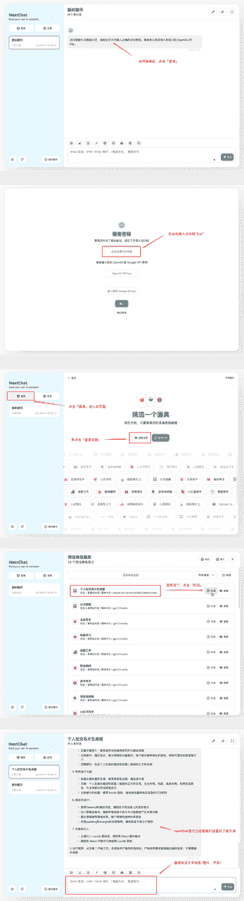

# 【已结束】立刻在 NextChat 免费生成 AI 社交名片

> 来源：[https://chatmemo.feishu.cn/docx/KF0SdN7goo8cyWx7S5achOO4nub](https://chatmemo.feishu.cn/docx/KF0SdN7goo8cyWx7S5achOO4nub)

> **活动已结束，感谢大家支持！**

> 感谢 NextChat 官方提供的免费活动（不是广告），现在我们可以用 NextChat 直接生成 AI 社交名片了

> **关于 NextChat**

> NextChat 是一款可以一键部署跨平台私人 GPT 应用的开源工具，支持国内外多种主流 AI 模型，也是开源社区首个支持 Artifacts 功能及兼容 GPT 原版 Action 方案的产品，主打轻量化和Local First。

> NextChat 从 23 年 3 月启动的开源项目，Github 已达到 74.9k star

> 🔗 项目地址：https://github.com/ChatGPTNextWeb/ChatGPT-Next-Web?tab=readme-ov-file （这个不是体验地址）

> 👥 开发者微信：elricliu1008

前两天发布了[个人社交名片生成器｜By 一泽Eze](https://zkv549gmz8.feishu.cn/wiki/YRf2wb6BAil2j9kXMiVcfGBSnhd)，通过 Claude Artifacts 就能用提示词一键创作出精美的社交名片。

不过因为 Claude 的特殊性，也有不少小伙伴没法玩到。

恰好昨晚 NextChat 找到我，希望提供免费体验的支持，给还没用上的同学一个使用途径。

> ps：社交名片背后的提示词实战思路已经完全开源，详见我的万字新作

> 👉 https://mp.weixin.qq.com/s/7vrhxQYdgQ_WpGK6Xi49aw

> 欢迎关注、转发分享，共同推动 AI 行业生长～

## 使用路径：

1.  点击 NextChat 的链接 👉 https://artifact.nextchat.dev/

1.  根据下方图示进行操作，5 步之后即可上传开玩！

> Tips：大家尽量自己使用，经费有限，有朋友需要可以直接分享这个文档，不要薅秃哇～

<https://chatmemo.feishu.cn/sync/OXhxdlqqcsuEkObLUgsceuRinef>