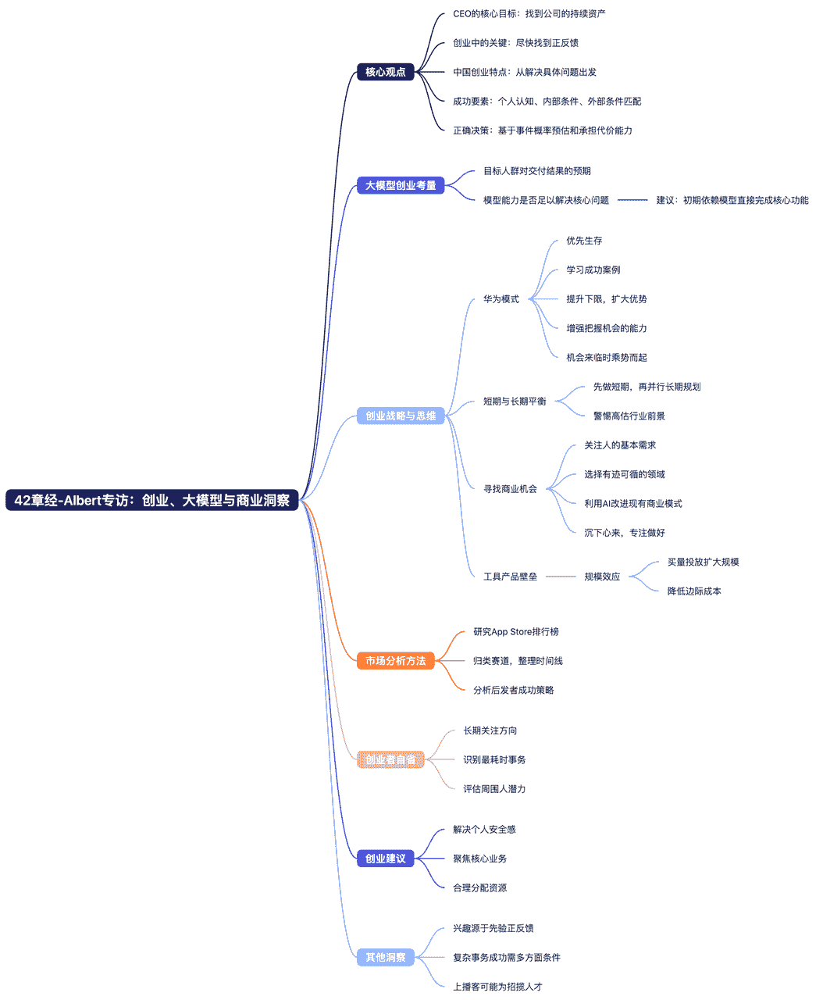

# 整理专访/播客/分享等笔记｜By 一泽 Eze

> 来源：[https://chatmemo.feishu.cn/docx/S7P6dr3yWoJUuLxuHxecZjZznwg](https://chatmemo.feishu.cn/docx/S7P6dr3yWoJUuLxuHxecZjZznwg)


# 提示词

```
// 作者：一泽Eze
// 名称：整理专访、播客、分享的笔记
// 版本：1.1
// 用途：重新组织自己的随手记，方便回顾
// 测试模型：claude 3.5 sonnet

深度理解以下专访记录，准确把握内容主题与专访意图，使用最合适的思维逻辑方法，重新整理输出。

## 要求：
1. 确保最终产物的易读、易理解
2. 包含全部有效信息
3. 不过度简化/复杂化表达
4. 为了避免长期回顾时忘记信息的上下文背景，需要根据理解补充表达
5. 在适当位置添加 mermaid 语法以增强理解
6. 最终输出内容，使用 markdown 在一个代码块中完整输出

## mermaid 语法格式（应在文内合适位置，文本形式）
内容文本
 ```mermaid
&lt;mermaid语法&gt;
```
内容文本

## 记录主旨
{{输入记录文本}}

## 记录内容
{{输入记录文本}}
```

# 测试效果

## 原文（听的时候的随手记）

```
# 42 章经-Albert 专访记录
CEO 的核心目标是找到公司的持续资产
创业中，尽快找到正反馈，让团队持续下去很重要

大模型创业：
人群是否对交付结果有预期
模型能力是否足够解决（创业最好还是先依赖模型直接完成核心功能即可）

“我长期关注的方向是什么？”

在中国，更多的是从“解决 xx 问题”出发，去创业（因为需要尽快赚到钱）

要做看似复杂的事情，需要具备很多要素才能成功：个人认知、内部条件、外部条件。不 Match 的话，个人能力的占比就会降低，“运气”成分就变高了

华为：优先活下去，学成功的人/公司，提升自己的下限，不断扩大自己的优势，提升自己抓住机会的能力。在最终机会来临的时候，乘势而起。
吃饱是为了更快的赶路
做短期做到能够并行做长期时，再做长期（高估行业的都死的很惨，低估行业的不一定会死）

正确的事情：预估事情发生的概率、能承担做这件事的代价

兴趣 = 先验的正反馈事件

人的需求是不变的
没壁垒的事=很多人做过、做成的事情=一定可以有迹可循
找到商业模式比较好的，用 AI 把事情做的更好
沉下来，做好

工具产品的唯一壁垒：速度带来的规模（买量投放；规模越大，边际成本越低，就能更多的买量，挤垮其他竞品）

## 寻找规律
App store 100 名拉出来
归类赛道，整理时间点
看后发的人做了什么，追上了先行者

## 问题
钱花在哪（训模型？买量？……）

为什么想要上播客？——为了招人

## 面试问题
最消耗自己时间的事情是什么？
身边有没有一个人，你愿意把全部的工资投给他？

长期创业，最重要的还是解决安全感，聚焦自己的业务
```

## 整理结果

```
# 42章经-Albert专访：创业、大模型与商业洞察

## 核心观点

1. CEO的核心目标是找到公司的持续资产
2. 创业中，尽快找到正反馈，让团队持续下去至关重要
3. 在中国，创业多从&quot;解决具体问题&quot;出发，因为需要尽快盈利
4. 成功需要个人认知、内部条件和外部条件的匹配
5. 正确的决策基于对事件发生概率的预估和承担代价的能力

## 大模型创业的关键考量

1. 目标人群是否对交付结果有明确预期
2. 模型能力是否足以解决核心问题
   - 建议：初期最好依赖模型直接完成核心功能

## 创业战略与思维

### 华为模式
1. 优先生存
2. 学习成功案例
3. 提升下限，扩大优势
4. 增强把握机会的能力
5. 在机会来临时乘势而起

### 短期与长期平衡
- 先做短期，直到能够并行长期规划
- 警惕：高估行业前景往往导致失败，低估不一定会失败

### 寻找商业机会
1. 关注人的基本需求（相对恒定）
2. 选择有迹可循的领域（已有成功案例）
3. 利用AI改进现有商业模式
4. 沉下心来，专注做好

### 工具产品的壁垒
- 唯一壁垒：规模效应
  - 通过买量投放扩大规模
  - 规模增长降低边际成本，形成良性循环

## 市场分析方法

1. 研究App Store排行榜前100名
2. 归类赛道，整理时间线
3. 分析后发者的成功策略

## 创业者自省

- 思考：&quot;我长期关注的方向是什么？&quot;
- 识别最消耗时间的事务
- 评估周围人的潜力：&quot;是否愿意把全部工资投资给某人？&quot;

## 创业建议

1. 解决个人安全感问题
2. 聚焦核心业务
3. 合理分配资源（模型训练、市场推广等）

## 其他洞察

- 兴趣源于先验的正反馈体验
- 复杂事务的成功需要多方面条件匹配
- 上播客的动机可能是为了招揽人才

## 背景补充

本次专访记录来自&quot;42章经&quot;，采访对象是Albert（可能是一位经验丰富的创业者或投资人）。专访聚焦于创业、大模型应用和商业洞察，旨在为创业者和商业决策者提供宝贵的见解和建议。在人工智能快速发展的背景下，这些观点对于理解和把握AI创业机会尤为重要。
```

