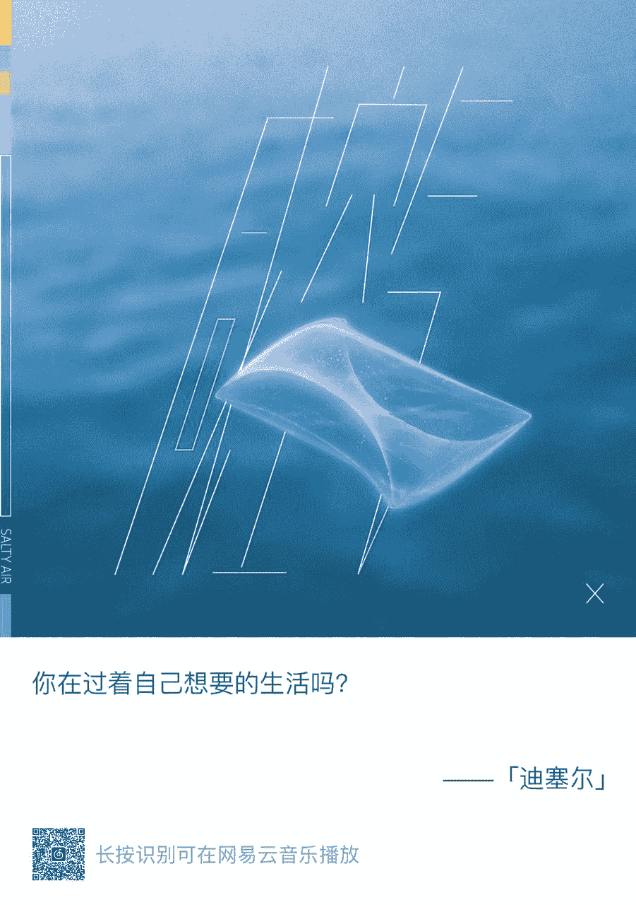
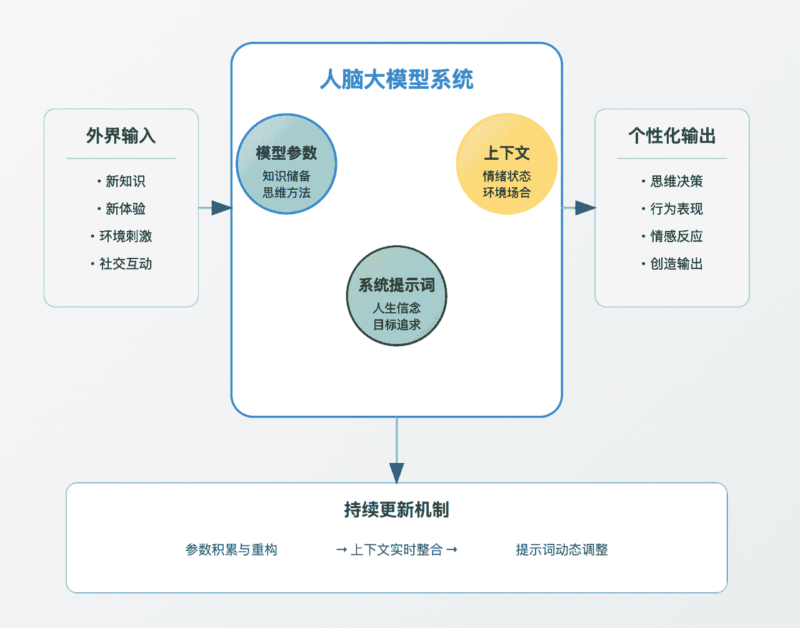
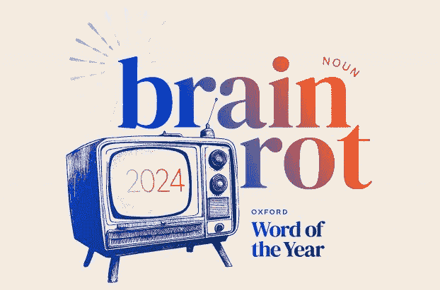
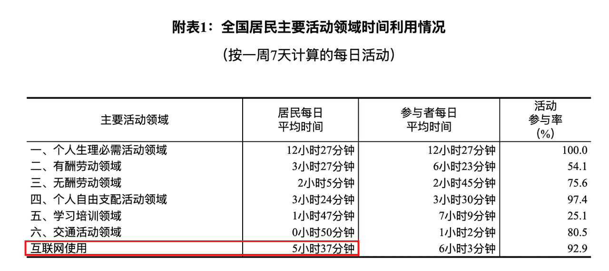
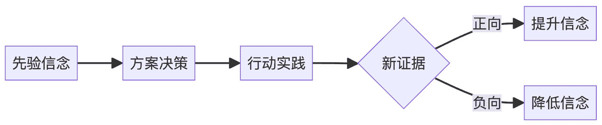
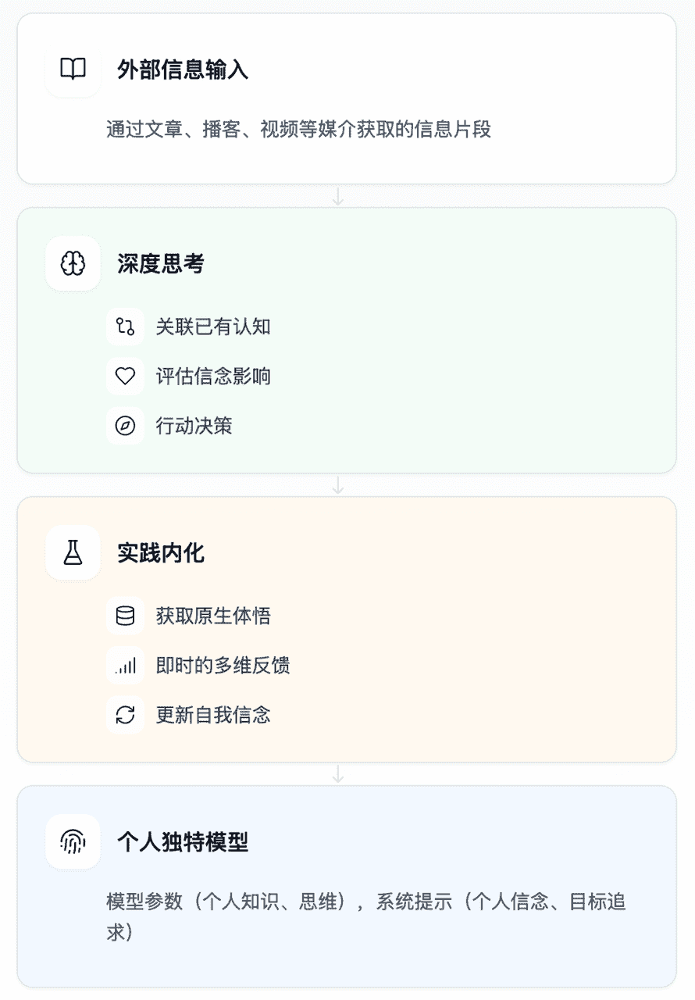
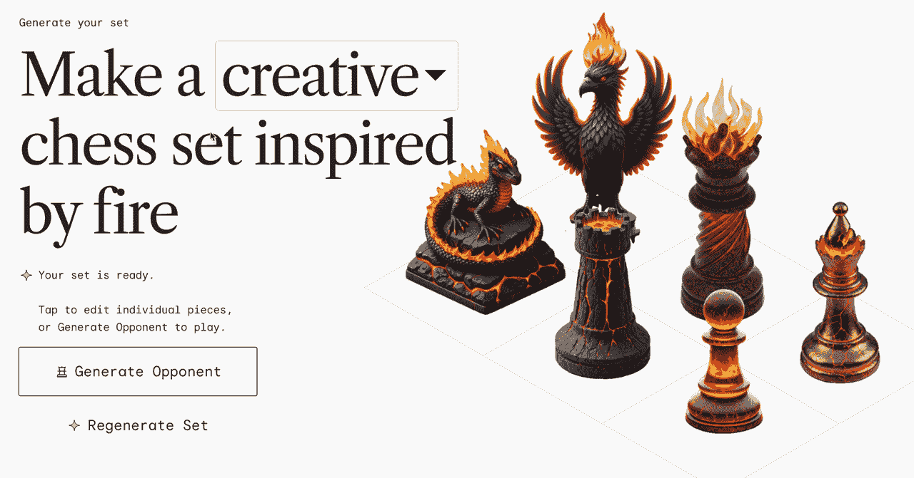
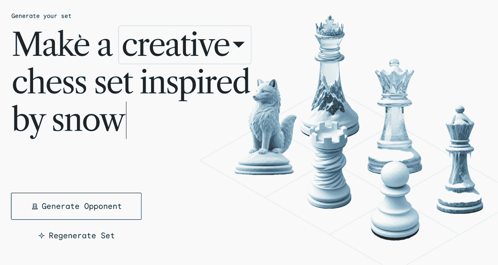
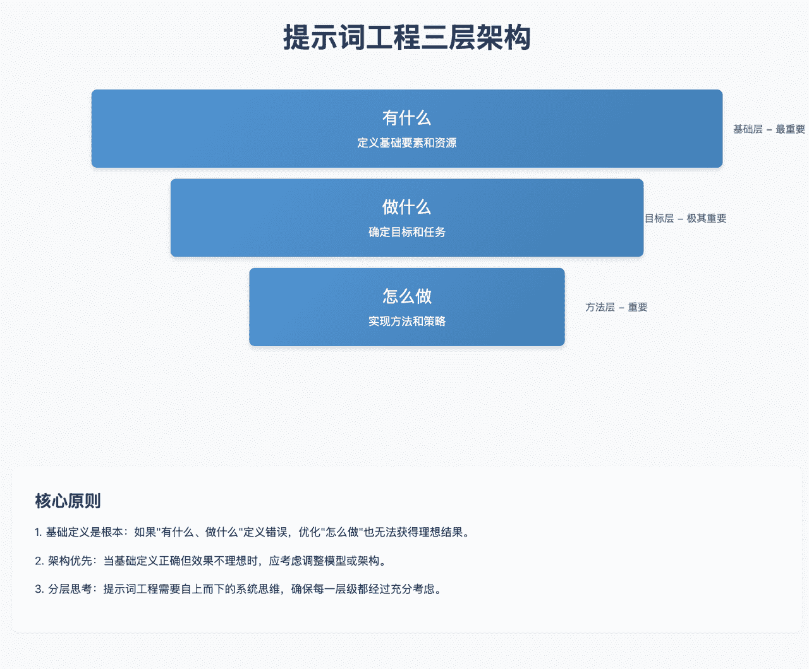

# 见知录 Vol.002：愿你成为独一无二的大模型

> 来源：[https://chatmemo.feishu.cn/docx/ArATduSngocGfmxmvDQcdKhXnpb](https://chatmemo.feishu.cn/docx/ArATduSngocGfmxmvDQcdKhXnpb)

> 本期概要：

+   深思：愿你成为独一无二的大模型

+   趣味：新年醒“蛇”Prompt

+   画皮：当 Gen AI 遇上游戏皮肤定制

+   哇哦：提示词变长器

+   拾遗：提示词工程三层架构


## 🎐 卷首语

+   时光流转，又至新年。愿本期文字，予你一份前行的力量。

+   亦愿你我，在新的一年，成为独一无二的大模型。

**By 一泽Eze**


---

> 送上一首朋友演奏的后摇《Desire》。

> 让无声的旋律，引领我们穿越内心的迷雾，探索独一无二的自我。



---

## 🧠 深思：愿你成为独一无二的大模型

我们一直以来，都试图从人脑的运作机制中汲取灵感，来研发比肩人类智能的 AI。

但或许也可以反过来启发自己的思考、决策模式。

### 1. 人脑亦是大模型

> 从表象上来看，人脑何尝不是一种精妙复杂的“大模型”？

每个人就像是经过不同信息训练的，拥有独特模型参数的大模型。

面对外界输入时，我们结合系统提示词（人生信念、近期目标、远期追求），和多维度的上下文（瞬时情绪、环境场合、近期经历、长期知识经验），作出符合个人特性的概率响应。



这个“人类模型”并非一成不变。自降生之日起，我们便持续进行着“模型更新”：

+   **模型参数的积累与重构：**通过持续接触形形色色的人、事、物，我们不断吸收外界信息，实践内化为自身的知识储备、思维方法和行为模式，构成了独特的“模型参数”。

+   **系统提示词的动态调整：**人的信念与追求会随着人生阶段变化而更新。如同不断进化的"系统提示词"，实时引导着我们的注意力分配和决策方向。

+   **上下文的实时整合：**环境刺激、瞬时情绪、近期经历和被选择性召回的记忆，使得长期积累的知识与当下情境动态融合，让我们得以触发独特的思考和行为响应。

这三重更新机制，赋予我们独特且无限进化的智能基础。

让我们不断更新自我、适应世界变化，并基于个人特质，创造性地做出人生选择与行动。

### 2. **趋同的浅层输入**与思维钝化

> 过量的浅层输入，正在使我们失去自己的独特创造力。

牛津大学出版社最近公布了 2024 年度词汇“brain rot”，直译为“脑腐”，特指过量摄入低质量信息，导致一个人的精神或智力状态逐渐恶化。



2024 年 10 月，国家统计局发布《第三次全国时间利用调查公报》显示，中国居民每天平均上网时间已高达 5 小时 37 分钟。

根据《中国网络视听发展研究报告 2024》，移动互联网用户人均单日使用时长为 435 分钟，其中短视频使用时长更是高达 151 分钟。



这看似是信息输入剧增的时代，每个人都拥**有了前所未有的信息获取效率，实**际上我们却被趋同的、无关的外界信息所裹挟。

它们看似丰富，却大多是经过算法筛选、刻意迎合大众消费需求的“短平快”消费品。

> 试想，推荐流中的“XXX 绝了”、“ 我要吹爆 XXX”，和你的短期目标/人生追求的有多大关联？

> 这些被快速消费的信息，又有多少被深入思考，转化为探索世界的有效决策？

人的一天 24 小时，除去生理活动，剩余时间大多被重复性工作和推荐算法带来的浅层输入占据。

它们如温水煮青蛙一般，让我们在不知不觉中习惯于被动接收信息，失去了主动思考和实践内化的能力。

甚至面对有价值的信息，我们往往也只是匆匆浏览，不做深入的思考转化，过量输入反而造成了信息负载。

长此以往，我们陷入在趋同的浅层输入和信息负载的恶性循环中，逐渐被训练为一个个雷同的低效模型，失去自我独特性和思考活力，退化为“地球 Online 的 NPC”。

### 3. 人的局限性，正是人的独特性

> 不用追求接收所有看似有用的信息，人的局限性正是人的独特性所在。

贝叶斯思维的目标在于，“在不完整信息的情况下，做出更好的决策”。

它承认了我们大脑的局限性——人脑并非无所不能，不可能关注所有的输入，也无法避免认知偏差。

面对无限的外部信息，我们必须做出选择，将有限的精力投入到真正与我相关的事情上。这不仅是选择“不看什么”，更是选择“要思考什么”和“要做什么”。

人非“白纸”，每个人都有自己独特的“先验信念”——即我们过往的知识、经验、价值观和目标追求。

它们是否正确并不重要，重要的是，这构成了我们理解世界的基础，影响着我们对新信息的选择和解读。

**基**于当下自我认知的 “短期目标” 和 “人生追求”，我们有意或无意地以先验信念驱动决策，以自身行动收集信息反馈，不断修正“系统提示”，更新我们的“模型参数”。



我们正是**在这种不断地选择、迭代、修正中，定义着自**己的目标和幸福追求，勾勒出独特的人生轨迹。

> “**没有大的追求**，每天到点下班逗猫看剧”，也是一种个人选择。是否正确和收入、社会价值无关，而在于这个结论是否为自己有意识的验证所得。

> 同时，每个人的经历各不相同，我们也无法评价他人的选择，只能提供些许视角供其自由参考。

而正是这无数个体的独特选择交织在一起，编织成了人类社会的多样性图景。

当个体的选择在社会中相互碰撞，那些最具社会价值的选择便会被群体共识、放大，最终凝结为推动人类文明向前的力量。

### 4. 以思考与实践，训练自身独特的参数

> 独特性需要通过深度思考与实践，才能被真正地训练出来。

语言作为人类的符号系统，让我们得以传递知识和经验。

但正如老子所言：“道可道，非常道。名可名，非常名”。语言传递的始终是经过压缩的信息，是对原始体验的简化与抽象。

当我们通过文章、播客、视频获取他人经验时，其实接**收的只是经过语言符号编码的“知识片段”。要让**这些外部信息真正内化为我们的一部分，需要经历两个关键的转化：深度思考和实践内化。



深度思考，是将接收到的信息与先验信念进行深度处理的过程，而非简单的理解。 它包括：

+   **关联已有认知：**思考它与我们已有认知的关联与冲突，找出差异与矛盾。

+   **评估信念影响：**探索它对个人目标和价值观的影响，明确前进的方向。

+   **行动决策：**将其转化为具体可行的决策方向，指导我们未来的行动。

而实践内化，则能提供无损的上下文情境体验，以“行”见“知”，它不仅仅是简单的执行，更在于：

+   **获取原生体悟**：不仅包含语言可表达的显性知识，更包含难以言传的潜性感知

+   **即时的多维反馈**：在行动中及时获得的立体反馈，能够让我们细致地微调方向。

+   **更新自我信念**：成功带来自信、失败产生谨慎，在真实体验后方能树立坚定的自我信念

正所谓“不碰南墙不回头”，“实践出真知”。

正是在这种完整的体验中，外界的信息才能真正地训练为我们的“模型参数”。

这不是简单的知识累积，而是通过亲身经历，将信息与个人特质、情感、目标相融合，最终完成独特的自我更新。

> 这也解释了为什么相同的信息输入，会在不同个体中产生迥异的理解与成长。

### 5. 新的一年，愿你成为独一无二的大模型

我们并非要彻底摆脱内容消费，也无需苛求自己时刻保持深度思考与实践转化。

每个人都有自己的生活节奏，只是希望在新的一年里，我们能够有意识地选择、修正、迭代自己。

不妨尝试一些微小的改变：

+   **从选择开始**：有意识地根据当下追求，筛选真正重要的信息输入。

+   **从思考深入**：在刷到感兴趣的内容时，停下来多想三分钟。

+   **从行动出发**：遇到触动内心的想法，尝试付诸一次行动。

愿你以先验信念为基石，以深度思考与实践内化为路径，在选择、**思考与行动中**，定义属于自己的幸福，探索出真正属于自己的独特人生轨迹。

愿你，在新的一年，成为那个独一无二的、不断进化的大模型。

**补充信息：**

+   迎合大众消费口味的“短平快”消费品：

中国职业主播数量已超 1508 万人，短视频用户账号总数更是达到了 15.5 亿个。历史上从未有如此多的人能够平等地利用媒介传播自己的作品。这表面上呈现出前所未有的表达自由，但实际上，这种“自由”却被流量和算法所裹挟。

为了追逐流量，生产端（作者）和分发端（平台算法）无不追寻着“流量密码”，反复包装短平快、迎合大众消费口味的言论、新闻、视频。

而在互联网尚不发达的年代，只有少数“精英”的见解才能被以“书、报”的形式记录和传播。而当每个人都有权成为信息的生产者时，有着独特个人视角的信息却被淹没在争抢流量的同质化内容中。

**推荐阅读：**

+   [**‘Brain rot’ named Oxford W**](https://corp.oup.com/news/brain-rot-named-oxford-word-of-the-year-2024/)ord of the Year 2024 By 牛津大学出版社

+   [**第三次全国时间利用调查公报**](https://www.stats.gov.cn/sj/zxfb/202410/t20241031_1957216.html) By 国家统计局

+   人均单日使用151分钟！你“刷”了多久？ By 人民网｜《中国网络视听发展研究报告（2024）》

+   “在垃圾的信息环境中，尽量不做一个垃圾人” By 晚点 LastPost

---

## 🧸 趣味：新年醒“蛇”Prompt

> 快召唤自己的新年醒“蛇”吧～

改编自Irene的“醒狮小猫”提示词。

用 Google 的 imagen3 可以直出，“福”字的生成很稳定！


醒“蛇” Prompt 可参考：

```
A 3D-rendered cartoon character: an adorable snake positioned frontally, facing directly towards the camera. The snake&#x27;s body is gracefully raised in a vertical stance, with its head held high and the rest of its body forming a gentle wave-like posture below. The snake features large, friendly black and white eyes and a cute, smiling expression. 

Main attire: Traditional Chinese lion dance costume adapted for its serpentine form, featuring vibrant red, orange, and white colors, with fluffy white fur trim and golden decorations. The snake&#x27;s scales have a subtle, iridescent quality, and a small red lucky charm with golden Chinese characters (&quot;good fortune&quot;) is delicately wrapped around its tail. 

Environmental elements: Festive decorations including gift boxes, ribbons, and golden coins float around the character, creating multiple layers of depth. Set against a soft, solid pink background with subtle 3D effects. 

Technical specifications: Ultra-realistic 8K rendering with cinematic composition, professional studio lighting, soft shadows, and shiny highlights on the costume. Material quality is smooth and glossy, creating a toy-like, collectible design that makes the snake appear both cute and approachable.
```

Irene 的原版 prompt，是一只非常可爱的醒狮小猫：


原版小猫 prompt 如下：

```
A 3D-rendered cartoon character, a cute cat, with a round, chubby body, standing slightly to the right, featuring large, sparkling black and white eyes, dressed in traditional Chinese lion dance attire in vibrant colors of red, orange, and white, adorned with fluffy white fur trim and golden decorations. The character holds a red lucky charm with the golden Chinese characters (meaning &quot;good fortune&quot;). The scene conveys a festive atmosphere with a playful design, smooth and glossy material, set against a soft, solid pink background, detailed textures, vivid and rich colors, professional studio lighting, soft shadows, shiny highlights on the costume, creating a cheerful and festive ambiance. The rendering quality is ultra-realistic, in 8K resolution, with cinematic composition, highly detailed and clear rendering, and a toy-like, collectible design.
```

你也可以自行修改为其他各种 IP、节日主题（藏师傅的群里已经玩 high 了）


---

## 🔦 画皮：当 Gen AI 遇上游戏皮肤定制





[**Google 推**](https://labs.google/genchess)出的 Gen AI 游戏实验：Genchess，可以用 AI 定制专属主题的棋子皮肤

+   极为巧妙的 Gen AI + Game 的应用探索

+   用户只需输入简单关键词：比如"冰"、"火"、"芝士"、"巧克力"、"树枝"

+   AI 即可绘制出独特的棋子皮肤

+   系统自动**替换游戏贴图**，打造个性化游戏体验

+   目前仅限于 2D 贴图生成，但按照 AI 的进化速度，Gen 3D 模型的未来指日可待

+   同样的思路，可以很方便地给自己的 APP、游戏换皮、换主题

---

## 🤪 哇哦：提示词变长器

还在担心自己写的提示词太短，没法彰显自己的 Prompt 功力吗？🐶

302.AI 的提示词变长器来救你了 🐶 ➡️ https://302.ai/tools/prompter/


+   支持 12 种提示词变长方法，从知名提示词架构 CO-STAR 到 o1-style 提示词，一键转换

+   **尤其适合 A**I 提示词培训、提示词项目交付，让你的 Prompt 方案情绪价值爆棚

+   完美解决：“这么短的提示词，我上我也行”的客户错觉

+   慎用！一旦变长，概不负责 😏

---

## 📥 拾遗：提示词工程三层架构

+   [**这篇提示词分享在 X 上已经有了近 1**](https://x.com/eze_is_1/status/1871833776684507290)0w 的浏览量，相信再读还能对你有所启发

> 写提示词，强烈推荐使用“有什么、做什么、怎么做”的三分法，理清每句提示词的作用

>

> 其中，最重要的就是“有什么、做什么”

> 如果“有什么、做什么”定义错了，再怎么限定“怎么做”，也只是无用的雕花

> 如果“有什么、做什么”定义对了，但怎么设定“怎么做”都没法达到预期，那就可以考虑换模型/架构了

>

> 比如修复语音转文字中的错误，定义为“听写稿纠错”，就比“优化语音转文字内容”准确的多




---

这次阅读感受如何？非常欢迎找我聊聊阅读感受、建议 🙋‍♂️

> 欢迎通过以下方式交流：

+   🛰️：eze_is

+   即刻：@一泽Eze

+   👸号：评论 / 后台留言

<https://chatmemo.feishu.cn/sync/OXhxdlqqcsuEkObLUgsceuRinef>