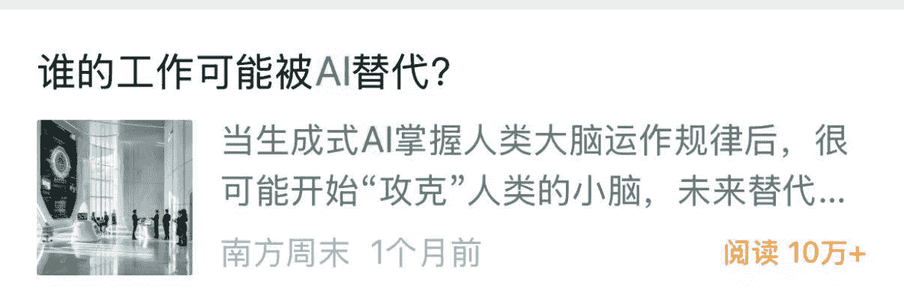
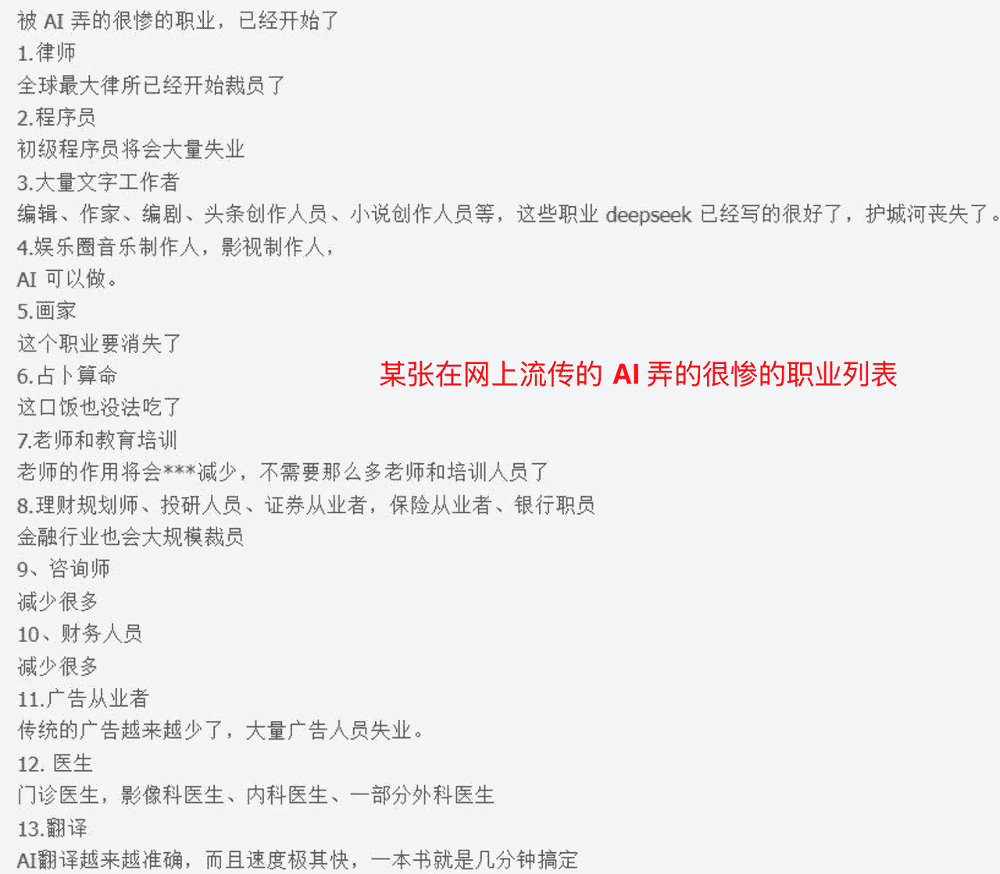

# AI 无法替代的工作们｜见知录 Vol.003

> 来源：[https://chatmemo.feishu.cn/docx/Lky5dzJtAo4TL7xX6y5cJJMDnxg](https://chatmemo.feishu.cn/docx/Lky5dzJtAo4TL7xX6y5cJJMDnxg)

## 🎐 卷首语

+   说来惭愧，「见知录」也有一个月没有更新。（就如我对你们的想念时间一样久）

坦白一下「休耕」理由，因为工作交接、身体劳累、春节过年，也就顺势给自己放了个长假。（ 嘿！新学到的妙词“休耕”，比“停更”文雅多了）

PS：我现在已从职场中暂时脱身，也会借着这段难得的自由时间，思考自己与 AI 共处的新模式，多想点、做点、写点 AI 相关的内容，尽自己可能启发一小撮人的生活。

也欢迎交流、合作～

+   不多说，这就开始第三期「见知录」的正文。

**By 一泽Eze**

---

## 🔦 深思：AI 无法替代的工作们

2025 年春节，全国最猛烈持久的话题，必然是 DeepSeek R1。

人们一方面惊叹 AI 的进化速度——它能编写代码、批量创作诗歌、化身最贴心的聊天伙伴，甚至还能帮科学家预测蛋白质结构，拿下诺贝尔奖。

另一方面也陷入了更深的迷茫——对保住工作、自我价值的群体性焦虑中。

*尤其近年来失业人数递增，25 年依然有 1222 万名毕业生被继续输送到“求职”战场。（以及往年的失业、毕业大军尚未被消化干净……）

——当 AGI（能帮助人类完成一切任务的通用强人工智能）越来越近，人类还有什么安稳的工作，是无法被 AI 取代的？

> 逻辑论证的碎碎念比较多，答案在后面 3 小节中（跳还是不跳，你说了算～）

---

### 不得不承认，AI 已经具备超越人类的潜力

前两天写的《非技术人 10 分钟读懂 DeepSeek R1》中，大致提到过，人类终于找到了AI 真正超越人类的希望。

就连 Sam · Altman（OpenAI CEO） 这周新发的博客《Three Observations》中，也再次预测：

1.  Technically speaking, the road in front of us looks fairly clear. （从技术上讲，我们面前的（AGI 到来）道路看起来相当清晰）

1.  AI will seep into all areas of the economy and society.（AI 将渗透到经济和社会的所有领域）

1.  Anyone in 2035 should be able to marshall the intellectual capacity equivalent to everyone in 2025.（2035 年的任何人都应该能够（通过 AI）使用与 2025 年所有人类相当的智力）

虽**难免有过分乐观的嫌疑，但即使**仅从今天的 DeepSeek R1 身上，我们也能发觉 AI 终于开始掌握解决复杂人类任务的“元方法”：

通过自主学习、试错，习得解决问题的可迁移原则（例如：类比与启发法、归纳演绎法），试着推理从未见过的问题，一步步尝试解决问题直至达成目标。

——**AI 虽然没有诞生真正的自我思考，但在一言一行中，已然如同不通****世**事的天才一样聪明、富有洞察力与成长潜力。

---

### 在 AI 冲击下，必将转型的“脑力”劳动

这两天和几位朋友聊天，他们有身处传统岗位想要学习 AI 使用技巧的，也有在直接投身建设 AI infra 平台的。

朋友带着好奇，想听听我对 AI 对人类职业会产生什么影响的看法。

我当时分享了几个现阶段的想法：

1.  把 AI 当做与人平等的劳动力单元，具备和我们人类一样的独立思考、行事能力。

仅把 AI 当作提效用的自动化 Workflow，是短期的片面认识。

1.  未来 AI 与机器、AI 间的信息效率会比人类高很多（网络接口可比人类口述、码字吞吐性能强劲了），带来更高的信息获取、规划决策、共识、执行的效率。（比如 AI 接通扫描仪对纸质合同审核，分析法律风险，再跨系统与对方组织的 AI 交换意见，对合同做出调整，达成初步共识结果）

1.  虽然当前 Agent 落地的重心还在 AI 编程领域，专门针对“写作”、“商业分析”、“入门教育”等其他场景的 Agent 开发似乎没啥动静。

➡️ 但这反而意味着，若这些领域出现 Agent 后，工作流程会较现在 Chat/Copilot 式的使用方式有大变化。

1.  传统组织架构中，有大量人员负责着纯信息收集/联想总结/操作执行类的工作，像是按照某种可预测的逻辑，完成“脑力”劳动。

此类“脑力”劳动，既不负责“创新”，也不做出“决策”。

**正如蒸汽机替代马车，自动纺织机取代纺织工人。A**I 只不过终于在部分“脑力”劳动领域，为社会提供了效率更高、成本更低的结构化转型选择。

> 注：

1.  本文不讨论体力劳动场景（而且我也缺乏相关从业经验，讲来也是纸上谈兵）：

1.  一方面，在大陆，体力劳动人力比具身智能机器人便宜多了。

1.  另一方面，早在工业化进程中，许多重复性体力劳动已被自动化设备所取代（如自动织布机取代纺织工人），被释放的劳动力或主动或被动地都转型到了新岗位（如跨行业流动到了物流、电商行业）。

1.  这里说的 AI Agent，指的是能自主规划方案、自主选择/制造工具、独立解决任务的 AI 劳动力单元（也可能是 AI 高级管理者）。

即便 AI 暂时还无法像人类一样持续获取现实世界信息，验证并更新自己的信念（没有“手脚眼睛”，只能通过人类转述的信息切片来“认识”世界，如互联网语料、历史文献、图像等）。

但**它依然对虚构创作（写网文小**说、编段子、绘画）、基础教育（入门学科辅导）、翻译（语言翻译、计算机语言编程）等不需要从现实世界持续获取原始信息的岗位——甚至商业分析、战略咨询这类高端智力工作，带来了人人可预见的转型风波。

> 补充 1：有时候会想，各大商分、战略之所以只录用顶尖学府的优秀毕业生，是不是因为这类初级岗就需要信息吞吐、关联总结能力强大的处理模型？

> 而在 AGI 时代之前，聪明的大脑就是最佳的信息处理模型。

> 补充 2：人类分析、战略岗仍有其价值。一纸分析报告从来不是终点，而是资源分配行为的起点。

> 人的资源，在以人为主体的社会中，终究需要人来拍板分配。而人的决策不完全理性，往往是理性与感性、逻辑与自我社会关系的自我考量。

---

### 世界本就是流动的，别怕

**一切皆流，无物常驻。**

人类对稳定的追求，本质上是对心理安全感的渴望。水滴尚可穿石，你不可能苛求所有的一切，都如金字塔一样稳固不变。

联合耕作机出来了，务农的人数变少了；

预制菜出来了，商场里的厨师需求量变少了；

省直事业事业编制，都能被精简、调整到基层（详见2024 年河南事业单位改革）。

**流动意味着变化、新机会。**

机械化耕作后，被释放的农村劳动力进城务工，从事物流、建筑等行业（应该大部分人都不想回老家锄禾日当午吧）；

预制菜在商城普及后，有特色、能炒出锅气的小馆子更受青睐；

智能手机让每个人都能摄影后，催生了短视频创作变现的时代机会；

就连人人焦虑的 AI，都让更多小白有能力写爆文、编程（甚至转身卖起 AI 课。我看这些朋友其实一点都不焦虑 AI）。

你看，机会一直都在，虽然有转型的阵痛，但日子也可能变好。

真正的失业潮不是岗位的消失，而是认知停滞在过去时代的遗骸里。

Btw：过去的农民不会在网上诉苦。人人担心 AI 的社会氛围，也是因为 AI 刚好威胁到了习惯在网上发声的我们而已。

---

### **撇去浮躁**，多关注如何用 AI 拓展人类主体性的边界

只焦虑，不作为，何尝不是一种“鸵鸟”心态。它会使我们看不清变化带来的真正影响，失去适应与抓住新机遇的机会。

即使出圈如 DeepSeek ，也依然有让人无奈的戏码在重复上演。

⬇️

过年间，主动来和我聊 DS 的人（亲戚、朋友、同事）很多，大多数对话都停留在这样的对话：

问：“你知道 DS 多厉害吗”

我：“你用过了吗？没用过的话，似乎也没啥好聊的🥲”

答：“没用过。”

——未来的信号再一次通过无数媒体、朋友圈的转发，传达到了眼前，但人们依旧在焦虑中躺平。

**撇去浮躁，多思考人的需求本质，关注如**何用新技术拓展而非让渡人类主体性的边界。

再拿最近思考比较多的场景来举个 🌰 子：写作。

写作只是手段，记录与表达自己所见所思才是人的需求。

从纸笔到电子化记录，从朴素的备忘录到 Notion、飞书 等 All in One 产品，我们一直在利用工具拓展人类写作的能力边界。

通过写作，人类增补、修剪自己认知。借助文字记录，人才得以开展系统二的长推理。

通过写作，我们外延个体想法。每个人有独特的现实经历、发心和视角。脱离了人，需求就不成立了。

AI 写作只是一种帮助人更快、更好地把自己的想法记录 or 分享出来的新方案。

它加速文本润色、优化表述结构；辅以更全面的搜索调研、逻辑论证。

——也就是提升思维的外化效率与质量。

与 AI 共处，人类再一次拓展了自我觉察、表达的能力边界。（同样的，AI 编程有益的价值不在于外包开发，而是让每一个想法更容易诞生为能帮到自己的产品）

> 打个补丁：公众号、小红书、抖音这类创作平台发展到今天，创作者早就被分成了两类，一类是记录和表达自己的想法，一类是假装记录和表达自己的想法。

> 后者本就不存在真正的写作需求，只是批量化生产内容商品。他们不需要从现实世界持续获取原始信息。

> AI 也只是为这样的内容产业，提供了一个效率更高、成本更低的生产替代方案。

所以，**要注意区分需求与手段的差异，不要因为 AI 威胁了**以往的手段，就放弃需求，让渡自己的主体性。

---

### Be real, prolific, humble, trustworthy

这里借用 @中二怪 的小报童专栏《金钱游戏（三）：Prolific, focused, shamemless and humble》的形式，抛出我的四个词 Real, prolific, humble and trustworthy.

相信能做到这四点，能够让我们更容易在这次时代变革中，更容易找到自己的独特价值，找寻属于自己的无法替代的工作。

**1）Be real**

+   官方词义：真实的、真诚的、不做作的。

+   **在**我的理解中，我会额外强调“接受自己的局限性，发觉自己的独特性”。要 real，不仅是对别人 real，更是对自己 real。

+   在过去时代的叙事风格中，我们总是讲求“立人设”、“会包装”，通过自我规训和吹嘘，让自己攀爬到某个位置，争取更多资源与报酬。打工人的表现越完美，位置就越高，报酬就越多。

+   但可以发现，AI 有着极强的统计、关联、总结、分析的性能，对于信息的处理性能远优于人类头脑。靠着人设、包装，再聪明也难在 AGI 面前保持自己的“聪明”价值。

+   人的独特价值，来自于个体的局限性：

+   人的视野存在局限性，人与人之间拥有的关系是有限的，人所能经历的物理世界也是有限的。

+   局限性是独特信念的来源：因为天生只有一对父母，所以我们心怀感激；因为亲历互联网产品改变生活的时刻，才立志成为有执念的产品经理，也想用产品改变一小撮人的生活。

+   **个**体的信念会驱动我们持续改造自己可辐射范围内的世界。而其中一部分人所创造的选择，刚好被全社会所共识，带来了全社会的进步。（详见《见知录 Vol.002：愿你成为独一无二的大模型 》）

+   纵使 AI 全知全能，感知一切，但因为没有局限性，就不会有持久、坚定的“小”信念。

+   ——这就是我理解的人要保有的独特价值。

+   当 AI 能加速一切生产行为后，人的价值就来源于与现实、人群的亲历体验。掌握身边的第一手需求与信息反馈，建立持续做好某事的信念，成为用 AI 解决别人问题的人。

**2）Be prolific**

+   官方词义：丰富的、多产的、能产出大量成果或作品的

+   个人认为这个词有两个参考意义，一个是保持好奇心，体验更多事情；另一个是多多产出个人的成果与作品。

+   体验更多事情：

+   按照二怪的说法，是指在自己体力和风险控制能接受的范围内，先尽可能地去做更多类型的事情，不断扩大舒适区。

+   在**我看来，体验更多事情，**意味着与更多的人、事建立连接。这不仅能正向刺激自己的好奇心与执行力，更能从现实世界中，以自己的独特视角，积累更多元的经历与反馈。这是人类与同等智力 AI 最大的区别。

+   只有亲身经历，才能知道一件事有什么坑，适不适合自己，能不能成。人类太擅长打自己脸了，经历后才觉得困难不过如此，反馈如此美妙。（比如 👻 屋、过山车不过如此？）

+   在不断体验更多的过程中，还能积累足够的视野，提升自己的兴趣、天赋和事业进入自己射程的概率。

3 岁就进幼儿园，高考盲目选专业，毕业就匆匆按第一个岗位定事业。这就想一击必中自己的天命？太难了，从概率上和中彩票一样难。

+   多多产出个人的成果与作品：

+   多想想能不能把自己的经验、思考公开表达出来，最好做出点让圈里人认可、愿意传播的东西，积累自己的  showcase。

+   在这个供大于求的市场上，无论是想买你产品的客户，还是潜在的合作伙伴，亦或是未来雇佣你的老板，大家的时间、注意力是有限的。有客观展示自己实力的作品，能大大增加你被看到的概率，和别人对你的社交耐心。

这是我 24 年最重要的体会——当我把我对 AI 有关的提示词、智能体项目经验发布到网上后，各类合作邀约、 大佬 coffee chat 机会纷至沓来，可接触的资源都在逐渐积累。仿佛世界对自己打开了一扇天窗，好运气都会自己找上门来。

+   Btw：输出的过程也是自我整理的过程，能发现自己观点逻辑上的缺陷，把所思所想愈发夯实一些，也有助于信念的形成与更新。（比如写这篇文章时，其实打了另外 6000 字的大纲，把自己关于 AI 对产业的影响、自我觉察、个人生涯选择这些的笔记都翻了出来，还和 AI 聊了很久，尽可能把自己对于这个命题的理解表达到现阶段的最佳水平）

+   起心动念，多捕捉内生的有趣灵感，每周给符合自己目标的心念一个孵化的机会。这可是你的大脑通过个人经历产生的弱关联，赐予自己的独特礼物。

+   弱关联意味着非大众化的、新颖的、有创造力的，这种创新往往源自于个人独特的交叉领域经历，正是每个人的独特价值，具备着强大的杠杆效果。（如同社交名片prompt，没人想过，没人做过，又很有趣，就撬动了行业内大量的关注度）

**3）Be humble**

+   官方词义：谦逊、普通的

+   这个词理解起来会比较简单，就是字面上的保持谦逊。时刻记得自己也是只“小虾米**”**，世界这么大，信息更新的那么快，AI 的成本都能每 10 个月下降约 12 倍，人外必然有人，视野之外必然有自己未知之处，要时刻记得自己有所局限。

+   自大意味着自我封闭，抑制了他人与自己沟通的欲望，也阻塞了获取外部世界信息的效率。这当然不是好事，一个完全封闭的生态系统，其结局必然崩溃。想要在高流动性的社会中保持自己的不可替代性，离不开保持谦逊，从外界多多汲取新能量，更新自己的认知与能力储备。

+   尊重他人，尊重人与人之间的差异。每个人思想、经历不同，这些差异点往往就是互相 inspire 的触发点，保不齐哪次和一个“圈外人”的交流，就带来的全新视角与灵感。

+   更何况，相较于 AI，人类的独特优势就在人类社会中积累更多元的现实经历与反馈，又怎能自弃？

4）Be trustworthy

+   官方词义：可靠、值得信赖的

+   人人都知道要做个可靠的人。想要关系长久，先让自己成为别人愿意信赖的人。有点抽象，也难以付诸实践。

不过我可以给这个词多加一些新释义——去做某个领域/区域内，做某件事最可靠、值得信赖的人。

+   想在全国范围内，成为某个大领域公认的权威，难度不亚于成为中国奥运会运动员。但所幸如果只是构建自己的独特价值，我们不需要定这么宏大的目标。

对于旁人来说，他们能接触的信息同样也有局限。不需要成为全国最棒的 xx，你只需要从自己的过往经历，找到一块适合自己发展的切面，去提升自己的能力、辐射影响力，成为 xx 市 / xx 区 / xx 小区挺不错的 xx 。你就会发现由于场景切的够小、地理区域有限，这个目标就没那么难达成了。慢慢的就能吸引到同一个位面想和你合作、与你玩耍、为你付费的人。

（这个效应在餐饮业尤为明显，我日常觅食会倾向于跑附近 3km 内最棒的土菜馆，而不会选择刻意跑到 10km 开外的全市人气 Top1 的同类餐厅）

+   总得在某个切面上，有能拿得出手的东西，让一些人可以相信你是可以信赖的，光是与你产生连接都会变得安心。

### Fin.

回到文章开头的那个问题，AI 无法替代的工作是什么？或许这期见知录能为你带来一些新的启发。

**借着 AI 浪潮，这转型焦**虑何尝不是一次明心见性，找寻个体独特价值的机会？

**不**如撇去浮躁与焦虑，多多关注如何用 AI 拓展个人主体性的边界。Be real, prolific, humble, trustworthy。

---

### 📑 推**荐阅读：**

+   Sam · Altman《Three Observations》：https://blog.samaltman.com/three-observations

+   中二怪《金钱游戏（三）Prolific, focused, shamemless and humble》：https://xiaobot.net/post/f272d972-9e4f-49d9-9fbd-3b6e06219c83

+   一泽Eze《见知录 Vol.002：愿你成为独一无二的大模型 》：https://mp.weixin.qq.com/s/DMjumAxIdsNy0RgNDjRG_g

+   一泽 Eze《非技术人 10 分钟读懂 Deepseek R1》：https://mp.weixin.qq.com/s/fdRnD0kHR7ixrMy4uZYFoA

<https://chatmemo.feishu.cn/sync/OXhxdlqqcsuEkObLUgsceuRinef>