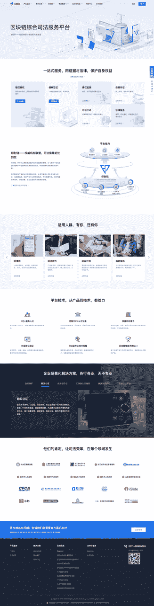
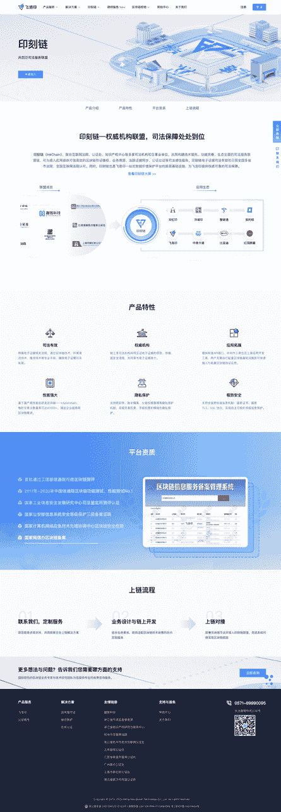

# 官网设计-2022-飞洛印

> 来源：[https://chatmemo.feishu.cn/docx/VDwKdGkdEoYdJFx3gY9c3GOVnvh](https://chatmemo.feishu.cn/docx/VDwKdGkdEoYdJFx3gY9c3GOVnvh)

> **作为**产品主策，和自己非常认可的设计小伙伴 @娇  ，一起共创落地的 B 端 SaaS 产品的官网设计改版。

+   🎯 为**什么要重构官网？ **

+   ➡️  高效传达产品能力，建立足够可信的品牌形象

+   2021 年，调研了一众竞品（区块链应用、电子取证），无论大厂或垂类 Top 竞争者的官网，基本都不“讲人话”，让不明所以，品牌认知效果差

+   于是，重构官网设计与文案，希望更快让用户理解我们是什么、为什么选择我们

+   **🛠️ 建设内容：**

+   重构官网页面架构，提升交互引导性

+   打造全新首页、印刻链的内容结构、文案表达、UI 视觉

+   建设网站流量链路，包括 SEO 投放与优化、落地流量建联、商机售前与转化

+   💡 核**心思考：**

+   像 Apple 官网、飞书官网一样说人话；像 PPT 说服一样顺逻辑

+   优秀的内容呈现，是不需要思考的

+   一切 UI 元素，都是为了更高效的传达信息（如无必要，勿增实体）

+   🎉 卖**一下瓜：**

+   当时的行业最“卷”，我自认为算是同行 Top 1️⃣

+   时至 2024 年，当初的设计与文案依然能打💪

⬇️ 快速查看我的成果 ⬇️

