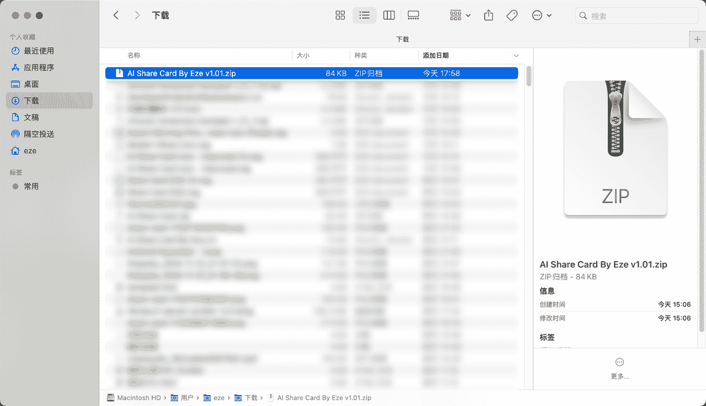
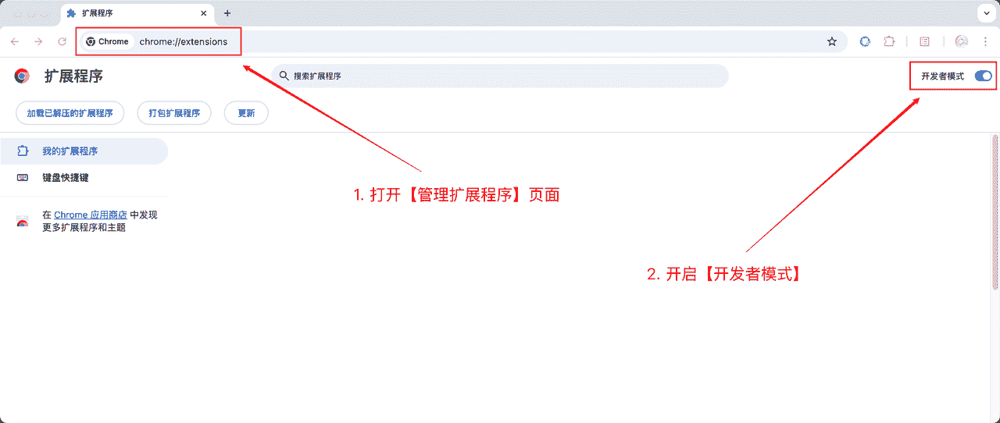
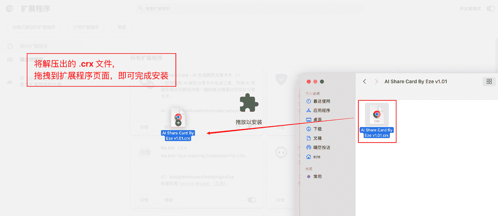
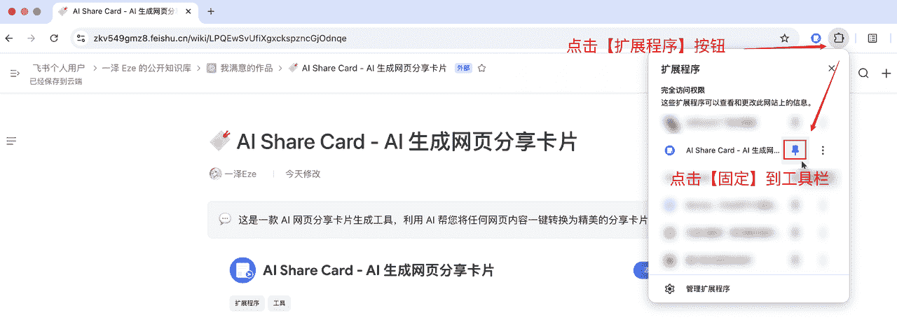

# AI Share Card 插件本地安装指南

> 来源：[https://chatmemo.feishu.cn/docx/CeOcdiaovoYmoIxjwEgce6RbnPh](https://chatmemo.feishu.cn/docx/CeOcdiaovoYmoIxjwEgce6RbnPh)

## 1）下载 AI Share Card.crx 安装包，并解压

> **产品官网、下载地址：****h**ttps://aicard.eze.is

<https://chatmemo.feishu.cn/sync/WRQZd06eWsmmUWbcf4YcDVAFnHh>

## 2）打开 Chrome 的扩展程序页面，并打开开发者模式

> 扩展程序页面：浏览器地址栏输入 chrome://extensions/

## 3）安装 AI Share Card 插件

> ⚠️ 注意：需要拖入 .crx 文件，不要点击加载已解压的扩展程序

## 4）安装成功，置顶显示插件（方便后续使用）

## 5）开始快乐使用！