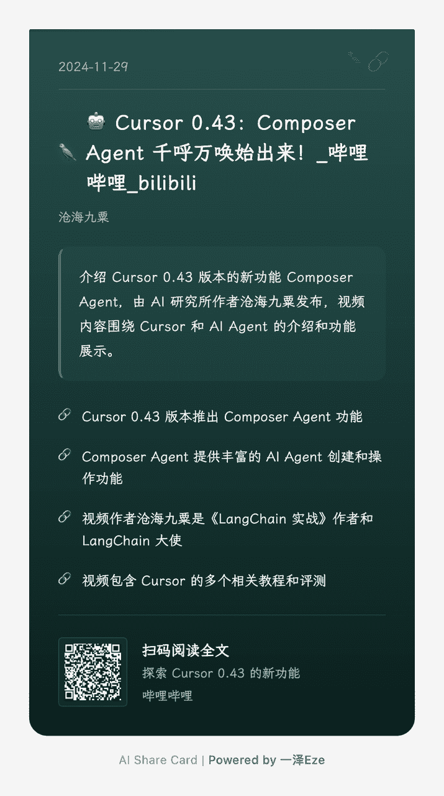
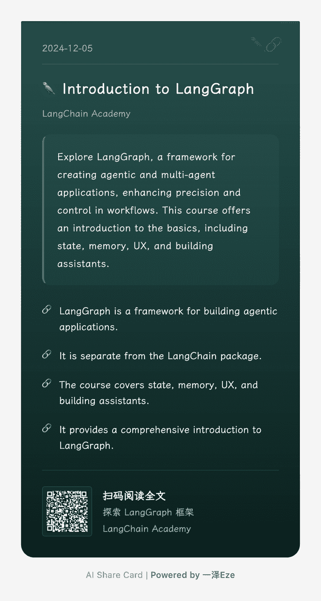
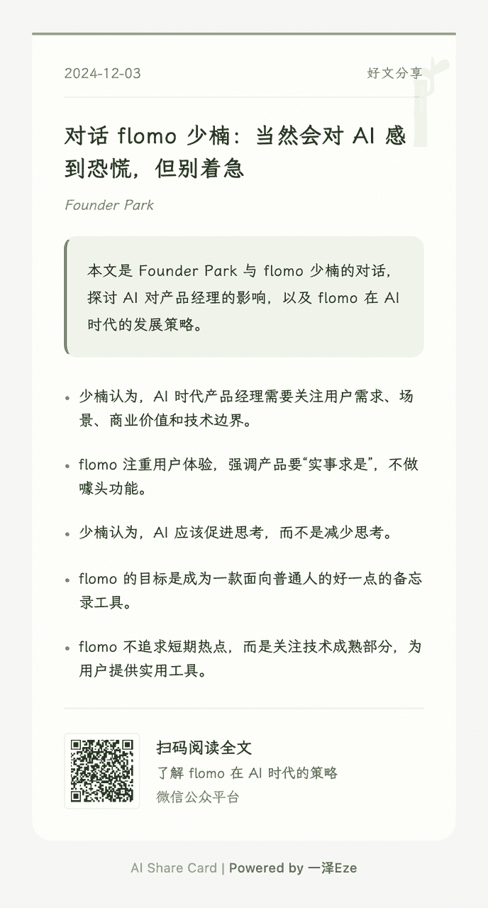
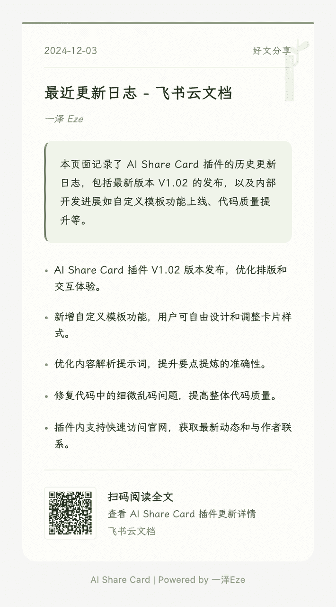
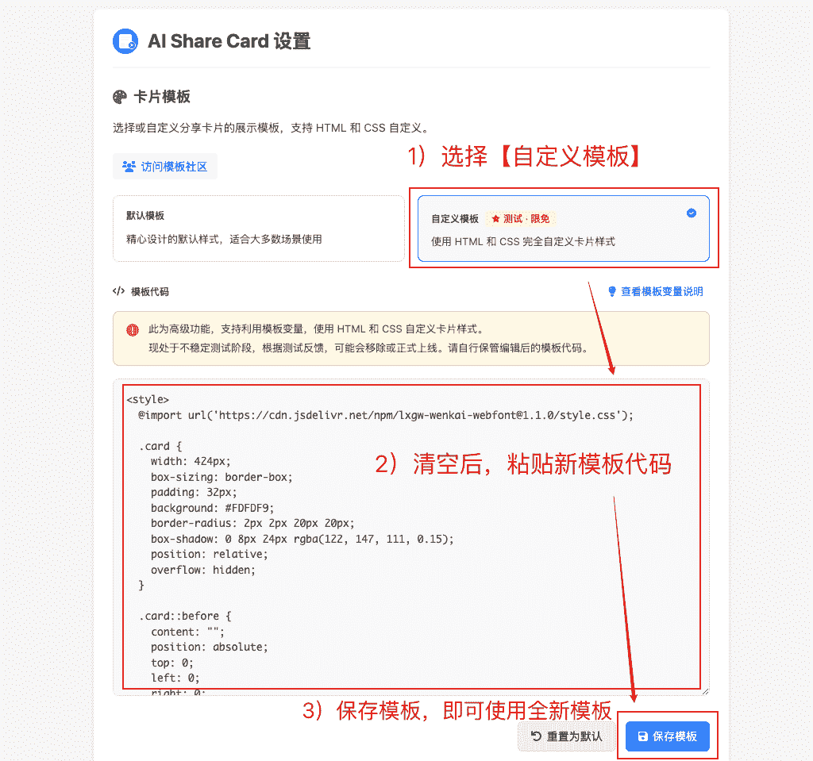

# 模板社区

> 来源：[https://chatmemo.feishu.cn/docx/JpZrdJiZEoXYzexJyfkcLdhznAb](https://chatmemo.feishu.cn/docx/JpZrdJiZEoXYzexJyfkcLdhznAb)

<https://chatmemo.feishu.cn/sync/SIErdovINs8WT1ba0sJc5f4fnsh>

# 👍 优秀模板推荐

| 主题 | 作者 | 效果 | 立即获取 |
| --- | --- | --- | --- |
| LangChain Dark | 沧海九粟（space.bilibili.com/28357052） |  | [LangChain Dark](https://zkv549gmz8.feishu.cn/wiki/UH1swFUqzirL6HkGRgjcUfk4nse) |
| 竹韵 | 一泽Eze |  | [竹韵](https://zkv549gmz8.feishu.cn/wiki/AJGLwNnE4iswqWk5dfbcwvywnbh) |

---

# 🙌 我要投稿

<https://zkv549gmz8.feishu.cn/share/base/form/shrcnTOhdGmxqgoabOKk0XA8esd?iframeFrom=docx&ccm_open=iframe>

---

# 👉 如何使用？

1.  进入插件设置页面

1.  按照图中指引，贴入想要使用的模板代码：

