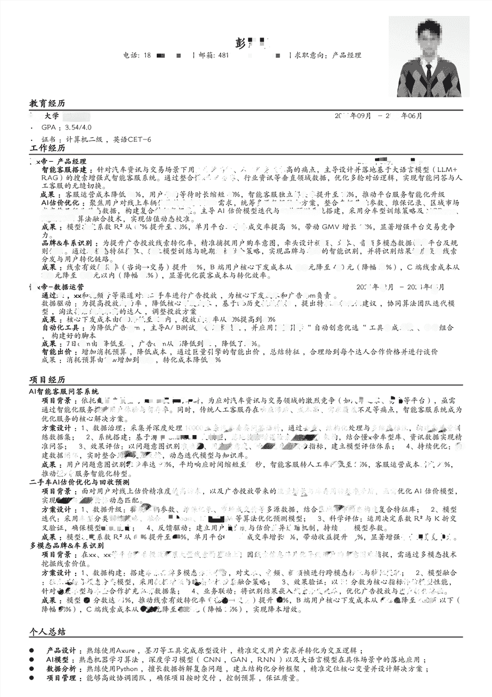
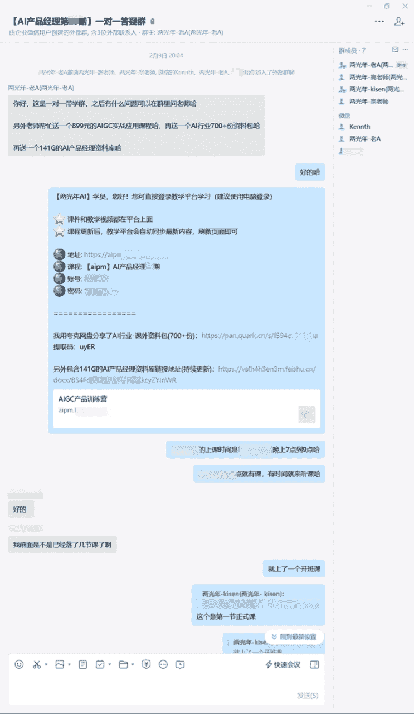
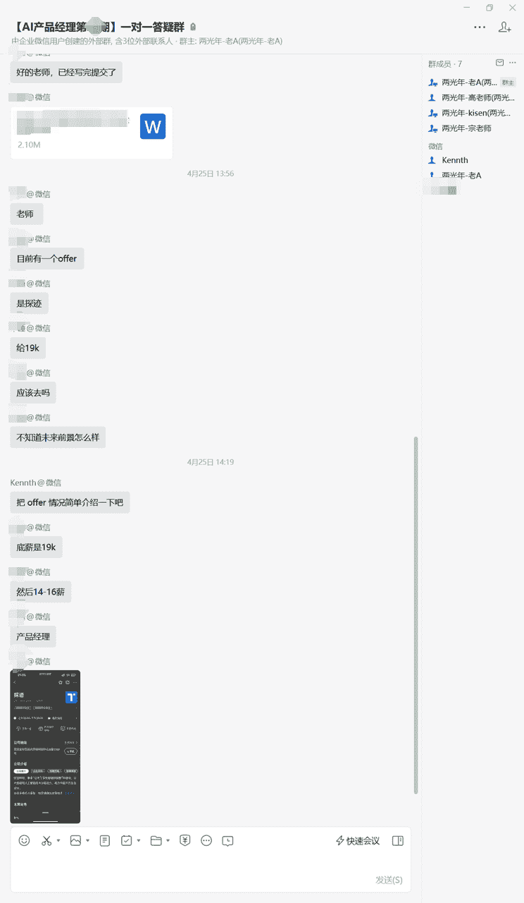

# 真实AI产品经理转行案例

> 来源：[https://v11enp9ok1h.feishu.cn/docx/GbnkdVfRWoYBd6xP6yEcJ6v7nZb](https://v11enp9ok1h.feishu.cn/docx/GbnkdVfRWoYBd6xP6yEcJ6v7nZb)

#### 联系我们

####  🛰️：AIGC7654

---

## 👧个人背景：

**🎓 2****0届，**双非（本科），**💬  两段**互联网运营实习

**💻 原****xx综合平台-数**据运营岗（发展瓶颈、被迫转行）

🧑🏻‍💻 早在2**3年就开始关注AI；因身边**科班出身的朋友，在人工智能领域吃到了一波很大的红利！阶段性焦虑、陷入自我否定、对未来规划迷茫。

**🏆 5****月转行了【**探迹AI产品经理】年薪27w-30w

---

** 📌 学员沟通后、同意c**

修改前

修改后

## 🏃转行进程：

> 一共2个半月的时间成功转行上岸，中间隔了清明假期

✅ 2月：老师一对一辅导（职业规划），AI产品经理的全局了解，产品经理的基本知识教学，产品思维的训练在老师的带学下开始恶补产品知识。

✅ 2月：（python、机器学习、深度学习）等AI必要掌握的实战教学

PS：基础层和技术层的AI公司对产品经理的技术要求是毋庸置疑的；对于以产品为主导的AI公司来说，产品经理得懂AI技术，但是不需要完全掌握

✅ 3月：（产品设计、AI项目实战）吧

跟随直播教学完成（自动驾驶、PLC广告流媒体自动挂载、AI二手车）等项目；在老师的辅导下从0搭建（PRD、原型图、数据清洗、模型选型、模型微调、量化指标）并输出作品集

✅ 4月：约老师（改简历，面试模拟）海投简历，正式面试

> 录制: 两光年-面试辅导

> 日期: 2025-04-07 19:45:23

> 录制文件：https://meeting.tencent.com/ xxxxxxxxxxxx

> 密码：J**P

> (涉及隐私，禁止公开)

> 录制：两光年-面试辅导

> 日期：2025-04-15 10:33:52

> 录制文件：https://meeting.tencent.com/ xxxxxxxxxxxxx

> 访问密码：Q**R

**✅ 金三银四：面试半个月上岸**

## ✍️学习路径：

1、预习课、直播课、1v1专属带学群

2、职业规划、简历润色修改、模拟面试、岗位JD分析

3、技术沙龙、个性化项目（辅导、教学、包装）

---

报名后助教老师立马给开通了自研学习平台的账号

学习平台一共8门课包括：**直播课****（每次**直**播的****回放第二天会同步**上传学习平台）、预习课（往期的直播课基础内容可以提前预习）、*选修AIGC应用课 （Dify.AI智能体课程、ChatGPT 课程、GPTS 智能体应用、Midjourney 课程、Stable Diffusion 课程、人工智能科普课程  共6门选修）

作业知识点答疑（部分截图）

提前学完预习课后想趁着 **金三银四 **找工作、于是预约老师修改简历及面试辅导、老师在明确了相关需求后，约了腾讯会议进行1v1会议辅导，后投递多家岗位、虽然接到很多面试邀约但都是一面被拒。

***老师复盘：**（一般一面都是业务面、要根据招聘JD有针对性的准备，在面试前准备好逐字稿，如果准备不充分，很容易在一面就被发现，业务需求理解不深入，产品架构，项目流程不熟悉）

在跟着直播课补充AI技术认知和项目需求理解、第二次约老师修改简历，完善面试准备逐字稿，线上面即可照着逐字稿读，对于常见的问题有充分的准备，大大提升面试通过的几率

---

海投多家公司后、整理了多家面试题、老师帮助整理了SOP及模拟面试、简历调优后成功拿下【探迹AI产品经理】年薪27w-30w

## 总结：

> 从一开始对转行AI产品经理的质疑，另外因为就双非本科的学历，也没有AI产品经理经验，完全没有自信，一点点的学习，完成作业，做项目，找老师。总算是对AI产品经理的工作和技能有了一定的掌握。

>

> 但是在简历投递环节，还有面试环节，反复被拒，反复碰壁，中间也怀疑过是否能成功转行AI产品经理，不断的进行腾讯会议私聊辅导，还好最终拿到了满意的结果！

## 课程详细目录大纲

[AI产品经理特训班-学习大纲（148课时）](https://v11enp9ok1h.feishu.cn/wiki/OgZ2wWPpHiSfhBk2aGMcissNnbc)

