# 3 分钟速通AIGC产品经理

> 来源：[https://v11enp9ok1h.feishu.cn/docx/NNH8dwhKZoHjNUxLVhxcijQnnbb](https://v11enp9ok1h.feishu.cn/docx/NNH8dwhKZoHjNUxLVhxcijQnnbb)

> 精简浓缩后的入门教程，0 基础纯小白也能学懂产品经理！

| **本文适合的人群** | **解决痛点** | **我是谁** |
| --- | --- | --- |
| +   想找产品实习 / 校招，但0经验的学生 | +   网上信息太多，不知道哪些最重要 | +   两光年-Jack |

## 一、产品经理是什么？

> 说人话：策划设计产品方案，并联合研发、设计、运营等团队实现，所有你使用的软硬件产品背后的人。Be like：产品宝宝的爸爸妈妈。

举例：

+   📕：内容分发产品经理，负责首页的推荐策略和产品功能。

+   字节：AI 产品经理，负责抖音、剪映等产品的 AI 技术落地，以及大模型在内容创作应用适配。

+   支付宝：大模型产品经理，负责将大模型技术融入金融服务与生活场景

+   美团：Agent 产品经理，负责即时零售、外卖等业务的智能体（Agent）开发

## 二、产品经理有哪些类型？

### （1）按服务对象划分

| **类型** | **举例** |
| --- | --- |
| To C：面向个人用户 | +   电商：拼多多，交易产品经理 |
| To B：面向企业 / 组织客户 | +   电商：拼多多，商家产品经理 |

> 用户就是自己用

> 经营、赚钱的目的

> 如商家、机构、企业、单位

### （2）按负责模块划分

按照产品经理负责的模块类型划分：

| **类型** | **举例** |
| --- | --- |
| 功能型产品经理 | +   用户产品、工具产品、平台产品、店铺产品 |
| 策略产品经理 | +   增长策略产品、推荐产品、搜索产品、数值产品 |
| AI 产品经理 | +   AI 对话、AI 图片生成、AI 视频生成产品 |

> 负责的产品以 “功能” 为主

> 负责的产品以 “策略” 为主

> 负责的产品以 “AI 功能” 为主

### （3）新兴领域的产品经理

| **类型** | **举例** |
| --- | --- |
| 大模型产品经理 | +   支付宝大模型产品经理，优化智能客服的金融问题解答精度 |
| Agent 产品经理 | +   美团 Agent 产品经理，优化外卖配送路径的智能调度 Agent |
| AIGC 产品经理 | +    Midjourney 的图像生成产品经理 |

> 聚焦大模型在各场景的商业化落地

> 负责具备自主决策能力的智能体开发

> 专注生成式 AI 内容产品的设计与迭代

## 三、产品经理的能力要求？

化繁为简，三种关键能力！

| **1** | 产品设计 | +   基于业务目的，理解用户 / 客户需求，输出产品方案 |
| --- | --- | --- |
| **2** | 数据分析 | +   通过数据提前验证需求，上线后评估效果，达成业务目标 |
| **3** | 沟通协同 &amp; 项目管理 | +   协调跨团队资源，确保项目按计划推进 |

> 最关键

> 功能、策略、AI 模型…

> 判断价值的核心

> 数据分析、AB 实验、用户调研…

> 推动落地的保障

## 四、AI产品经理的能力要求？

| **1** | AI 技术理解 | +   理解 AI 算法逻辑、模型原理，明确技术边界与可行性，判断需求能否通过 AI 技术实现 |
| --- | --- | --- |
| **2** | AI 产品设计 | +   基于 AI 技术能力，挖掘用户在 AI 场景下的痛点 |
| **3** | 数据驱动与模型迭代 | +   通过 A/B 实验、模型效果指标验证 AI 产品需求，上线后追踪用户使用数据和模型性能数据，驱动模型迭代与产品优化 |
| **4** | 跨团队协同 &amp; 项目管理 | +   协调算法研发、工程开发、UI/UX 设计等跨领域团队，明确各环节在 AI 产品迭代中的角色与时间节点，确保 AI 产品按计划上线并持续迭代 |

> 基础支撑

> 如生成式 AI 的 prompt 设计上限、多模态模型的输入输出能力

> 核心价值

> 如智能助手的交互效率、AI 生成内容的创意需求

> 例如 AI 对话产品的上下文理解策略、AI 绘图产品的风格定制功能设计

> 效果保障

> 比如 AI 推荐产品的点击率提升、AI 客服的意图识别准确率优化

> 落地关键

## 五、0 基础入门AI产品经理，要做什么准备？

> 系统学习，打好基础 -> 勤加练习，培养思维 -> 实战演练，准备作品

### （1）系统学习--[AI产品经理学习清单](https://v11enp9ok1h.feishu.cn/wiki/Cprcw2Xciiy1Jrkz8nRcwzwcnYg)

| #### [AI产品经理学习清单](https://v11enp9ok1h.feishu.cn/wiki/Cprcw2Xciiy1Jrkz8nRcwzwcnYg) |  |  |
| --- | --- | --- |
| 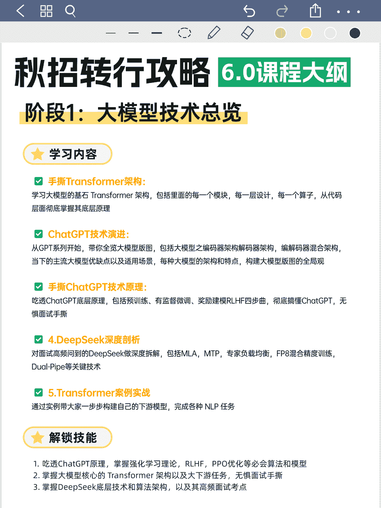 | 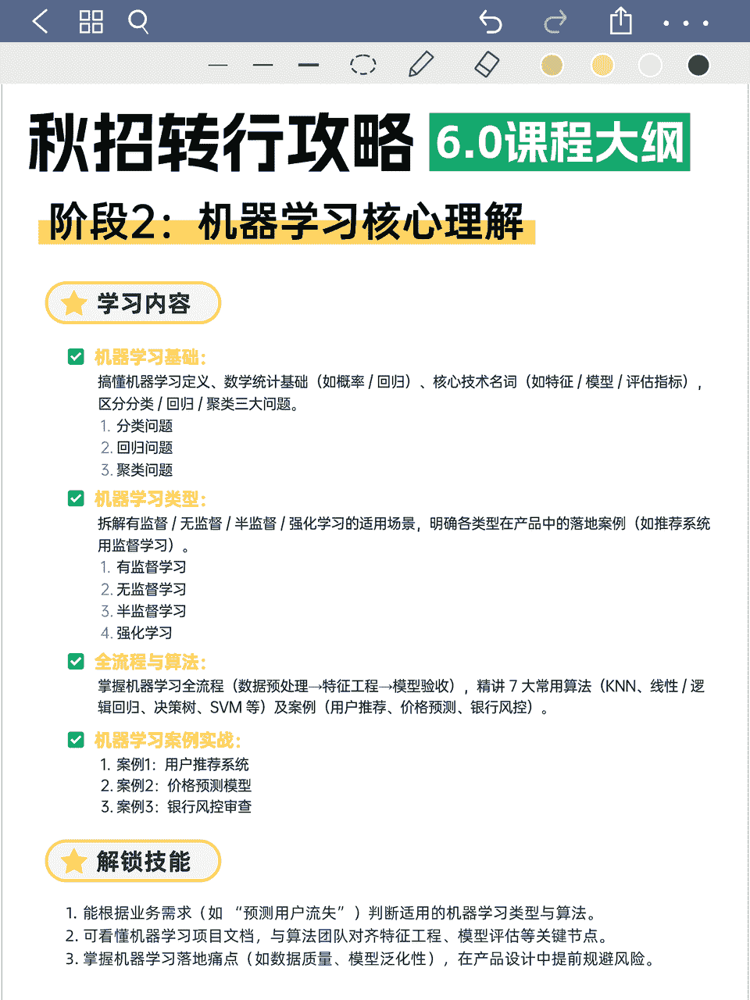 | 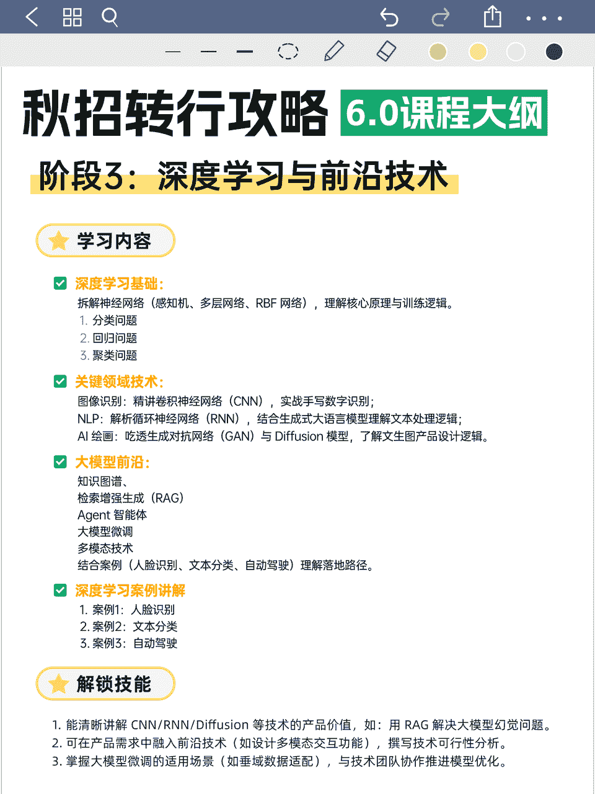 |
| 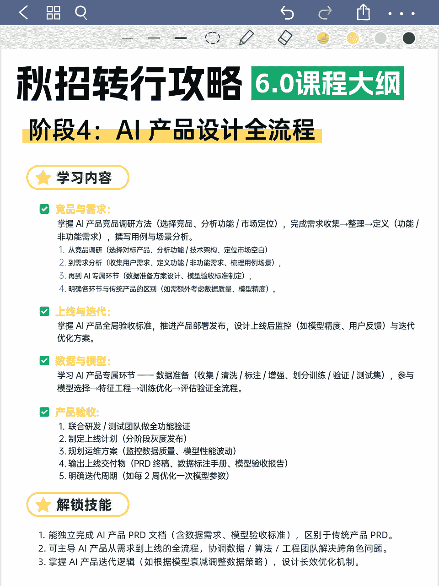 | 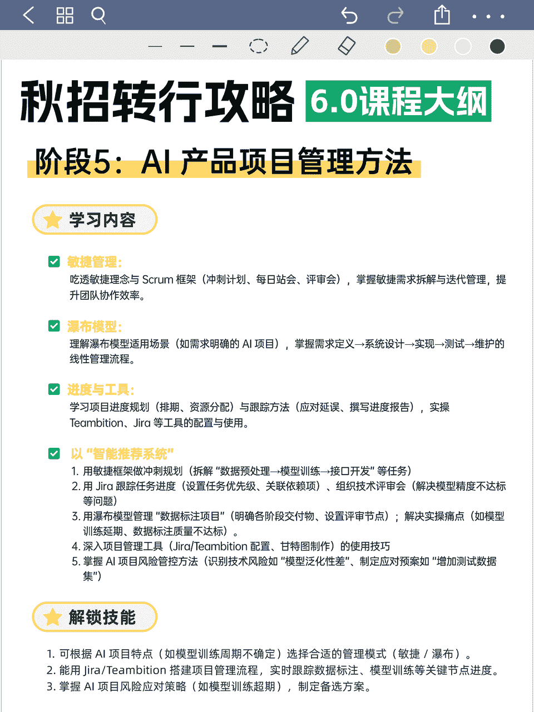 | 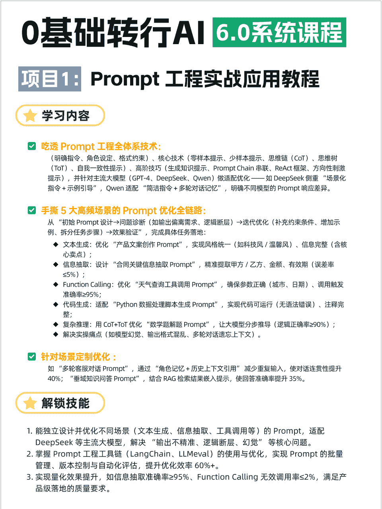 |
| 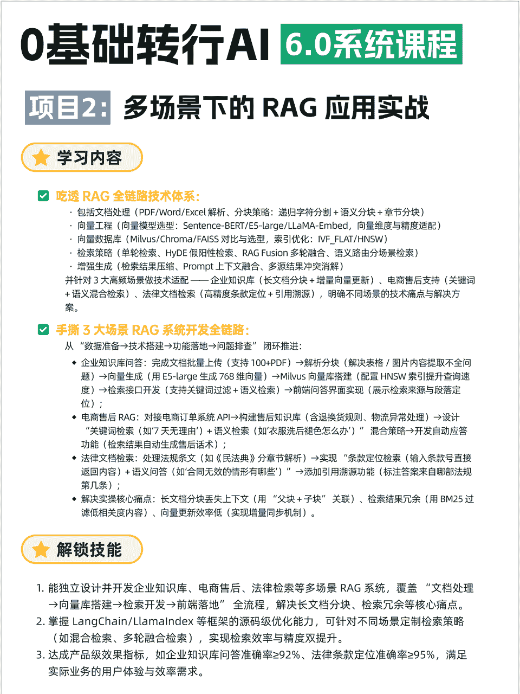 | 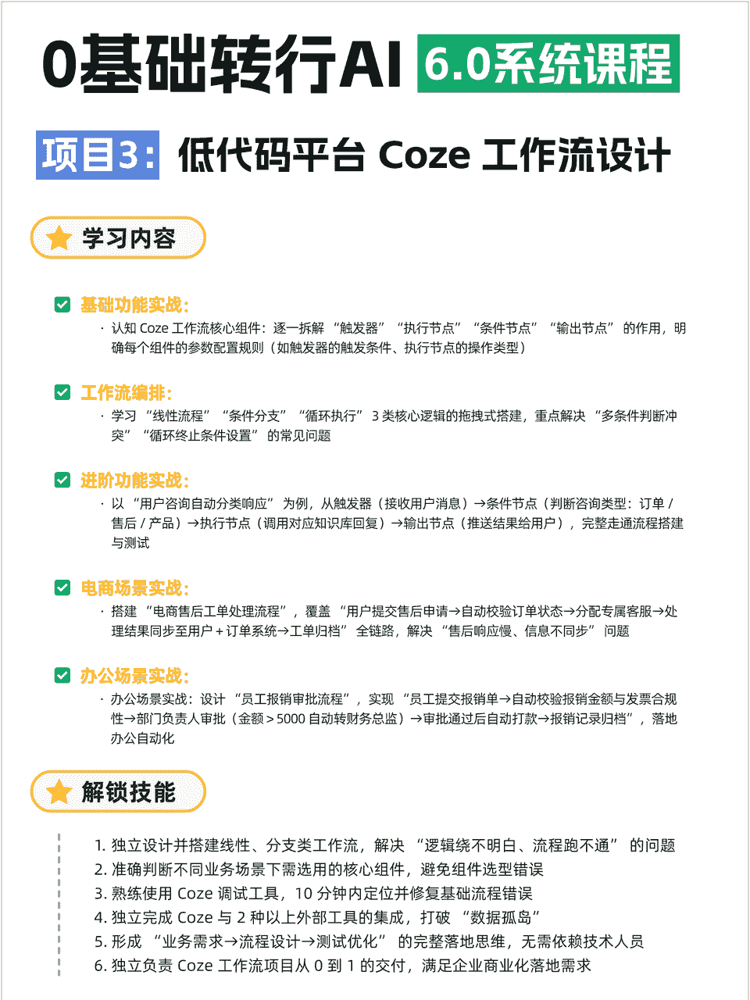 | 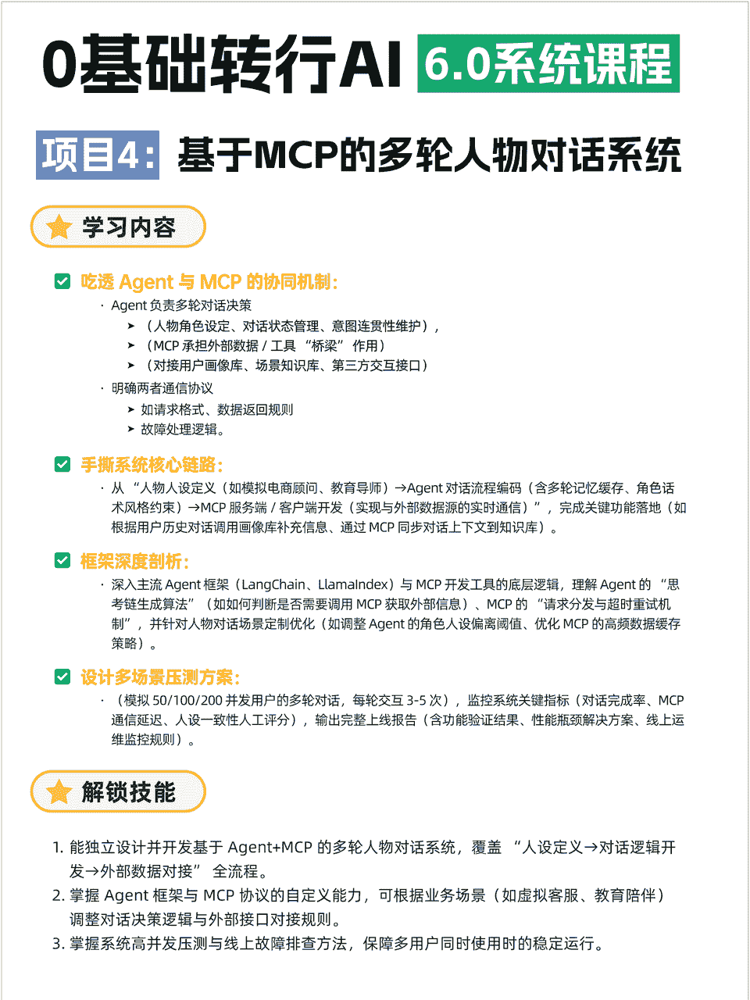 |

**书籍📚：**

+   pm 工作内容介绍分享：《人人都是产品经理》、《结网》

+   交互设计：《交互设计精髓》《信息架构》

+   用户研究和需求分析：《认知与设计》、《可用性测试手册》、《匹配度》

+   技术理解：《给产品经理讲技术》

+   市场：《定位》

+   数据分析：《精益数据分析》、《深入浅出统计学》

+   大模型技术与产品结合类：《Machine Learning Powered Applications》、《AI 产品经理：人工智能产品从 0 到 1》

<https://v11enp9ok1h.feishu.cn/share/base/view/shrcnQDFNVE4QX7qmbtP5eCBjLh?iframeFrom=docx&ccm_open=iframe>

### （2）产品 sense 培养

常常听面试官说产品 sense，究竟什么是产品 sense 呢？

> 所有人都可以提需求，因为每个人都可以是用户。但产品经理和普通用户的区别是，需求判断力。

+   别人提了需求：这个需求是否合理？代表了多少用户的需求？现在的产品可以满足么？需要新增产品吗

+   别人没提需求：用户有哪些需求？哪些是没有满足但不会说的？用户这样做的原因是什么？如何解决？

+   往上思考商业：从公司业务目的出发，当前业务发展阶段，我们要做什么来获取市场？

+   往下理解用户：目标用户的画像是什么样，人群规模是多少，使用场景是什么样，如何设计解决方案？

**产品sense****=****用户sense****+****解决用户需求的框架****，属于对产品、运营的基础要求。**

+   **怎么训练产品sense:**

> 套用框架先分析：**用户-**>**痛点**->**解决办法**->**验证指标**，研究下你的常用app以及功能，满足了谁的痛点。

> 验证：问问朋友的使用场景和你设想的一样吗

+   **学厉害的产品经理：**

> 李想、张小龙的产品分享：精读。尤其龙哥的，腾讯的朋友可在内网看8小时版本。

<https://v11enp9ok1h.feishu.cn/share/base/view/shrcnOyiyd5op126AoBBil6b0Ih?iframeFrom=docx&ccm_open=iframe>

可以认为产品 sense 是做好产品设计的前提。针对这方面的训练，除了平时多多关注业内专业人士的经验见解，我们也可以针对市场上的产品和问题写一些文章作为训练，发表在社交媒体上积累经验。

### （3）有亮点的作品

除了系统学习外还需要个人作品，毕竟理解并不代表会做。更重要的是，与你一同竞争的候选人那么多，总有许多有实习有项目的牛人，那么如何从表现出自己的优势呢？

> 我们需要有亮点的作品，我们需要发现某个用户群体的痛点，在相应的赛道上没有得到解决，或者现有解决方案不能很好解决，而我们的产品能够很好解决的。

如果没有产品实习，可以组队参加比赛，或者自己花时间做一个产品。从前期的用户调研、市场分析、产品定位，写出 MRD 市场需求报告，到需求分析、需求排序、产品架构设计、产品原型设计，写出 PRD 产品需求文档，画出完整的产品原型交互稿，甚至用 vibe code 的方式自己开发出来上线，获取一线真实的用户数据和反馈。这样一个完整的流程下来，我们就有自己的作品和实战经历了。

大家不用害怕，这些环节其实并不难，我们可以借助一些大佬的经验。

<https://v11enp9ok1h.feishu.cn/share/base/view/shrcn9QhJiqf3HaXXWYvSaesTsc?iframeFrom=docx&ccm_open=iframe>

### **拿新人**最难上手的产品设计环节举例，画原型

一、先吃透需求：明确 “为什么画这个原型”

原型的本质是传递需求逻辑，如果没思路，先回到需求本身：

+   梳理需求背景：这个功能是为了解决什么用户痛点？服务于哪些场景（比如 “新用户首次下单”“老用户复购”）？

+   定义核心目标：原型要实现的核心功能是什么？用户完成这个功能的关键路径有哪些？

+   锁定用户角色：目标用户是谁？他们的使用习惯、操作能力如何？（比如 To C 的普通用户更在意直观，To B 的企业用户更关注效率）

从 “借鉴” 到 “创新”：站在巨人的肩膀上

完全原创容易卡壳，先参考成熟案例找灵感：

+   拆解主流产品的交互逻辑：把你熟悉的 APP（如🛰️、淘宝、抖音）中类似功能的页面截图，分析它们的布局、按钮位置、交互反馈（比如 “点击后弹窗的动效”“页面跳转的逻辑”）。

+   逛原型案例库：

+   Axure Gallery、摹客的 “案例广场”：有大量行业原型模板，可直接参考结构；

+   Dribbble、Behance：找 UI 设计作品，借鉴视觉和交互的表现形式；

#### 大厂axure原型图案例库

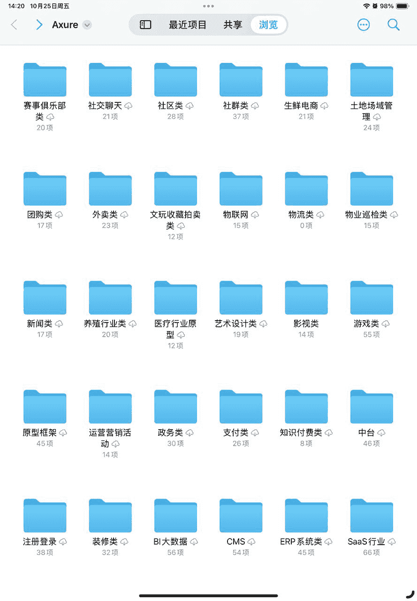

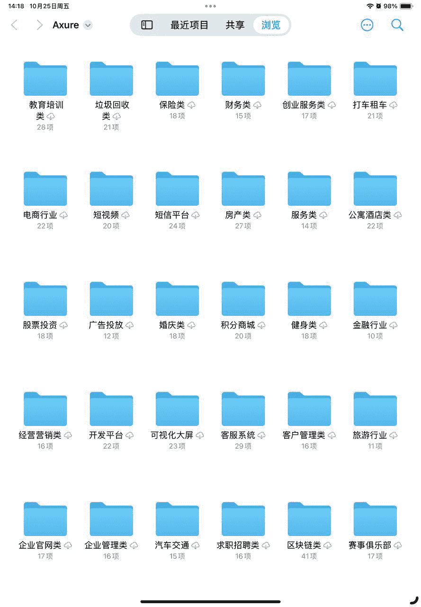