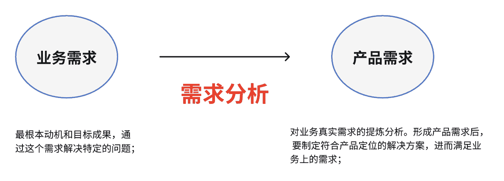
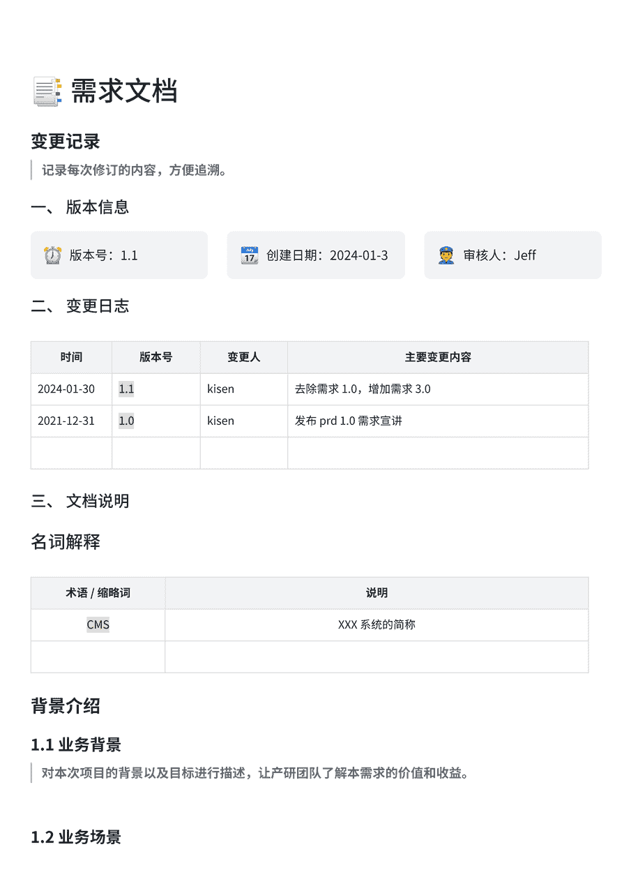

# AI产品经理入门

> 来源：[https://v11enp9ok1h.feishu.cn/docx/UJ8sdsHf4oVHkQxZU3JcPqxdnRc](https://v11enp9ok1h.feishu.cn/docx/UJ8sdsHf4oVHkQxZU3JcPqxdnRc)

<https://v11enp9ok1h.feishu.cn/sync/VztedzIoUstVPDb6RNMctK8Unie>

# AI产品经理工作流程

> 按照产品的生命周期，产品经理的工作流程可以分为4个阶段：

**【需求定义阶段】**

**【产品设计阶段】**

**【产品研发阶段】**

**【验收复盘阶段】**

## 需求定义阶段

1.  **需求收集**

**外部来源**: 用户反馈(直接/间接);市场调研;竞品分析;

**内部来源**: Boss;其他同事提出;产品团队脑暴;业务方需求，

**需求分析**

**工作内容：**根据收集来的业务需求，确定产品的业务场景，并转变成产品需求。

此时不仅要考虑需求是否可行，还要考虑公司是否有能力支撑提供。

**工作产出：**产品功能清单

**区分业务需求和产品需求：**

1.  **业务需求=业务动机+业务目标**

> 业务需求就是最根本的动机和目标成果，通过这个需求解决特定的问题

1.  产品需求=解决方案=产品结构+产品流程+产品功能

> 产品需求是对用户真实需求的提炼分析。

> 形成产品需求后，要制定符合产品定位的解决方案，进而满足业务上的需求

**需求分析的思路：**

**本质——**基于**场景**对需求进行分析 **(前提是先认知产品定位)**

**场景——**时间+地点+人物+环境+事件

**场景和需求有什么关系?**

+   不同的需求都是在特定的场景下才需要被满足

+   做产品就必须要考虑产品要服务怎么样的场景

1.  **需求管理**

可以通过**需求池**的方式管理和收集来自各方的需求，包括新需求、优化需求及变更需求

[PM基础技能之需求管理](https://v11enp9ok1h.feishu.cn/wiki/U1mNw2CYji54mHkvyDrcRha6nXb)

**需求池的作用&管理原则**

| **需求管理** | +   **收到新的需求，要记录** |
| --- | --- |
| **需求维护** | +   每一条需求是如何处理的? |
| **需求回溯** | +   未处理的需求：这条需求是如何产生的?用户和场景分别是什么? |
| **管理原则** | +   有进有出：收集到的需求都要录入，处理完的需求要转出「注意备份!不能只是删除 」 |

1.  **需求评估**

+   对需求进行初步的分析和理解，**判断需求是否成立**，将业务需求转换为产品需求，必要时和研发做前置沟通，初步确定优先级

**需求评审**

**工作内容：**与公司其他部门，包括运营、研发等部门，评审产品的需求，并最终定稿【能不 能做?好不好做?哪些没必要做?】

+   如果开发气势汹汹说这个做不了!——说明有可能你的逻辑等地方有问题，抑或者对方 不想做。那就修改/找到可以实现的案例。

+   如果开发态度比较好的说这个做不了一—可能是不会，或者太复杂技术不足以实现， 则想办法能不能简化、好做一些、砍掉哪些部分等。

**工作产出：终版PRD**

[PM基础技能之识别&验证伪需求](https://v11enp9ok1h.feishu.cn/wiki/SZCnwap3ViklRnkgPGxcEx4zn9b)

[PM基础技能之需求判断能力](https://v11enp9ok1h.feishu.cn/wiki/GpXxwQGgfio2rak957FcQxNbnQb)

## 产品设计阶段

1.  **业务流程设计**

+   根据业务实际流程绘制**业务流程图**，梳理业务逻辑，通常用**ProcessOn**或者**Visio**绘制，主要目的是捋清楚底层逻辑，方便各方理解和认知拉齐，也为后面具体的功能设计打好基础

1.  **功能模块及逻辑设计**

+   根据需求设计产品功能及页面逻辑，为了展示不**同模块之**间的关系及信息/数据流向，通常以UML图的形式展现，具体采用哪种格式以实际需要为准。

+   **原型图绘制:****原型图主要**用**来展现产品页**面**的功能、跳**转逻辑和交互设计，一般用Axure、Sketch、Figma等工具。

> **流程图**和**原型图**是否需要设计精美或高保真，因个人及团队习惯而定，这种图对于文档来说都是非必须的，但是能够很好的辅助产品将问题和逻辑讲清楚，这才是核心。

1.  **需求文档输出**

+   **版本信息**

+   **修改记录**

+   **需求背景**

+   **需求目标**

+   **具体需求**

1.  **概念定义**

非必须，当产品中出现新的概念和数据定义的时候，最好前置拉齐定义和认知

1.  **功能逻辑图**

使用产品流程图/功能结构图 梳理产品，特别是逻辑较复杂或者新产品。

1.  **产品功能**

文字描述+原型图+备注

[PM基础技能之异常处理情况](https://v11enp9ok1h.feishu.cn/wiki/I7luwkvI0i0ZobkEWNAcKJjAnRf)要考虑到有可能出现的异常情况的定义:

1.  **埋点需求**

[PM基础技能之数据埋点](https://v11enp9ok1h.feishu.cn/wiki/YxCvwZvqbip4NHkZgoAcsZQDnfg)

1.  **数据指标**

是否需要灰度测试或者AB Test，希望到达的数据指标是什么

+   **会议纪要**

## 产品研发阶段

### 需求评审

[PM基础技能之需求沟通](https://v11enp9ok1h.feishu.cn/wiki/ZyeSwaUZTiLbnnkjrrccaWBnnAh)

1.  产品内审

1.  (大需求)需求预评审

体量较大或涉及流程较复杂的需求，最好先组织一次需求预评审，拉齐认知对齐疑问点，按照各方意见修改一次后再进行正式的外审。

1.  外审-需求相关方+研发

### 技术评审

技术评审足指研发针对产品需求进行的技术方案设计评审，产品参与主要是了解大概的实现逻辑以及是否能够满足需求，所以最好参加并且大概了解。

### 研发实现-项目管理

确定关键节点及开发周期和时间，产品应心里有数

### 试及验收上线

1.  验收需求还原度

测试用例评审一定要参加，并且注意是否所有的情况都在用例中被覆盖到产品经理要多多使用自己的功能，思考和分析表现是否合理，操作是否方便

1.  对产品上线负责

准备上线需要的资料(用户手册等)，是否需要运营同学协助告知用户，进行用户培训

## 观察复盘阶段

1.  **数据监测及分析**

1.  **复盘会议**

人员包括所有该选代参与开发者，对功能完成情况及线上数据情况做总结分析，并且所有人可提出做的好及做的不好的地方，复盘会议需要注意两点:

1.    有目标有讨论有结论

1.  对后续工作有借鉴意义

## **发布**

###### **1.测试验收**

工作内容：在测试工程师完成测试之后，产品介入验收环节，交由测试验收通过即可上线

工作产出：验收报告(正规化)

###### **2.发布上线**

工作内容：将验收通过的产品发布到对应的渠道

工作产出：上线通知报告

## **运营**

|  | **(冷启动)引入期** | **成长期** |
| --- | --- | --- |
| **主要** | +   获取种子用户，主动对外宣传产品； | +   思考产品的业务战略、目标和发展方向 |
|  | **成熟期** | **衰退期** |
| **主要** | +   进一步提高产品用户粘性，使用户向核心用户转化； | +   设法了解和触达流失用户，通过运营促成最大限度回流； |

## **迭代**

**▶循环[需求分析一发布]流程**

<https://v11enp9ok1h.feishu.cn/sync/PaIIdslbxsIJUIbkTfPcsMCFnph>