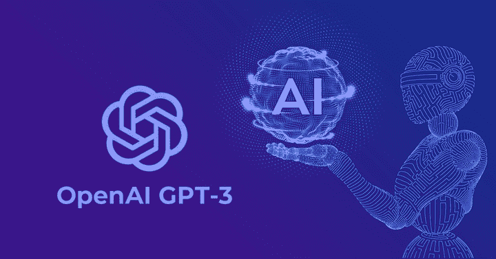
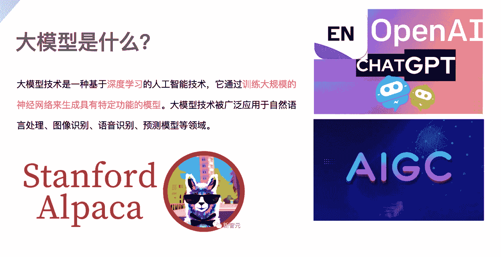
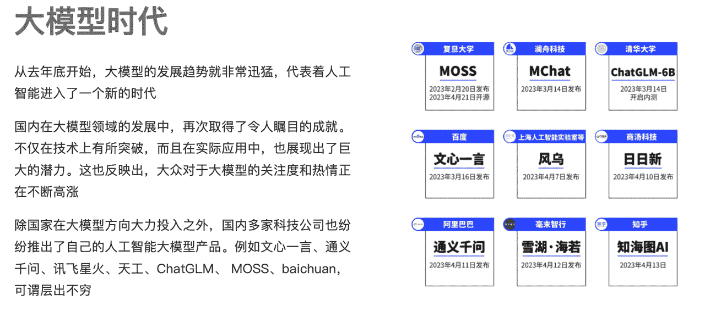
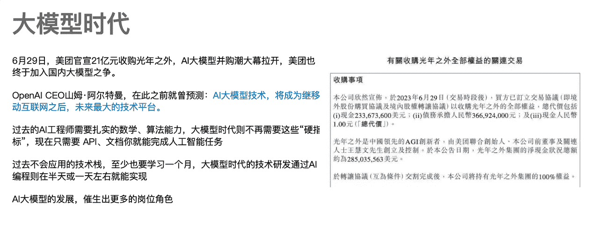
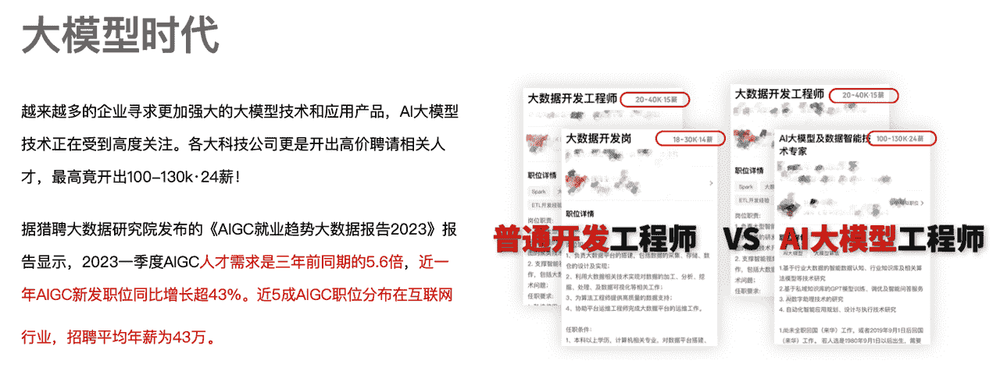
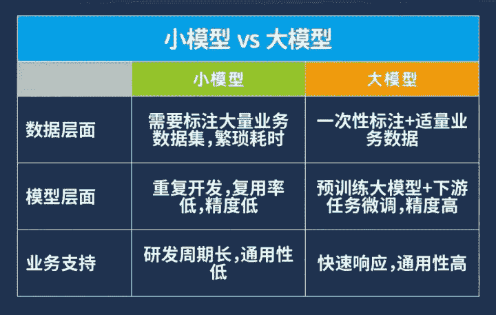
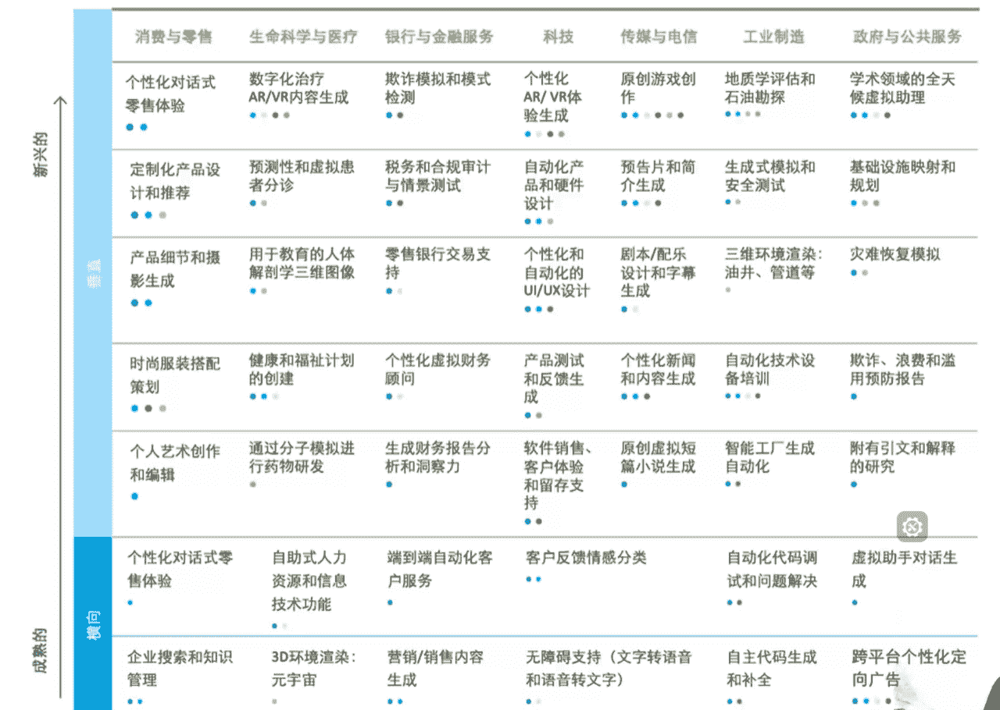
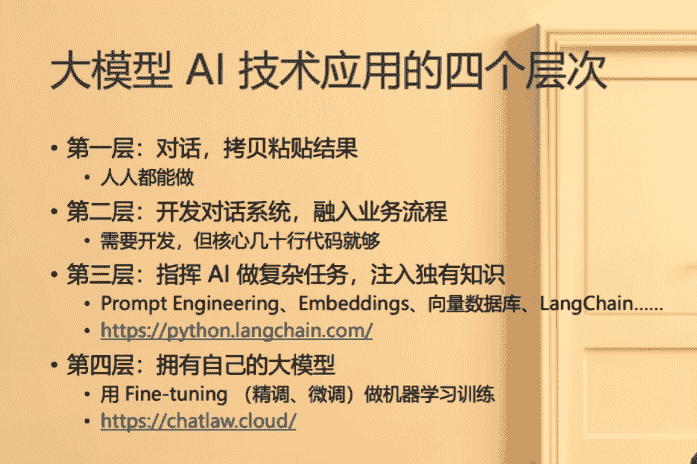
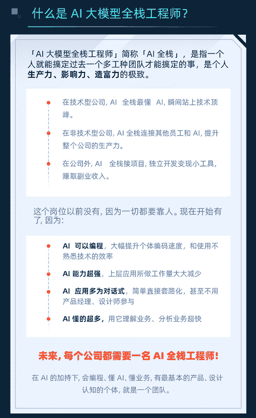

# AI大模型：智能世界超级玩家，轻松驾驭搞钱未来

> 来源：[https://v11enp9ok1h.feishu.cn/docx/Za4QdhJyzoESYkxtafMcseJHnTf](https://v11enp9ok1h.feishu.cn/docx/Za4QdhJyzoESYkxtafMcseJHnTf)

<https://v11enp9ok1h.feishu.cn/sync/PaIIdslbxsIJUIbkTfPcsMCFnph>

# **什么是AI大模型？**

**我们在生活中常常使用过很多模型，比如自制雪糕的雪糕模具，蛋糕店里摆着的蛋糕模型这些都是模具，装着鸡蛋羹的碗**等等，我们可以使用这些模具来更加简单的完成最终的成品。这些是实体店模型，映射到虚拟上，就包括我们听到过很多次的数据建模；

**举例：我**需要大量计算一个数的平方最后减去3，一个一个计算太麻烦了，我就可以先使用一个数，计算它的平方再减去3。根据这个例子，建立一个模型，就变成了一个虚拟的“模具”，我就可以使用这个“模具”来计算我其他的数据了。其中，数的平方减去3，就是这个模型的算法；把这个算式封装好的盒子，就是模型，是不是特别好理解。我们可以使用这个模型来增加提高我们的工作效率。

> **Ai大模型就是一种很聪明的电脑程序，它可以学习很多很多的信息，比如文字、图片、声音，然后根据这些信息来做各种各样的事情，比如写文章、画画、聊天等。AI大模型就像是一个超级大脑，可以处**理很多很复杂的问题，也可以适应不同的场景和需求。AI大模型是人工智能的一种重要形式，也是人类探索智能的一种方式。简单来说，就是在大数据的支持下进行训练，学习出一些特征和规则，微调后应用在各场景任务中。

> **AI大模型具有很高的计算和存储需求，需要使用极为强大的计算设备和高效的算法才能训练和应用，所以参数量一般可以达到惊人的数十亿或者数千亿。例如OpenA**I的GPT系列，最开始的GPT-1拥有1.17亿个参数，到GPT-3的参数已经到达1750亿个，最新的GPT-4没有给出具体的参数量，但根据推测，它或将接近万亿

> **传**统的小模型生成模式相比，大模型能够大幅缩减特定模型训练所需要的算力和数据量，缩短模型的开发周期，并得到更好的模型训练效果。

> **可以说，大模型的真正意义在于改变了 AI 模型的开发模式，将模型的生产由“作坊式”升级为“流水线”。而模型开发模式的转变，使得 **AI 技术在落地时拥有更强的通用性，可以泛化到多种应用场景。由此利用大模型的通用能力可以有效应对多样化、碎片化的AI应用需求，为实现规模推广AI落地应用提供可能

# **AI和AI大模型区别**

**👉AI（人工智能）是****指**模拟、复制、扩展人类智能的科学与工程领域。它是通过机器学习、深度学习、自然语言处理等技术，使机器能够模拟和执行人类智能活动的分支。

**👉AI大模型是****一种具**有巨大参数量的深度神经网络模型。这些模型通常由数十亿、甚至上百亿个参数组成，可以在大规模数据集上进行训练。AI大模型的典型代表是GPT-3（Generative Pre-trained Transformer-3），它是由OpenAI开发的自然语言处理模型，拥有1750亿个参数

# 大模型门槛高不高？

大模型门槛高不高，要分三种情况

大模型领域当中不同类型的玩家，

👉第一种：像谷歌 微软 百度 open ai 这样的玩家，从0开始做一个这样的基础大模型

1、这一部分无论是数据还是算力，还是人才的要求都非常高。整个的大模型，他之所以有这样的一个通用的智能化的能力，实际上是它经过了海量的数据的训练，（可能相当于数百万个这样的人，他们一生的阅读量）

2、另一方面实际上是这种高质量的标注数据，比如说像OpenAI，他们有大量的这种专业领域的标注员，那么除了数据之外，当然算力的要求也是非常高的，像Chat GPT这样的一个千亿级别的大模型要连续训练1000张A100连续训练100天这样的一个时间，所以这个成本也非常高（动辄花几千万美金 甚至几亿 几十亿美金购买GPU）

【自建基础大模型，算力、算法、数据，人才要求高】

👉第二种：在已有开源的基础大模型之上，比如chatglm3、 llama2、 阿里通义这样的基础大模型之上，做这种行业的领域大模型，就好比站在巨人的肩膀之上，训练完成之后90%的工作大模型都给你解决了，它所需要的数据量、它所需要的计算量、成本方面就算我们是普通程序员也是可以接受。

电商  量化交易 教育  工业的知识库  天气预测 客服机器人等   都是可以落地的，现在市面招聘99%也都是领域大模型的产品经理 、算法工程师

【行业大模型，基于基础大模型微调，针对性定制】

👉第三种：基于前两类的大模型，在上面开发应用，门槛降的非常低，整个的创新的速度非常快（在进行模型二次训练的时候顺手就搞定了）

【用大模型开发应用，通过开发工具，降低门槛】

> 大模型本身已经是非常强大了，但是无法满足我们工作需求。所以我们做的是基于基座大模型做模型二次训练 做独有场景 独有数据方向 私有化部署（真正意义上的几何倍率的提高工作效率，成为超级个体，成为大模型全栈工程师）

# **AI大模型应用案例**

# **大模型的应用可以在以下领域：**

当然并不是只有这些的，还有很多的应用场景在等待着我们的开发。

# 大模型技术为什么会这么多公司追捧呢？

☘️ 核心就是两点 ：效率高、想象力巨大。

## **效率高的事情**

**⭐**️产品开发过程中前端 后端 测试 产品 设计图片 UI都是利用大模型半个月开发完毕，正常效率是4 5个工程师 几个月的工作量。

**⭐️作为独立开发者前后端 设计 产品等一个**人完成，完成多个数百万金额项目 独立交付

## **想象力大事情怎么解释呢？**

说两个方向： 存量市场和增量市场

**1：存量市场逻辑：**

**     2018年开始，移动互联网增速趋向于饱和，像我们平时使用的“抖音”“快手”“微信”支付宝““携程”“小红书”等等，基本就没变过样子，企业招开发岗 更多是维持本身业务的发展，而当企业的**商业增速 流量增速到达瓶颈后，本身开发工程师是不带来新的经济增长的 自然配合此业务的“产品经理”“项目经理”等相关岗位和开发工程师一样 就会薪资下降  ，薪资水平刚刚维系企业可以正常运转即可，或者直接裁员其他冗余岗位，这就是”存量市场逻辑“

**2：增量市场逻辑：     **

**自从chatgpt火起来之后，各个大厂开始自研基座大模型，很多文案 编辑 开发等工作大模型都可以替代 或替代大部分，而它真正的想象力在于，很多微小的 或传统的行业 都可以利用大模型重塑一次，真正改变生产力，**比如“量化交易”“医疗问诊”“客服机器人”“教育运营”“企业CRM“”线上企业框架搭建“等等等，有更多新的场景亟待解决，这就是机会，而这些新的机会，是给企业降本增效 或带来新的经济增长的，自然薪资就高 而且给钱还痛快，这就是”增量市场逻辑“

**👇**在这样的市场情况下，大模型一定是未来重塑生产力的方式，薪资也非常高，那么我们应该如何学习呢？ 目前个人认为有三种情况

1、有特定的场景 或者公司需求 急待解决，想要训练专业领域的大模型

**2**、本身从事IT工作，自己不知道大模型可以做些什么，简单提升下工作效率，或闲余时间可以利用大模型做一些副业

认可大模型方向，想要ALL IN进去 快速转行

大模型出来后，你也知道，对于行业的冲击还是很强的

学习AI大模型可以具体帮咱们实现：

**①**✅基于大模型底层技术，让咱们前端 后端 数据分析 产品  绘图 算法工程等一个人可以做。自身工作起码提效50%

**②✅学会模型精调，掌握独立训练基础**大模型，并且某个专业领域落地部署的能力

**③**✅AI新方向薪资高，打破了行业壁垒，不像传统IT，学大模型薪资至少上涨10%~15%，且拥有绝佳的高薪岗位

**④✅技术傍身**

**写代码？ 编程要求很高？  不存在的同学，大模型现在很强，核心不**是代码基础  是编程思维，它并不是只停留在一个gpt上，大模型本质是重塑生产力，

学模型精调、做AI全栈、想做出自己的私人场景、私人数据的模型产品。

# **大模型AI技术应用的四个层次**

我们可以看下自己处于第几层的哦

# **什么是AI大模型全栈工程师？**

# **什么是AI PM？**