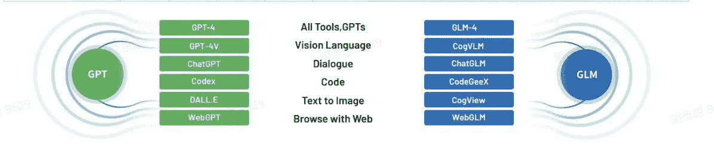

# 智谱 AI 技术文档

> 来源：[https://v11enp9ok1h.feishu.cn/docx/EfDKdY6OnoEu71xfayZc12aWntf](https://v11enp9ok1h.feishu.cn/docx/EfDKdY6OnoEu71xfayZc12aWntf)

<https://v11enp9ok1h.feishu.cn/sync/PaIIdslbxsIJUIbkTfPcsMCFnph>

自 2019 年成立以来，智谱 AI 致力于大模型技术的研究和推广工作。自 2020 年，我们推出并开源了多款模型（如上图所示），它们具有不同的能力，开发者可以对这些模型进行使用和定制。

## 知识库目录

智谱AI 一直致力于制作更好的开源模型，在本章节中，我们将展示智谱AI 目前所有的开源模型，如果您对我们的开源模型的细节和使用感兴趣，欢迎前往我们的技术文档：

[1.1 模型 · GLM 系列开源模型](https://v11enp9ok1h.feishu.cn/wiki/LpTXwb2x8iiIulkeINJcEEuinPv)

[1.2 模型 · CogVLM 系列开源模型](https://v11enp9ok1h.feishu.cn/wiki/PtGlwmn6fiFJKekiYrDcjKganee)

[1.3 模型 · CharacterGLM 开源模型](https://v11enp9ok1h.feishu.cn/wiki/DoTCwZoC0i9ZqEkFtAWcvt8TnWg)

同时，智谱AI也推出了优秀的产品，关于更多产品的细节，欢迎大家访问

[2.1 产品 · 智谱清言](https://v11enp9ok1h.feishu.cn/wiki/H1CKwkVyCirH65ka9jUcaXg3n0d)

[2.2 产品 · API 开放平台](https://v11enp9ok1h.feishu.cn/wiki/V0cWwTKxWiOOaVk6Kd0ccY7ynUf)

[2.3 产品 · CodeGeeX智能编程助手](https://v11enp9ok1h.feishu.cn/wiki/TPwQwWLZiipqEDkJyHfcM7Rvnyg)

如果您对智谱AI往期举办的活动，竞赛有兴趣，欢迎访问

[3.1 生态 · 比赛](https://v11enp9ok1h.feishu.cn/wiki/XA2HwKEkrizqeWkZz3OczlLEn7f)

[3.2 生态 · 聊技术](https://v11enp9ok1h.feishu.cn/wiki/CYKlwL52airrQdkthC3cJnRTnST)

[3.3 生态 · 智能体](https://v11enp9ok1h.feishu.cn/wiki/Q5ZdwU99vijMS6kqslrcby4knrf)

[3.4 生态 · 走进智谱](https://v11enp9ok1h.feishu.cn/wiki/VLb6wr3loiicZDkgiPWcoXxZnmh)

## 开源大语言模型

下表为智谱 AI 开源的语言模型列表

| 模型 | 介绍 | 上下文token数 | 代码链接 | 模型权重下载链接 |
| --- | --- | --- | --- | --- |
| `GLM-4-9B` | 第四代 `GLM` 基座模型。`GLM-4-9B` 是智谱 AI 推出的最新一代预训练模型 `GLM-4` 系列中的开源版本。在语义、数学、推理、代码和知识等多方面的数据集测评中，`GLM-4-9B` 及其人类偏好对齐的版本 `GLM-4-9B-Chat` 均表现出超越 `Llama-3-8B` 的卓越性能。 | 8K | [`GLM-4`](https://github.com/THUDM/GLM-4) | [🤗 Huggingface ](https://huggingface.co/THUDM/glm-4-9b)🤖[ ModelScope 🟣](https://modelscope.cn/models/ZhipuAI/glm-4-9b) [WiseModel](https://wisemodel.cn/models/ZhipuAI/glm-4-9b) |
| `GLM-4-9B-Chat` | 第四代 GLM 对话模型。`GLM-4-9B-Chat` 表现出超越 `Llama-3-8B` 的卓越性能。除了能进行多轮对话，`GLM-4-9B-Chat` 还具备网页浏览、代码执行、自定义工具调用（`Function Call`）和长文本推理（支持最大 128K 上下文）等高级功能。本代模型增加了多语言支持，支持包括日语，韩语，德语在内的 26 种语言。 | 128K |  | [🤗 Huggingface ](https://huggingface.co/THUDM/glm-4-9b-chat)🤖[ ModelScope 🟣](https://modelscope.cn/models/ZhipuAI/glm-4-9b-chat) [WiseModel](https://wisemodel.cn/models/ZhipuAI/GLM-4-9B-Chat) |
| `GLM-4-9B-1M` | 第四代 GLM 长上下文对话模型。支持 1M 上下文长度（约 200 万中文字符）的推理。 | 1M |  | [🤗 Huggingface ](https://huggingface.co/THUDM/glm-4-9b-chat-1m)🤖[ ModelScope 🟣](https://modelscope.cn/models/ZhipuAI/glm-4-9b-chat-1m) [WiseModel](https://wisemodel.cn/models/ZhipuAI/GLM-4-9B-Chat-1M) |
| `GLM-4V-9B` | 第四代 GLM 多模态模型。该模型基于 `GLM-4-9B`，具备 1120 * 1120 高分辨率下的中英双语多轮对话能力，在中英文综合能力、感知推理、文字识别、图表理解等多方面多模态评测中，`GLM-4V-9B` 表现出超越 `GPT-4-turbo-2024-04-09`、`Gemini 1.0 Pro`、`Qwen-VL-Max` 和 `Claude 3 Opus` 的卓越性能。 | 8K |  | [🤗 Huggingface ](https://huggingface.co/THUDM/glm-4v-9b)🤖[ ModelScope 🟣](https://modelscope.cn/models/ZhipuAI/glm-4v-9b) [WiseModel](https://wisemodel.cn/models/ZhipuAI/GLM-4V-9B) |
| `LongWriter` | 具备 10+ 字/词输出能力的模型，包含`LongWriter-9B`（`GLM-4-9B`微调）和 `LongWriter-8B`（`Llama3-8B` 微调） | 128k | `LongWriter` |  |
| `ChatGLM3-6B` | 第三代 ChatGLM 对话模型。`ChatGLM3-6B` 采用了全新设计的 `Prompt` 格式，除正常的多轮对话外。同时原生支持工具调用（`Function Call`）、代码执行（`Code Interpreter`）和 `Agent` 任务等复杂场景。 | 8K | [`ChatGLM3`](https://github.com/THUDM/ChatGLM3) | [Huggingface](https://huggingface.co/THUDM/chatglm3-6b) [魔搭社区](https://modelscope.cn/models/ZhipuAI/chatglm3-6b) [始智社区](https://www.wisemodel.cn/models/ZhipuAI/chatglm3-6b) [Swanhub](https://swanhub.co/ZhipuAI/chatglm3-6b) [启智社区](https://openi.pcl.ac.cn/Zhipu.AI/ChatGLM3/modelmanage/model_readme_tmpl?name=chatglm3-6b) |
| `ChatGLM3-6B-base` | 第三代`ChatGLM`基座模型。`ChatGLM3-6B-Base` 采用了更多样的训练数据、更充分的训练步数和更合理的训练策略。在语义、数学、推理、代码、知识等不同角度的数据集上测评显示，`ChatGLM3-6B-Base` 具有在 10B 以下的基础模型中最强的性能。 | 8K |  | [Huggingface](https://huggingface.co/THUDM/chatglm3-6b-base) [魔搭社区](https://modelscope.cn/models/ZhipuAI/chatglm3-6b-base) [始智社区](https://www.wisemodel.cn/models/ZhipuAI/chatglm3-6b-base) [Swanhub](https://swanhub.co/ZhipuAI/chatglm3-6b-base) [启智社区](https://openi.pcl.ac.cn/Zhipu.AI/ChatGLM3/modelmanage/model_readme_tmpl?name=chatglm3-6b-base) |
| `ChatGLM3-6B-32k` | 第三代ChatGLM长上下文对话模型。在`ChatGLM3-6B`的基础上进一步强化了对于长文本的理解能力，能够更好的处理最多32K长度的上下文。 | 32K |  | [Huggingface](https://huggingface.co/THUDM/chatglm3-6b-32k) [魔搭社区](https://modelscope.cn/models/ZhipuAI/chatglm3-6b-32k) [始智社区](https://www.wisemodel.cn/models/ZhipuAI/chatglm3-6b-32k) [Swanhub](https://swanhub.co/ZhipuAI/chatglm3-6b-32k) [启智社区](https://openi.pcl.ac.cn/Zhipu.AI/ChatGLM3/modelmanage/model_readme_tmpl?name=chatglm3-6b-32k) |
| `ChatGLM2-6B` | 第二代 ChatGLM 对话模型。相比一代模型，具有更强的性能，且其基座模型的上下文长度从 2k 扩展到 32k，并在对话阶段使用 8K 的上下文长度训练。推理速度相比初代提升42%。 | 8K | [`ChatGLM2`](https://github.com/THUDM/ChatGLM2-6B) | [Huggingface](https://huggingface.co/THUDM/chatglm2-6b) 魔搭社区 始智社区 启智社区 |
| `ChatGLM2-6B-int4` | `ChatGLM2-6B`的 `int4` 量化版本，具备最小 5.1GB 显存即可运行。`INT4` 量化下，6G 显存支持的对话长度由 1K 提升到了 8K。 | 8K |  | [Huggingface](https://huggingface.co/THUDM/chatglm2-6b-int4) 魔搭社区 始智社区 启智社区 |
| `ChatGLM2-6B-32k` | [`第二代 ChatGLM`](https://huggingface.co/THUDM/chatglm2-6b) 长上下文对话模型。`ChatGLM2-6B-32K`在`ChatGLM2-6B`的基础上进一步强化了对于长文本的理解能力，能够更好的处理最多32K长度的上下文。具体地，我们基于位置插值（`Positional Interpolation`）的方法对位置编码进行了更新，并在对话阶段使用 32K 的上下文长度训练。在实际的使用中，如果您面临的上下文长度基本在 8K 以内，我们推荐使用`ChatGLM2-6B`；如果您需要处理超过 8K 的上下文长度，我们推荐使用`ChatGLM2-6B-32K`。 | 32K |  | [Huggingface](https://huggingface.co/THUDM/chatglm2-6b-32k) 魔搭社区 始智社区 启智社区 |
| `ChatGLM2-6B-32k-int4` | `ChatGLM2-6B-32K`的`int4`版本 | 32K |  | [Huggingface](https://huggingface.co/THUDM/chatglm2-6b-32k-int4) 魔搭社区 始智社区 启智社区 |
| `ChatGLM-6B` | 第一代 ChatGLM 对话模型。支持中英双语的对话语言模型，基于 General Language Model (`GLM`) 架构，具有 62 亿参数。结合模型量化技术，用户可以在消费级的显卡上进行本地部署。 | 2K | [`ChatGLM`](https://github.com/THUDM/ChatGLM-6B) | [Huggingface](https://huggingface.co/THUDM/chatglm-6b) 魔搭社区 始智社区 启智社区 |
| `ChatGLM-6B-int4` | `ChatGLM-6B`的`int4`版本。最低只需 6GB 显存即可部署，最低只需 7GB 显存即可启动微调（`P-Tuning v2`） | 2K |  | [Huggingface](https://huggingface.co/THUDM/chatglm-6b-int4) 魔搭社区 始智社区 启智社区 |
| `ChatGLM-6B-int8` | `ChatGLM-6B`的`Int8`版本 | 2K |  | [Huggingface](https://huggingface.co/THUDM/chatglm-6b-int8) 魔搭社区 始智社区 启智社区 |
| `AgentLM-7B` | 1. 我们提出了一种 `AgentTuning` 的方法； | 4K | [`AgentTuning`](https://github.com/THUDM/AgentTuning) | 🤗Huggingface Repo |
| `AgentLM-13B` |  | 4K |  | 🤗Huggingface Repo |
| `AgentLM-70B` |  | 8K |  | 🤗Huggingface Repo |

## 视频生成模型

| 模型 | 介绍 | 代码链接 | 模型下载 |
| --- | --- | --- | --- |
| `CogVideoX-5B` | `CogVideoX-5B` 模型更大，视频生成质量更高，视觉效果更好。 |  | [huggingface](https://huggingface.co/THUDM/CogVideoX-5b)｜[魔塔社区](https://modelscope.cn/models/ZhipuAI/CogVideoX-5b) |
| `CogVideoX-2B` | `CogVideoX 系列`视频生成模型的第一个模型, `CogVideoX-2B` | [`CogVideoX`](https://github.com/THuDM/CogVideo) | [Huggingface](https://huggingface.co/THUDM/CogVideoX-2b)｜[魔搭社区](https://modelscope.cn/models/zhipuai/cogvideox-2b) |
| `CogVideo` | `CogVideo` 视频生成模型（现在你可以在 `CogVideo` 分支中看到），这是首个开源的基于 `Transformer` 的大型文本生成视频模型，您可以访问 ICLR&#x27;23 论文 查看技术细节。 | [`CogVideo`](https://github.com/THUDM/CogVideo/tree/CogVideo) |  |

## 图像生成模型

| 模型 | 介绍 | 代码链接 | 模型下载 |
| --- | --- | --- | --- |
| `RDM` | Relay Diffusion Model：级联扩散模型，可以从任意给定分辨率的图像快速生成，而无需从白噪声生成。 | [`RDM`](https://github.com/THUDM/RelayDiffusion) |  |
| `CogView2` | `CogView2` 是一个用于通用领域文本到图像生成的分层变压器（参数为6B-9B-9B）。这个实现基于 `SwissArmyTransformer` 库（v0.2）。 | [`CogView2`](https://github.com/THUDM/CogView2) |  |
| `CogView` | `CogView` 是一个在通用领域用于文本到图像生成的预训练（4B参数）变压器。 | [`CogView`](https://github.com/THUDM/CogView) |  |

## 视觉理解模型

智谱AI致力于推动多模态模型的发展，因此，我们推出了具有视觉和语言双模态的模型。

| 模型 | 介绍 | 代码链接 | 模型下载 |
| --- | --- | --- | --- |

# 模型列表

## 多模态模型

| 模型 | 介绍 | 代码链接 | 模型下载 | 社区 |
| --- | --- | --- | --- | --- |
| `CogVLM2-Video` | `CogVLM2` 模型的视频理解版本 `CogVLM2-Video` 模型，通过抽取关键帧的方式，实现对连续画面的解读，该模型可以支持最高1分钟的视频。 | [CogVLM2-Video](https://cogvlm2-video.github.io/) | [Huggingface ](https://huggingface.co/THUDM/cogvlm2-video-llama3-chat) | [魔搭社区](https://modelscope.cn/models/ZhipuAI/cogvlm2-video-llama3-chat)｜[始智社区](https://www.wisemodel.cn/models/ZhipuAI/cogvlm2-video-llama3-chat) |
| `CogVLM2-19B` | 我们推出了新一代的 `CogVLM2` 系列模型并开源了两款基于 `Meta-Llama-3-8B-Instruct` 开源模型。与上一代的 `CogVLM` 开源模型相比，`CogVLM2` 系列开源模型具有以下改进： | [CogVLM2](https://github.com/THUDM/CogVLM2) | [Huggingface](https://huggingface.co/THUDM/cogvlm2-llama3-chinese-chat-19B) | [魔搭社区](https://modelscope.cn/models/ZhipuAI/cogvlm2-llama3-chinese-chat-19B/) | [始智社区](https://wisemodel.cn/models/ZhipuAI/cogvlm2-llama3-chinese-chat-19B/) |
| `CogAgent-18B` | 基于 `CogVLM-17B` 改进的开源视觉语言模型。`CogAgent-18B` 拥有110亿视觉参数和70亿语言参数，支持 1120*1120 分辨率的图像理解，在 `CogVLM` 功能的基础上，具备GUI图像的Agent能力。 | CogVLM &amp; CogAgent | [Huggingface ](https://huggingface.co/THUDM/CogVLM)| [魔搭社区](https://modelscope.cn/models/ZhipuAI/cogagent-chat/summary) | [Swanhub](https://swanhub.co/ZhipuAI/cogagent-chat-hf) | 始智社区 |
| `CogVLM-17B` | 强大的开源视觉语言模型（VLM）。基于对视觉和语言信息之间融合的理解，`CogVLM` 可以在不牺牲任何 NLP 任务性能的情况下，实现视觉语言特征的深度融合。我们训练的 `CogVLM-17B`是目前多模态权威学术榜单上综合成绩第一的模型，在14个数据集上取得了state-of-the-art或者第二名的成绩。 | | [Huggingface ](https://huggingface.co/THUDM/cogvlm-chat-hf)| [魔搭社区](https://modelscope.cn/models/AI-ModelScope/cogvlm-chat/summary) |
| `Visualglm-6B` | `Visualglm-6B` 是一个[开源](https://github.com/THUDM/ChatGLM-6B)的，支持图像、中文和英文的[多模态对话语言模型](https://arxiv.org/abs/2301.12597)，语言模型基于 `ChatGLM-6B`，具有 62 亿参数；图像部分通过训练 `BLIP2-Qformer` 构建起视觉模型与语言模型的桥梁，整体模型共78亿参数。 | [VisuaGLM](https://github.com/THUDM/VisualGLM-6B) | [Huggingface](https://huggingface.co/THUDM/visualglm-6b) | [魔搭社区](https://modelscope.cn/models/ZhipuAI/visualglm-6b/summary) |

## 代码模型

| 模型 | 介绍 | 代码链接 | 模型下载 |

| --- | --- | --- | --- |

| `CodeGeeX4` | `CodeGeeX4-ALL-9B`，这是最新的 `CodeGeeX4` 系列模型的开源版本。该模型是在 `GLM-4-9B` 基础上持续训练的多语言代码生成模型，显著提升了代码生成能力。使用单个 `CodeGeeX4-ALL-9B` 模型，可以支持代码补全与生成、代码解释、联网搜索、函数调用、仓库级代码问答等多种功能，覆盖了软件开发的各个场景。`CodeGeeX4-ALL-9B` 在 `BigCodeBench` 和 `NaturalCodeBench` 等公开基准测试中取得了极具竞争力的表现。它是目前参数量少于 100 亿的最强代码生成模型，甚至超越了更大的通用模型，在推理速度和模型性能方面达到了最佳平衡。 | [CodeGeeX4](https://github.com/THUDM/CodeGeeX4) | [Huggingface](https://huggingface.co/THUDM/codegeex4-all-9b) | [魔搭社区](https://modelscope.cn/models/ZhipuAI/codegeex4-all-9b) |
| `CodeGeeX2-6B` | `CodeGeeX2` 是多语言代码生成模型 `CodeGeeX` (KDD’23) 的第二代模型。不同于一代 `CodeGeeX` ，`CodeGeeX2` 是基于 `ChatGLM2` 架构加入代码预训练实现，得益于 `ChatGLM2` 的更优性能，`CodeGeeX2` 在多项指标上取得性能提升（+107% > `CodeGeeX`；仅60亿参数即超过150亿参数的 `StarCoder-15B` 近10%）。 | [CodeGeeX2](https://github.com/THUDM/CodeGeeX2) | [Huggingface](https://huggingface.co/THUDM/codegeex2-6b) | [魔搭社区](https://modelscope.cn/models/ZhipuAI/codegeex2-6b/summary) |
| `CodeGeeX2-6B-int4` | `CodeGeeX2` 的量化版本 | | [Huggingface](https://huggingface.co/THUDM/codegeex2-6b-int4) | [魔搭社区](https://modelscope.cn/models/ZhipuAI/CodeGeeX2-6B-int4/summary) |
| `CodeGeeX-13B` | 第一代 `CodeGeeX`，具有130亿参数的多编程语言代码生成预训练模型。`CodeGeeX` 采用华为 `MindSpore` 框架实现，在鹏城实验室“鹏城云脑II”中的192个节点（共1536个国产昇腾910 AI处理器）上训练而成。 | [CodeGeeX](https://github.com/THUDM/CodeGeeX) | [CodeGeeX下载](https://models.aminer.cn/codegeex/download/request) |

## 其他模型

我们还开源了以下模型，以便用户使用我们多元化的产品。

| 模型 | 介绍 | 代码链接 | 模型下载 |

| --- | --- | --- | --- |

| `WebGLM-10B` | 利用百亿参数通用语言模型（`GLM`）提供高效、经济的网络增强型问题解答系统。它旨在通过将网络搜索和检索功能集成到预训练的语言模型中，改进现实世界的应用部署。 | [WebGLM](https://github.com/THUDM/WebGLM) | [Huggingface](https://huggingface.co/THUDM/WebGLM) |
| `WebGLM-2B` | | | [Huggingface](https://huggingface.co/THUDM/WebGLM-2B) |
| `MathGLM-2B` | 在训练数据充足的情况下，20亿参数的 `MathGLM` 模型能够准确地执行多位算术运算，准确率几乎可以达到100%，其结果显著超越最强大语言模型 `GPT-4` 在相同测试数据上18.84%的准确率。 | [MathGLM](https://github.com/THUDM/MathGLM) | [THU-Cloud](https://cloud.tsinghua.edu.cn/d/cf429216289948d889a6/) |
| `MathGLM-500M` | | | [THU-Cloud](https://cloud.tsinghua.edu.cn/d/c80046ec7e234be4831b/) |
| `MathGLM-100M` | | | [THU-Cloud](https://cloud.tsinghua.edu.cn/d/a6ca369a212c4df08359/) |
| `MathGLM-10M` | | | [THU-Cloud](https://cloud.tsinghua.edu.cn/d/16a914d6db2a4b8f80f5/) |
| `MathGLM-Large` | 采用 `GLM` 的不同变体作为骨干来训练 `MathGLM`，包括具有 335M 参数的 `GLM-large` 和 `GLM-10B`。此外，还使用 `ChatGLM-6B` 和 `ChatGLM2-6B` 作为基座模型来训练 `MathGLM`。这些骨干模型赋予 `MathGLM` 基本的语言理解能力，使其能够有效理解数学应用题中包含的语言信息。 | | [THU-Cloud](https://cloud.tsinghua.edu.cn/d/3d138deaf93441b196fb/) |
| `MathGLM-10B` | | | [THU-Cloud](https://cloud.tsinghua.edu.cn/d/bc3c7b5c46304c2b88f6/) | [魔搭社区](https://modelscope.cn/models/ZhipuAI/MathGLM/summary) |
| `MathGLM-ChatGLM-6B` | | | [THU-Cloud](https://cloud.tsinghua.edu.cn/d/92127e3a1b4144db8d13/) |
| `MathGLM-ChatGLM2-6B` | | | [THU-Cloud](https://cloud.tsinghua.edu.cn/d/ab7eaac27ebd4d088834/) |

## 下载模型

智谱AI提供的所有开源模型均可以在以下平台进行下载：

[Huggingface](https://huggingface.co/THUDM) | [魔搭社区](https://modelscope.cn/organization/ZhipuAI) | [启智社区](https://openi.pcl.ac.cn/Zhipu.AI) | [始智社区](https://wisemodel.cn/organization/ZhipuAI) | [SwanHub](https://swanhub.co/ZhipuAI)

欢迎开发者和用户下载我们的开源模型。

## 模型声明

### 数据隐私

智谱AI提供的所有开源模型均可下载后基于完全离线的环境使用，用户无需担心数据泄露等风险！

### 商业化行为

智谱AI[所有](https://open.bigmodel.cn/mla/form)的开源模型对学术研究完全开放，部分模型（`ChatGLM`系列）在填写问卷进行登记后亦允许免费商业使用。

AI模型可能犯错，由于模型回答造成的后果，智谱AI不承担相应责任。
