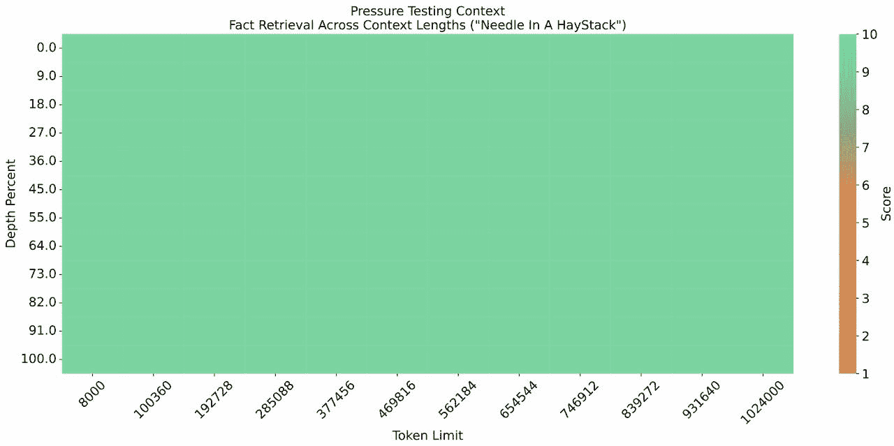
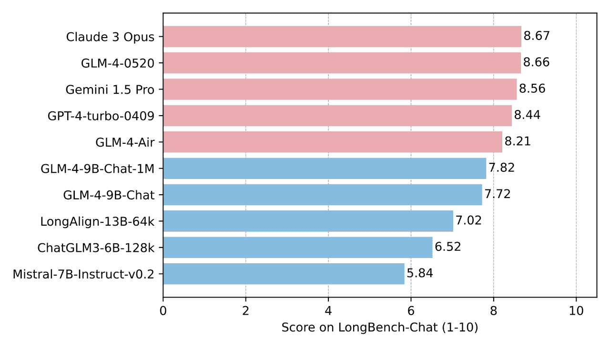

# 评测结果

> 来源：[https://v11enp9ok1h.feishu.cn/docx/ElSUdACLToqq1Sx9klXcBk8In2d](https://v11enp9ok1h.feishu.cn/docx/ElSUdACLToqq1Sx9klXcBk8In2d)

<https://v11enp9ok1h.feishu.cn/sync/VztedzIoUstVPDb6RNMctK8Unie>

本文档展现了 GLM-4-9B 开源模型系列的模型评测结果和论文。

### GLM-4-9B

基座模型，不支持对话，支持 8K上下文。

#### 典型任务

| Model | MMLU | C-Eval | GPQA | GSM8K | MATH | HumanEval |
| --- | --- | --- | --- | --- | --- | --- |
| Llama-3-8B | 66.6 | 51.2 | - | 45.8 | - | - |
| Llama-3-8B-Instruct | 68.4 | 51.3 | 34.2 | 79.6 | 30.0 | 62.2 |
| ChatGLM3-6B-Base | 61.4 | 69.0 | - | 72.3 | 25.7 | - |
| GLM-4-9B | **74.7** | **77.1** | **34.3** | **84.0** | **30.4** | **70.1** |

### GLM-4V-9B

#### 视觉典型任务

GLM-4V-9B 是一个多模态语言模型，具备视觉理解能力，其相关经典任务的评测结果如下：

|  | **MMBench-EN-Test** | **MMBench-CN-Test** | **SEEDBench_IMG** | **MMStar** | **MMMU** | **MME** | **HallusionBench** | **AI2D** | **OCRBench** |
| --- | --- | --- | --- | --- | --- | --- | --- | --- | --- |
|  | 英文综合 | 中文综合 | 综合能力 | 综合能力 | 学科综合 | 感知推理 | 幻觉性 | 图表理解 | 文字识别 |
| GPT-4o, 20240513 | 83.4 | 82.1 | 77.1 | 63.9 | 69.2 | 2310.3 | 55 | 84.6 | 736 |
| GPT-4v, 20240409 | 81 | 80.2 | 73 | 56 | 61.7 | 2070.2 | 43.9 | 78.6 | 656 |
| GPT-4v, 20231106 | 77 | 74.4 | 72.3 | 49.7 | 53.8 | 1771.5 | 46.5 | 75.9 | 516 |
| InternVL-Chat-V1.5 | 82.3 | 80.7 | 75.2 | 57.1 | 46.8 | 2189.6 | 47.4 | 80.6 | 720 |
| LlaVA-Next-Yi-34B | 81.1 | 79 | 75.7 | 51.6 | 48.8 | 2050.2 | 34.8 | 78.9 | 574 |
| **Step-1V** | 80.7 | 79.9 | 70.3 | 50 | 49.9 | 2206.4 | 48.4 | 79.2 | 625 |
| MiniCPM-Llama3-V2.5 | 77.6 | 73.8 | 72.3 | 51.8 | 45.8 | 2024.6 | 42.4 | 78.4 | 725 |
| **Qwen-VL-Max** | 77.6 | 75.7 | 72.7 | 49.5 | 52 | 2281.7 | 41.2 | 75.7 | 684 |
| **GeminiProVision** | 73.6 | 74.3 | 70.7 | 38.6 | 49 | 2148.9 | 45.7 | 72.9 | 680 |
| **Claude-3V Opus** | 63.3 | 59.2 | 64 | 45.7 | 54.9 | 1586.8 | 37.8 | 70.6 | 694 |
| **GLM-4v-9B** | 81.1 | 79.4 | 76.8 | 58.7 | 47.2 | 2163.8 | 46.6 | 81.1 | 786 |

### GLM-4-9B-Chat

该模型是开发者最常用的模型，具备128K上下文对话长度，具备 Function Call 能力。

#### 典型任务

典型对话任务评测结果：

| Model | AlignBench | MT-Bench | IFEval | MMLU | C-Eval | GSM8K | MATH | HumanEval | NaturalCodeBench |
| --- | --- | --- | --- | --- | --- | --- | --- | --- | --- |
| Llama-3-8B-Instruct | 6.40 | 8.00 | 68.6 | 68.4 | 51.3 | 79.6 | 30.0 | 62.2 | 24.7 |
| ChatGLM3-6B | 5.18 | 5.50 | 28.1 | 61.4 | 69.0 | 72.3 | 25.7 | 58.5 | 11.3 |
| GLM-4-9B-Chat | 7.01 | 8.35 | 69.0 | 72.4 | 75.6 | 79.6 | 50.6 | 71.8 | 32.2 |

#### 工具调用

[Berkeley Function](https://github.com/ShishirPatil/gorilla/tree/main/berkeley-function-call-leaderboard) Calling Leaderboard 测试结果：

| Model | Overall Acc. | AST Summary | Exec Summary | Relevance |
| --- | --- | --- | --- | --- |
| Llama-3-8B-Instruct | 58.88 | 59.25 | 70.01 | 45.83 |
| gpt-4-turbo-2024-04-09 | 81.24 | 82.14 | 78.61 | 88.75 |
| ChatGLM3-6B | 57.88 | 62.18 | 69.78 | 5.42 |
| GLM-4-9B-Chat | 81.00 | 80.26 | 84.40 | 87.92 |

#### 多语言

在六个多语言数据集上对 GLM-4-9B-Chat 和 Llama-3-8B-Instruct 进行了测试，测试结果及数据集对应选取语言如下表

| Dataset | Llama-3-8B-Instruct | GLM-4-9B-Chat | Languages |
| --- | --- | --- | --- |
| M-MMLU | 49.6 | 56.6 | all |
| FLORES | 25.0 | 28.8 | ru, es, de, fr, it, pt, pl, ja, nl, ar, tr, cs, vi, fa, hu, el, ro, sv, uk, fi, ko, da, bg, no |
| MGSM | 54.0 | 65.3 | zh, en, bn, de, es, fr, ja, ru, sw, te, th |
| XWinograd | 61.7 | 73.1 | zh, en, fr, jp, ru, pt |
| XStoryCloze | 84.7 | 90.7 | zh, en, ar, es, eu, hi, id, my, ru, sw, te |
| XCOPA | 73.3 | 80.1 | zh, et, ht, id, it, qu, sw, ta, th, tr, vi |

### GLM-4-9B-Chat-1M

#### 长文本

在 1M 的上下文长度下进行[大海捞针实验](https://github.com/LargeWorldModel/LWM/blob/main/scripts/eval_needle.py)，结果如下：

在 LongBench-Chat 上对长文本能力进行了进一步评测，结果如下:

#