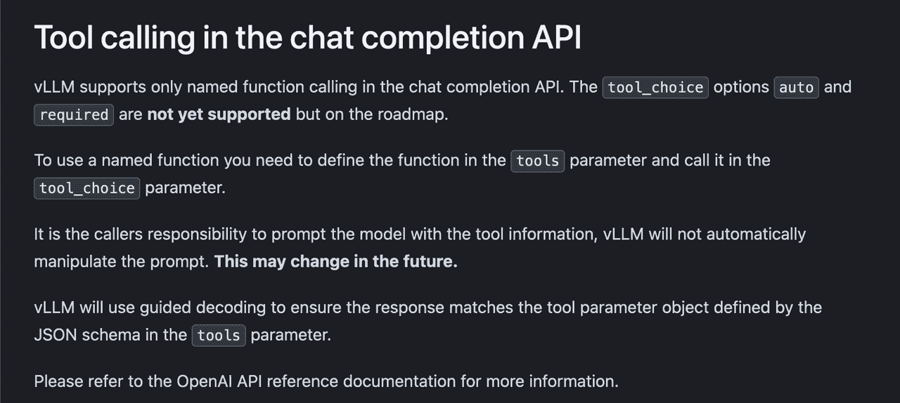

# OpenAI API Demo

> 来源：[https://v11enp9ok1h.feishu.cn/docx/TSivdFA8Rorv3Vx841acwTq3nbr](https://v11enp9ok1h.feishu.cn/docx/TSivdFA8Rorv3Vx841acwTq3nbr)

<https://v11enp9ok1h.feishu.cn/sync/VztedzIoUstVPDb6RNMctK8Unie>

### 为什么使用OpenAI API类

从 GLM-4-9B-Chat开源模型开始，我们不再接入 LangChain等开源框架，而是统一使用 OpenAI API的接口，在开源框架调用的同时，您仅需要更换 base_url 就可以切换到 GLM-4 模型，不需要进行更多的修改和适配。

请配合以下代码库，修改部分代码进行上手练习：

https://github.com/THUDM/GLM-4/blob/main/basic_demo/openai_api_request.py

https://github.com/THUDM/GLM-4/blob/main/basic_demo/openai_api_server.py

> 本 Demo 必须使用 Linux 操作系统。

为了提升模型的推理速度，在本代模型基座中，我们对 OpenAI API Demo 使用 vLLM底座替换了前代仓库的 transformers底座，两代代码不兼容。

### 使用vLLM进行调用

使用vLLM调用GLM-4系列模型，可以在命令行进行多轮对话，目前支持vLLM >= 0.6.3

+   使用vLLM调用文本模型glm-4-9b-chat，可选在代码中LORA_PATH[将Lora adapter载入vLLM](https://zhipu-ai.feishu.cn/wiki/UOmbw8PsJiJXrfksUmwcnHHBnQf)数中添加lora微调权重的路径(详见： )

```
python vllm_cli_demo.py
```

+   使用vLLM调用多模态模型glm-4v-9b

```
python vllm_cli_vision_demo.py
```

### OpenAI Demo （GLM-4 开源仓库版本）

基于vLLM底座，自行构建服务端，并使用 OpenAI API 的请求格式与 GLM-4-9B-Chat 模型进行对话。本 demo 支持 Function Call 和 All Tools功能。

目前支持 vLLM >= 0.6.3 和 transformers >= 4.46.1

```
python openai_api_server.py ## 服务端
python openai_api_request.py ## 请求端
```

我们已经对工具的输出进行了特殊的处理，使得接口能返回 Function Call 格式的返回，实现与 OpenAI 官方接口完全匹配的工作。

#### 指定模型

```
import os
import subprocess

# text-model THUDM/glm-4-9b-chat
MODEL_PATH = os.environ.get(&#x27;MODEL_PATH&#x27;, &#x27;THUDM/glm-4-9b-chat&#x27;)

# vision-model THUDM/glm-4v-9b
# MODEL_PATH = os.environ.get(&#x27;MODEL_PATH&#x27;, &#x27;THUDM/glm-4v-9b&#x27;)

if &#x27;4v&#x27; in MODEL_PATH.lower():
    subprocess.run([&quot;python&quot;, &quot;glm4v_server.py&quot;, MODEL_PATH])
else:
    subprocess.run([&quot;python&quot;, &quot;glm_server.py&quot;, MODEL_PATH])

```

本代码可以自由选择加载glm-4和glm-4v模型，启动为openai兼容的server

+   如果使用glm-4模型，请在第8行添加模型路径或者仓库id，并注释第4行，注意模型路径中不要带4v

+   如果使用glm-4v模型，请在第4行添加模型路径或者仓库id，并注释第8行，注意模型路径中要包含4v

#### 指定 glm-4 模型加载时的GPU数量 / 显存

您可以在 glm_server.py中找到以下代码：

```
engine_args = AsyncEngineArgs(
        model=MODEL_PATH,
        tokenizer=MODEL_PATH,
        # 如果你有多张显卡，可以在这里设置成你的显卡数量
        tensor_parallel_size=1,
        # dtype=&quot;bfloat16&quot;,
        dtype=&quot;half&quot;,
        trust_remote_code=True,
        # 占用显存的比例，请根据你的显卡显存大小设置合适的值，例如，如果你的显卡有80G，您只想使用24G，请按照24/80=0.3设置
        gpu_memory_utilization=0.9,
        enforce_eager=True,
        worker_use_ray=False,
        disable_log_requests=True,
        max_model_len=MAX_MODEL_LENGTH,
    )
```

其中：

+   tensor_parallel_size : 如果您有多张GPU，可以修改这个参数。

+   gpu_memory_utilization： 每张 GPU 显存占用的比例，vLLM会默认开启 这个比例的显存占用，例如，将该值设置为0.9, 您有80G显存，则即使模型载入仅需要18G显存，vLLM 仍然会申请 0.9 * 80G的空间，也就是72G的占用。

#### 载入微调的模型

目前仅支持glm-4v模型载入lora adapter

+   修改openai_api_server.py文件中第4行glm-4v的模型路径为lora adapter的路径，即可载入微调后的模型

如有需要，您可以根据 [vLLM官方文档](https://docs.vllm.ai/en/stable/models/lora.html) 自行配置微调模型。

#### 测试

测试openai server时，您可以配置openai_api_request.py中的主函数，自由选择测试方法，选择一种测试方法后，请注释其他的测试方法

```
simple_chat(use_stream=False) # 测试 glm-4 普通对话
function_chat(use_stream=False) # 测试 glm-4 工具调用
glm4v_simple_image_chat(use_stream=False, img_path=&quot;demo.jpg&quot;) # 测试 glm-4v 图像对话
```

### OpenAI Demo（VLLM官方版本）

如果您通过vLLM包自带的 OpenAI API方式启动，那么，您只需要一行代码：

```
python -m vllm.entrypoints.openai.api_server --model THUDM/GLM-4-9B-Chat（更换为你的绝对路径） --dtype bf16 --api-key glm-4
```

+   API-Key 被设置为  glm-4,您可以自行修改 key

+   不支持Function Call 功能，因为 vLLM 官方仓库统一没有支持该功能（无论何种模型）



+   更多信息，请查看 [vLLM官方文档](https://docs.vllm.ai/en/stable/serving/openai_compatible_server.html)