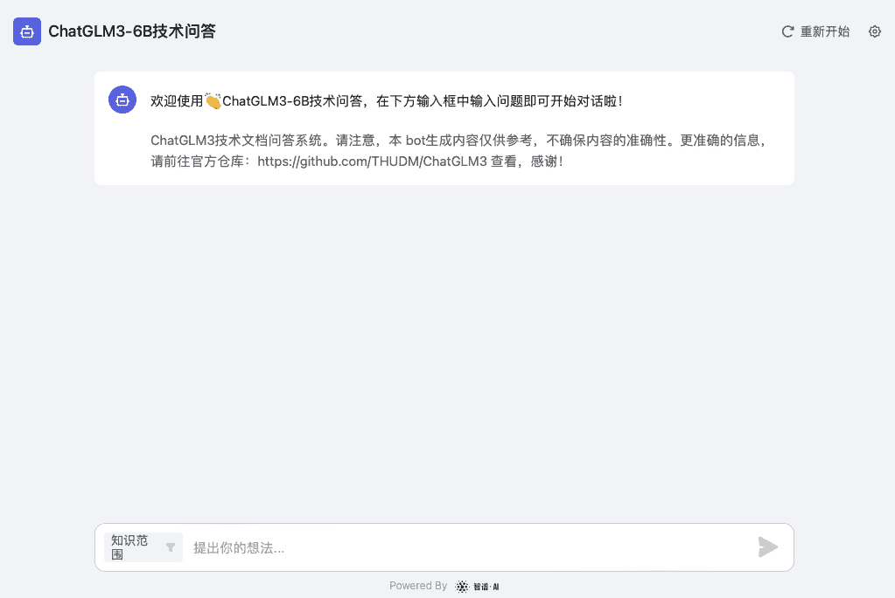

# ChatGLM-3-6B 技术文档

> 来源：[https://v11enp9ok1h.feishu.cn/docx/SMsPd52qOohTxUxNJHQcQYFonLd](https://v11enp9ok1h.feishu.cn/docx/SMsPd52qOohTxUxNJHQcQYFonLd)

<https://v11enp9ok1h.feishu.cn/sync/VztedzIoUstVPDb6RNMctK8Unie>

> G[GLM-4-9B 技术文档](https://v11enp9ok1h.feishu.cn/wiki/JR38woB74iZ5I2kIjLAcyaJ7ncd)M-4-9B 开源模型已经推出，欢迎使用我们最新的开源模型，在多个指标上均有较大的提升，GLM-4-9B开源模型技术文档详见

> ChatGLM3-6B 模型的维护频率可能稍有降低。如果您对 GLM-4-9B 模型有更多疑问，欢迎前往

> https://github.com/THUDM/GLM-4 查看。

+   作者：智谱团队

+   Github 官方仓库：https://github.com/THUDM/ChatGLM3

+   技术支持：请到 github issue 提问

### 简介

ChatGLM3 是智谱AI与清华大学KEG实验室联合发布的新一代对话预训练模型。在第二代ChatGLM 的基础之上，

1.  **更强大的基础模型：** C**hatGLM3-6B 的基础模型 C**hatGLM3-6B-Base 采用了更多样的训练数据、更充分的训练步数和更合理的训练策略。在语义、数学、推理、代码、知识等不同角度的数据集上测评显示，ChatGLM3-6B-Base 具有在 10B 以下的基础模型中最强的性能。

1.  **更完整的功能支持：**[ ChatGLM3](https://github.com/THUDM/ChatGLM3/blob/main/PROMPT.md)[-6B ](https://github.com/THUDM/ChatGLM3/blob/main/tool_using/README.md)采用了全新设计的 Prompt 格式，除正常的多轮对话外。同时原生支持工具调用（Function Call）、代码执行（Code Interpreter）和 Agent 任务等复杂场景。

1.  **更全面的开源序列：** 除了对话模型 [ChatGLM3-6B](https://huggingface.co/THUDM/chatglm3-6b) 外，还开源了基础模型 ChatGLM3-[6B-Base、长文本对话模型](https://huggingface.co/THUDM/chatglm3-6b-32k) ChatGLM3-6B**-32K**。以上所[有权](https://open.bigmodel.cn/mla/form)重对学术研**究完全开放，在填写**问卷进行登记后亦允许免费商业使用。

### 模型介绍

ChatGLM系列模型基于autoregressive blank infilling的通用语言模型（GLM）。为解决，在已有的自动编码模型（例如，BERT）、自回归模型（例如，GPT）和编码器-解码器模型（例如，T5）中，对不同的任务需要特殊的训练场景，预训练框架选型遇到的挑战。

### 技术报告和论文

> 论文地址：

> [GLM: General Language Model Pretrai](https://arxiv.org/abs/2103.10360)ning with Autoregressive Blank Infilling

> [ChatGLM: A Family of Large Language](https://arxiv.org/pdf/2406.12793) Models from GLM-130B to GLM-4 All Tools

```
@misc{glm2024chatglm,
      title={ChatGLM: A Family of Large Language Models from GLM-130B to GLM-4 All Tools},
      author={Team GLM and Aohan Zeng and Bin Xu and Bowen Wang and Chenhui Zhang and Da Yin and Diego Rojas and Guanyu Feng and Hanlin Zhao and Hanyu Lai and Hao Yu and Hongning Wang and Jiadai Sun and Jiajie Zhang and Jiale Cheng and Jiayi Gui and Jie Tang and Jing Zhang and Juanzi Li and Lei Zhao and Lindong Wu and Lucen Zhong and Mingdao Liu and Minlie Huang and Peng Zhang and Qinkai Zheng and Rui Lu and Shuaiqi Duan and Shudan Zhang and Shulin Cao and Shuxun Yang and Weng Lam Tam and Wenyi Zhao and Xiao Liu and Xiao Xia and Xiaohan Zhang and Xiaotao Gu and Xin Lv and Xinghan Liu and Xinyi Liu and Xinyue Yang and Xixuan Song and Xunkai Zhang and Yifan An and Yifan Xu and Yilin Niu and Yuantao Yang and Yueyan Li and Yushi Bai and Yuxiao Dong and Zehan Qi and Zhaoyu Wang and Zhen Yang and Zhengxiao Du and Zhenyu Hou and Zihan Wang},
      year={2024},
      eprint={2406.12793},
      archivePrefix={arXiv},
      primaryClass={id=&#x27;cs.CL&#x27; full_name=&#x27;Computation and Language&#x27; is_active=True alt_name=&#x27;cmp-lg&#x27; in_archive=&#x27;cs&#x27; is_general=False description=&#x27;Covers natural language processing. Roughly includes material in ACM Subject Class I.2.7. Note that work on artificial languages (programming languages, logics, formal systems) that does not explicitly address natural-language issues broadly construed (natural-language processing, computational linguistics, speech, text retrieval, etc.) is not appropriate for this area.&#x27;}
}
```

### 快速阅览

我们在文档不同的位置进行了详细的介绍，您可以点击进入并查看具体的技术文档。

###### [**快速使用**](https://zhipu-ai.feishu.cn/wiki/HIj5wVxGqiUg3rkbQ1OcVEe5n9g)

+   [GLM3环境问题指南](https://zhipu-ai.feishu.cn/wiki/OwCDwJkKbidEL8kpfhPcTGHcnVc)

+   [GLM3开源模型指令模板设计](https://zhipu-ai.feishu.cn/wiki/ATFHwOlYdiF2HBkxlQPc9o7wnif)

[**进阶之路**](https://zhipu-ai.feishu.cn/wiki/ErOgwVttSiSKuEkztFgcmYgMnCc)

+   [微调指南](https://zhipu-ai.feishu.cn/wiki/AqvXwAwf5ilHqmkdk56cQlX2niR)

+   [GLM3代码解析器工程设计](https://zhipu-ai.feishu.cn/wiki/VdYWwcZfmiNBnlkwYf1cqytcngf)

+   [工具插件集成](https://zhipu-ai.feishu.cn/wiki/RYsHwIp6siQ0lgkVX3scfybNnld)

+   [Langchain适配Demo](https://zhipu-ai.feishu.cn/wiki/X5shwBPOBiDWyNkwZ6xcd33lnRe)

+   [加速推理](https://zhipu-ai.feishu.cn/wiki/UdjjwCpHIiqZ16kr0yQcoAEvnmd)

[**社区适配**](https://zhipu-ai.feishu.cn/wiki/JrcVwqxWUiLrhPkBFpzcYLSTnDc)

+   业务框架BISHENG、langchain-chatchat

+   推理框架vLLM, FastChat, Xorbits Inference

[**相关资源**](https://zhipu-ai.feishu.cn/wiki/Ljvhw1cZJiW41dknjO8caSXinKf)

[**常见问题**](https://zhipu-ai.feishu.cn/wiki/QpqawLISmihwfBkXjQZcTS3qn9w)

### 场景

+   基于ChatGLM_turbo +知识库《ChatGLM3技术文档》构建的 QA 机器人（仅供便利，不确保内容完全准确）：https://open.bigmodel.cn/shareapp/v1/?share_code=0egooPndEt8OGj-39HjEl



---

# 📚 信息汇总

官方网站：https://www.zhipuai.cn/

智谱清言：https://chatglm.cn

API开放平台：https://bigmodel.cn/

Github仓库：https://github.com/THUDM/ChatGLM3

# 👋  价值观

+   让机器像人一样思考。

---

# 💡  Help

本 wiki 将尽可能完备地提供关于 ChatGLM3 相关问题的解决方案，但在这是一个不断完善的过程，必然会有许多错误或遗漏的地方，您在使用过程如有任何建议，欢迎随时联系我们。