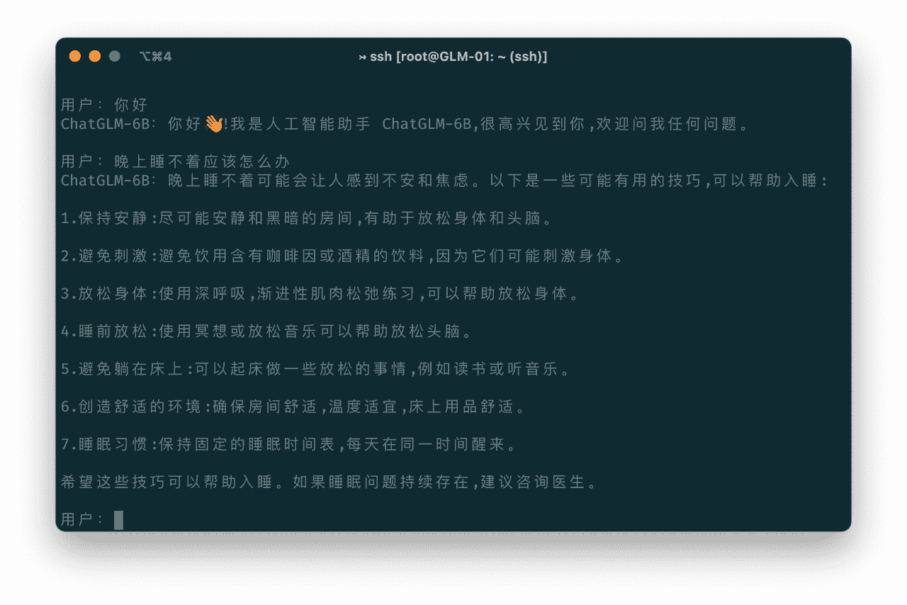
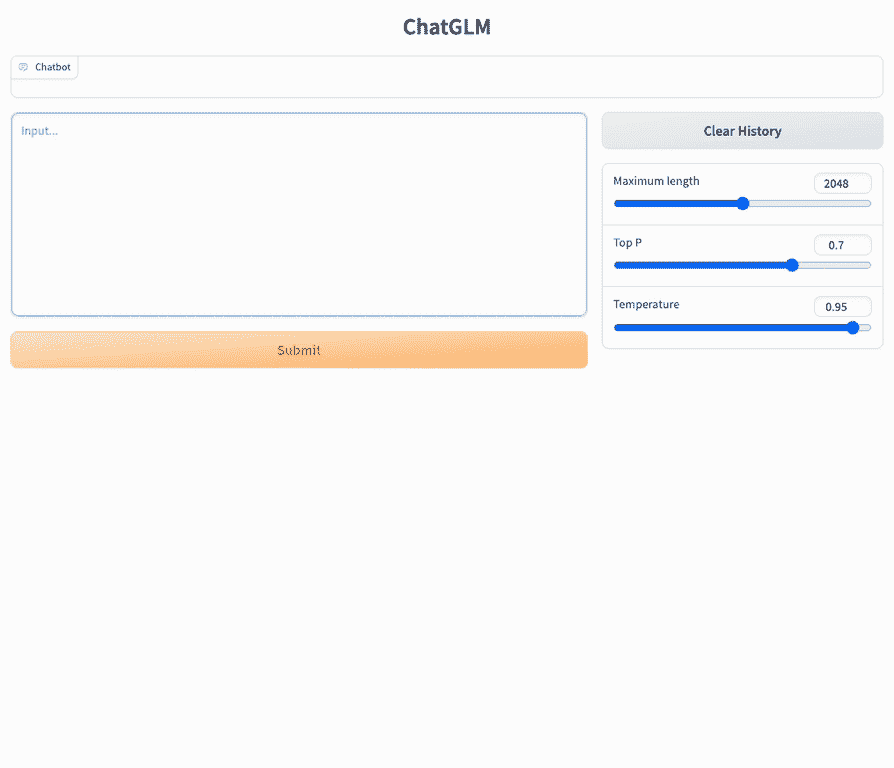
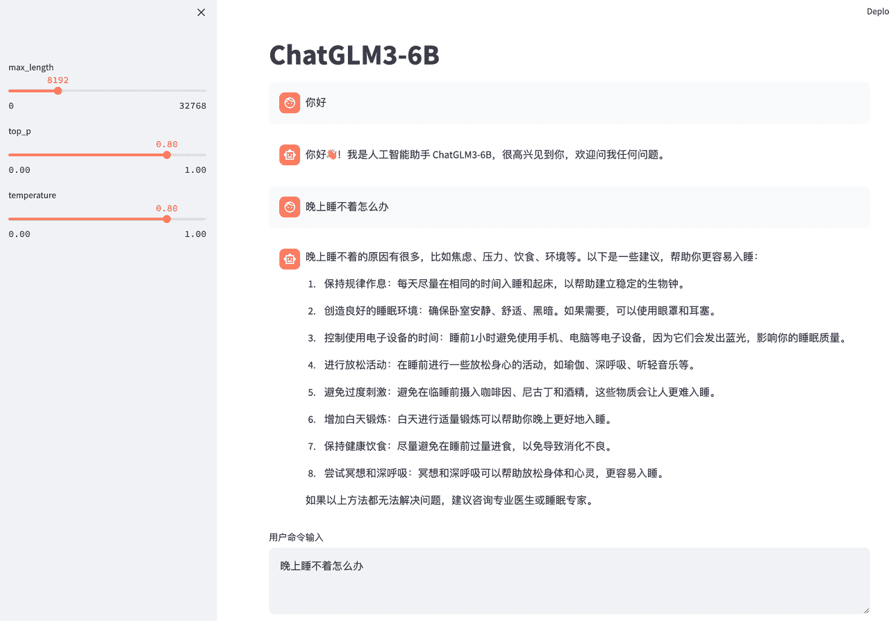

# 快速使用（推理部署）

> 来源：[https://v11enp9ok1h.feishu.cn/docx/LCk5dYlHQoEeAMxAFFAcSIcWnMs](https://v11enp9ok1h.feishu.cn/docx/LCk5dYlHQoEeAMxAFFAcSIcWnMs)

<https://v11enp9ok1h.feishu.cn/sync/VztedzIoUstVPDb6RNMctK8Unie>

## 子页面目录

这份文档旨在让开发者在五分之内体验上 ChatGLM3-6B 模型

## 免安装在线尝鲜

你将有三种办法免费，无需安装的尝鲜我们的模型，他们分别是：

+   [魔搭社区 · 创空间](https://modelscope.cn/studios/ZhipuAI/chatglm3-6b-demo/summary)（实现对话功能）

+   使用 SwanHub 提供的在线模型体验

+   使用Python 远程访问 Huggingface 体验，以下代码是一种最简单的执行方案，可以直接用来检验模型是否正常。该代码无需下载模型，使用的为Huggingface的联网模型。

```
&gt;&gt;&gt; from transformers import AutoTokenizer, AutoModel
&gt;&gt;&gt; tokenizer = AutoTokenizer.from_pretrained(&quot;THUDM/chatglm3-6b&quot;, trust_remote_code=True)
&gt;&gt;&gt; model = AutoModel.from_pretrained(&quot;THUDM/chatglm3-6b&quot;, trust_remote_code=True, device=&#x27;cuda&#x27;)
&gt;&gt;&gt; model = model.eval()
&gt;&gt;&gt; response, history = model.chat(tokenizer, &quot;你好&quot;, history=[])
&gt;&gt;&gt; print(response)
你好👋!我是人工智能助手 ChatGLM3-6B,很高兴见到你,欢迎问我任何问题。
&gt;&gt;&gt; response, history = model.chat(tokenizer, &quot;晚上睡不着应该怎么办&quot;, history=history)
&gt;&gt;&gt; print(response)
晚上睡不着可能会让你感到焦虑或不舒服,但以下是一些可以帮助你入睡的方法:

1. 制定规律的睡眠时间表:保持规律的睡眠时间表可以帮助你建立健康的睡眠习惯,使你更容易入睡。尽量在每天的相同时间上床,并在同一时间起床。
2. 创造一个舒适的睡眠环境:确保睡眠环境舒适,安静,黑暗且温度适宜。可以使用舒适的床上用品,并保持房间通风。
3. 放松身心:在睡前做些放松的活动,例如泡个热水澡,听些轻柔的音乐,阅读一些有趣的书籍等,有助于缓解紧张和焦虑,使你更容易入睡。
4. 避免饮用含有咖啡因的饮料:咖啡因是一种刺激性物质,会影响你的睡眠质量。尽量避免在睡前饮用含有咖啡因的饮料,例如咖啡,茶和可乐。
5. 避免在床上做与睡眠无关的事情:在床上做些与睡眠无关的事情,例如看电影,玩游戏或工作等,可能会干扰你的睡眠。
6. 尝试呼吸技巧:深呼吸是一种放松技巧,可以帮助你缓解紧张和焦虑,使你更容易入睡。试着慢慢吸气,保持几秒钟,然后缓慢呼气。

如果这些方法无法帮助你入睡,你可以考虑咨询医生或睡眠专家,寻求进一步的建议。
```

如果你已经下载了模型，以上方案也可以使用本地模型加载，我们强烈建议在使用本地模型加载的时候使用绝对路径，以防止系统寻找huggingface缓存。

例如，如果你的模型位于/home/ubuntu/chatglm3-6b中，则我们建议这么书写：

```
&gt;&gt;&gt; tokenizer = AutoTokenizer.from_pretrained(&quot;/home/ubuntu/chatglm3-6b&quot;, trust_remote_code=True)
&gt;&gt;&gt; model = AutoModel.from_pretrained(&quot;/home/ubuntu/chatglm3-6b&quot;, trust_remote_code=True, device=&#x27;cuda&#x27;)
```

## 懒人包安装

如果你使用的操作系统为 [Windo](https://www.bilibili.com/video/BV1c34y1w75K/?vd_source=c083324a69ff411499cf1b5f539eaac7)ws10 / Windows11 你可以在以下链接直接下载一键安装包和观看手把手教程。

```
&quot;&quot;&quot;
以下懒人包和教程由 非官方开发者 十字鱼 友情提供
&quot;&quot;&quot;
百度网盘链接：https://pan.baidu.com/s/1fHElFanrdK9Y-pTpeY_azg
提取码：glut
```

## 源码安装

上述两种方案的目的是让更多的用户能够体验到我们的模型，但无法进行二次开发，如果您准备深度使用我们的模型，我们建议按照以下方式安装。

### 克隆代码和模型

模型基础运行代码已经上传到 github 和 SwanHub 两个平台，两个平台的信息同步。开发者通过以下方式下载模型代码。

+   从 github 下载源码

```
git clone https://github.com/THUDM/ChatGLM3.git
```

+   从 SwanHub 下载源码

```
git clone https://swanhub.co/ZhipuAI/ChatGLM3.git
```

开发者可以通过以下方式下载模型文件

+   [下载](https://github.com/git-lfs/git-lfs?utm_source=gitlfs_site&utm_medium=installation_link&utm_campaign=gitlfs#installing)模型文件前请先确保`git lfs`命令已安装，安装教程请参考这里。

+   模型文件已上传至 Huggingface, Modelsope ,  SwanHub  三个平台，用户可以快速安装模型。

+   若使用 Huggingface 下载模型

```
git lfs install
git clone https://huggingface.co/THUDM/chatglm3-6b.git
```

+   若使用 Modelscope 下载模型

```
git lfs install
git clone https://www.modelscope.cn/ZhipuAI/chatglm3-6b.git
```

+   若使用 SwanHub 下载模型

```
git lfs install
git clone https://swanhub.co/ZhipuAI/chatglm3-6b.git
```

### 检查文件的完整性

+   用户在下载完模型后请检查每个文件的完整性，以下是模型文件的sha256校验码。

```
# sha256 checksums for chatglm3-6b
4d5567466e89625dbd10e51c69a02982f233a10108cf232a379defdbb065ae0b  pytorch_model-00001-of-00007.bin
4ad41534016ac4a2431fa2d4b08efbe28f963744135ec52b2ea13cc86730fa2a  pytorch_model-00002-of-00007.bin
a2be9b17c332a8345e787953d4879caee4747ad4b263f013aa3c4654c94c3d24  pytorch_model-00003-of-00007.bin
b5526891e1b4c8edd2e3688df5156aa107e2140fe7e3f9d0d54f9cbe3b6ee3b5  pytorch_model-00004-of-00007.bin
84bb18a476f74beaf4d941733bd1c475791eba799b228f78d0165de989cb7a40  pytorch_model-00005-of-00007.bin
1181875a2dc30fba968d72d0fc4628b9a60d3866bf680eb14b9822b5b504830f  pytorch_model-00006-of-00007.bin
1271b638dc0a88206d1c7a51bcaa862410eb56f3e59fd0068a96e96cb5e3f4f0  pytorch_model-00007-of-00007.bin
e7dc4c393423b76e4373e5157ddc34803a0189ba96b21ddbb40269d31468a6f2  tokenizer.model

# sha256 checksums for chatglm3-6b-32k
39aeddd81596b2d66d657687a7328ebc7f8850e8ea83fa74080da59f7d2f7afc  pytorch_model-00001-of-00007.bin
2525475ea2d483ecc15a15ad4e016ee0155e628ac66f15cd54daa6c811193e92  pytorch_model-00002-of-00007.bin
faa1d884168a125af5105c4ee4c59fdac79f847b35a7389e0122a562995d34db  pytorch_model-00003-of-00007.bin
66492c02ed13189202c7e46a121e308cf0ebbcf8141ecf3d551141aecfac7120  pytorch_model-00004-of-00007.bin
870bb2bb4a289b8ab37cce88f56e93381ff428063b3d0065994a3dd2e830cb32  pytorch_model-00005-of-00007.bin
a5f39ca17ba89e47e484d3b20d4ff78f4fb9b1b24bd3dfb314eff91ff6e37230  pytorch_model-00006-of-00007.bin
7c8a8f3e881202ac3a9ab2638ce30147f67d4bd799624c24af66406a6ba22db2  pytorch_model-00007-of-00007.bin
e7dc4c393423b76e4373e5157ddc34803a0189ba96b21ddbb40269d31468a6f2  tokenizer.model

# sha256 checksums for chatglm3-6b-base
b6a6388dae55b598efe76c704e7f017bd84e6f6213466b7686a8f8326f78ab05  pytorch_model-00001-of-00007.bin
2f96bef324acb5c3fe06b7a80f84272fe064d0327cbf14eddfae7af0d665a6ac  pytorch_model-00002-of-00007.bin
2400101255213250d9df716f778b7d2325f2fa4a8acaedee788338fceee5b27e  pytorch_model-00003-of-00007.bin
472567c1b0e448a19171fbb5b3dab5670426d0a5dfdfd2c3a87a60bb1f96037d  pytorch_model-00004-of-00007.bin
ef2aea78fa386168958e5ba42ecf09cbb567ed3e77ce2be990d556b84081e2b9  pytorch_model-00005-of-00007.bin
35191adf21a1ab632c2b175fcbb6c27601150026cb1ed5d602938d825954526f  pytorch_model-00006-of-00007.bin
b7cdaa9b8ed183284905c49d19bf42360037fdf2f95acb3093039d3c3a459261  pytorch_model-00007-of-00007.bin
e7dc4c393423b76e4373e5157ddc34803a0189ba96b21ddbb40269d31468a6f2  tokenizer.model
```

### 安装依赖

使用 pip 安装依赖：

```
cd ChatGLM3 
pip install -r requirements.txt
```

[环境配置和检查](https://lslfd0slxc.feishu.cn/wiki/OwCDwJkKbidEL8kpfhPcTGHcnVc)果你担心你的配置不满足最低配置，你可以访问 获取更多信息。

的

### 运行demo

使用本地模型加载并使用命令行来问答

```
python basic_demo/cli_demo.py
```

你将会在类似如下的命令行中进行交互。



使用本地模型加载并使用web_demo来问答

```
python basic_demo/web_demo_gradio.py
```

你将会得到如下的网页。



通过以下命令启动基于 Gradio 的网页版 demo

```
python basic_demo/web_demo_streamlit.py
```



通过以下命令启动基于 Streamlit 的网页版 demo：

```
streamlit run basic_demo/web_demo_streamlit.py
```

其效果与Gradio相同，但是更加流畅。