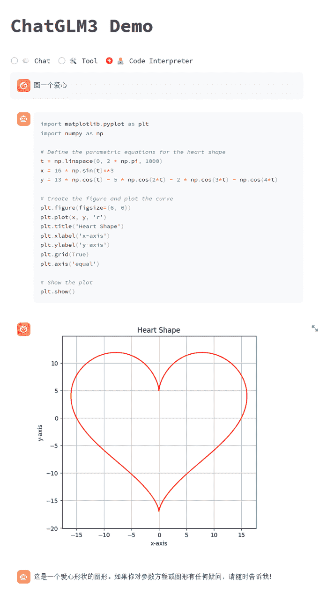

# 代码解释器

> 来源：[https://v11enp9ok1h.feishu.cn/docx/OajgdYR6qogBfOx579bcYEwRnXd](https://v11enp9ok1h.feishu.cn/docx/OajgdYR6qogBfOx579bcYEwRnXd)

<https://v11enp9ok1h.feishu.cn/sync/VztedzIoUstVPDb6RNMctK8Unie>

本章节将带领开发者学习如何使用ChatGLM3-6B来实现代码解释器的功能

请配合以下代码库中微调部分代码进行上手练习

https://github.com/THUDM/ChatGLM3/tree/main/composite_demo/demo_cli.py

## 什么是代码解释器

Code Interpreter最早出现于ChatGPT的插件中，用于数据分析，图像转换，编辑代码等。可以让普通用户（非程序员）用自然语言完成以前需要写代码来完成的复杂工作。

现在，ChatGLM3-6B已经支持了代码解释器的功能。这将大大降低用户使用代码解释器的使用成本。

由于拥有代码执行环境，ChatGLM3模型能够执行更为复杂的任务，例如绘制图表、执行符号运算等等。模型会根据对任务完成情况的理解自动地连续执行多个代码块，直到任务完成。因此，在这一模式下，你只需要指明希望模型执行的任务即可。

## 学习如何使用代码解释器

### 构造代码执行内核

在ChatGLM3-6B中，为了更好的激发大模型书写代码的能力，我们使用以下提示词来激发他的代码能力

```
SYSTEM_PROMPT = '你是一位智能AI助手，你叫ChatGLM，你连接着一台电脑，但请注意不能联网。在使用Python解决任务时，你可以运行代码并得到结果，如果运行结果有错误，你需要尽可能对代码进行改进。你可以处理用户上传到电脑上的文件，文件默认存储路径是/mnt/data/。'
```

为了实现代码运行，中断等功能，我们在`demo_cli.py`中完成了对应的基础功能

首先，我们实现了`CodeKernel`

这是一个用于管理和与Jupyter内核进行交互的工具。Jupyter内核是一种允许你执行代码的计算引擎。这个类定义了如何启动、管理和与这个内核进行交互。

以下是该类每个方法的作用：

+   `__init__(self, ...)`: 这是类的构造器方法，当你创建一个新的 `CodeKernel` 对象时，这个方法会被调用。它初始化内核管理器和客户端，并设置环境变量，如果提供了 `python_path` 或 `ipython_path`。

```
def __init__(self,
             kernel_name='kernel',
             kernel_id=None,
             kernel_config_path="",
             python_path=None,
             ipython_path=None,
             init_file_path="./startup.py",
             verbose=1):

    self.kernel_name = kernel_name
    self.kernel_id = kernel_id
    self.kernel_config_path = kernel_config_path
    self.python_path = python_path
    self.ipython_path = ipython_path
    self.init_file_path = init_file_path
    self.verbose = verbose
    
    if python_path is None and ipython_path is None:
        env = None
    else:
        env = {"PATH": self.python_path + ":$PATH", "PYTHONPATH": self.python_path}

    # Initialize the backend kernel
    self.kernel_manager = jupyter_client.KernelManager(kernel_name=IPYKERNEL, 
                                                       connection_file=self.kernel_config_path,
                                                       exec_files=[self.init_file_path],
                                                       env=env)
    if self.kernel_config_path:
        self.kernel_manager.load_connection_file()
        self.kernel_manager.start_kernel(stdout=PIPE, stderr=PIPE)
        print("Backend kernel started with the configuration: {}".format(
            self.kernel_config_path))
    else:
        self.kernel_manager.start_kernel(stdout=PIPE, stderr=PIPE)
        print("Backend kernel started with the configuration: {}".format(
            self.kernel_manager.connection_file))

    if verbose:
        pprint(self.kernel_manager.get_connection_info())

    # Initialize the code kernel
    self.kernel = self.kernel_manager.blocking_client()
    # self.kernel.load_connection_file()
    self.kernel.start_channels()
    print("Code kernel started.")
```

+   `execute(self, code)`: 这个方法执行传递给它的代码，并处理来自内核的响应。它会等待执行结果，并捕获任何输出或错误信息。

```
def execute(self, code):
    self.kernel.execute(code)
    try:
        shell_msg = self.kernel.get_shell_msg(timeout=30)
        io_msg_content = self.kernel.get_iopub_msg(timeout=30)['content']
        while True:
            msg_out = io_msg_content
            ### Poll the message
            try:
                io_msg_content = self.kernel.get_iopub_msg(timeout=30)['content']
                if 'execution_state' in io_msg_content and io_msg_content['execution_state'] == 'idle':
                    break
            except queue.Empty:
                break
        
        return shell_msg, msg_out
    except Exception as e:
        print(e)
        return None
```

+   `execute_interactive(self, code, verbose=False)`: 这个方法以交互模式执行代码。如果设置了 `verbose`，它还会打印额外的信息。

```
def execute_interactive(self, code, verbose=False):
    shell_msg = self.kernel.execute_interactive(code)
    if shell_msg is queue.Empty:
        if verbose:
            print("Timeout waiting for shell message.")
    self.check_msg(shell_msg, verbose=verbose)
    return shell_msg
```

+   `inspect(self, code, verbose=False)`: 这个方法请求内核提供关于代码片段的信息。这可以用于获取变量的文档或类型信息等。

```
def inspect(self, code, verbose=False):
    msg_id = self.kernel.inspect(code)
    shell_msg = self.kernel.get_shell_msg(timeout=30)
    if shell_msg is queue.Empty:
        if verbose:
            print("Timeout waiting for shell message.")
    self.check_msg(shell_msg, verbose=verbose)

    return shell_msg
```

+   `get_error_msg(self, msg, verbose=False)`: 这个方法尝试从内核的消息中提取错误信息。

```
def get_error_msg(self, msg, verbose=False) -> str | None:
    if msg['content']['status'] == 'error':
        try:
            error_msg = msg['content']['traceback']
        except:
            try:
                error_msg = msg['content']['traceback'][-1].strip()
            except:
                error_msg = "Traceback Error"
        if verbose:
            print("Error: ", error_msg)
        return error_msg
    return None
```

+   `check_msg(self, msg, verbose=False)`: 这个方法检查内核的响应消息的状态，并可能打印出错的详细轨迹。

```
def check_msg(self, msg, verbose=False):
    status = msg['content']['status']
    if status == 'ok':
        if verbose:
            print("Execution succeeded.")
    elif status == 'error':
        for line in msg['content']['traceback']:
            if verbose:
                print(line)
```

+   `shutdown(self)`: 这个方法关闭内核。

+   `restart(self)`: 这个方法重启内核。

+   `interrupt(self)`: 这个方法中断内核。

+   `is_alive(self)`: 这个方法检查内核是否仍在运行。

```
def shutdown(self):
    # Shutdown the backend kernel
    self.kernel_manager.shutdown_kernel()
    print("Backend kernel shutdown.")
    # Shutdown the code kernel
    self.kernel.shutdown()
    print("Code kernel shutdown.")
    
def restart(self):
    # Restart the backend kernel
    self.kernel_manager.restart_kernel()
    # print("Backend kernel restarted.")

def interrupt(self):
    # Interrupt the backend kernel
    self.kernel_manager.interrupt_kernel()
    # print("Backend kernel interrupted.")

def is_alive(self):
    return self.kernel.is_alive()
```

完成这些工作之后，我们要调用`CodeKernel`来完成代码的交互和实现,在demo代码中，UI界面会吊起这个内核。

```
@st.cache_resource
def get_kernel():
    kernel = CodeKernel()
    return kernel
```

整个类的目的是为了与Jupyter内核进行交互，用来执行代码片段，收集执行结果，处理错误，以及管理内核的生命周期。这在开发交互式计算环境或远程执行代码时非常有用，比如在一个网络服务中。

### 执行代码解释器

为了执行上述的代码，我们需要写一段程序，来配合ChatGLM3-6B的提示和角色模板。在这里，我们为开发者提供了一个简单示例:

这段Python代码定义了一个名为 `execute` 的函数，它接收一段代码和一个 `CodeKernel` 对象作为输入，执行该代码，并返回执行结果。这里的 `CodeKernel` 是指在上一个问题中描述的类，负责与Jupyter内核通信。

以下是 `execute` 函数的主要逻辑和步骤：

1.  函数定义了两个变量 `res` 和 `res_type` 用于存储执行结果和结果类型。

1.  函数接收代码字符串，并且尝试将一些字符串替换为空字符串，但由于替换的字符串是空的，这段替换逻辑实际上没有做任何改变。

1.  通过 `kernel.execute(code)` 方法执行传入的代码，并获取执行消息 `msg` 和输出 `output`。

1.  接下来，函数检查消息的状态：

+   如果状态是 `"timeout"`，则函数返回 `"timeout"` 消息。

+   如果状态是 `"error"`，则函数调用 `kernel.get_error_msg(msg, verbose=True)` 方法来获取错误信息，并返回这个错误信息。

1.  函数检查 `output` 字典，根据输出的类型（文本或图片），设置 `res_type` 和 `res` 的值。

+   如果输出包含文本（`'text'` 键），则将结果类型设置为 `"text"`，并将结果设置为相应的文本。

+   如果输出包含数据（`'data'` 键），则遍历数据键：

+   如果找到 `'text/plain'` 键，则将结果类型设置为 `"text"`，并将结果设置为对应的值。

+   如果找到 `'image/png'` 键，则将结果类型设置为 `"image"`，并将结果设置为对应的图片数据，然后中断循环。

1.  如果结果类型是 `"image"`，则调用 `b64_2_img(res)` 函数将 base64 编码的图片数据转换为一个 `Image` 对象，并返回。

1.  如果结果类型是 `"text"` 或 `"traceback"`，则直接返回文本结果。

这个函数的主要作用是执行代码并处理不同类型的输出，能够处理文本和图像数据，这使得它可以在Jupyter笔记本或类似的交互式编程环境中使用。函数返回一个元组，包含结果类型和结果本身，其中图片数据被转换为 `Image` 对象，文本则保持不变。


```python
def execute(code, kernel: CodeKernel) -> tuple[str, str | Image.Image]:
    res = ""
    res_type = None
    code = code.replace("<|observation|>", "")
    code = code.replace("<|assistant|>interpreter", "")
    code = code.replace("<|assistant|>", "")
    code = code.replace("<|user|>", "")
    code = code.replace("<|system|>", "")
    msg, output = kernel.execute(code)
    
    if msg['metadata']['status'] == "timeout":
        return res_type, 'Timed out'
    elif msg['metadata']['status'] == 'error':
        return res_type, clean_ansi_codes('\n'.join(kernel.get_error_msg(msg, verbose=True)))
    
    if 'text' in output:
        res_type = "text"
        res = output['text']
    elif 'data' in output:
        for key in output['data']:
            if 'text/plain' in key:
                res_type = "text"
                res = output['data'][key]
            elif 'image/png' in key:
                res_type = "image"
                res = output['data'][key]
                break

    if res_type == "image":
        return res_type, b64_2_img(res)
    elif res_type == "text" or res_type == "traceback":
        res = res
    
    return res_type, res
```

其中遇到的两个子函数 `b64_2_img` 和 `clean_ansi_codes` 实现如下：

```python
def b64_2_img(data):
    buff = BytesIO(base64.b64decode(data))
    return Image.open(buff)

def clean_ansi_codes(input_string):
    ansi_escape = re.compile(r'(\x9B|\x1B\[|\u001b\[)[0-?]*[ -/]*[@-~]')
    return ansi_escape.sub('', input_string)
```

## 总流程

现在，我们将这个流程进行拼接，完成带有UI界面的流畅代码解释实现。我们为开发者们提供了简单的函数来实现完整的代码解释功能。

我们使用 Streamlit 创建的用户界面的核心部分，它用于处理与用户的对话，并使用一个内部的会话状态（`st.session_state`）来保存对话历史。这个函数可能是一个用于构建交互式聊天界面的一部分，其中可以包括一个聊天机器人、代码解释器和代码执行器。让我们逐步理解这个函数：

1. 首先检查 `st.session_state` 是否已经包含 `ci_history`（会话历史），如果没有，则初始化为空列表。
2. 获取这个会话历史并显示之前的对话。
3. 如果用户输入了提示文本（`prompt_text`），这个文本将被清理（`.strip()` 删除头尾空白字符）并作为用户角色的新对话添加到历史记录中。
4. `preprocess_text` 函数被用来准备输入到聊天机器人的文本，可能是基于用户的最新输入和之前的对话历史。
5. 创建一个 Streamlit 容器，用来显示机器人的回答。
6. 然后，函数进入一个循环，最多执行5次。在循环内部：
    - 调用 `client.generate_stream` 方法来连续生成响应文本，参数包括会话历史、温度（`temperature`）、采样参数（`top_p`）等，用来控制生成文本的随机性和创造性。
    - 遍历生成的响应流，并处理特殊的响应令牌（可能是由聊天机器人定义的控制代码执行的特殊指令）。
    - 根据特殊令牌的不同，执行不同的动作，比如运行代码或者显示代码执行结果。
    - 如果输出结果太长，将其截断。
7. 使用 `append_conversation` 函数来更新会话历史并在 Streamlit 容器中显示。
8. 在执行代码时，会使用 `execute` 函数（在之前的消息中描述的那个函数）来运行代码，并处理文本或图像输出。
9. 根据执行结果更新对话，并在用户界面中相应地显示文本或图片。
10. 如果在生成响应时遇到任何未预期的特殊令牌，将显示错误消息。

总体来说，这个 `main` 函数创建了一个与用户进行交互的环境，允许用户输入文本，聊天机器人生成响应，并且可以执行代码片段并显示结果。它特别适用于需要交互式编程和即时反馈的场景，例如在线编程教学或代码测试平台。

代码如下：


```python
def main(top_p: float, temperature: float, prompt_text: str):
    if 'ci_history' not in st.session_state:
        st.session_state.ci_history = []

    history: list[Conversation] = st.session_state.ci_history

    for conversation in history:
        conversation.show()

    if prompt_text:
        prompt_text = prompt_text.strip()
        role = Role.USER
        append_conversation(Conversation(role, prompt_text), history)

        input_text = preprocess_text(
            SYSTEM_PROMPT,
            None,
            history,
        )
        print("=== Input:")
        print(input_text)
        print("=== History:")
        print(history)

        placeholder = st.container()
        message_placeholder = placeholder.chat_message(name="assistant", avatar="assistant")
        markdown_placeholder = message_placeholder.empty()

        for _ in range(5):
            output_text = ''
            for response in client.generate_stream(
                system=SYSTEM_PROMPT,
                tools=None,
                history=history,
                do_sample=True,
                max_length=MAX_LENGTH,
                temperature=temperature,
                top_p=top_p,
                stop_sequences=[str(r) for r in (Role.USER, Role.OBSERVATION)],
            ):
                token = response.token
                if response.token.special:
                    print("=== Output:")
                    print(output_text)

                    match token.text.strip():
                        case '<|user|>':
                            append_conversation(Conversation(
                                Role.ASSISTANT,
                                postprocess_text(output_text),
                            ), history, markdown_placeholder)
                            return
                        # Initiate tool call
                        case '<|assistant|>':
                            append_conversation(Conversation(
                                Role.ASSISTANT,
                                postprocess_text(output_text),
                            ), history, markdown_placeholder)
                            message_placeholder = placeholder.chat_message(name="interpreter", avatar="assistant")
                            markdown_placeholder = message_placeholder.empty()
                            output_text = ''
                            continue
                        case '<|observation|>':
                            code = extract_code(output_text)
                            print("Code:", code)

                            display_text = output_text.split('interpreter')[-1].strip()
                            append_conversation(Conversation(
                                Role.INTERPRETER,
                                postprocess_text(display_text),
                            ), history, markdown_placeholder)
                            message_placeholder = placeholder.chat_message(name="observation", avatar="user")
                            markdown_placeholder = message_placeholder.empty()
                            output_text = ''
                            
                            with markdown_placeholder:
                                with st.spinner('Executing code...'):
                                    try:
                                        res_type, res = execute(code, get_kernel())
                                    except Exception as e:
                                        st.error(f'Error when executing code: {e}')
                                        return
                            print("Received:", res_type, res)

                            if res_type == 'text' and len(res) > TRUNCATE_LENGTH:
                                res = res[:TRUNCATE_LENGTH] + ' [TRUNCATED]'

                            append_conversation(Conversation(
                                Role.OBSERVATION,
                                '[Image]' if res_type == 'image' else postprocess_text(res),
                                tool=None,
                                image=res if res_type == 'image' else None,
                            ), history, markdown_placeholder)
                            message_placeholder = placeholder.chat_message(name="assistant", avatar="assistant")
                            markdown_placeholder = message_placeholder.empty()
                            output_text = ''
                            break
                        case _:
                            st.error(f'Unexpected special token: {token.text.strip()}')
                            break
                output_text += response.token.text
                display_text = output_text.split('interpreter')[-1].strip()
                markdown_placeholder.markdown(postprocess_text(display_text + '▌'))
            else:
                append_conversation(Conversation(
                    Role.ASSISTANT,
                    postprocess_text(output_text),
                ), history, markdown_placeholder)
                return
```

# 体验代码解释器

如果想直接体验代码解释器，可以前往综合demo直接体验。

使用代码解释器状态并在demo中输入：

```
画一个爱心
```

你将会看到命令行中出现以下日志：

```
=== History:
[Conversation(role=<Role.USER: 2>, content='画一个爱心', tool=None, image=None), Conversation(role=<Role.ASSISTANT: 3>, content='很抱歉，我无法直接个简单的ASCII艺术爱心或提供一个小程序来绘制爱心形状。您希望选择哪种方式？', tool=None, image=None), Conversation(role=<Role.USER: 2>, content='用pyersation(role=<Role.ASSISTANT: 3>, content="好的，我将为您提供一个简单的Python代码来绘制一个爱心形状。\n\n```python\nimport math\n\ndef print_heart:\n        line = ''\n        for x in range(7):\n            if (x == 2 or x == 6 or y == 2 or y == 6):\n                line += '*'\n            else:\n                line += ' '\n        print(line)\n\nprint_heart()\n```\n\n这段代码将使用Python的`print`函数来打印一个简单的爱心形状。您希望我e=None), Conversation(role=<Role.USER: 2>, content='执行', tool=None, image=None)]

=== Output:

interpreter
```

```python
def print_heart():
    for y in range(6):
        line = ''
        for x in range(7):
            if (x == 2 or x == 6 or y == 2 or y == 6):
                line += '*'
            else:
                line += ' '
        print(line)

print_heart()
```

```
Code: def print_heart():

    for y in range(6):

        line = ''

        for x in range(7):

            if (x == 2 or x == 6 or y == 2 or y == 6):

                line += '*'

            else:

                line += ' '

        print(line)

print_heart()

Backend kernel started with the configuration: /tmp/tmprie8vhq_.json

{'control_port': 37755,

 'hb_port': 58129,

 'iopub_port': 51739,

 'ip': '127.0.0.1',

 'key': b'df3d3860-c68ef973ec4c58c5b561bcbd',

 'shell_port': 44607,

 'signature_scheme': 'hmac-sha256',

 'stdin_port': 49903,

 'transport': 'tcp'}

Code kernel started.

Received: text   *   *

  *   *

*******

  *   *

  *   *

  *   *

<|user|> 画一个爱心 None

=== Input:

<|system|>

你是一位智能AI助手，你叫ChatGLM，你连接着一台电脑，但请注意不能联网。在使用Python解决任务时，你可以运行代码并得到结果，如果运行结果有错误，你需要尽可能对代码进行改进。你可以处理用户上传到电脑上的文件，文件默认存储路径是/mnt/data/。<|user|>

画一个爱心<|assistant|>

=== History:

[Conversation(role=<Role.USER: 2>, content='画一个爱心', tool=None, image=None)]

=== Output:

interpreter
```


# Python 心形曲线绘制示例

## 代码实现

```python
import matplotlib.pyplot as plt
import numpy as np

# Define the parametric equations for the heart shape
t = np.linspace(0, 2 * np.pi, 1000)
x = 16 * np.sin(t)**3
y = 13 * np.cos(t) - 5 * np.cos(2*t) - 2 * np.cos(3*t) - np.cos(4*t)

# Create the figure and plot the curve
plt.figure(figsize=(6, 6))
plt.plot(x, y, 'r')
plt.title('Heart Shape')
plt.xlabel('x-axis')
plt.ylabel('y-axis')
plt.grid(True)
plt.axis('equal')

# Show the plot
plt.show()
```

## 完整代码

```python
import matplotlib.pyplot as plt
import numpy as np

# Define the parametric equations for the heart shape
t = np.linspace(0, 2 * np.pi, 1000)
x = 16 * np.sin(t)**3
y = 13 * np.cos(t) - 5 * np.cos(2*t) - 2 * np.cos(3*t) - np.cos(4*t)

# Create the figure and plot the curve
plt.figure(figsize=(6, 6))
plt.plot(x, y, 'r')
plt.title('Heart Shape')
plt.xlabel('x-axis')
plt.ylabel('y-axis')
plt.grid(True)
plt.axis('equal')

# Show the plot
plt.show()
```

## 运行输出

Received: image `<PIL.PngImagePlugin.PngImageFile image mode=RGBA size=543x547 at 0x7F3ED1BDA260>`

## 可视化效果

可视化效果如下：


