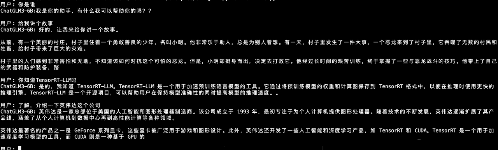

# NVIDIA TensorRT 推理加速

> 来源：[https://v11enp9ok1h.feishu.cn/docx/Yo5NdlcKeoa80nxiH2Hc9zGgnwe](https://v11enp9ok1h.feishu.cn/docx/Yo5NdlcKeoa80nxiH2Hc9zGgnwe)

`https://v11enp9ok1h.feishu.cn/sync/VztedzIoUstVPDb6RNMctK8Unie`

本章节将带领开发者使用 [TensorRT-LLM](https://github.com/NVIDIA/TensorRT-LLM) 加速推理ChatGLM3-6B模型

> 本章节具有一定的技术门槛，请保持耐心，备份数据。

> chatglm 官方团队同学完成本章节内容的平均时间超过12小时。

## 什么是 TensorRT-LLM

TensorRT-LLM为用户提供了一个易于使用的Python API，用于定义大型语言模型（LLMs）并构建包含最新优化的TensorRT引擎，以便在NVIDIA GPU上高效地执行推理。TensorRT-LLM还包含创建执行这些TensorRT引擎的Python和C++运行时的组件。它还包括一个用于与NVIDIA Triton推理服务器集成的后端；一个用于服务LLMs的生产质量系统。使用TensorRT-LLM构建的模型可以在从单个GPU到多个节点的多个GPU的各种配置上执行。

请配合以下代码库中微调部分代码进行上手练习

`https://github.com/THUDM/ChatGLM3/tree/main/speed_up_demo`

## 配置 TensorRT-LLM

首先，获取 TensorRT-LLM 代码

```
# TensorRT-LLM 代码需要使用 git-lfs 拉取
apt-get update && apt-get -y install git git-lfs

git clone https://github.com/NVIDIA/TensorRT-LLM.git
cd TensorRT-LLM

# 本流程将使用 v0.7.0 Release 版本
git checkout tags/v0.7.0 -b release/0.7.0
git submodule update --init --recursive
git lfs install
git lfs pull
```

### 构建docker镜像并安装TensorRT-LLM

```
make -C docker release_build
```

### 运行docker镜像

```
make -C docker release_run
```

> 该部分内容会涉及
>
> +   访问境外源(Ubuntu 官方源）
> +   访问 github

> 请注意，如果你处于无法访问到这些内容的地区，你可能需要修改英伟达官方的`dockerfile`。

## 构建引擎

接着，将 `chatglm3-6b` 模型 构建为 TensorRT-LLM 的推理引擎

### 代码参数解释

+   `model_dir`: 模型的Huggingface地址 / TensorRT 地址。
+   `output_dir`: 转换后模型引擎的地址。
+   `max_output_len`: 支持的最大输出长度
+   `max_input_len`: 支持的最大长度输出。
+   `remove_input_padding`: 移除输入的padding功能，`fp16`不要使用。

> 注意：
>
> 1.  `max_output_len`和`max_input_len`的长度相加总和需要低于8192。
> 2.  由于引擎为静态构造，这部分的内容是固定的，如果你需要改变任何一个设置，你需要重构引擎。

> 请注意不要将这两个参数调整太大，由于转换的时候会使用 `FP32` 的格式，因此，如果你的显卡显存不足，会出现这个错误。

```
Internal Error (Internal error: plugin node PLUGIN_V2_GPTAttention_1 requires 25422738560 bytes of scratch space, but only 25393692672 is available. Try increasing the workspace size with IBuilderConfig::setMemoryPoolLimit().
```

> 经过测试，一张 24GB 的显存的显卡在执行这个操作的时候，最多只能承受

`max_output_len + max_input_len <= 4096`

> 如果超过这个值，将会出现这种错误

```
[12/24/2023-21:50:43] [TRT] [W] UNSUPPORTED_STATESkipping tactic 3 due to insufficient memory on requested size of 24105713664 detected for tactic 0x000000000000001b.
[12/24/2023-21:50:43] [TRT] [E] 2: [virtualMemoryBuffer.cpp::resizePhysical::140] Error Code 2: OutOfMemory (no further information)
[12/24/2023-21:50:43] [TRT] [E] 2: [virtualMemoryBuffer.cpp::resizePhysical::140] Error Code 2: OutOfMemory (no further information)
[12/24/2023-21:50:43] [TRT] [W] Requested amount of GPU memory (24105713664 bytes) could not be allocated. There may not be enough free memory for allocation to succeed.
```

> 此类错误虽然不影响程序执行，但是执行结束之后，无法正常调用引擎，导致无法对话，引擎报废。

+   `visualize`: 可视化解析过程。
+   `max_batch_size`: 模型支持的最大批处理数
+   `use_xx_plugin`: 通常为是否使用英伟达算子插件，填写的为精度，例如`int8`, `float32`等。
+   `gpus_per_node`: 每个节点有几个GPU。
+   `log_level`: 日志级别，通常没

### 可配置的 plugin 参数

+   使用 `--use_gpt_attention_plugin <DataType>` 来配置 GPT Attention plugin (默认使用`float16`)。
+   使用 `--use_gemm_plugin <DataType>` 来配置 GEMM plugin (默认使用`float16`)。
+   使用 `--use_rmsnorm_plugin <DataType>` 来配置 RMS normolization plugin (默认使用`float16`)。

### Fused Multi-Head Attention (FMHA)

+   使用 `--enable_context_fmha` 或 `--enable_context_fmha_fp32_acc` 参数来开启FMHA kernels, 可以获得更好的性能的同时降低显存开销。
+   `--use_gpt_attention_plugin` 如果被设置为关闭的话将无法使用FMHA功能。
+   `--enable_context_fmha` 将会使用`FP16` accumulator, 可能会略微降低精度. 您也可以选择使用 `--enable_context_fmha_fp32_acc` 来保护精度，但这会略微降低FMHA的性能提升。

### Weight-Only 量化

+   使用 `--use_weight_only` 来开启 Weight-Only 量化, 这样可以加速推理并减少显存开销。
+   你还可以通过切换 `--weight_only_precision int8` 或者 `--weight_only_precision int4` 来选择具体是使用`int8`还是`int4`量化，默认为`Int8`。

### In-flight Batching（须使用NVIDIA Triton进行推理）

+   使用 `--use_inflight_batching` 来开启 In-flight Batching，启用后，Paged KV Cache也会自动启用。
+   Paged KV cache中block的数量可以用`--tokens_per_block` 来配置。

## 使用TensorRT-LLM Python Runtime进行推理

执行代码

```
python3 build.py --model_name chatglm3_6b \   
                 --model_dir {your_huggingface_chatglm3-6b_dir} \ 
                 --output_dir {your_trt_chatglm3-6b_dir} \
                 --max_output_len 2048 \
                 --max_input_len 2048 \
                 --visualize
```

代码执行效果


## TRT-LLM 模型构建日志

```
python3 build.py --model_name chatglm3_6b --model_dir /root/autodl-tmp/chatglm3-6b/ --output_dir /root/autodl-tmp/trt_engines/chatglm3-6b-trt --max_output_len 2048 --max_input_len 2048
[12/24/2023-21:54:42] [TRT-LLM] [I] ========================================= Build Arguments ==========================================
[12/24/2023-21:54:42] [TRT-LLM] [I]  - model_name....................: chatglm3_6b
[12/24/2023-21:54:42] [TRT-LLM] [I]  - world_size....................: 1
[12/24/2023-21:54:42] [TRT-LLM] [I]  - tp_size.......................: 1
[12/24/2023-21:54:42] [TRT-LLM] [I]  - pp_size.......................: 1
[12/24/2023-21:54:42] [TRT-LLM] [I]  - model_dir.....................: /root/autodl-tmp/chatglm3-6b
[12/24/2023-21:54:42] [TRT-LLM] [I]  - quant_ckpt_path...............: awq/
[12/24/2023-21:54:42] [TRT-LLM] [I]  - dtype.........................: float16
[12/24/2023-21:54:42] [TRT-LLM] [I]  - logits_dtype..................: float32
[12/24/2023-21:54:42] [TRT-LLM] [I]  - timing_cache..................: model.cache
[12/24/2023-21:54:42] [TRT-LLM] [I]  - log_level.....................: info
[12/24/2023-21:54:42] [TRT-LLM] [I]  - max_batch_size................: 8
[12/24/2023-21:54:42] [TRT-LLM] [I]  - max_input_len.................: 2048
[12/24/2023-21:54:42] [TRT-LLM] [I]  - max_output_len................: 2048
[12/24/2023-21:54:42] [TRT-LLM] [I]  - max_beam_width................: 1
[12/24/2023-21:54:42] [TRT-LLM] [I]  - use_gpt_attention_plugin......: float16
[12/24/2023-21:54:42] [TRT-LLM] [I]  - use_gemm_plugin...............: float16
[12/24/2023-21:54:42] [TRT-LLM] [I]  - use_layernorm_plugin..........: float16
[12/24/2023-21:54:42] [TRT-LLM] [I]  - use_rmsnorm_plugin............: float16
[12/24/2023-21:54:42] [TRT-LLM] [I]  - gather_all_token_logits.......: False
[12/24/2023-21:54:42] [TRT-LLM] [I]  - parallel_build................: False
[12/24/2023-21:54:42] [TRT-LLM] [I]  - enable_context_fmha...........: False
[12/24/2023-21:54:42] [TRT-LLM] [I]  - enable_context_fmha_fp32_acc..: False
[12/24/2023-21:54:42] [TRT-LLM] [I]  - multi_block_mode..............: False
[12/24/2023-21:54:42] [TRT-LLM] [I]  - visualize.....................: False
[12/24/2023-21:54:42] [TRT-LLM] [I]  - enable_debug_output...........: False
[12/24/2023-21:54:42] [TRT-LLM] [I]  - gpus_per_node.................: 8
[12/24/2023-21:54:42] [TRT-LLM] [I]  - builder_opt...................: None
[12/24/2023-21:54:42] [TRT-LLM] [I]  - output_dir....................: /root/autodl-tmp/trt_engines/chatglm3-6b-trt
[12/24/2023-21:54:42] [TRT-LLM] [I]  - strongly_typed................: False
[12/24/2023-21:54:42] [TRT-LLM] [I]  - remove_input_padding..........: False
[12/24/2023-21:54:42] [TRT-LLM] [I]  - paged_kv_cache................: False
[12/24/2023-21:54:42] [TRT-LLM] [I]  - use_inflight_batching.........: False
[12/24/2023-21:54:42] [TRT-LLM] [I]  - use_smooth_quant..............: False
[12/24/2023-21:54:42] [TRT-LLM] [I]  - use_weight_only...............: False
[12/24/2023-21:54:42] [TRT-LLM] [I]  - weight_only_precision.........: int8
[12/24/2023-21:54:42] [TRT-LLM] [I]  - per_channel...................: False
[12/24/2023-21:54:42] [TRT-LLM] [I]  - per_token.....................: False
[12/24/2023-21:54:42] [TRT-LLM] [I]  - per_group.....................: False
[12/24/2023-21:54:42] [TRT-LLM] [I]  - group_size....................: 128
[12/24/2023-21:54:42] [TRT-LLM] [I]  - int8_kv_cache.................: False
[12/24/2023-21:54:42] [TRT-LLM] [I]  - random_seed...................: None
[12/24/2023-21:54:42] [TRT-LLM] [I]  - tokens_per_block..............: 64
[12/24/2023-21:54:42] [TRT-LLM] [I]  - enable_fp8....................: False
[12/24/2023-21:54:42] [TRT-LLM] [I]  - fp8_kv_cache..................: False
[12/24/2023-21:54:42] [TRT-LLM] [I]  - max_num_tokens................: None
[12/24/2023-21:54:42] [TRT-LLM] [I]  - use_custom_all_reduce.........: False
[12/24/2023-21:54:42] [TRT-LLM] [I]  - apply_query_key_layer_scaling.: False
[12/24/2023-21:54:42] [TRT-LLM] [I]  - apply_residual_connection_post_layernorm: False
[12/24/2023-21:54:42] [TRT-LLM] [I]  - ffn_hidden_size...............: 13696
[12/24/2023-21:54:42] [TRT-LLM] [I]  - hidden_act....................: swiglu
[12/24/2023-21:54:42] [TRT-LLM] [I]  - hidden_size...................: 4096
[12/24/2023-21:54:42] [TRT-LLM] [I]  - linear_bias...................: False
[12/24/2023-21:54:42] [TRT-LLM] [I]  - max_seq_length................: 4096
[12/24/2023-21:54:42] [TRT-LLM] [I]  - multi_query_mode..............: True
[12/24/2023-21:54:42] [TRT-LLM] [I]  - norm_epsilon..................: 1e-05
[12/24/2023-21:54:42] [TRT-LLM] [I]  - num_heads.....................: 32
[12/24/2023-21:54:42] [TRT-LLM] [I]  - num_kv_heads..................: 2
[12/24/2023-21:54:42] [TRT-LLM] [I]  - num_layers....................: 28
[12/24/2023-21:54:42] [TRT-LLM] [I]  - qkv_bias......................: True
[12/24/2023-21:54:42] [TRT-LLM] [I]  - rmsnorm.......................: True
[12/24/2023-21:54:42] [TRT-LLM] [I]  - rotary_embedding_scaling......: 1.0
[12/24/2023-21:54:42] [TRT-LLM] [I]  - use_cache.....................: True
[12/24/2023-21:54:42] [TRT-LLM] [I]  - vocab_size....................: 65024
[12/24/2023-21:54:42] [TRT-LLM] [I]  - quant_mode....................: 0
[12/24/2023-21:54:42] [TRT-LLM] [I] ====================================================================================================
[12/24/2023-21:54:42] [TRT-LLM] [I] Serially build TensorRT engines.
[12/24/2023-21:54:42] [TRT] [I] [MemUsageChange] Init CUDA: CPU +13, GPU +0, now: CPU 113, GPU 393 (MiB)
[12/24/2023-21:54:44] [TRT] [I] [MemUsageChange] Init builder kernel library: CPU +1809, GPU +316, now: CPU 2058, GPU 709 (MiB)
[12/24/2023-21:54:44] [TRT-LLM] [W] Invalid timing cache, using freshly created one
[12/24/2023-21:54:49] [TRT-LLM] [I] Loading weights from HF
Loading checkpoint shards: 100%|██████████████████████████████████████████████████████████████████████████████████████████████████████████████████████████████████████████████████████████████████████| 7/7 [00:06<00:00,  1.03it/s]
[12/24/2023-21:54:58] [TRT-LLM] [I] Loading weights finish in 8.89s
[12/24/2023-21:55:00] [TRT] [W] ITensor::setType(Half) was called on non I/O tensor: PLUGIN_V2_GPTAttention_1_output_0. This will have no effect unless this tensor is marked as an output.
[12/24/2023-21:55:00] [TRT] [W] ITensor::setType(Half) was called on non I/O tensor: PLUGIN_V2_GPTAttention_1_output_1. This will have no effect unless this tensor is marked as an output.
[12/24/2023-21:55:01] [TRT] [W] ITensor::setType(Half) was called on non I/O tensor: PLUGIN_V2_GPTAttention_3_output_0. This will have no effect unless this tensor is marked as an output.
[12/24/2023-21:55:01] [TRT] [W] ITensor::setType(Half) was called on non I/O tensor: PLUGIN_V2_GPTAttention_3_output_1. This will have no effect unless this tensor is marked as an output.
[12/24/2023-21:55:02] [TRT] [W] ITensor::setType(Half) was called on non I/O tensor: PLUGIN_V2_GPTAttention_5_output_0. This will have no effect unless this tensor is marked as an output.
[12/24/2023-21:55:02] [TRT] [W] ITensor::setType(Half) was called on non I/O tensor: PLUGIN_V2_GPTAttention_5_output_1. This will have no effect unless this tensor is marked as an output.
[12/24/2023-21:55:03] [TRT] [W] ITensor::setType(Half) was called on non I/O tensor: PLUGIN_V2_GPTAttention_7_output_0. This will have no effect unless this tensor is marked as an output.
[12/24/2023-21:55:03] [TRT] [W] ITensor::setType(Half) was called on non I/O tensor: PLUGIN_V2_GPTAttention_7_output_1. This will have no effect unless this tensor is marked as an output.
[12/24/2023-21:55:05] [TRT] [W] ITensor::setType(Half) was called on non I/O tensor: PLUGIN_V2_GPTAttention_9_output_0. This will have no effect unless this tensor is marked as an output.
[12/24/2023-21:55:05] [TRT] [W] ITensor::setType(Half) was called on non I/O tensor: PLUGIN_V2_GPTAttention_9_output_1. This will have no effect unless this tensor is marked as an output.
[12/24/2023-21:55:06] [TRT] [W] ITensor::setType(Half) was called on non I/O tensor: PLUGIN_V2_GPTAttention_11_output_0. This will have no effect unless this tensor is marked as an output.
[12/24/2023-21:55:06] [TRT] [W] ITensor::setType(Half) was called on non I/O tensor: PLUGIN_V2_GPTAttention_11_output_1. This will have no effect unless this tensor is marked as an output.
[12/24/2023-21:55:07] [TRT] [W] ITensor::setType(Half) was called on non I/O tensor: PLUGIN_V2_GPTAttention_13_output_0. This will have no effect unless this tensor is marked as an output.
[12/24/2023-21:55:07] [TRT] [W] ITensor::setType(Half) was called on non I/O tensor: PLUGIN_V2_GPTAttention_13_output_1. This will have no effect unless this tensor is marked as an output.
[12/24/2023-21:55:09] [TRT] [W] ITensor::setType(Half) was called on non I/O tensor: PLUGIN_V2_GPTAttention_15_output_0. This will have no effect unless this tensor is marked as an output.
[12/24/2023-21:55:09] [TRT] [W] ITensor::setType(Half) was called on non I/O tensor: PLUGIN_V2_GPTAttention_15_output_1. This will have no effect unless this tensor is marked as an output.
[12/24/2023-21:55:10] [TRT] [W] ITensor::setType(Half) was called on non I/O tensor: PLUGIN_V2_GPTAttention_17_output_0. This will have no effect unless this tensor is marked as an output.
[12/24/2023-21:55:10] [TRT] [W] ITensor::setType(Half) was called on non I/O tensor: PLUGIN_V2_GPTAttention_17_output_1. This will have no effect unless this tensor is marked as an output.
[12/24/2023-21:55:11] [TRT] [W] ITensor::setType(Half) was called on non I/O tensor: PLUGIN_V2_GPTAttention_19_output_0. This will have no effect unless this tensor is marked as an output.
[12/24/2023-21:55:11] [TRT] [W] ITensor::setType(Half) was called on non I/O tensor: PLUGIN_V2_GPTAttention_19_output_1. This will have no effect unless this tensor is marked as an output.
[12/24/2023-21:55:13] [TRT] [W] ITensor::setType(Half) was called on non I/O tensor: PLUGIN_V2_GPTAttention_21_output_0. This will have no effect unless this tensor is marked as an output.
[12/24/2023-21:55:13] [TRT] [W] ITensor::setType(Half) was called on non I/O tensor: PLUGIN_V2_GPTAttention_21_output_1. This will have no effect unless this tensor is marked as an output.
[12/24/2023-21:55:14] [TRT] [W] ITensor::setType(Half) was called on non I/O tensor: PLUGIN_V2_GPTAttention_23_output_0. This will have no effect unless this tensor is marked as an output.
[12/24/2023-21:55:14] [TRT] [W] ITensor::setType(Half) was called on non I/O tensor: PLUGIN_V2_GPTAttention_23_output_1. This will have no effect unless this tensor is marked as an output.
[12/24/2023-21:55:15] [TRT] [W] ITensor::setType(Half) was called on non I/O tensor: PLUGIN_V2_GPTAttention_25_output_0. This will have no effect unless this tensor is marked as an output.
[12/24/2023-21:55:16] [TRT] [W] ITensor::setType(Half) was called on non I/O tensor: PLUGIN_V2_GPTAttention_25_output_1. This will have no effect unless this tensor is marked as an output.
[12/24/2023-21:55:17] [TRT] [W] ITensor::setType(Half) was called on non I/O tensor: PLUGIN_V2_GPTAttention_27_output_0. This will have no effect unless this tensor is marked as an output.
[12/24/2023-21:55:17] [TRT] [W] ITensor::setType(Half) was called on non I/O tensor: PLUGIN_V2_GPTAttention_27_output_1. This will have no effect unless this tensor is marked as an output.
[12/24/2023-21:55:18] [TRT] [W] ITensor::setType(Half) was called on non I/O tensor: PLUGIN_V2_GPTAttention_29_output_0. This will have no effect unless this tensor is marked as an output.
[12/24/2023-21:55:18] [TRT] [W] ITensor::setType(Half) was called on non I/O tensor: PLUGIN_V2_GPTAttention_29_output_1. This will have no effect unless this tensor is marked as an output.
[12/24/2023-21:55:20] [TRT] [W] ITensor::setType(Half) was called on non I/O tensor: PLUGIN_V2_GPTAttention_31_output_0. This will have no effect unless this tensor is marked as an output.
[12/24/2023-21:55:20] [TRT] [W] ITensor::setType(Half) was called on non I/O tensor: PLUGIN_V2_GPTAttention_31_output_1. This will have no effect unless this tensor is marked as an output.
[12/24/2023-21:55:21] [TRT] [W] ITensor::setType(Half) was called on non I/O tensor: PLUGIN_V2_GPTAttention_33_output_0. This will have no effect unless this tensor is marked as an output.
[12/24/2023-21:55:21] [TRT] [W] ITensor::setType(Half) was called on non I/O tensor: PLUGIN_V2_GPTAttention_33_output_1. This will have no effect unless this tensor is marked as an output.
[12/24/2023-21:55:22] [TRT] [W] ITensor::setType(Half) was called on non I/O tensor: PLUGIN_V2_GPTAttention_35_output_0. This will have no effect unless this tensor is marked as an output.
[12/24/2023-21:55:22] [TRT] [W] ITensor::setType(Half) was called on non I/O tensor: PLUGIN_V2_GPTAttention_35_output_1. This will have no effect unless this tensor is marked as an output.
[12/24/2023-21:55:24] [TRT] [W] ITensor::setType(Half) was called on non I/O tensor: PLUGIN_V2_GPTAttention_37_output_0. This will have no effect unless this tensor is marked as an output.
[12/24/2023-21:55:24] [TRT] [W] ITensor::setType(Half) was called on non I/O tensor: PLUGIN_V2_GPTAttention_37_output_1. This will have no effect unless this tensor is marked as an output.
[12/24/2023-21:55:25] [TRT] [W] ITensor::setType(Half) was called on non I/O tensor: PLUGIN_V2_GPTAttention_39_output_0. This will have no effect unless this tensor is marked as an output.
[12/24/2023-21:55:25] [TRT] [W] ITensor::setType(Half) was called on non I/O tensor: PLUGIN_V2_GPTAttention_39_output_1. This will have no effect unless this tensor is marked as an output.
[12/24/2023-21:55:27] [TRT] [W] ITensor::setType(Half) was called on non I/O tensor: PLUGIN_V2_GPTAttention_41_output_0. This will have no effect unless this tensor is marked as an output.
[12/24/2023-21:55:27] [TRT] [W] ITensor::setType(Half) was called on non I/O tensor: PLUGIN_V2_GPTAttention_41_output_1. This will have no effect unless this tensor is marked as an output.
[12/24/2023-21:55:28] [TRT] [W] ITensor::setType(Half) was called on non I/O tensor: PLUGIN_V2_GPTAttention_43_output_0. This will have no effect unless this tensor is marked as an output.
[12/24/2023-21:55:28] [TRT] [W] ITensor::setType(Half) was called on non I/O tensor: PLUGIN_V2_GPTAttention_43_output_1. This will have no effect unless this tensor is marked as an output.
[12/24/2023-21:55:29] [TRT] [W] ITensor::setType(Half) was called on non I/O tensor: PLUGIN_V2_GPTAttention_45_output_0. This will have no effect unless this tensor is marked as an output.
[12/24/2023-21:55:29] [TRT] [W] ITensor::setType(Half) was called on non I/O tensor: PLUGIN_V2_GPTAttention_45_output_1. This will have no effect unless this tensor is marked as an output.
[12/24/2023-21:55:31] [TRT] [W] ITensor::setType(Half) was called on non I/O tensor: PLUGIN_V2_GPTAttention_47_output_0. This will have no effect unless this tensor is marked as an output.
[12/24/2023-21:55:31] [TRT] [W] ITensor::setType(Half) was called on non I/O tensor: PLUGIN_V2_GPTAttention_47_output_1. This will have no effect unless this tensor is marked as an output.
[12/24/2023-21:55:32] [TRT] [W] ITensor::setType(Half) was called on non I/O tensor: PLUGIN_V2_GPTAttention_49_output_0. This will have no effect unless this tensor is marked as an output.
[12/24/2023-21:55:32] [TRT] [W] ITensor::setType(Half) was called on non I/O tensor: PLUGIN_V2_GPTAttention_49_output_1. This will have no effect unless this tensor is marked as an output.
[12/24/2023-21:55:34] [TRT] [W] ITensor::setType(Half) was called on non I/O tensor: PLUGIN_V2_GPTAttention_51_output_0. This will have no effect unless this tensor is marked as an output.
[12/24/2023-21:55:34] [TRT] [W] ITensor::setType(Half) was called on non I/O tensor: PLUGIN_V2_GPTAttention_51_output_1. This will have no effect unless this tensor is marked as an output.
[12/24/2023-21:55:35] [TRT] [W] ITensor::setType(Half) was called on non I/O tensor: PLUGIN_V2_GPTAttention_53_output_0. This will have no effect unless this tensor is marked as an output.
[12/24/2023-21:55:35] [TRT] [W] ITensor::setType(Half) was called on non I/O tensor: PLUGIN_V2_GPTAttention_53_output_1. This will have no effect unless this tensor is marked as an output.
[12/24/2023-21:55:36] [TRT] [W] ITensor::setType(Half) was called on non I/O tensor: PLUGIN_V2_GPTAttention_55_output_0. This will have no effect unless this tensor is marked as an output.
[12/24/2023-21:55:36] [TRT] [W] ITensor::setType(Half) was called on non I/O tensor: PLUGIN_V2_GPTAttention_55_output_1. This will have no effect unless this tensor is marked as an output.
[12/24/2023-21:55:39] [TRT-LLM] [I] Build TensorRT engine chatglm3_6b_float16_tp1_rank0.engine
[12/24/2023-21:55:39] [TRT] [W] Unused Input: position_ids
[12/24/2023-21:55:39] [TRT] [W] [RemoveDeadLayers] Input Tensor position_ids is unused or used only at compile-time, but is not being removed.
[12/24/2023-21:55:39] [TRT] [I] [MemUsageChange] Init cuBLAS/cuBLASLt: CPU +0, GPU +8, now: CPU 14055, GPU 1805 (MiB)
[12/24/2023-21:55:39] [TRT] [I] [MemUsageChange] Init cuDNN: CPU +2, GPU +10, now: CPU 14057, GPU 1815 (MiB)
[12/24/2023-21:55:39] [TRT] [W] TensorRT was linked against cuDNN 8.9.6 but loaded cuDNN 8.9.2
[12/24/2023-21:55:39] [TRT] [I] Global timing cache in use. Profiling results in this builder pass will be stored.
[12/24/2023-21:57:17] [TRT] [I] [GraphReduction] The approximate region cut reduction algorithm is called.
[12/24/2023-21:57:17] [TRT] [I] Detected 64 inputs and 29 output network tensors.
[12/24/2023-21:57:22] [TRT] [I] Total Host Persistent Memory: 77024
[12/24/2023-21:57:22] [TRT] [I] Total Device Persistent Memory: 0
[12/24/2023-21:57:22] [TRT] [I] Total Scratch Memory: 6828392576
[12/24/2023-21:57:22] [TRT] [I] [BlockAssignment] Started assigning block shifts. This will take 430 steps to complete.
[12/24/2023-21:57:22] [TRT] [I] [BlockAssignment] Algorithm ShiftNTopDown took 17.0406ms to assign 9 blocks to 430 nodes requiring 7545621504 bytes.
[12/24/2023-21:57:22] [TRT] [I] Total Activation Memory: 7545621504
[12/24/2023-21:57:22] [TRT] [I] Total Weights Memory: 12487168000
[12/24/2023-21:57:22] [TRT] [I] [MemUsageChange] Init cuBLAS/cuBLASLt: CPU +1, GPU +8, now: CPU 14118, GPU 13741 (MiB)
[12/24/2023-21:57:22] [TRT] [I] [MemUsageChange] Init cuDNN: CPU +0, GPU +10, now: CPU 14118, GPU 13751 (MiB)
[12/24/2023-21:57:22] [TRT] [W] TensorRT was linked against cuDNN 8.9.6 but loaded cuDNN 8.9.2
[12/24/2023-21:57:22] [TRT] [I] Engine generation completed in 102.506 seconds.
[12/24/2023-21:57:22] [TRT] [I] [MemUsageStats] Peak memory usage of TRT CPU/GPU memory allocators: CPU 1016 MiB, GPU 17120 MiB
[12/24/2023-21:57:22] [TRT] [I] [MemUsageChange] TensorRT-managed allocation in building engine: CPU +0, GPU +11909, now: CPU 0, GPU 11909 (MiB)
[12/24/2023-21:57:27] [TRT] [I] [MemUsageStats] Peak memory usage during Engine building and serialization: CPU: 27468 MiB
[12/24/2023-21:57:27] [TRT-LLM] [I] Total time of building chatglm3_6b_float16_tp1_rank0.engine: 00:01:47
[12/24/2023-21:57:27] [TRT-LLM] [I] Config saved to /root/autodl-tmp/trt_engines/chatglm3-6b-trt/config.json.
[12/24/2023-21:57:28] [TRT] [I] Loaded engine size: 11909 MiB
[12/24/2023-21:57:29] [TRT] [I] [MemUsageChange] Init cuBLAS/cuBLASLt: CPU +1, GPU +8, now: CPU 14084, GPU 13723 (MiB)
[12/24/2023-21:57:29] [TRT] [I] [MemUsageChange] Init cuDNN: CPU +0, GPU +8, now: CPU 14084, GPU 13731 (MiB)
[12/24/2023-21:57:29] [TRT] [W] TensorRT was linked against cuDNN 8.9.6 but loaded cuDNN 8.9.2
[12/24/2023-21:57:29] [TRT] [I] [MemUsageChange] TensorRT-managed allocation in engine deserialization: CPU +0, GPU +11908, now: CPU 0, GPU 11908 (MiB)
[12/24/2023-21:57:29] [TRT-LLM] [I] Activation memory size: 7196.07 MiB
[12/24/2023-21:57:29] [TRT-LLM] [I] Weights memory size: 11909.60 MiB
[12/24/2023-21:57:29] [TRT-LLM] [I] Max KV Cache memory size: 896.00 MiB
[12/24/2023-21:57:29] [TRT-LLM] [I] Estimated max memory usage on runtime: 20001.66 MiB
[12/24/2023-21:57:29] [TRT-LLM] [I] Serializing engine to /root/autodl-tmp/trt_engines/chatglm3-6b-trt/chatglm3_6b_float16_tp1_rank0.engine...
[12/24/2023-21:57:38] [TRT-LLM] [I] Engine serialized. Total time: 00:00:09
[12/24/2023-21:57:39] [TRT] [I] Serialized 59 bytes of code generator cache.
[12/24/2023-21:57:39] [TRT] [I] Serialized 41169 bytes of compilation cache.
[12/24/2023-21:57:39] [TRT] [I] Serialized 241 timing cache entries
[12/24/2023-21:57:39] [TRT-LLM] [I] Timing cache serialized to /root/autodl-tmp/trt_engines/chatglm3-6b-trt/model.cache
[12/24/2023-21:57:39] [TRT-LLM] [I] Total time of building all 1 engines: 00:02:57
```


这样，我们就构建好了模型，接着，我们就可以使用官方的`demo`进行对话了。



质量虽然有一定下降，但是总体性价比较高。

经过测试，使用TensorRT推理的模型仍然能很好的支持`Function Call`功能。
