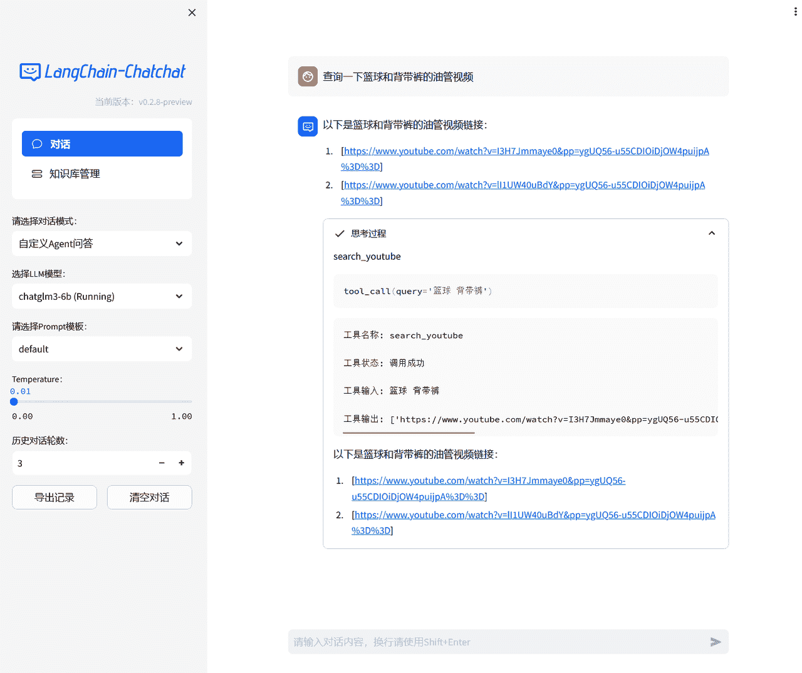

# LangChain-Chatchat

> 来源：[https://v11enp9ok1h.feishu.cn/docx/Xjwjdq7S0oGxyjxeqaFcRX6ZnOe](https://v11enp9ok1h.feishu.cn/docx/Xjwjdq7S0oGxyjxeqaFcRX6ZnOe)

<https://v11enp9ok1h.feishu.cn/sync/VztedzIoUstVPDb6RNMctK8Unie>

Gtihub地址:  https://github.com/chatchat-space/Langchain-Chatchat

> LangChain-Chatchat 是基于 ChatGLM 等大语言模型与 Langchain 等应用框架实现，开源、可离线部署的检索增强生成(RAG)大模型知识库项目。

本章节将带领开发者在 LangChain-Chatchat 中配置 ChatGLM3-6B模型 和 Function Call 功能。

1.  在configs/model_config.py中设置 ChatGLM3-6B 的地址, 并将LLM_MODEL修改为chatglm3-6b

```
MODEL_PATH = {
    &quot;llm_model&quot;: {
        ...
        &quot;chatglm3-6b&quot;: &quot;THUDM/chatglm3-6b&quot;,
        ...
    },
}

# LLM 名称
LLM_MODEL = &quot;chatglm3-6b&quot;

# LLM通用对话参数
TEMPERATURE = 0.01 #设置成0.01效果更佳
TOP_P = 0.95 

```

1.  在configs/server_config.py中添加ChatGLM3-6B的服务。

```
# 可以如下示例方式更改默认配置
    &quot;chatglm3-6b&quot;: { # 使用default中的IP和端口
       &quot;device&quot;: &quot;auto&quot;,
    },
```

1.  在configs/prompt_config.py中设置适合于ChatGLM3-6B的提示词

```
PROMPT_TEMPLATES[&quot;agent_chat&quot;] = {
&quot;ChatGLM3&quot;:
&quot;&quot;&quot;
You can answer using the tools, or answer directly using your knowledge without using the tools.Respond to the human as helpfully and accurately as possible.
You have access to the following tools:
{tools}
Use a json blob to specify a tool by providing an action key (tool name) and an action_input key (tool input).
Valid &quot;action&quot; values: &quot;Final Answer&quot; or  [{tool_names}]
Provide only ONE action per $JSON_BLOB, as shown:

```
{{{{
  &quot;action&quot;: $TOOL_NAME,
  &quot;action_input&quot;: $INPUT
}}}}
```

Follow this format:
    
Question: input question to answer
Thought: consider previous and subsequent steps
Action:
```
$JSON_BLOB
```
Observation: action result
... (repeat Thought/Action/Observation N times)
Thought: I know what to respond
Action:
```
{{{{
  &quot;action&quot;: &quot;Final Answer&quot;,
  &quot;action_input&quot;: &quot;Final response to human&quot;
}}}}
Begin! Reminder to ALWAYS respond with a valid json blob of a single action. Use tools if necessary. Respond directly if appropriate. Format is Action:```$JSON_BLOB```then Observation:.

history: {history}

Question: {input}

Thought: {agent_scratchpad}
&quot;&quot;&quot;,
}
```

在该提示词下，模型能较好的发挥出 Function Call 的性能。因此，不要大规模的修改Agent的提示词模板。

我们欢迎开发者为我们和Langchain-Chatchat社区提出PR，让模型的支持更上一层。

1.  适配效果

当用户适配上框架之后，正常使用 ChatGLM3-6B 并调用工具的状态如图所示

