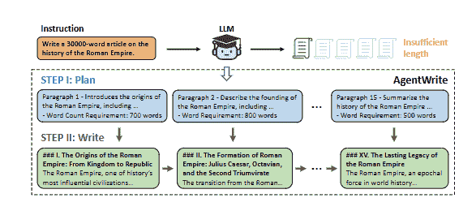
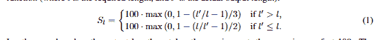

# 微调训练

> 来源：[https://v11enp9ok1h.feishu.cn/docx/F8l5dRtonoDw3lxwnzOcpGQIn6d](https://v11enp9ok1h.feishu.cn/docx/F8l5dRtonoDw3lxwnzOcpGQIn6d)

<https://v11enp9ok1h.feishu.cn/sync/VztedzIoUstVPDb6RNMctK8Unie>

在[LongWriter 输出10k+ 技术文档 ](https://zhipu-ai.feishu.cn/wiki/BmhywJ0OzitJnQkjSnecP90AnMb)介绍的一些细节比如**AgentWrite、DOP方法、长文本数据集生成等等，本**文会对LongWriter更加详细的说明，也许您已经详细看过我们的论文，这些您也可以从论文查阅

### 文本生成限制

在一些学者的眼中，限制LLM的输出长度一般源于[样本的分布情况，比如一个比较关键的见解（Effective L](https://aclanthology.org/2024.naacl-long.260.pdf)ong-Context Scaling of Foundation Models）中：尽管预训练阶段有很多更长的序列，但对输出长度的限制主要源于监督微调（SFT）数据集的特征。 这一发现解释了当前模型中普遍存在的 2000 字生成限制，最重要的是现有的 SFT 数据集很少包含超长的示例

上面限制在每个模型都存在，为此我们提出了一种长输出SFT数据集的方案，按照我们的数据集抽取方法，您可以在众多模型完成长文本拓展，我们的方案利用 GPT-4o 生成 6,000 个长输出 SFT 数据，即 LongWriter-6k。

+   任务设计

设计了 AgentWrite，这是一种分治式代理管道（如图 3 所示）。 AgentWrite 首先将长的写作任务分解为多个子任务，每个子任务要求模型只写一个段落。然后模型按顺序执行这些子任务，我们将子任务输出连接起来以获得最终的长输出



+   任务1

我们利用LLMs的规划能力，在给定写作指令的情况下输出这样的写作大纲，其中包括主要内容和每个段落的字数要求。

```
I need you to help me break down the following long-form writing instruction into multiple
subtasks. Each subtask will guide the writing of one paragraph in the essay, and should include
the main points and word count requirements for that paragraph.
The writing instruction is as follows:
{User Instruction}
Please break it down in the following format, with each subtask taking up one line:
Paragraph 1 - Main Point: [Describe the main point of the paragraph, in detail] - Word Count:
[Word count requirement, e.g., 400 words]
Paragraph 2 - Main Point: [Describe the main point of the paragraph, in detail] - Word Count:
[word count requirement, e.g. 1000 words].
...
Make sure that each subtask is clear and specific, and that all subtasks cover the entire content
of the writing instruction. Do not split the subtasks too finely; each subtask’s paragraph should
be no less than 200 words and no more than 1000 words. Do not output any other content.
```

+   子任务

分段子任务生成写作内容。为了保证输出的连贯性， 调用模型生成时，我们会输入之前生成的n-1个部分的内容到第n个上下文中，模型根据现有的写入历史继续编写下一个部分。从而保证写作的整体连贯性和质量远远优于并行生成的输出，不过这种串行方式阻止了对模型的并行调用以同时完成多个子任务，并且输入长度变得更长，可能会超过模型的上下文

```
You are an excellent writing assistant. I will give you an original writing instruction and my
planned writing steps. I will also provide you with the text I have already written. Please help
me continue writing the next paragraph based on the writing instruction, writing steps, and the
already written text.
Writing instruction:
{User Instruction}
Writing steps:
{The writing plan generated in Step I}
Already written text:
{Previous generated (n-1) paragraphs}
Please integrate the original writing instruction, writing steps, and the already written text, and
now continue writing {The plan for the n-th paragraph, i.e., the n-th line in the writing plan}
for me. If needed, you can add a small subtitle at the beginning. Remember to only output the
paragraph you write, without repeating the already written text.
```

+   评估数据集

为了验证上面的数据集的准确性，比如生成长度和质量， 我们提出两个方法。第一个是 LongWrite-Ruler 用于准确测量该方法可以提供的输出长度。第二个是我们构建的LongBench-Write基准，它主要用于评估模型生成的内容在长度和书写质量方面与用户指令的一致性程度。

相关内容仓库和代码可以在[github](https://github.com/THUDM/LongWriter/tree/main?tab=readme-ov-file#evaluation)上查看



同样也有更加详细的视频介绍

### SFT训练扩充长度

### 官方示例

[LongWriter继续训练](https://v11enp9ok1h.feishu.cn/wiki/HpGOwc00oiVarokgUYUcOzWbnze)照上面的步骤，将准备好的sft数据，按照 中的方法继续训练，即可获得超长文本的模型

#### 其它开源支持

在[LLamaFactory微调Longwriter](https://v11enp9ok1h.feishu.cn/wiki/R5A7wpw53imIU6kmuYBcCAjgnVb)面的官方示例中，微调模型还需要经过很多的操作，我们提供了在LLama factory框架中一键微调的代码 ，您可以在 中找到快速微调的方案，目前只支持SFT -lora方法