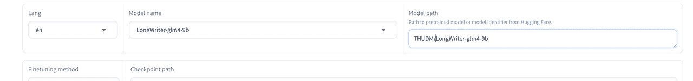
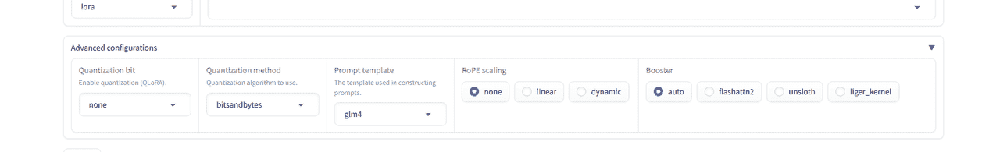
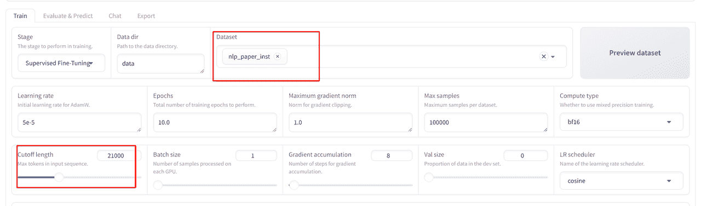
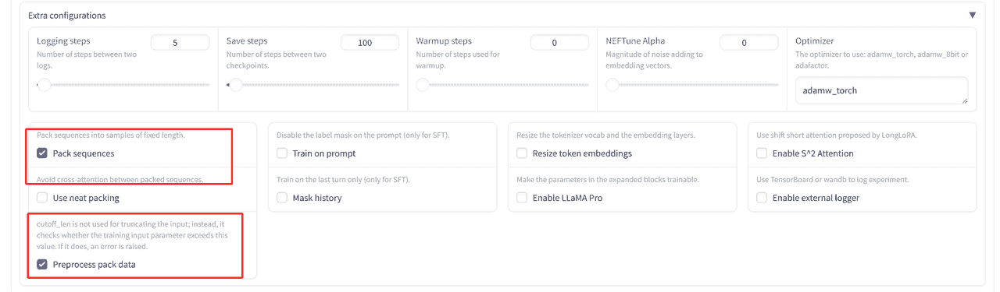
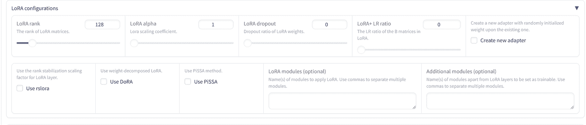
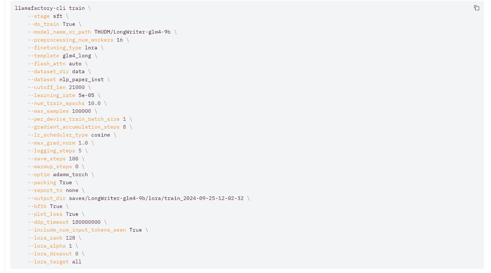
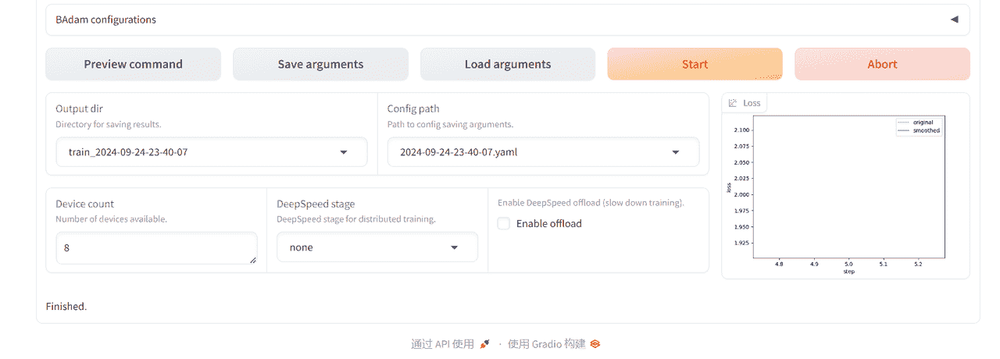
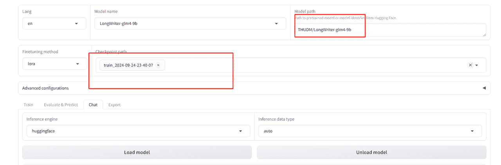

# LLamaFactory微调Longwriter

> 来源：[https://v11enp9ok1h.feishu.cn/docx/Pvc0dvikworYy1xYf20c8W0bn7Q](https://v11enp9ok1h.feishu.cn/docx/Pvc0dvikworYy1xYf20c8W0bn7Q)

<https://v11enp9ok1h.feishu.cn/sync/VztedzIoUstVPDb6RNMctK8Unie>

### 微调资源

根据pack包的长度定义，一般20000tokens长度需要80G显存

### 下载源码

+   下载仓库

```
git clone https://github.com/hiyouga/LLaMA-Factory.git
```

+   下载模型权重

```
git clone https://huggingface.co/THUDM/LongWriter-glm4-9b
```

https://github.com/hiyouga/LLaMA-Factory/pull/5532

### 环境说明

建议使用conda配置一个新环境

```
conda create -p &lt;path&gt;/conda_env/llamafactory python=3.10  
```

+   安装源码

```
conda activate &lt;path&gt;/conda_env/llamafactory 
cd LLaMA-Factory
pip install -e &quot;.[torch,metrics]&quot;
```

#### L[**LaMA B**](https://github.com/gradio-app/gradio)o**ard** 可视化微调（由 Gradio 驱动）

```
llamafactory-cli webui
```

### 开始微调-UI

[再微调前](https://github.com/hiyouga/LLaMA-Factory/blob/main/data/README_zh.md)，你需要准备自己的数据，数据格式按照llamafactory的文档准备，我们提供了一个长文本论文生成的数据集，可以使用此数据微调，需要注意由于这个输入单个文档长度很高，需要cutoff_len大小是21000，显存大小80G的设备才可以微调

+   nlp_paper_inst数据集

```
  &quot;nlp_paper_inst&quot;: {
    &quot;file_name&quot;: &quot;nlp_paper_inst.json&quot;,
    &quot;columns&quot;: {
      &quot;prompt&quot;: &quot;prompt&quot;, 
      &quot;response&quot;: &quot;response&quot;,
      &quot;system&quot;: &quot;system&quot;
    }
  }
```

##### 加载模型



##### 配置训练模板



##### 选择准备的数据



##### 配置Pack



##### Lora



##### 预览训练命令



#### 微调



开始微调-BASH

在LLaMA-Factory仓库上，examples/train_lora目录下有个执行脚本，放在源码目录下方，设置好环境即可完成微调

start_glm_train.sh

```
 

CUDA_VISIBLE_DEVICES=0,1,2,3,4,5,6,7 WANDB_API_KEY=974207f7173417ef95d2ebad4cbe7f2f9668a093 llamafactory-cli train \
    --stage sft \
    --do_train True \
    --model_name_or_path /mnt/ceph/develop/jiawei/model_checkpoint/LongWriter-glm4-9b-base \
    --preprocessing_num_workers 1 \
    --finetuning_type lora \
    --template glm4 \
    --flash_attn auto \
    --dataset_dir data \
    --dataset nlp_paper_inst \
    --cutoff_len 21000 \
    --learning_rate 2e-5 \
    --num_train_epochs 1.0 \
    --max_samples 100000 \
    --per_device_train_batch_size 1 \
    --gradient_accumulation_steps 2 \
    --lr_scheduler_type cosine \
    --max_grad_norm 1.0 \
    --logging_steps 1 \
    --save_steps 1 \
    --warmup_steps 0 \
    --warmup_ratio 0.03 \
    --weight_decay 0.1 \
    --optim adamw_torch \
    --packing True \
    --report_to wandb \
    --run_name LongWriter-test4 \
    --output_dir saves/LongWriter-glm4-9b-base/lora/train_2024-11-01-test4 \
    --bf16 True \
    --plot_loss True \
    --ddp_timeout 180000000 \
    --include_num_input_tokens_seen True \
    --lora_rank 8 \
    --lora_alpha 32 \
    --lora_dropout 0.05 \
    --lora_target all 
```

### 测试对话

完成微调训练后，

选择一个模型，和刚才的lora结果，点击chat对话，加载模型即可对话



记得配置对话模板

