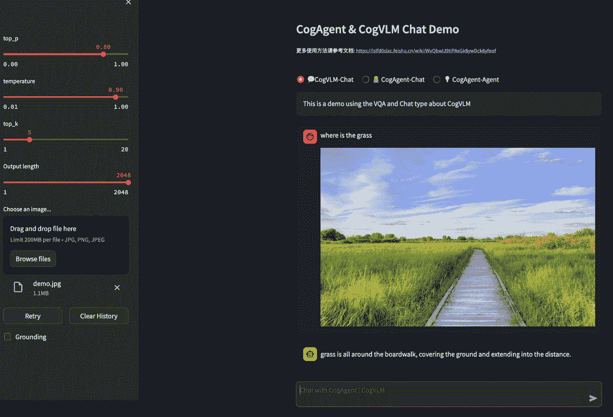
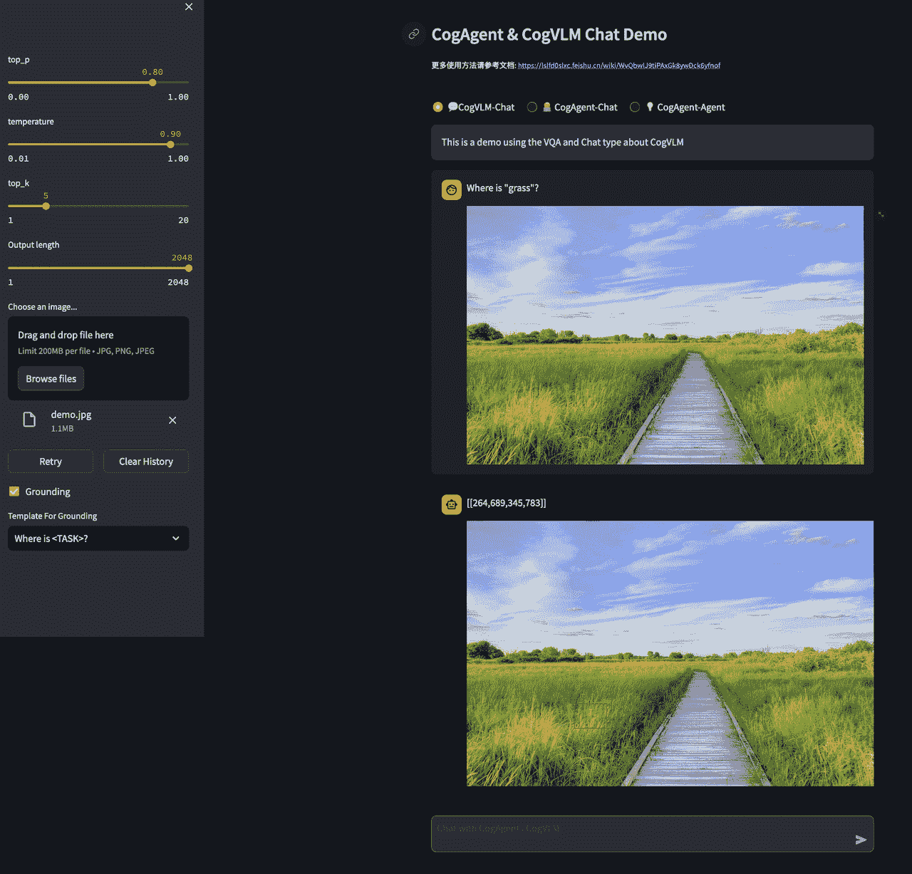
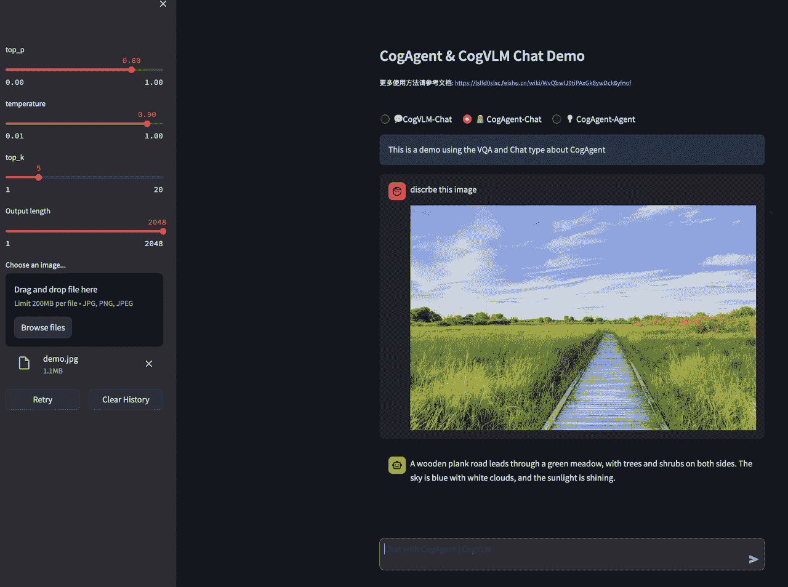
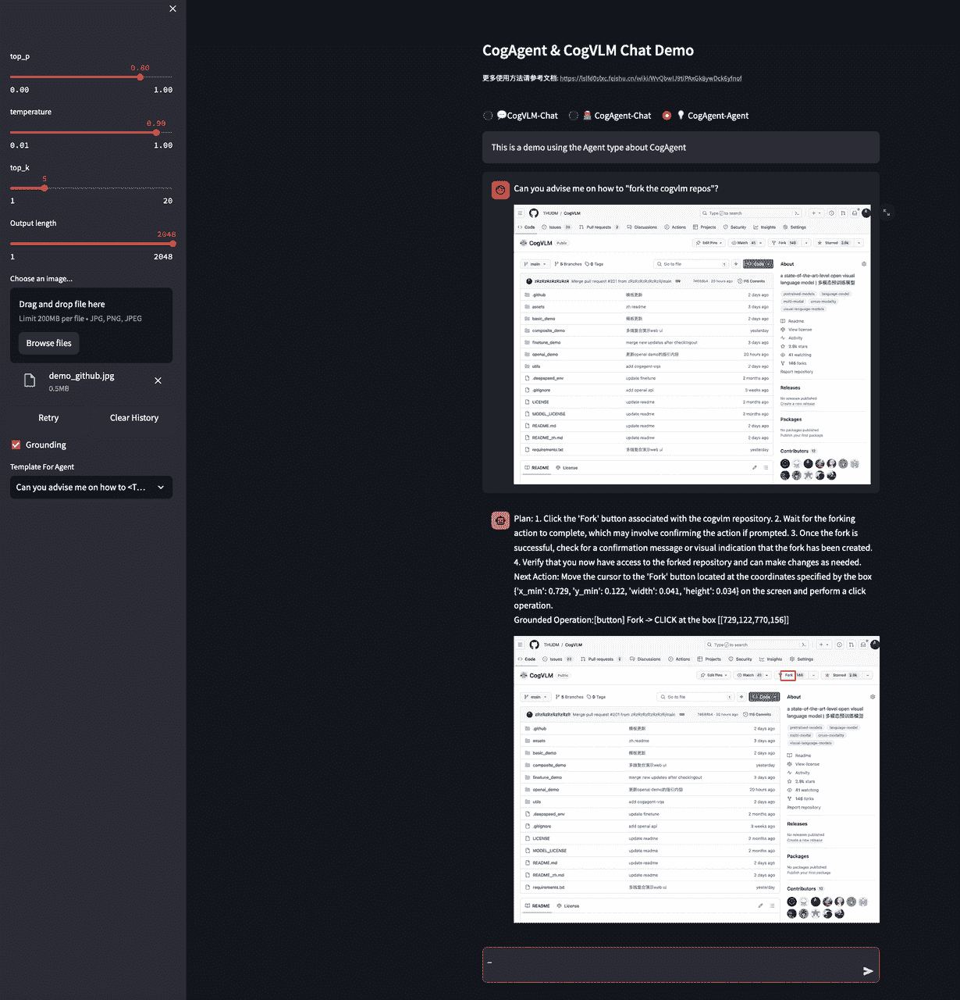

# 快速使用（推理部署）

> 来源：[https://v11enp9ok1h.feishu.cn/docx/ZWeTdnx32oVxzNxfFtWcQGaUnbe](https://v11enp9ok1h.feishu.cn/docx/ZWeTdnx32oVxzNxfFtWcQGaUnbe)

<https://v11enp9ok1h.feishu.cn/sync/VztedzIoUstVPDb6RNMctK8Unie>

## 子页面目录

这份文档旨在让开发者在十五分钟之内体验上 CogAgent / CogVLM 模型

### 免安装在线尝鲜

> 你将有一种办法免费，无需安装的尝鲜我们的模型，它是：

+ [官方体验地址](http://36.103.203.44:7861/)

> 在这个demo中，你将能体验到完整的 CogVLM,CogAgent的，关于如何使用玩转本Demo，请访问  运行 WebDemo (使用官方在线DEMO) 章节

### 我应该选择哪一个模型

我们的两个模型虽然相似，但具体的下游任务有一定的区别。

如果你希望完成传统CV任务中例如目标检测，定位, VQA 任务，我们CogVLM模型就可以胜任任务。

例如：

+ 图中是否有小猫，请帮我框出来。

+ 圈出地上的垃圾

+ 图中的文字是什么

当然，这些任务使用CogAgent都能完成，但是运算量大一点点 (17B -> 18B)。

如果你希望完成多模态的指令任务，例如 跨模态指令，图文指导，工具调用任务，我们推荐使用CogAgent模型。

例如：

+ 我怎么在这个页面中选择并订购从上海到北京最便宜的机票。

+ 这个表格想总结的内容是

+ 怎么给CogVLM 的 Github 仓库点 Stars

### 懒人包安装

如果你使用的操作系统为 [Windo](https://www.bilibili.com/video/BV1zN4y147vh/?spm_id_from=333.337.search-card.all.click)ws10 / Windows11 你可以在以下链接直接下载一键安装包和观看手把手教程。

```
"""
以下懒人包和教程由 非官方开发者 十字鱼 友情提供
"""
百度网盘链接：https://www.123pan.com/s/Pf5Yjv-orAW3.html
提取码：glut
```

### 源码安装

上述方案的目的是让更多的用户能够体验到我们的模型，但无法进行二次开发，如果您准备深度使用我们的模型，我们建议按照以下方式安装。

模型基础运行代码已经上传到 github 平台。开发者通过以下方式下载模型代码，CogAgent和CogVLM代码在一个仓库中，代码具有兼容性。

+ 从 github 下载源码

```
git clone https://github.com/THUDM/CogVLM.git
```

+ 从 Swanhub 下载源码

```
git clone https://swanhub.co/ZhipuAI/CogVLM.git
```

开发者可以通过以下方式下载模型文件

+ [下载](https://github.com/git-lfs/git-lfs?utm_source=gitlfs_site&utm_medium=installation_link&utm_campaign=gitlfs#installing)模型文件前请先确保`git lfs`命令已安装，安装教程请参考这里。

+ 模型文件已上传至 Huggingface, Modelsope ,  SwanHub  三个平台，用户可以快速安装模型。

+ 若使用 Huggingface 下载模型

```
git lfs install
# CogVLM
git clone https://huggingface.co/THUDM/cogvlm-chat-hf.git
# CogAgent
git clone https://huggingface.co/THUDM/cogagent-chat-hf.git
```

+ 若使用 Modelscope 下载模型

```
git lfs install
# CogVLM
git clone https://www.modelscope.cn/ZhipuAI/cogvlm-chat.git
# CogAgent
git clone https://www.modelscope.cn/ZhipuAI/cogagent-chat.git
```

+ 若使用 SwanHub 下载模型

```
git lfs install
# CogVLM
git clone https://swanhub.co/ZhipuAI/cogvlm-chat.git
# CogAgent
git clone https://swanhub.co/ZhipuAI/cogagent-chat-hf.git
```

#### 安装依赖

使用 `pip` 安装依赖：

```
cd CogVLM
pip install -r requirements.txt
python -m spacy download en_core_web_sm
```

[环境配置和检查](https://lslfd0slxc.feishu.cn/wiki/OwCDwJkKbidEL8kpfhPcTGHcnVc)果你担心你的配置不满足最低配置，你可以访问 获取更多信息。

#### 运行demo

使用我们提供的命令行交互来完成命令行与 CogAgent & CogVLM 的对话。

在 `python basic_demo/cli_demo_hf.py` 中运行代码

```
# CogAgent
python cli_demo_hf.py --from_pretrained THUDM/cogagent-chat-hf --bf16
python cli_demo_hf.py --from_pretrained THUDM/cogagent-vqa-hf --bf16

# CogVLM
python cli_demo_hf.py --from_pretrained THUDM/cogvlm-chat-hf --bf16
python cli_demo_hf.py --from_pretrained THUDM/cogvlm-grounding-generalist --bf16
```

在demo中，我们将自动检测你的 GPU 是否支持 bf16推理，以及使用的是哪一个模型，两个模型之间有一定的推理区别。

##### 运行效果

```
========Use torch type as:torch.bfloat16 with device:cuda========


Loading checkpoint shards: 100%|███████████████████████████████████████████████████████████████████████████████████████████████████████████████████████████████████████████████████████████████████████████████████████████████████████████████████████████████████████████████████████| 8/8 [00:00<00:00, 12.63it/s]
image path >>>>> openai_demo/img.png
Human: How Can I search CogVLM paper

/share/real_shared_envs/sat_torch2/lib/python3.10/site-packages/transformers/generation/configuration_utils.py:389: UserWarning: `do_sample` is set to `False`. However, `temperature` is set to `0.9` -- this flag is only used in sample-based generation modes. You should set `do_sample=True` or unset `temperature`.
  warnings.warn(

Cog: Enter "CogVLM paper" into the search bar and press enter to search.
```

如果你使用的是sat模型，请使用 `cli_demo_sat.py` 来完整这个步骤。

```
# CogAgent
python cli_demo_hf.py --from_pretrained THUDM/cogagent-chat-hf --bf16
python cli_demo_hf.py --from_pretrained THUDM/cogagent-vqa-hf --bf16

# CogVLM
python cli_demo_hf.py --from_pretrained THUDM/cogvlm-chat-hf --bf16
python cli_demo_hf.py --from_pretrained THUDM/cogvlm-grounding-generalist --bf16
```

#### 运行 WebDemo (使用官方在线DEMO)

在本仓库中，我们为开发者提供了一个可以直接运行的完整 Web Demo。

用户可以直接在Web Demo中可视化的与模型进行交互。

##### 启动代码

首先，按照要求下载必须的配置。

```
pip install -r composite_demo/requirements.txt
```

接着，在 `composite_demo/client.py` 中将修改以下代码

```
# 将这两行替换为你模型的实际位置
MODEL_PATH = os.environ.get('MODEL_PATH', 'your cogagent-chat-hf path')
TOKENIZER_PATH = os.environ.get('TOKENIZER_PATH', 'your vicuna-7b-v1.5 path')
```

接着，运行代码

```
streamlit run composite_demo/main.py
```

##### 运行效果

1. 使用 cogvlm-chat-v1.1（without grounding）



1. 使用 cogvlm-grounding-generalist-v1.1 (with grounding)



1. 使用 cogagent-chat



1. 使用 cogagent-agent (with grounding)



##### 页面讲解

+ 图片上传器（必选）：一定需要上传一张图片才能对话。由于CogVLM和CogAgent在单次多轮完整对话中，只能对一张图像进行对话，因此，如果你上传了新的图像，那么，之前的历史记录会默认清零。

+ 模式选择（必选）：选择使用VQA 或者 Vagent 模式，其中，CogVLM 不支持 Vagent 模式。

+ Grounding（可选）：只有选择Vagent才会出现，选择之后，提示词最后会加入 (with grounding)，这样模型就会画出目标框。

+ 模板选择（必选）：只有选择Vagent才会出现，在Vagent中，用户要输入的只有`<TASK>`的内容, 然后选择一个模板，让模型成功的相应并绘制框。

例如，用户输入 `search CogVLM paper`, 模板选择 "Can you advise me on how to `<TASK>`?",则会被填充为 `Can you advise me on how to "search CogVLM paper"?`。这样，大模型才能有效的完成 Agent 任务。

##### 模型准备

为了流畅运行完整的demo（含官方在线demo），请先阅读demo的运行逻辑

```
Web Demo user operation logic is as follows:
    CogVLM-Chat -> grounding? - yes -> Choose a template -> CogVLM-grounding-17B
                              - no  -> CogVLM-chat-17B (without grounding)

    CogAgent-Chat  -> CogAgent-chat-18B (Only QA,without Grounding)

    CogAgent-Agent -> CogAgent-chat-18B
                    -> Choose a template -> grounding? - yes -> prompt + (with grounding)
                                                      - no  -> prompt

    CogAgent-vqa-hf are not included in this demo, but you can use it in the same way as CogAgent-chat-18B
    and used it in CogAgent-Chat
```

也就是说，如果需要流畅的运行demo的全部功能，你需要至安装三个模型，分别是

+ cogvlm-chat-v1.1
+ cogvlm-grounding-generalist-v1.1
+ cogagent-chat
+ vicuna-7b-v1.5 (tokenizer only)

之后，你需要在 `client.py` 中配置相关内容

```
models_info = {
    'tokenizer': {
        'path': os.environ.get('TOKENIZER_PATH', '/share/official_pretrains/hf_home/vicuna-7b-v1.5'),
    },
    'agent_chat': {
        'path': os.environ.get('MODEL_PATH_AGENT_CHAT', '/share/official_pretrains/hf_home/cogagent-chat-hf'),
        'device': ['cuda:0']
    },
    'vlm_chat': {
        'path': os.environ.get('MODEL_PATH_VLM_CHAT', '/share/official_pretrains/hf_home/cogvlm-chat-v1-1-hf'),
        'device': ['cuda:3']
    },
    'vlm_grounding': {
        'path': os.environ.get('MODEL_PATH_VLM_GROUNDING', '/share/official_pretrains/hf_home/cogvlm-grounding-generalist-hf'),
        'device': ['cuda:6']
    }
}
```

其中，后台将智能分配空闲的显卡用户回答问题。

你可以将一个模型复制到不同的显卡（不是拆分）。

如果你想使用部分模型，你可以按照如下配置。

```
models_info = {
    'tokenizer': {
        'path': os.environ.get('TOKENIZER_PATH', '/share/official_pretrains/hf_home/vicuna-7b-v1.5'),
    },
    'agent_chat': {
        'path': os.environ.get('MODEL_PATH_AGENT_CHAT', '/share/official_pretrains/hf_home/cogagent-chat-hf'),
        'device': ['cuda:0']
}
```

在这份配置中，你可以单独运行 cogagent的对话，但是 cogvlm 的相关对话网页将无法使用。

##### 翻译

本webui已经预留了百度翻译的接口，位于 `conversation.py` 中。

你可以在这里填写上你的百度翻译API key。


# 百度翻译接口

## `translate_baidu` 函数

```python
def translate_baidu(translate_text, source_lan, target_lan):
    """
        Translates text using Baidu's translation service. (if you are not use English)

        This function sends a request to the Baidu translation API to translate the provided text
        from the source language to the target language.

        Args:
            translate_text (str): The text to be translated.
            source_lan (str): The source language code (e.g., "en" for English).
            target_lan (str): The target language code (e.g., "zh" for Chinese).

        Returns:
            str: The translated text. Returns "error" in case of an exception.
        """
    url = "https://aip.baidubce.com/rpc/2.0/mt/texttrans/v1?access_token="
    headers = {'Content-Type': 'application/json'}
    payload = {
        'q': translate_text,
        'from': source_lan,
        'to': target_lan
    }
    try:
        r = requests.post(url, json=payload, headers=headers)
        result = r.json()
        final_translation = ''

        for item in result['result']['trans_result']:
            final_translation += item['dst'] + '\n'
    except Exception as e:
        print(e)
        return "error"
    return final_translation
```

如果没有填入`Key`，则输入中文将不能获得正确的回答。

如果你仅使用英语进行交互，则无需关注这个内容。
