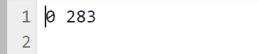
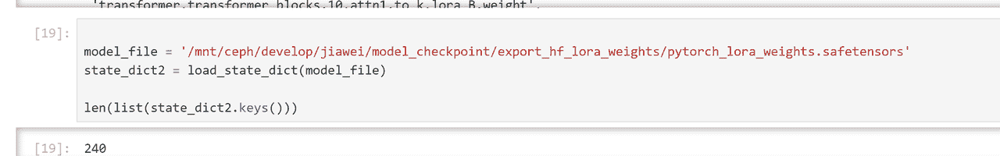

# CogVideoX探索Lora微调风格场景

> 来源：[https://v11enp9ok1h.feishu.cn/docx/GGHqdMlkeo2VGFxsWyRcdLc6ndf](https://v11enp9ok1h.feishu.cn/docx/GGHqdMlkeo2VGFxsWyRcdLc6ndf)

## 目前的模型

CogVideoX

## 微调方向的探索

从公开的评分排行榜对比信息看，CogVidex在主题一致、动态信息、背景一致、对象信息、人类动作、空间关系评分较高于其它模型，评分低于其它模型的分类维度主要为运动平滑，成像质量、多个对象、颜色、场景、外观样式、时态样式上

实际测试[视频指令维度](https://zhipu-ai.feishu.cn/docx/P2zadNU2FoAZMvxFYjYcoZIFngf)发现，我们的CogVideoX对主题一致、动态信息、背景一致、对象信息、运动平滑、颜色、场景、外观样式、时态样式都有不错的效果，而在人类动作、空间关系、多个对象这几个维度上，不能得到良好的效果

为了让这些无法完成任务可以正常生成视频，弥补在这一方面的空缺，我们尝试进一步收集该方向上的数据集，通过GPT之类的工具，对视频抽帧对话，筛选出符合的视频素材，裁剪成需要的片段

## 任务一：数据整理

### 准备数据集工作

数据集判断、抽帧、语言模型问答

为了保证让模型能很好理解人物动作、空间信息，数据集的筛选工作是一个繁琐切巨大的劳动，一般为了完成某一目标的结果，我们准备的数据集大多数来自互联网数据，只需要下载这些你认为需要学习的样本，使用我们提供的脚本处理后，即可生成用于训练和验证的数据集。脚本由如下几个jupyter构成

> 请注意：这几个jupyter应该使用不同的`python`环境，例如`conda`区分

#### 场景采集

[这个过程用户可以自己](https://github.com/glide-the/TransNetV2/blob/scenes/inference/%E6%8F%90%E5%8F%96%E5%9C%BA%E6%99%AF.ipynb)标记视频中使用的场景，也可以使用提供的TransNetV2工具

这个脚本会将提供的文件夹下方`mp4`视频移动到工作空间，并为每个文件标记一个序号，提供的TransNetV2 获得视频的镜头分割结果，结果将以 `.scenes.txt`格式保存在本地



执行完成之后目录结构应该为

```
root_path
     └── test_1
          ├── test_1.mp4
          ├── test_1.mp4.predictions.txt
          └── test_1.mp4.scenes.txt
```

#### 01-保存视频帧画面

https://github.com/glide-the/Keyframe-Extraction-for-video-summarization/blob/caption/src/01-%E4%BF%9D%E5%AD%98%E8%A7%86%E9%A2%91%E5%B8%A7%E7%94%BB%E9%9D%A2.ipynb

这个脚本将会把视频按照关键帧和场景帧抽取出来，分别放在`keyframe`、`keyframe-features`

`keyframe-features`：是视频每一帧图像用于聚类视频帧，找到最符合当前场景的视频画面

`keyframe`：是场景开始帧画面

#### 02-视频帧特征提取

https://github.com/glide-the/Keyframe-Extraction-for-video-summarization/blob/caption/src/02-%E8%A7%86%E9%A2%91%E5%B8%A7%E7%89%B9%E5%BE%81%E6%8F%90%E5%8F%96.ipynb

#### 03-帧片段最佳聚类结果

https://github.com/glide-the/Keyframe-Extraction-for-video-summarization/blob/caption/src/03-%E5%B8%A7%E7%89%87%E6%AE%B5%E6%9C%80%E4%BD%B3%E8%81%9A%E7%B1%BB%E7%BB%93%E6%9E%9C.ipynb

#### 04-1-批量处理字幕操作

https://github.com/glide-the/Keyframe-Extraction-for-video-summarization/blob/caption/src/04-1-%E6%89%B9%E9%87%8F%E5%A4%84%E7%90%86%E5%AD%97%E5%B9%95%E6%93%8D%E4%BD%9C.ipynb

#### 04-2-帧长度合并

https://github.com/glide-the/Keyframe-Extraction-for-video-summarization/blob/caption/src/04-2-%E5%B8%A7%E9%95%BF%E5%BA%A6%E5%90%88%E5%B9%B6.ipynb

#### 04-3-填充分镜描述词

https://github.com/glide-the/Keyframe-Extraction-for-video-summarization/blob/caption/src/04-3-%E5%A1%AB%E5%85%85%E5%88%86%E9%95%9C%E6%8F%8F%E8%BF%B0%E8%AF%8D.ipynb

#### 05-视频裁剪增加镜头描述

任务内容：对视频分片为，首帧和尾帧的描述，总结之后作为训练提示词

注意调整`split_video`的默认参数，用于处理横屏数据`w=540`、`h=360`或者竖屏数据 `w=720`、`h=960`，这个参数按照原视频大小填写

提示词镜头描述使用了`glm-4-9b`模型，你可以使用在线的平台，也可以单独在本地加载

> 强烈推荐使用开放平台的服务：这个任务用`minicpm2.5`微调的模型在`A100`上面自己运行了四个服务，任务大概是 “对视频分片为，首帧和尾帧的描述，总结之后作为训练提示词”

> 一晚上每个任务只跑了400个左右，大部分都是本地的这个`minicpm`浪费的

> 每次推理在6-10秒左右

> 但是我们的`glm-4v-plus`，只需要2秒就可以完成推理

>

> 加入交流群，扫描这个[二维码](https://v11enp9ok1h.feishu.cn/docx/GGHqdMlkeo2VGFxsWyRcdLc6ndf#doxcnlx2NNAhWtAgLEHN2hRrsoh)

https://github.com/glide-the/Keyframe-Extraction-for-video-summarization/blob/caption/src/05-%E8%A7%86%E9%A2%91%E8%A3%81%E5%89%AA%E5%A2%9E%E5%8A%A0%E9%95%9C%E5%A4%B4%E6%8F%8F%E8%BF%B0.ipynb

#### 06-插帧 （可选）

https://github.com/glide-the/Keyframe-Extraction-for-video-summarization/blob/caption/src/06-%E6%8F%92%E5%B8%A7.ipynb

## 任务二：lora微调的配置策略

### 超参数效果

LORA微调的[CogVideoX transformer超参数](https://zhipu-ai.feishu.cn/wiki/LNvywTaDkiWsI1kAlM4cwyI7nKc)在中有一些详细的描述，正常微调需要关注的是下面几个参数

#### Adam params

`1E-3`：更加适合新任务学习，在我们没有存在的能力上微调，可以获得更好的效果

`5E-4`：更适合细节学习，比如物体精细程度，人物穿戴，画面风格等任务

#### Lora Rank

`LoRA`权重有一个秩（`rank`）参数，默认情况下，`2B`模型设为`128`，`5B`模型设为`256`。这个参数用来计算`lora_scale`的值，默认情况下会被`alpha`值除，`alpha`用于稳定学习并防止下溢。在`SAT`训练框架中，`alpha`默认设为`1`。秩越高，表现能力越强，但需要更多的内存和训练时间。盲目地增加这个数值并不总是更好。`lora_scale`的公式是：`lora_r / alpha`。

它和[sd训练方式](https://github.com/darkstorm2150/sd-scripts/blob/main/docs/train_network_README-en.md#execute-learning)的预期工作是一样的

#### text_length&max_length

这个参数是输入长度，采用了`T5`的`token`计算方法，用来限定输入内容的，理论上跟显存大小成正比，`2B`和`5B`模型公开的参数为 `226`

这里我使用的是[`MiniCPM2`微调版本](https://v11enp9ok1h.feishu.cn/docx/GGHqdMlkeo2VGFxsWyRcdLc6ndf#doxcndMLP0wnYjqKqhZr6d6vpCb)的提示词生成模型, 参数调整到了`2048`

### sat微调配置


[`cogvideox_2b_lora.yaml`](https://internal-api-drive-stream.feishu.cn/space/api/box/stream/download/all/H6Y4bpL7poSUxWxtAhFcWJgAn3e)


[`sft.yaml`](https://internal-api-drive-stream.feishu.cn/space/api/box/stream/download/all/VvODbgJBJomTxQxt1bgckWHBngh)

### 训练参数注意事项

#### LORA网络检查

区分`lora`权重信息，可以通过下面的方式打印权重结构，通过对比结构判断是不是正确

训练后的输出目录一些参数包含了低秩权重，可以打印这个`.pt`文件可以看到在`qkvo`结构上会存在一个`matrix_A.0`、`matrix_B.0`的权重信息，通过`get_state_dict`函数可以看到完整的权重信息,其中`lora`权重也包含在里面

+ `get_state_dict`函数

```
from typing import Any, Dict

def get_state_dict(saved_dict: Dict[str, Any]) -> Dict[str, Any]:
    state_dict = saved_dict
    if "model" in saved_dict.keys():
        state_dict = state_dict["model"]
    if "module" in saved_dict.keys():
        state_dict = state_dict["module"]
    if "state_dict" in saved_dict.keys():
        state_dict = state_dict["state_dict"]
    return state_dict


```

+ 获取文件权重

```
from diffusers.models.modeling_utils import ModelMixin, load_state_dict
model_file = '/mnt/ceph/develop/jiawei/model_checkpoint/ckpts_2b_lora/lora-disney-09-09-21-10/1000/mp_rank_00_model_states.pt'
merge_original_state_dict = get_state_dict(torch.load(model_file, map_location="cpu", mmap=True))
```

```
[
--------------------------------
 'model.diffusion_model.transformer.layers.0.attention.query_key_value.matrix_A.0',
 'model.diffusion_model.transformer.layers.0.attention.query_key_value.matrix_A.1',
 'model.diffusion_model.transformer.layers.0.attention.query_key_value.matrix_A.2',
 'model.diffusion_model.transformer.layers.0.attention.query_key_value.matrix_B.0',
 'model.diffusion_model.transformer.layers.0.attention.query_key_value.matrix_B.1',
 'model.diffusion_model.transformer.layers.0.attention.query_key_value.matrix_B.2',
 'model.diffusion_model.transformer.layers.0.attention.dense.matrix_A.0',
 'model.diffusion_model.transformer.layers.0.attention.dense.matrix_B.0',
 'model.diffusion_model.transformer.layers.1.attention.query_key_value.matrix_A.0',
 ---------------------
]
```

#### SAT继续微调

当模型微调成功之后，发现在样本目标上欠拟合，则可用执行继续微调操作

`SAT`框架保存了完整的`transformer`模型结构，只需要观察`wandb`的训练曲线，将上次的微调为中表现最好的模型权重复制成如下结构，其中`latest`默认内容是`1`，`1`和`1-ema`文件夹是期望继续微调的权重

```
├── lora-disney-test
│   ├── 1
│   ├── 1-ema
│   └── latest
```

#### Huggingface Diffusers lora注意事项

Here are a few key differences in the diffusers framework used in our publicly released SAT fine-tuning code:

`LoRA` weights have a rank parameter, with the `2B` transformer model defaulting to a rank of `128`, and the `5B` transformer model defaulting to a rank of `256`.

The `lora_scale` is calculated as `alpha / lora_r`, where `alpha` is typically set to `1` during `SAT` training to ensure stability and prevent underflow.

Higher rank offers better expressiveness, but it also demands more memory and results in longer training times.

### 从SAT权重文件导出Huggingface Diffusers lora权重

支持了从`SAT`权重文件

在经过上面这些步骤训练之后，我们得到了一个`sat`带`lora`的权重，在`{args.save}/1000/mp_rank_00_model_states.pt`你可以看到这个文件

导出的`lora`权重脚本在`CogVideoX`仓库 `tools/export_sat_lora_weight.py` ,导出后使用 `load_cogvideox_lora.py` 推理

+ 导出命令

```
python tools/export_sat_lora_weight.py --sat_pt_path {args.save}/{experiment_name}-09-09-21-10/1000/mp_rank_00_model_states.pt --lora_save_directory   {args.save}/export_hf_lora_weights_1/
```

这次训练主要修改了下面几个模型结构,下面列出了 转换为`HF`格式的`lora`结构对应关系,可以看到`lora`将模型注意力结构上增加一个低秩权重,


```
'attention.query_key_value.matrix_A.0': 'attn1.to_q.lora_A.weight',
'attention.query_key_value.matrix_A.1': 'attn1.to_k.lora_A.weight',
'attention.query_key_value.matrix_A.2': 'attn1.to_v.lora_A.weight',
'attention.query_key_value.matrix_B.0': 'attn1.to_q.lora_B.weight',
'attention.query_key_value.matrix_B.1': 'attn1.to_k.lora_B.weight',
'attention.query_key_value.matrix_B.2': 'attn1.to_v.lora_B.weight',
'attention.dense.matrix_A.0': 'attn1.to_out.0.lora_A.weight',
'attention.dense.matrix_B.0': 'attn1.to_out.0.lora_B.weight'
```

通过`export_sat_lora_weight.py`将它转换为HF格式的lora结构



## 联系我们


