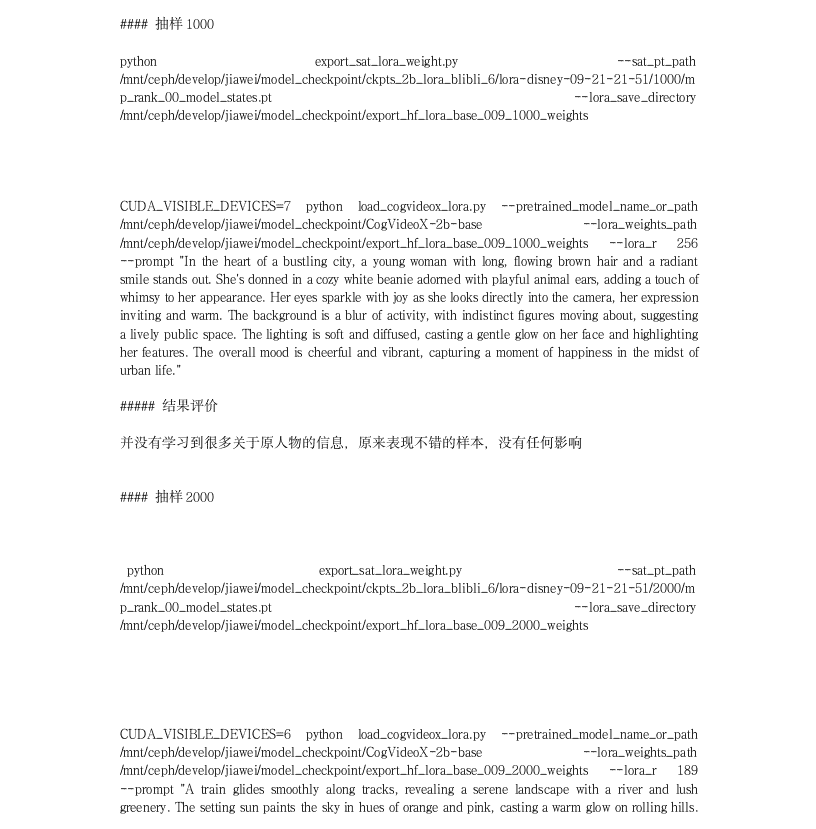

# Lora_role_7

> 来源：[https://v11enp9ok1h.feishu.cn/docx/EsGWdXYIroTTKfxf04Rcxsmbnnh](https://v11enp9ok1h.feishu.cn/docx/EsGWdXYIroTTKfxf04Rcxsmbnnh)

### 实验信息

训练数据来源B站,UID:

[Lora_role_5](https://zhipu-ai.feishu.cn/wiki/AzP8wLht7i9daikuzVHcCfNwn1d)抽取数据集46条，[Lora_role_2](https://zhipu-ai.feishu.cn/wiki/Cscyw20uXiFBF6kC14zcpCWwn7d)中166个训练样本（处理脚本错误，存在索引错误的文件，删除后剩余166）

这次分别在学习率不同的值上进行了比较，

使用小的学习率lr:8e-6，目标增加迭代步10000（实际迭代了1000）

skip_frms_num: 6.

使用大的学习率lr:1e-3，目标增加迭代步10000

skip_frms_num: 6.

[sft.yaml](https://internal-api-drive-stream.feishu.cn/space/api/box/stream/download/all/FxPNbnw2ioUYLux1pdQc0s1DnIg)

[sft_2.yaml](https://internal-api-drive-stream.feishu.cn/space/api/box/stream/download/all/KY6nbyFQdoZBckx8SuMc6ALgn7e)

[cogvideox_2b_lora.yaml](https://internal-api-drive-stream.feishu.cn/space/api/box/stream/download/all/QCtMboimuoE7YCxUhZycuFYNnoe)

#### Huggingface Diffusers  Lora权重

#### 结果评价

使用大的学习率lr:1e-3，目标增加迭代步10000（实际2700），表现更好

[抽样.txt](https://internal-api-drive-stream.feishu.cn/space/api/box/stream/download/all/YZ7zbvZSQowxjxxVEwhcBAqbnEc)

**总体结论**：

+   **低抽样点（700、800）**：模型无法正确渲染人物，场景变化过大，提示词与预期图像不对应

+   中间抽样点（1300、2000）：能清晰还原人物形象等占据视图的重要信息，面部无法正常生成主体运动不连贯，场景无法识别

+   较高抽样点（2000、2700）： 能清晰还原人物形象表情等占据视图的重要信息，主体运动不连贯

#### 新的任务

#### 关联任务

### HF代码加载模型抽样数据

多维表格（J0VVbHLrFaVxxDss40HcMczJn0C_tblrGDZDaNSd8ug8）