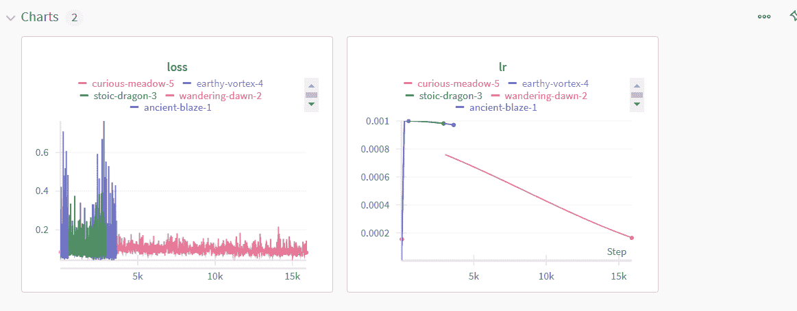

# Lora_image

> 来源：[https://v11enp9ok1h.feishu.cn/docx/WomMdjBPyodWoAx6Z6BcZykBnlc](https://v11enp9ok1h.feishu.cn/docx/WomMdjBPyodWoAx6Z6BcZykBnlc)

### 实验信息

训练数据来源B站,UID:

[Lora_role_5](https://zhipu-ai.feishu.cn/wiki/AzP8wLht7i9daikuzVHcCfNwn1d)抽取数据集46条，[Lora_role_2](https://zhipu-ai.feishu.cn/wiki/Cscyw20uXiFBF6kC14zcpCWwn7d)中166个训练样本（处理脚本错误，存在索引错误的文件，删除后剩余166）

训练过程调整了lora_alpha，按照顺序在lora_alpha值为1、16、32上分别训练了一些step

https://wandb.ai/dmeck/DiffUsers_CogVideoX_IMAGE_LORA2



```
#!/bin/bash

export MODEL_PATH=&quot;/mnt/ceph/develop/jiawei/model_checkpoint/CogVideoX-5b-I2V&quot;
export CACHE_PATH=&quot;~/.cache&quot; 
export OUTPUT_PATH=&quot;/mnt/ceph/develop/jiawei/model_checkpoint/hf_cogvideox_imglora_2_r128_a1_naitang&quot;
export VAL_IMAGE1=&quot;/mnt/ceph/develop/jiawei/diffusers_fork_zmf/examples/cogvideo/frame0.jpg&quot;
export VAL_IMAGE2=&quot;/mnt/ceph/develop/jiawei/diffusers_fork_zmf/examples/cogvideo/frame30.jpg&quot;
export PYTORCH_CUDA_ALLOC_CONF=expandable_segments:True
GPU_IDS=&quot;6,7&quot;
WANDB_PROJECT=DiffUsers_CogVideoX_IMAGE_LORA2

# if you are not using wth 8 gus, change `accelerate_config_machine_single.yaml` num_processes as your gpu number
PYTORCH_CUDA_ALLOC_CONF=expandable_segments:True WANDB_API_KEY=key accelerate launch --main_process_port 29501 --gpu_ids $GPU_IDS   --config_file /mnt/ceph/develop/jiawei/diffusers_fork_zmf/examples/cogvideo/lora_image_k2.yaml  \
  train_cogvideox_image_to_video_lora.py \
  --gradient_checkpointing \
  --pretrained_model_name_or_path $MODEL_PATH \
  --cache_dir $CACHE_PATH \
  --enable_tiling \
  --enable_slicing \
  --instance_data_root /mnt/ceph/develop/jiawei/lora_dataset/Dance-VideoGeneration-Dataset \
  --caption_column prompts.txt \
  --video_column videos.txt \
  --id_token 奶糖, \
  --validation_prompt &quot;奶糖, A young girl in a white blouse and navy skirt stands in a sunlit park, smiling and holding up two fingers. She&#x27;s surrounded by trees and a pathway, with dappled sunlight casting shadows. A young woman in a school uniform stands on a tree-lined path, surprised, with hands raised. In the park, a woman in a white blouse with a navy collar raises her hands in a playful &#x27;V&#x27; shape, surrounded by lush greenery and sunlight.:::奶糖, A young woman with long dark hair tied into ponytails stands in a cozy, warmly lit room, smiling gently at the camera. She takes a selfie, her hair styled in loose waves, with a playful expression. The background is a plain, light-colored wall, emphasizing her features.&quot; \
  --validation_images  &quot;$VAL_IMAGE1:::$VAL_IMAGE2&quot; \
  --validation_prompt_separator ::: \
  --num_validation_videos 1 \
  --validation_epochs 5 \
  --seed 42 \
  --rank 128 \
  --lora_alpha 32 \
  --mixed_precision bf16 \
  --output_dir $OUTPUT_PATH \
  --height 480 \
  --width 720 \
  --fps 8 \
  --max_num_frames 49 \
  --skip_frames_start 0 \
  --skip_frames_end 0 \
  --train_batch_size 1 \
  --num_train_epochs 150 \
  --checkpointing_steps 1000 \
  --gradient_accumulation_steps 1 \
  --learning_rate 1e-3 \
  --lr_scheduler cosine_with_restarts \
  --lr_warmup_steps 200 \
  --lr_num_cycles 1 \
  --enable_slicing \
  --enable_tiling \
  --gradient_checkpointing \
  --optimizer AdamW \
  --adam_beta1 0.9 \
  --adam_beta2 0.95 \
  --max_grad_norm 1.0 \
  --resume_from_checkpoint latest \
  --report_to wandb --tracker_name $WANDB_PROJECT

```

#### Huggingface Diffusers  Lora权重

/mnt/ceph/develop/jiawei/model_checkpoint/hf_cogvideox_imglora_2_r128_a1_naitang

#### 结果评价

训练任务在 1e-3的学习率，rank 128,a 32上完成了150次训练，

分别在不同的检查点下测试任务

+   checkpoint-10000

r:128,a: 1，原来表现不错的，相关人物的图像并没有很好的融合，出现了奇怪的动作，扭曲的形象

r:128,a:32, 原样本表现良好的，出现了过度拟合训练数据，风景类的数据集影响不大，目标训练样本相关的任务生成形象清晰，手部有轻微的变形

通过上述抽样，lora权重比值越大越接近目标样本，在目标训练采样中数据拟合成功，但是影响了原来的表现不错的样本，导致所有关于人物的样本相似目标训练样本

> PS: 训练后 出现亮的过亮，暗的过暗的情况，猜测是从[0,255]转换到[0,1]到[-1,1],出现了精度损失

> 通过这个代码应该可以修复

```
        self.video_transforms = transforms.Compose(
            [
                transforms.RandomHorizontalFlip(random_flip) if random_flip else transforms.Lambda(lambda x: x),
                transforms.Lambda(lambda x: x / 255.0),
                transforms.Normalize(mean=[0.5, 0.5, 0.5], std=[0.5, 0.5, 0.5], inplace=True),
            ]
```

+   checkpoint-15000

[视频指令维度](https://zhipu-ai.feishu.cn/wiki/Alw9w7kaLim5F7kk3kpc2szBnoc)有的参数样本都已经趋近目标数据，在 上能很好的泛化相关的形象，例如主题一致、动态信息、背景一致、对象信息、运动平滑、颜色、场景、外观样式、时态样式都有不错的效果

#### 新的任务

#### 关联任务

###

#### checkpoint-10000

多维表格（WYCNb6lyYaOqmFsYwNLcQrVanee_tblwD8TxkM1C36mj）

###

#### checkpoint-15000

多维表格（WYCNb6lyYaOqmFsYwNLcQrVanee_tblj1zni4mL6rGAc）