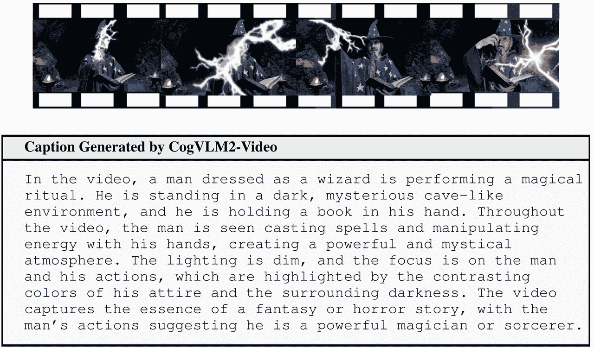

# 生成视频的描述性文本

> 来源：[https://v11enp9ok1h.feishu.cn/docx/XQuVdRmG3oUh7txkarvcywBsnPi](https://v11enp9ok1h.feishu.cn/docx/XQuVdRmG3oUh7txkarvcywBsnPi)

通常情况下，大多数视频数据都没有相应的描述性文本，因此有必要将视频数据转换为文本描述，为文本到视频模型提供必要的训练数据。

# 用 CogVLM2-Video 生成视频的描述性文本

🤗 H[ugging Face ](https://huggingface.co/THUDM/cogvlm2-video-llama3-chat)  |   🤖 Mo[delScope  ](https://modelscope.cn/models/ZhipuAI/cogvlm2-video-llama3-chat) |    📑 Blo[g   ](https://cogvlm2-video.github.io/) ｜ 💬 O[nline Demo  ](http://cogvlm2-online.cogviewai.cn:7868/)

CogVLM2-Video 是一种多功能视频理解模型，具有基于时间戳的问题解答功能。用户可以向模型输入 “请详细描述这段视频 ”等提示语，以获得详细的视频字幕：



## CogVLM2-Video CLI 演示

我们可以用 CLI 与CogVLM2-Video 模型交互。CogVLM2-Video是优化视频输入的 LLaMA 架构的一个变体。CLI 允许用户提供视频并通过文本查询与模型互动，生成结合视频信息的响应。

*注意，需要Python 3.6 或更高版本

### 安装依赖

```
pip install -r requirements.txt
```

如果希望使用 CUDA 功能，请确保您的系统具有兼容的 GPU。

### 使用 CLI 运行

--quant: 指定模型加载的量化精度。接受 4 或 8 的值。默认值为 0（不使用量化）。

```
python script.py --quant 8
```

### 导入以及常量和参数解析

+   MODEL_PATH: 定义了要使用的预训练模型路径，需要将 THUDM/cogvlm2-video-llama3-chat 换成本地路径。

+   DEVICE: 根据是否可用CUDA，选择计算设备（GPU或CPU）。

+   TORCH_TYPE: 根据CUDA计算能力选择数据类型（bfloat16或float16）。

+   使用 argparse 处理命令行参数，--quant 参数指定量化精度（4位或8位）。如果模型路径中包含int4，则将量化精度设为4位。

```
import io
import numpy as np
import torch
from decord import cpu, VideoReader, bridge
from transformers import AutoModelForCausalLM, AutoTokenizer, BitsAndBytesConfig
import argparse

MODEL_PATH = &quot;THUDM/cogvlm2-video-llama3-chat&quot;
DEVICE = &#x27;cuda&#x27; if torch.cuda.is_available() else &#x27;cpu&#x27;
TORCH_TYPE = torch.bfloat16 if torch.cuda.is_available() and torch.cuda.get_device_capability()[0] &gt;= 8 else torch.float16

parser = argparse.ArgumentParser(description=&quot;CogVLM2-Video CLI Demo&quot;)
parser.add_argument(&#x27;--quant&#x27;, type=int, choices=[4, 8], help=&#x27;启用4位或8位精度加载&#x27;, default=0)
args = parser.parse_args()

if &#x27;int4&#x27; in MODEL_PATH:
    args.quant = 4
```

### 视频加载

+   bridge.set_bridge('torch'): 设置 Decord 库使用 PyTorch 作为桥接。

+   从 video_path 读取视频文件并转换为二进制流。

+   如果视频流存在，则用 io.BytesIO 将其包装成流；否则，直接读取视频路径。

+   strategy 参数决定如何选取视频帧：

+   base 策略：从视频开始的指定时间段中均匀选取帧。

+   chat 策略：根据帧的时间戳选择尽可能均匀分布的帧。

+   将选择的帧提取为批量数据并调整维度顺序，以便 PyTorch 使用。

```
def load_video(video_path, strategy=&#x27;chat&#x27;):
    bridge.set_bridge(&#x27;torch&#x27;)
    with open(video_path, &#x27;rb&#x27;) as f:
        mp4_stream = f.read()
    num_frames = 24

    if mp4_stream is not None:
        decord_vr = VideoReader(io.BytesIO(mp4_stream), ctx=cpu(0))
    else:
        decord_vr = VideoReader(video_path, ctx=cpu(0))
    frame_id_list = None
    total_frames = len(decord_vr)
    if strategy == &#x27;base&#x27;:
        clip_end_sec = 60
        clip_start_sec = 0
        start_frame = int(clip_start_sec * decord_vr.get_avg_fps())
        end_frame = min(total_frames,
                        int(clip_end_sec * decord_vr.get_avg_fps())) if clip_end_sec is not None else total_frames
        frame_id_list = np.linspace(start_frame, end_frame - 1, num_frames, dtype=int)
    elif strategy == &#x27;chat&#x27;:
        timestamps = decord_vr.get_frame_timestamp(np.arange(total_frames))
        timestamps = [i[0] for i in timestamps]
        max_second = round(max(timestamps)) + 1
        frame_id_list = []
        for second in range(max_second):
            closest_num = min(timestamps, key=lambda x: abs(x - second))
            index = timestamps.index(closest_num)
            frame_id_list.append(index)
            if len(frame_id_list) &gt;= num_frames:
                break
    video_data = decord_vr.get_batch(frame_id_list)
    video_data = video_data.permute(3, 0, 1, 2)
    return video_data
```

### 模型加载

+   使用 AutoTokenizer 从指定的 MODEL_PATH 加载分词器。

+   根据 GPU 内存大小和量化设置，决定如何加载模型。如果 GPU 内存小于 48GB 且未启用量化，则会提示用户并退出。

+   根据 --quant 参数选择是否加载量化模型（4位或8位），或者加载标准模型。

```
tokenizer = AutoTokenizer.from_pretrained(
    MODEL_PATH,
    trust_remote_code=True,
)

if torch.cuda.is_available() and torch.cuda.get_device_properties(0).total_memory &lt; 48 * 1024 ** 3 and not args.quant:
    print(&quot;GPU 内存少于 48GB。请使用 cli_demo_multi_gpus.py 或传递 `--quant 4` 或 `--quant 8`。&quot;)
    exit()

if args.quant == 4:
    model = AutoModelForCausalLM.from_pretrained(
        MODEL_PATH,
        torch_dtype=TORCH_TYPE,
        trust_remote_code=True,
        quantization_config=BitsAndBytesConfig(
            load_in_4bit=True,
            bnb_4bit_compute_dtype=TORCH_TYPE,
        ),
        low_cpu_mem_usage=True
    ).eval()
elif args.quant == 8:
    model = AutoModelForCausalLM.from_pretrained(
        MODEL_PATH,
        torch_dtype=TORCH_TYPE,
        trust_remote_code=True,
        quantization_config=BitsAndBytesConfig(
            load_in_8bit=True,
            bnb_4bit_compute_dtype=TORCH_TYPE,
        ),
        low_cpu_mem_usage=True
    ).eval()
else:
    model = AutoModelForCausalLM.from_pretrained(
        MODEL_PATH,
        torch_dtype=TORCH_TYPE,
        trust_remote_code=True
    ).eval().to(DEVICE)
```

### 执行生成

根据 MODEL_PATH 判断使用的模型策略（base 或 chat）。脚本会提示用户输入视频路径。如果用户没有输入视频路径，则脚本会进入纯文本对话模式。如果用户提供了视频路径，则调用 load_video 函数来加载视频。之后，脚本进入一个子循环以处理用户的查询。在这个子循环中，脚本调用 model.build_conversation_input_ids()函数来准备模型的输入，这些输入包括用户的查询、视频帧和对话历史。接着，脚本配置生成参数，比如最大新令牌数和采样方法等。使用配置好的模型生成响应后，脚本将生成的响应解码为文本，并打印出来，同时将当前对话添加到历史记录中。

```
while True:
    strategy = &#x27;base&#x27; if &#x27;cogvlm2-video-llama3-base&#x27; in MODEL_PATH else &#x27;chat&#x27;
    print(f&quot;使用 {strategy} 模型&quot;)
    video_path = input(&quot;视频路径 &gt;&gt;&gt;&gt;&gt; &quot;)
    if video_path == &#x27;&#x27;:
        print(&#x27;您没有输入视频路径，接下来的将是纯文本对话。&#x27;)
        video = None
    else:
        video = load_video(video_path, strategy=strategy)

    history = []
    while True:
        query = input(&quot;人类:&quot;)
        if query == &quot;clear&quot;:
            break

        inputs = model.build_conversation_input_ids(
            tokenizer=tokenizer,
            query=query,
            images=[video],
            history=history,
            template_version=strategy
        )

        inputs = {
            &#x27;input_ids&#x27;: inputs[&#x27;input_ids&#x27;].unsqueeze(0).to(DEVICE),
            &#x27;token_type_ids&#x27;: inputs[&#x27;token_type_ids&#x27;].unsqueeze(0).to(DEVICE),
            &#x27;attention_mask&#x27;: inputs[&#x27;attention_mask&#x27;].unsqueeze(0).to(DEVICE),
            &#x27;images&#x27;: [[inputs[&#x27;images&#x27;][0].to(&#x27;cuda&#x27;).to(TORCH_TYPE)]],
        }
        gen_kwargs = {
            &quot;max_new_tokens&quot;: 2048,
            &quot;pad_token_id&quot;: 128002,
            &quot;top_k&quot;: 1,
            &quot;do_sample&quot;: True,
            &quot;top_p&quot;: 0.1,
            &quot;temperature&quot;: 0.1,
        }
        with torch.no_grad():
            outputs = model.generate(**inputs, **gen_kwargs)
            outputs = outputs[:, inputs[&#x27;input_ids&#x27;].shape[1]:]
            response = tokenizer.decode(outputs[0], skip_special_tokens=True)
            print(&quot;\nCogVLM2-Video:&quot;, response)
        history.append((query, response))
```