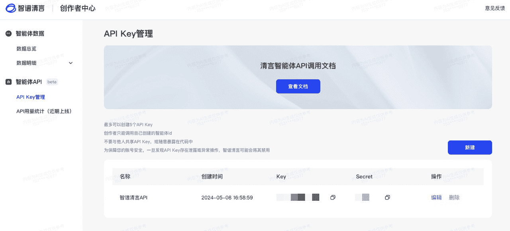

# 食用 · 清言 API

> 来源：[https://v11enp9ok1h.feishu.cn/docx/NGzbdZ02woGziQxA2PNcpuV1njc](https://v11enp9ok1h.feishu.cn/docx/NGzbdZ02woGziQxA2PNcpuV1njc)

<https://v11enp9ok1h.feishu.cn/sync/VztedzIoUstVPDb6RNMctK8Unie>



> 获取API KEY地址：https://chatglm.cn/developersPanel/apiSet

> github入门代码：https://github.com/MetaGLM/glm-cookbook/blob/main/glms/api/glms_api.ipynb

# 简介

具备开发能力的创作者可以[通过API](https://chatglm.cn/developersPanel)调用的方式使用智能体，方便将智能体应用于更多业务场景中。API基本覆盖清言C端页面所有功能，包含文本对话，文生图，图片解读，联网搜索，文档解析，Python代码执行，外部API调用等。接入前请通过创作者中心获取api_key及api_secret. 当前仅支持通过API方式调用创作者自己创建的智能体。

# 基础信息

服务根路径： https://chatglm.cn/chatglm/assistant-api/v1/

鉴权方式：header中发送 Authorization:  Bearer {access_token}. Token获取方式参考下方Access Token获取接口.

请求体格式：JSON

返回格式（除stream接口外）：JSON

返回结构体：

| 字段 | 类型 | 必填 | 说明 |
| --- | --- | --- | --- |
| status | int | Y | 是否成功，0-&gt;成功，其他代表失败，默认错误返回1. 具体错误码见接口说明。 |
| message | string | N | 错误信息 |
| result | Dict | N | 返回数据 |

# 用量控制

为避免API调用占用过多资源，系统限制每个开发者（非API_KEY）的并发数量。默认并发数为2。并发限制范围包括上传文件和会话调用API接口。

此外，我们对每个开发者调用会话接口的次数也设置了上限，目前为一天500次，总量5000次。

# 接口列表

## Access Token获取

请求路径和方式：POST /get_token

输入：

| 字段 | 类型 | 必填 | 说明 |
| --- | --- | --- | --- |
| api_key | string | Y | 开发者ID |
| api_secret | string | Y | 开发者秘钥 |

输出数据：

| 字段 | 类型 | 必填 | 说明 |
| --- | --- | --- | --- |
| access_token | string | Y | 接口鉴权token |
| expires_in | int | Y | token过期时间,单位秒。一次授权有效期为10天。请注意在token过期前更新。 |

异常说明：

| 异常情况 | http码 | status码 |
| --- | --- | --- |
| api_key被禁用 | 403 | 1001 |
| api_key或api_secret验证失败 | 401 | 1002 |

## Assistant 会话调用

请求路径和方式：POST /stream

输入：

| 字段 | 类型 | 必填 | 说明 |
| --- | --- | --- | --- |
| assistant_id | string | Y | 智能体 ID，浏览器打开智能体对话页后，可通过地址栏查看。下图红框中即为ID。 |
| conversation_id | string | N | 会话 ID，不传默认创建新会话。需要继续之前的会话时，传入流式输出Result中的conversation_id值。对话轮数和上下文长度无限制，需要注意上下文过大会导致响应耗时增加。 |
| prompt | string | Y | prompt文本 |
| file_list | List&lt;Dict&gt; | N | 文件列表，传入文件上传接口返回的file_id。 [{&quot;file_id&quot;:&quot;xxx&quot;}] |
| meta_data | Dict | N | 元信息，拓展字段 |

输出：

SSE 流式输出

| 字段 | 类型 | 必填 | 说明 |
| --- | --- | --- | --- |
| message | Result | Y | SSE返回json格式消息体. |

### 输出Result结构

| 字段 | 类型 | 必填 | 说明 |
| --- | --- | --- | --- |
| history_id | string | Y | 历史记录ID |
| conversation_id | string | Y | 对话上下文ID |
| message | Message | Y | 输出消息体, 每次输出一个message对象，前一个message结束后，输出下一个message |
| created_at | string | Y | 创建时间，格式：“2023-11-23 18:00:00” |
| status | string | Y | init-&gt;初始态, processing-&gt;生成中 finish-&gt;生成结束,error-&gt;生成异常。 |
| last_error | dict | N | 异常信息 {&quot;error_code&quot;:&quot;&quot;, &quot;&quot;error_msg&quot;:&quot;&quot;} |
| meta_data | dict | N | {} |

### 输出Message结构

| 字段 | 类型 | 必填 | 说明 |
| --- | --- | --- | --- |
| role | string | Y | assistant为模型输出，tool为工具输出 |
| content | Content | Y | 输出内容，参考下方Content结构。 |
| status | string | Y | init/processing/finish/error，状态流转逻辑与外层Result相同。 |
| created_at | string | Y | 时间戳。格式参考：“2023-11-23 18:00:00” |
| meta_data | dict | N | {} |

### 输出Content结构

根据不同的Tool调用情况，返回的content结构不同，参考如下：

| Tool使用情况 | 返回结构 |
| --- | --- |
|  | ``` {     &amp;quot;type&amp;quot;: &amp;quot;text&amp;quot;,     &amp;quot;text&amp;quot;: &amp;quot;你好&amp;quot;  } ``` |
| CogView画图 | ``` {     &amp;quot;type&amp;quot;:&amp;quot;image&amp;quot;,      &amp;quot;image&amp;quot;:[         {&amp;quot;image_url&amp;quot;:&amp;quot;https://sfile.chatglm.cn/...&amp;quot;}     ] } ``` |
| Python代码执行 | ``` 代码执行-开始 {   &amp;quot;type&amp;quot;: &amp;quot;code&amp;quot;,   &amp;quot;code&amp;quot;: &amp;quot;# Calculating the square of 10\n10 ** 2&amp;quot; } 代码执行-成功，结果返回 {   &amp;quot;type&amp;quot;: &amp;quot;execution_output&amp;quot;,   &amp;quot;content&amp;quot;: &amp;quot;100&amp;quot; } 代码执行-失败 {   &amp;quot;type&amp;quot;: &amp;quot;system_error&amp;quot;,   &amp;quot;content&amp;quot;: &amp;quot;sandbox error code: 504&amp;quot; } ``` |
| OPEN-URL链接打开 | ``` OPEN-URL开始 {     &amp;quot;type&amp;quot;:&amp;quot;tool_calls&amp;quot;,     &amp;quot;tool_calls&amp;quot;:{         &amp;quot;name&amp;quot;:&amp;quot;browser&amp;quot;,         &amp;quot;arguments&amp;quot;:&amp;quot;open_url(\&amp;quot;https://www.chatglm.com/\&amp;quot;)&amp;quot;}     } } OPEN-URL结束-成功 {     &amp;quot;type&amp;quot;: &amp;quot;browser_result&amp;quot;,     &amp;quot;content&amp;quot;: &amp;quot;{\&amp;quot;title\&amp;quot;: \&amp;quot; Split string with multiple delimiters in Python - Stack Overflow\&amp;quot;, \&amp;quot;url\&amp;quot;: \&amp;quot; https://stackoverflow.com/questions/4998629/split-string-with-multiple-delimiters-in-python\&amp;quot;}&amp;quot;, }              OPEN-URL结束-失败 {     &amp;quot;type&amp;quot;:&amp;quot;system_error&amp;quot;,     &amp;quot;content&amp;quot;:&amp;quot;Error when executing command &amp;quot;}],     &amp;quot;meta_data&amp;quot;:{         &amp;quot;failedCommand&amp;quot;:&amp;quot;open_url(\&amp;quot;https://www.chatglm.com/\&amp;quot;)&amp;quot;         }     } } ``` |
| Search联网搜索 | ``` Search 开始 {     &amp;quot;type&amp;quot;:&amp;quot;tool_calls&amp;quot;,     &amp;quot;tool_calls&amp;quot;:{         &amp;quot;name&amp;quot;:&amp;quot;browser&amp;quot;,         &amp;quot;arguments&amp;quot;:&amp;quot;search(\&amp;quot;河南河北山西霰雪预警 2024\&amp;quot;, recency_days=30)&amp;quot;}     } } Search 结束-成功 {     &amp;quot;type&amp;quot;: &amp;quot;browser_result&amp;quot;,     &amp;quot;content&amp;quot;: &amp;quot;{}&amp;quot;,     &amp;quot;meta_data&amp;quot;:{       {         &amp;quot;metadata_list&amp;quot;:[           {             &amp;quot;type&amp;quot;:&amp;quot;webpage&amp;quot;,             &amp;quot;title&amp;quot;:&amp;quot;2024年1-2月份山西省进出口情况分析 - 昆明海关&amp;quot;,             &amp;quot;url&amp;quot;:&amp;quot;http://kunming.customs.gov.cn/taiyuan_customs/zfxxgk50/3023433/3023453/4676174/5755479/index.html&amp;quot;,&amp;quot;text&amp;quot;:&amp;quot;比去年同期（下同）增长26.8%。全省活跃企业数明显增加前2个月。占全省进出口总值的40.3%。国家&amp;quot;,             &amp;quot;pub_date&amp;quot;:&amp;quot;&amp;quot;           },         ]       }     } } Search 结束-失败 {     &amp;quot;type&amp;quot;:&amp;quot;system_error&amp;quot;,     &amp;quot;content&amp;quot;:&amp;quot;Error when executing command &amp;quot;}],     &amp;quot;meta_data&amp;quot;:{         &amp;quot;failedCommand&amp;quot;:&amp;quot;search(\&amp;quot;河南河北山西霰雪预警 2024\&amp;quot;, recency_days=30)&amp;quot;         }     } } mclick 搜索结果页面打开 开始. mclick中参数为打开链接序号列表，关联搜索结果 {   &amp;quot;type&amp;quot;: &amp;quot;tool_calls&amp;quot;,   &amp;quot;tool_calls&amp;quot;: {     &amp;quot;name&amp;quot;: &amp;quot;browser&amp;quot;,     &amp;quot;arguments&amp;quot;: &amp;quot;mclick([0, 1, 3])&amp;quot;   },   &amp;quot;meta_data&amp;quot;:{       &amp;quot;metadata_list&amp;quot;:[           {             &amp;quot;type&amp;quot;:&amp;quot;webpage&amp;quot;,             &amp;quot;title&amp;quot;:&amp;quot;2024年1-2月份山西省进出口情况分析 - 昆明海关&amp;quot;,             &amp;quot;url&amp;quot;:&amp;quot;http://kunming.customs.gov.cn/taiyuan_customs/zfxxgk50/3023433/3023453/4676174/5755479/index.html&amp;quot;,&amp;quot;text&amp;quot;:&amp;quot;比去年同期（下同）增长26.8%。全省活跃企业数明显增加前2个月。占全省进出口总值的40.3%。国家&amp;quot;,             &amp;quot;pub_date&amp;quot;:&amp;quot;&amp;quot;           },       ]   } } mclick 搜索结果页面打开 成功. 所有链接均完成后，返回quote_result. {     &amp;quot;type&amp;quot;: &amp;quot;quote_result&amp;quot;,     &amp;quot;content&amp;quot;: &amp;quot;{}&amp;quot;,     &amp;quot;meta_data&amp;quot;:{         &amp;quot;metadata_list&amp;quot;:[           {             &amp;quot;type&amp;quot;:&amp;quot;webpage&amp;quot;,             &amp;quot;title&amp;quot;:&amp;quot;2024年1-2月份山西省进出口情况分析 - 昆明海关&amp;quot;,             &amp;quot;url&amp;quot;:&amp;quot;http://kunming.customs.gov.cn/taiyuan_customs/zfxxgk50/3023433/3023453/4676174/5755479/index.html&amp;quot;,&amp;quot;text&amp;quot;:&amp;quot;比去年同期（下同）增长26.8%。全省活跃企业数明显增加前2个月。占全省进出口总值的40.3%。国家&amp;quot;,             &amp;quot;pub_date&amp;quot;:&amp;quot;&amp;quot;           },         ]     } } mclick 搜索结果页面打开 失败. 每个URL失败返回一次该事件，可能会出现部分失败. {   &amp;quot;type&amp;quot;: &amp;quot;system_error&amp;quot;,   &amp;quot;content&amp;quot;: &amp;quot;&amp;quot;，   &amp;quot;meta_data&amp;quot;:{       &amp;quot;failedURL&amp;quot;: &amp;quot;https://xxx.xx&amp;quot;   } } ``` |
| 外部API调用 | ``` 请求API的参数内容 {     &amp;quot;type&amp;quot;: &amp;quot;tool_calls&amp;quot;,     &amp;quot;tool_calls&amp;quot;: {         &amp;quot;name&amp;quot;: &amp;quot;generate&amp;quot;,         &amp;quot;arguments&amp;quot;: &amp;quot;```python\ntool_call(Content-Type=&amp;#x27;application/json&amp;#x27;, title=&amp;#x27;Hello World&amp;#x27;, type=&amp;#x27;post&amp;#x27;, platform=&amp;#x27;wordpress&amp;#x27;)\n```&amp;quot;,         &amp;quot;host&amp;quot;: &amp;quot;ppt-test-v101.wxbjq.top&amp;quot;     } } 请求API的返回内容 {     &amp;quot;type&amp;quot;: &amp;quot;function_result&amp;quot;,     &amp;quot;content&amp;quot;: &amp;quot;{\&amp;quot;status\&amp;quot;:0,\&amp;quot;message\&amp;quot;:\&amp;quot;success\&amp;quot;,\&amp;quot;result\&amp;quot;:{\&amp;quot;count\&amp;quot;:818},\&amp;quot;rid\&amp;quot;:\&amp;quot;2030521d-b4ea-4c38-854f-f3f189a3ebb3\&amp;quot;}&amp;quot; } ``` |
| 知识库检索（需在智能体配置中打开“显示相关的知识库段落”） | ``` 检索开始 {     &amp;quot;type&amp;quot;: &amp;quot;rag_slices&amp;quot;,     &amp;quot;content&amp;quot;: [] } 检索结果 {     &amp;quot;type&amp;quot;: &amp;quot;rag_slices&amp;quot;,     &amp;quot;content&amp;quot;: [         {             &amp;quot;text&amp;quot;: &amp;quot;知识库内容abcd&amp;quot;, # 只有rag模式会返回              &amp;quot;document_name&amp;quot;: &amp;quot;1.pdf&amp;quot;         }     ] } ``` |

异常说明：

| 异常情况 | http码 | status码 |
| --- | --- | --- |
| api_key被禁用 | 403 | 10004 |
| api_key已删除 | 400 | 10003 |
| FileList中文件不存在 | 400 | 10005 |
| 当日会话调用次数超限 | 403 | 10008 |
| 实时并发数超限 | 403 | 10007 |
| 智能体被删除 | 403 | 10010 |
| 无权限调用智能体 | 403 | 10018 |

流式异常说明：

| 异常情况 | error_code码 |
| --- | --- |
| 安全风控拦截 | 10031 |
| 生成中断（网络原因） | 10024 |
| 生成错误（模型原因） | 10027 |
| 生成异常（系统原因） | 10025 |
| 生成图片失败 | 10028 |

## Assistant 会话调用（非流式输出）

请求路径和方式：POST /stream_sync

输入：

| 字段 | 类型 | 必填 | 说明 |
| --- | --- | --- | --- |
| assistant_id | string | Y | 智能体 ID，浏览器打开智能体对话页后，可通过地址栏查看。下图红框中即为ID。 |
| conversation_id | string | N | 会话 ID，不传默认创建新会话。需要继续之前的会话时，传入流式输出Result中的conversation_id值。对话轮数和上下文长度无限制，需要注意上下文过大会导致响应耗时增加。 |
| prompt | string | Y | prompt文本 |
| file_list | List&lt;Dict&gt; | N | 文件列表，传入文件上传接口返回的file_id。 [{&quot;file_id&quot;:&quot;xxx&quot;}] |
| meta_data | Dict | N | 元信息，拓展字段 |

输出：

HTTP response JSON输出

https://zhipu-ai.feishu.cn/sync/Bz6sdk1QbsIbnjbX3nBcLOSMn8b

### 输出Result结构

| 字段 | 类型 | 必填 | 说明 |
| --- | --- | --- | --- |
| history_id | string | Y | 历史记录ID |
| conversation_id | string | Y | 对话上下文ID |
| output | List&lt;Part&gt; | Y | 输出消息体列表，每个Part对应流式中的一个Message |
| status | string | Y | init-&gt;初始态, processing-&gt;生成中 finish-&gt;生成结束,error-&gt;生成异常。 |

### 输出Part结构

| 字段 | 类型 | 必填 | 说明 |
| --- | --- | --- | --- |
| role | string | Y | assistant为模型输出，tool为工具输出 |
| content | Content | Y | 输出内容，参考下方Content结构。 |
| status | string | Y | init/processing/finish/error，状态流转逻辑与外层Result相同。 |
| created_at | string | Y | 时间戳。格式参考：“2023-11-23 18:00:00” |
| meta_data | dict | N | {} |

### 输出Content结构

根据不同的Tool调用情况，返回的content结构不同，参考如下：

| Tool使用情况 | 返回结构 |
| --- | --- |
|  | ``` {     &amp;quot;type&amp;quot;: &amp;quot;text&amp;quot;,     &amp;quot;text&amp;quot;: &amp;quot;你好&amp;quot;  } ``` |
| CogView画图 | ``` {     &amp;quot;type&amp;quot;:&amp;quot;image&amp;quot;,      &amp;quot;image&amp;quot;:[         {&amp;quot;image_url&amp;quot;:&amp;quot;https://sfile.chatglm.cn/...&amp;quot;}     ] } ``` |
| Python代码执行 | ``` 代码执行-开始 {   &amp;quot;type&amp;quot;: &amp;quot;code&amp;quot;,   &amp;quot;code&amp;quot;: &amp;quot;# Calculating the square of 10\n10 ** 2&amp;quot; } 代码执行-成功，结果返回 {   &amp;quot;type&amp;quot;: &amp;quot;execution_output&amp;quot;,   &amp;quot;content&amp;quot;: &amp;quot;100&amp;quot; } 代码执行-失败 {   &amp;quot;type&amp;quot;: &amp;quot;system_error&amp;quot;,   &amp;quot;content&amp;quot;: &amp;quot;sandbox error code: 504&amp;quot; } ``` |
| OPEN-URL链接打开 | ``` OPEN-URL开始 {     &amp;quot;type&amp;quot;:&amp;quot;tool_calls&amp;quot;,     &amp;quot;tool_calls&amp;quot;:{         &amp;quot;name&amp;quot;:&amp;quot;browser&amp;quot;,         &amp;quot;arguments&amp;quot;:&amp;quot;open_url(\&amp;quot;https://www.chatglm.com/\&amp;quot;)&amp;quot;}     } } OPEN-URL结束-成功 {     &amp;quot;type&amp;quot;: &amp;quot;browser_result&amp;quot;,     &amp;quot;content&amp;quot;: &amp;quot;{\&amp;quot;title\&amp;quot;: \&amp;quot; Split string with multiple delimiters in Python - Stack Overflow\&amp;quot;, \&amp;quot;url\&amp;quot;: \&amp;quot; https://stackoverflow.com/questions/4998629/split-string-with-multiple-delimiters-in-python\&amp;quot;}&amp;quot;, }              OPEN-URL结束-失败 {     &amp;quot;type&amp;quot;:&amp;quot;system_error&amp;quot;,     &amp;quot;content&amp;quot;:&amp;quot;Error when executing command &amp;quot;}],     &amp;quot;meta_data&amp;quot;:{         &amp;quot;failedCommand&amp;quot;:&amp;quot;open_url(\&amp;quot;https://www.chatglm.com/\&amp;quot;)&amp;quot;         }     } } ``` |
| Search联网搜索 | ``` Search 开始 {     &amp;quot;type&amp;quot;:&amp;quot;tool_calls&amp;quot;,     &amp;quot;tool_calls&amp;quot;:{         &amp;quot;name&amp;quot;:&amp;quot;search&amp;quot;,         &amp;quot;arguments&amp;quot;:&amp;quot;search(\&amp;quot;河南河北山西霰雪预警 2024\&amp;quot;, recency_days=30)&amp;quot;}     } } Search 结束-成功 {     &amp;quot;type&amp;quot;: &amp;quot;browser_result&amp;quot;,     &amp;quot;content&amp;quot;: &amp;quot;{}&amp;quot;,     &amp;quot;meta_data&amp;quot;:{       {         &amp;quot;metadata_list&amp;quot;:[           {             &amp;quot;type&amp;quot;:&amp;quot;webpage&amp;quot;,             &amp;quot;title&amp;quot;:&amp;quot;2024年1-2月份山西省进出口情况分析 - 昆明海关&amp;quot;,             &amp;quot;url&amp;quot;:&amp;quot;http://kunming.customs.gov.cn/taiyuan_customs/zfxxgk50/3023433/3023453/4676174/5755479/index.html&amp;quot;,&amp;quot;text&amp;quot;:&amp;quot;比去年同期（下同）增长26.8%。全省活跃企业数明显增加前2个月。占全省进出口总值的40.3%。国家&amp;quot;,             &amp;quot;pub_date&amp;quot;:&amp;quot;&amp;quot;           },         ]       }     } } Search 结束-失败 {     &amp;quot;type&amp;quot;:&amp;quot;system_error&amp;quot;,     &amp;quot;content&amp;quot;:&amp;quot;Error when executing command &amp;quot;}],     &amp;quot;meta_data&amp;quot;:{         &amp;quot;failedCommand&amp;quot;:&amp;quot;search(\&amp;quot;河南河北山西霰雪预警 2024\&amp;quot;, recency_days=30)&amp;quot;         }     } } mclick 搜索结果页面打开 开始. mclick中参数为打开链接序号列表，关联搜索结果 {   &amp;quot;type&amp;quot;: &amp;quot;tool_calls&amp;quot;,   &amp;quot;tool_calls&amp;quot;: {     &amp;quot;name&amp;quot;: &amp;quot;browser&amp;quot;,     &amp;quot;arguments&amp;quot;: &amp;quot;mclick([0, 1, 3])&amp;quot;   },   &amp;quot;meta_data&amp;quot;:{       &amp;quot;metadata_list&amp;quot;:[           {             &amp;quot;type&amp;quot;:&amp;quot;webpage&amp;quot;,             &amp;quot;title&amp;quot;:&amp;quot;2024年1-2月份山西省进出口情况分析 - 昆明海关&amp;quot;,             &amp;quot;url&amp;quot;:&amp;quot;http://kunming.customs.gov.cn/taiyuan_customs/zfxxgk50/3023433/3023453/4676174/5755479/index.html&amp;quot;,&amp;quot;text&amp;quot;:&amp;quot;比去年同期（下同）增长26.8%。全省活跃企业数明显增加前2个月。占全省进出口总值的40.3%。国家&amp;quot;,             &amp;quot;pub_date&amp;quot;:&amp;quot;&amp;quot;           },       ]   } } mclick 搜索结果页面打开 成功. 所有链接均完成后，返回quote_result. {     &amp;quot;type&amp;quot;: &amp;quot;quote_result&amp;quot;,     &amp;quot;content&amp;quot;: &amp;quot;{}&amp;quot;,     &amp;quot;meta_data&amp;quot;:{         &amp;quot;metadata_list&amp;quot;:[           {             &amp;quot;type&amp;quot;:&amp;quot;webpage&amp;quot;,             &amp;quot;title&amp;quot;:&amp;quot;2024年1-2月份山西省进出口情况分析 - 昆明海关&amp;quot;,             &amp;quot;url&amp;quot;:&amp;quot;http://kunming.customs.gov.cn/taiyuan_customs/zfxxgk50/3023433/3023453/4676174/5755479/index.html&amp;quot;,&amp;quot;text&amp;quot;:&amp;quot;比去年同期（下同）增长26.8%。全省活跃企业数明显增加前2个月。占全省进出口总值的40.3%。国家&amp;quot;,             &amp;quot;pub_date&amp;quot;:&amp;quot;&amp;quot;           },         ]     } } mclick 搜索结果页面打开 失败. 每个URL失败返回一次该事件，可能会出现部分失败. {   &amp;quot;type&amp;quot;: &amp;quot;system_error&amp;quot;,   &amp;quot;content&amp;quot;: &amp;quot;&amp;quot;，   &amp;quot;meta_data&amp;quot;:{       &amp;quot;failedURL&amp;quot;: &amp;quot;https://xxx.xx&amp;quot;   } } ``` |
| 外部API调用 | ``` 请求API的参数内容 {     &amp;quot;type&amp;quot;: &amp;quot;tool_calls&amp;quot;,     &amp;quot;tool_calls&amp;quot;: {         &amp;quot;name&amp;quot;: &amp;quot;generate&amp;quot;,         &amp;quot;arguments&amp;quot;: &amp;quot;```python\ntool_call(Content-Type=&amp;#x27;application/json&amp;#x27;, title=&amp;#x27;Hello World&amp;#x27;, type=&amp;#x27;post&amp;#x27;, platform=&amp;#x27;wordpress&amp;#x27;)\n```&amp;quot;,         &amp;quot;host&amp;quot;: &amp;quot;ppt-test-v101.wxbjq.top&amp;quot;     } } 请求API的返回内容 {     &amp;quot;type&amp;quot;: &amp;quot;function_result&amp;quot;,     &amp;quot;content&amp;quot;: &amp;quot;{\&amp;quot;status\&amp;quot;:0,\&amp;quot;message\&amp;quot;:\&amp;quot;success\&amp;quot;,\&amp;quot;result\&amp;quot;:{\&amp;quot;count\&amp;quot;:818},\&amp;quot;rid\&amp;quot;:\&amp;quot;2030521d-b4ea-4c38-854f-f3f189a3ebb3\&amp;quot;}&amp;quot; } ``` |
| 知识库检索（需在智能体配置中打开“显示相关的知识库段落”） | ``` 检索开始 {     &amp;quot;type&amp;quot;: &amp;quot;rag_slices&amp;quot;,     &amp;quot;content&amp;quot;: [] } 检索结果 {     &amp;quot;type&amp;quot;: &amp;quot;rag_slices&amp;quot;,     &amp;quot;content&amp;quot;: [         {&amp;quot;text&amp;quot;: &amp;quot;知识库内容abcd&amp;quot;, &amp;quot;document_name&amp;quot;: &amp;quot;1.pdf&amp;quot;}     ] } ``` |

异常说明：

| 异常情况 | http码 | status码 |
| --- | --- | --- |
| api_key被禁用 | 403 | 10004 |
| api_key已删除 | 400 | 10003 |
| FileList中文件不存在 | 400 | 10005 |
| 当日会话调用次数超限 | 403 | 10008 |
| 实时并发数超限 | 403 | 10007 |
| 智能体被删除 | 403 | 10010 |
| 无权限调用智能体 | 403 | 10018 |

## Assistant 对话文件上传

上传文件，输入为文件流，输出file_id用于会话调用时使用。文件大小限制为100MB。目前支持的业务场景与文件类型对应参考下表：

| 业务场景 | 文件类型 |
| --- | --- |
| 图片解析 | &#x27;jpg&#x27;, &#x27;png&#x27;, &#x27;jpeg&#x27;, &#x27;webp&#x27;, &#x27;gif&#x27; |
| 文档解读 | &#x27;pdf&#x27;, &#x27;docx&#x27;, &#x27;doc&#x27;, &#x27;txt&#x27;, &#x27;pptx&#x27;, &#x27;md&#x27;, &#x27;epub&#x27;, &#x27;epub.zip&#x27; |
| 代码执行（Code Interpreter） | 上传其他所有类型文件，或在图片与文档文件混合使用时。 |

请求路径和方式：POST form-data /file_upload

输入：

| 字段 | 类型 | 必填 | 说明 |
| --- | --- | --- | --- |
| file | file | Y | 文件流。仅支持上传单一文件。 |

输出：

| 字段 | 类型 | 必填 | 说明 |
| --- | --- | --- | --- |
| file_id | string | Y | 文件ID |
| file_name | String | Y | 文件名 |

异常说明：

| 异常情况 | http码 | status码 |
| --- | --- | --- |
| api_key被禁用 | 403 | 10004 |
| api_key已删除 | 400 | 10003 |
| 实时并发数超限 | 403 | 10006 |
| 文件上传失败 | 500 | 11003 |
| 文档解析失败 | 500 | 11004 |
| 文档字数超限（上限12万Token） | 400 | 11005 |
| 文件大小超限 | 400 | 11006 |
| 文件处理失败 | 500 | 11009 |

## 下一步问题建议

请求路径和方式：

POST chatglm/assistant-api/v1/suggest/prompts

输入：

```
{
    &quot;conversation_id&quot;: &quot;66cd9eea71105488bddd5d5f&quot;,
    &quot;log_id&quot;: &quot;66cd9eea71105488bddd5d63&quot;
}
```

| 字段 | 类型 | 必填 | 说明 |
| --- | --- | --- | --- |
| conversation_id | string | Y | 会话 ID，默认会给该会话的最后一条记录创建下一步问题建议 |
| log_id | string | N | 获取之前某条 log_id 的生成结果，如果未生成过，会返回空，如果传了该值，会走缓存的问题建议 |

输出：

HTTP response JSON输出

```
{
    &quot;message&quot;: &quot;success&quot;,
    &quot;result&quot;: {
        &quot;list&quot;: [
            &quot;谢谢老板&quot;,
            &quot;我知道了&quot;,
            &quot;已经搞定了，请你放心。&quot;
        ]
    },
    &quot;status&quot;: 0
}
```

| 字段 | 类型 | 必填 | 说明 |
| --- | --- | --- | --- |
| list | string | Y | 下一步问题建议的列表 |

异常说明：

| 异常情况 | http码 | status码 |
| --- | --- | --- |
| api_key被禁用 | 403 | 10004 |
| api_key已删除 | 400 | 10003 |
| Conversation 未找到 | 400 | 12001 |
| Conversation 不属于该用户 | 401 | 12002 |