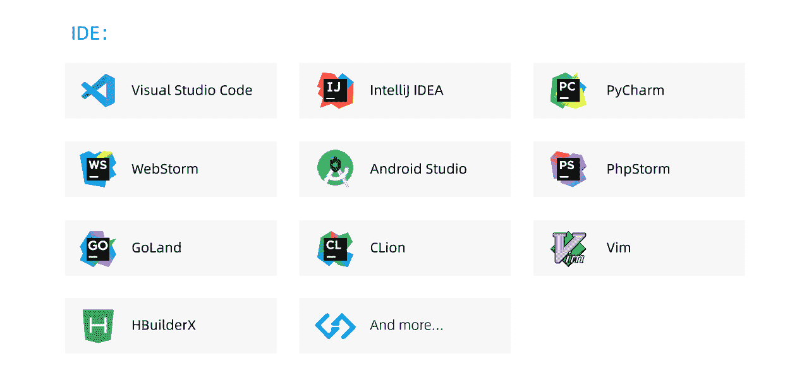

# ⏬ 安装插件

> 来源：[https://v11enp9ok1h.feishu.cn/docx/JGmodoxHcoTIqqx9jaScisW2n7d](https://v11enp9ok1h.feishu.cn/docx/JGmodoxHcoTIqqx9jaScisW2n7d)

**CodeGeeX在主流IDE平台，以**插件产品的形态提供给所有开发者免费使用。

# **插件下载方式**

在** VSCode 和 **JetBrains IDEs 、HBuilderX、Visual Studio插件市场搜索“CodeGeeX”即可免费下载；

**VSCode插件安装地址：**

https://marketplace.visualstudio.com/items?itemName=aminer.codegeex

JetBrains IDEs插件安装地址：

https://plugins.jetbrains.com/plugin/20587-codegeex

HBuilderX 插件安装地址：

https://ext.dcloud.net.cn/plugin?id=15497#detail

Open VSX 插件安装地址：

https://open-vsx.org/extension/AMiner/codegeex

Visual Stuido 2022 插件安装地址：

https://marketplace.visualstudio.com/items?itemName=aminer.CodeGeeXVisualStudio

Visual Studio 2019 插件安装地址：

https://marketplace.visualstudio.com/items?itemName=aminer.CodeGeeXVisualStudio2019

# 子页面目录