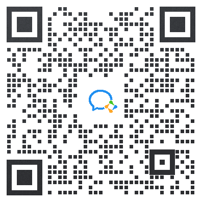

# 【已结束】GLM 法律挑战赛（25万）

> 来源：[https://v11enp9ok1h.feishu.cn/docx/RpgLdw1eUol6Y0xUByhcfRornoe](https://v11enp9ok1h.feishu.cn/docx/RpgLdw1eUol6Y0xUByhcfRornoe)

欢迎参加「GLM 法律大模型挑战赛」。

伴随着技术迭代，大语言模型（LLM）已经渗透到各个传统领域，展现出惊人的效果，法律行业更不例外。在法律服务、案件分析、合同审核等方面，LLM 已经展现出强大的能力。

为了探索 LLM 在法律行业的应用前景，在琶洲算法**大赛赛事主办方的指导下，我们**共同推出了 GLM 法律行业大模型挑战赛。

本赛题聚焦于法律文书生成的广泛问题，赛题由智谱AI、深圳数据交易所、安硕信息和魔搭社区联合承办，天池平台为指定赛事平台。本次比赛的目标是共同推动大模型在法律领域的发展，并邀请广大开发者和相关技术团队为大模型时代加速创新。

本次比赛要求参赛选手以 GLM-4 模型为中心创建一个能够与用户进行交互的法律虚拟助手。这个助手需要利用大语言模型的语义理解、Function Call 等能力，去理解自然语言查询，调用相关的法律知识库或API，做针对性的回答。通过这种方式，实现法律知识的普及和便捷获取，提高法律服务的效率。

> 本次挑战赛隶属于 2024 年第三届琶洲算法大赛 AI 大模型挑战赛赛道。2024 年第三届琶洲算法大赛（赛题总网站）由广州市人民政府、 中国人工智能学会联合主办， 中国信息通信研究院、 广州市海珠区人民政府、 广州市科学技术局、 广州市工业和信息化局、 广州市政务服务和数据管理局、 人工智能与数字经济广东省实验室（广州）共同承办， 聚焦 AI 大模型、 AIGC 行业热点， 广泛邀请行业龙头企业、 科研机构、 投资机构、 生态合作企业、 行业协会参与出题、发动征集、评审、技术合作及商业落地机会， 预计将吸引超 5000 支队伍参赛。

# **一、赛事日程**

报名：2024年5月29日- 6月30日。

在天池平台和琶洲算法大赛官网完成双重注册，未在官网报名将视为参赛无效。为了便于参赛者比赛，我们将对每支报名成功的团队赠送 500w GLM-4 API Tokens。

+   天池平台：https://tianchi.aliyun.com/competition/

+   琶洲算法大赛官网：http://www.aicompetition-pz.com

**初赛：2024年5月30日-7**月14日。初赛将分为 A 榜和 B 榜：

+   A 榜时间为 5 月 30日 - 6月30日。

+   B 榜时间为 7月1日-7月14日。评测和 A 榜一致，赛题将做难度上的变化。

初赛成绩将根据 A 榜和 B 榜成绩加权得到。其中 A 榜成绩占 30%，B 榜成绩占 70%。初赛各赛区前10名的参赛队伍将进入复赛。

复赛：2024年7月21日-8月4日。复赛也将分为 A 榜和 B 榜：

+   A 榜时间为 7 月 21日-8月1日。

+   B 榜时间为 8月2日-8月4日。评测和 A 榜一致，赛题会做调整。

同样，复赛成绩将根据 A 榜和 B 榜成绩加权得到。其中 A 榜成绩占 30%，B 榜成绩占 70%。

+   排名前 12 名队伍晋级决赛答辩环节。

+   复赛阶段，每个赛区第一名将获得赛事方提供的 2万元人民币现金奖励（税前）。

决赛：暂定2024年8月底或9月初，具体时间另行通知。决赛将以线下或线上答辩的形式进行，晋级决赛的队伍需提前准备答辩材料，包括答辩PPT、参赛总结、核心代码。

总决赛：暂定2024年9月，具体时间另行通知。决赛答辩冠军需要参加琶洲算法大赛总决赛的答辩，与另外 13 个赛道的冠军队伍同台竞技，争夺最终的总冠军。

# **二、奖项设置**

本次大赛奖金池共计25万元人民币现金奖励，具体如下（以下奖金皆为税前）：

**冠军（1 名）：**10 万元人民币奖金，价值10万元的算力券，颁发获奖证书

亚军（1 名）：5 万元人民币奖金，价值3万元的算力券，颁发获奖证书

季军（1名）：2 万元人民币奖金，价值2万元的算力券，颁发获奖证书

此外，为了激励大家，赛事组织方将在：

+   复赛阶段针对各赛区第一名奖励 2万元人民币。

+   决赛冠军有机会参与琶洲算法大赛总决赛（即与 14 个赛道冠军同台竞技），有机会另获 40万人民币现金奖励和价值10万元算力券。总冠军团队同时将获得 500 万专项扶持、广州市人才绿卡、琶洲 CBD 户口。

+   针对所有获奖团队，将有最高 1000万元的创业（项目）落地扶持，以及不低于 300 万元的创投机构资金优先投资；获奖团队成员将获得人才落地绿色服务通道。

（以上奖金均为税前）

# **三、赛题描述**

本次比赛要求参赛选手以 GLM-4 模型为中心创建一个能够与用户进行交互的法律虚拟助手。这个助手需要利用大语言模型的语义理解、Function Call 等能力，去理解自然语言查询，调用相关的法律知识库或API，做针对性的回答。通过这种方式，实现法律知识的普及和便捷获取，提高法律服务的效率。

为了比赛公平性，本次比赛仅限于使用 GLM-4 API ，不允许使用其他的大语言模型。参赛选手可以使用其他公开访问的外部数据来微调模型，也可以使用向量数据库等技术。

具体赛题内容，请见天池比赛平台。

# **四、加入比赛**

## **报名参赛**

（扫码报名）

+   或复制链接：https://tianchi.aliyun.com/competition/

+   或点击「阅读原文」

## **加入比赛群**

（扫码入群，如提示群满或过期，请到公众号消息页面回复「比赛群」）

# 五、比赛答疑直播

<https://player.bilibili.com/player.html?bvid=1HT421a7so>