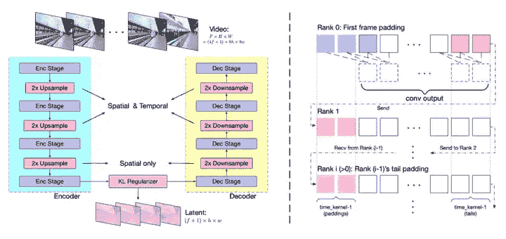
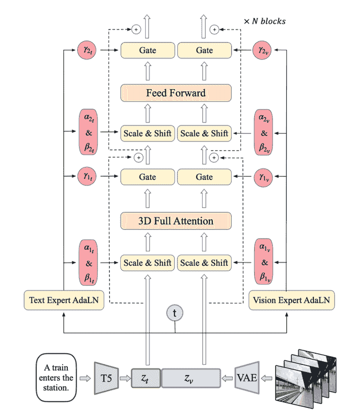
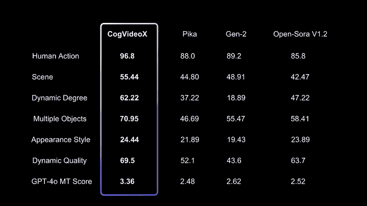
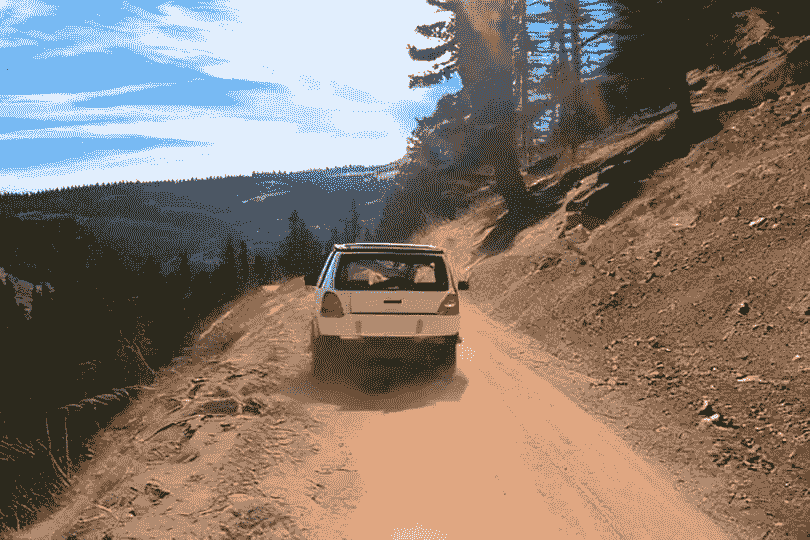
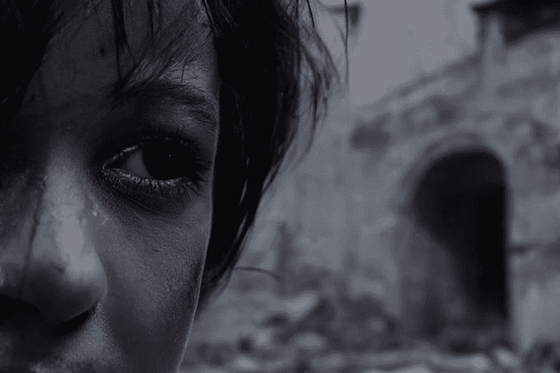
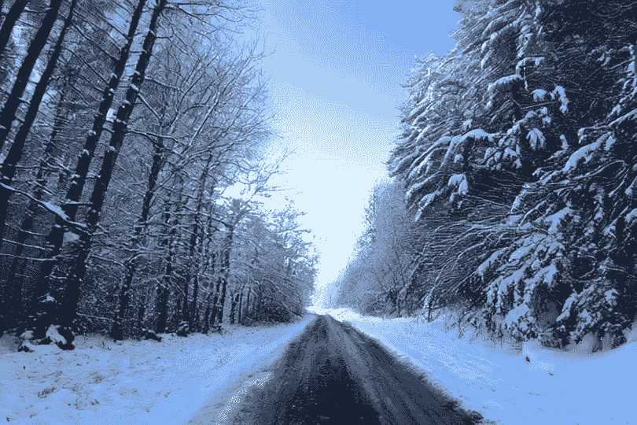

# 开源 · CogVideoX，开源了！

> 来源：[https://v11enp9ok1h.feishu.cn/docx/Qxg4ds93VoZrCbxKmzUcb26mnKd](https://v11enp9ok1h.feishu.cn/docx/Qxg4ds93VoZrCbxKmzUcb26mnKd)

随着大型模型技术的持续发展，视频生成技术正逐步走向成熟。以Sora、Gen-3等闭源视频生成模型为代表的技术，正在重新定义行业的未来格局。然而，截至目前，仍未有一个开源的视频生成模型能够满足商业级应用的要求。

智谱AI秉承“以先进技术，服务全球开发者”的理念，宣布将与「清影」同源的视频生成模型——CogVideoX开源，以期让每一位开发者、每一家企业都能自由地开发属于自己的视频生成模型，从而推动整个行业的快速迭代与创新发展。

CogVideoX开源模型包含多个不同尺寸大小的模型，目前我们将开源CogVideoX-2B，它在FP-16精度下的推理仅需18GB显存，微调则只需要40GB显存，这意味着单张4090显卡即可进行推理，而单张A6000显卡即可完成微调。

CogVideoX-2B的提示词上限为226个token，视频长度为6秒，帧率为8帧/秒，视频分辨率为720*480。我们为视频质量的提升预留了广阔的空间，期待开发者们在提示词优化、视频长度、帧率、分辨率、场景微调以及围绕视频的各类功能开发上贡献开源力量。

性能更强参数量更大的模型正在路上，敬请关注与期待。

代码仓库：https://github.com/THUDM/CogVideo

模型下载：https://huggingface.co/THUDM/CogVideoX-2b

体验链接：[https://huggingface.co/sp](https://huggingface.co/spaces/THUDM/CogVideoX)aces/THUDM/CogVideoX

技术报告：https://github.com/THUDM/CogVideo/blob/main/resources/CogVideoX.pdf

## 模型

### VAE

视频数据因包含空间和时间信息，其数据量和计算负担远超图像数据。为应对此挑战，我们提出了基于3D变分自编码器（3D VAE）的视频压缩方法。3D VAE通过三维卷积同时压缩视频的空间和时间维度，实现了更高的压缩率和更好的重建质量。

模型结构包括编码器、解码器和潜在空间正则化器，通过四个阶段的下采样和上采样实现压缩。时间因果卷积确保了信息的因果性，减少了通信开销。我们采用上下文并行技术以适应大规模视频处理。实验中，我们发现大分辨率编码易于泛化，而增加帧数则挑战较大。因此，我们分两阶段训练模型：首先在较低帧率和小批量上训练，然后通过上下文并行在更高帧率上进行微调。训练损失函数结合了L2损失、LPIPS感知损失和3D判别器的GAN损失。

### 专家 Transformer

我们使用VAE的编码器将视频压缩至潜在空间，然后将潜在空间分割成块并展开成长的序列嵌入z_vision。同时，我们使用T5，将文本输入编码为文本嵌入z_text，然后将z_text和z_vision沿序列维度拼接。拼接后的嵌入被送入专家Transformer块堆栈中处理。最后，我们反向拼接嵌入来恢复原始潜在空间形状，并使用VAE进行解码以重建视频。

添加图片注释，不超过 140 字（可选）

###  Data

视频生成模型训练需筛选高质量视频数据，以学习真实世界动态。视频可能因人工编辑或拍摄问题而不准确。我们开发了负面标签来识别和排除低质量视频，如过度编辑、运动不连贯、质量低下、讲座式、文本主导和屏幕噪音视频。通过video-llama训练的过滤器，我们标注并筛选了20,000个视频数据点。同时，计算光流和美学分数，动态调整阈值，确保生成视频的质量。

视频数据通常没有文本描述，需要转换为文本描述以供文本到视频模型训练。现有的视频字幕数据集字幕较短，无法全面描述视频内容。我们提出了一种从图像字幕生成视频字幕的管道，并微调端到端的视频字幕模型以获得更密集的字幕。这种方法通过Panda70M模型生成简短字幕，使用CogView3模型生成密集图像字幕，然后使用GPT-4模型总结生成最终的短视频。我们还微调了一个基于CogVLM2-Video和Llama 3的CogVLM2-Caption模型，使用密集字幕数据进行训练，以加速视频字幕生成过程。

添加图片注释，不超过 140 字（可选）

##  性能

为了评估文本到视频生成的质量，我们使用了VBench中的多个指标，如人类动作、场景、动态程度等。我们还使用了两个额外的视频评估工具：Devil 中的 Dynamic Quality 和 Chrono-Magic 中的 GPT4o-MT Score，这些工具专注于视频的动态特性。如下表所示。

添加图片注释，不超过 140 字（可选）

---

我们已经验证了scaling law在视频生成方面的有效性，未来会在不断 scale up 数据规模和模型规模的同时，探究更具突破式创新的新型模型架构、更高效地压缩视频信息、更充分地融合文本和视频内容。

## Demo

A detailed wooden toy ship with intricately carved masts and sails is seen gliding smoothly over a plush, blue carpet that mimics the waves of the sea. The ship's hull is painted a rich brown, with tiny windows. The carpet, soft and textured, provides a perfect backdrop, resembling an oceanic expanse. Surrounding the ship are various other toys and children's items, hinting at a playful environment. The scene captures the innocence and imagination of childhood, with the toy ship's journey symbolizing endless adventures in a whimsical, indoor setting.

[飞书20240802-161309.mp4](https://internal-api-drive-stream.feishu.cn/space/api/box/stream/download/all/Gbokbql7ZohZNYxAw4KcW5mgn2b)

The camera follows behind a white vintage SUV with a black roof rack as it speeds up a steep dirt road surrounded by pine trees on a steep mountain slope, dust kicks up from it’s tires, the sunlight shines on the SUV as it speeds along the dirt road, casting a warm glow over the scene. The dirt road curves gently into the distance, with no other cars or vehicles in sight. The trees on either side of the road are redwoods, with patches of greenery scattered throughout. The car is seen from the rear following the curve with ease, making it seem as if it is on a rugged drive through the rugged terrain. The dirt road itself is surrounded by steep hills and mountains, with a clear blue sky above with wispy clouds.

[飞书20240802-161307.mp4](https://internal-api-drive-stream.feishu.cn/space/api/box/stream/download/all/BhtRbwmDCoJGzhxKd87c7kpdnQd)

In the haunting backdrop of a war-torn city, where ruins and crumbled walls tell a story of devastation, a poignant close-up frames a young girl. Her face is smudged with ash, a silent testament to the chaos around her. Her eyes glistening with a mix of sorrow and resilience, capturing the raw emotion of a world that has lost its innocence to the ravages of conflict.

[飞书20240802-161258.mp4](https://internal-api-drive-stream.feishu.cn/space/api/box/stream/download/all/MCO1bA9TzogaaWxRekocqPaqn7b)

A single butterfly with wings that resemble stained glass flutters through a field of flowers. The shot captures the light as it passes through the delicate wings, creating a vibrant, colorful display. HD.

[000000.mp4](https://internal-api-drive-stream.feishu.cn/space/api/box/stream/download/all/PrcCbJST6oZYpXxfL8jcAQeQncl)

A snowy forest landscape with a dirt road running through it. The road is flanked by trees covered in snow, and the ground is also covered in snow. The sun is shining, creating a bright and serene atmosphere. The road appears to be empty, and there are no people or animals visible in the video. The style of the video is a natural landscape shot, with a focus on the beauty of the snowy forest and the peacefulness of the road.

[000000.mp4](https://internal-api-drive-stream.feishu.cn/space/api/box/stream/download/all/SIINbYqrxox7AcxNxYMcxCBEnKV)

Extreme close-up of chicken and green pepper kebabs grilling on a barbeque with flames. Shallow focus and light smoke. vivid colours

[000000.mp4](https://internal-api-drive-stream.feishu.cn/space/api/box/stream/download/all/ZfHMbC1KkoRrFZx922RcuSCJnjh)