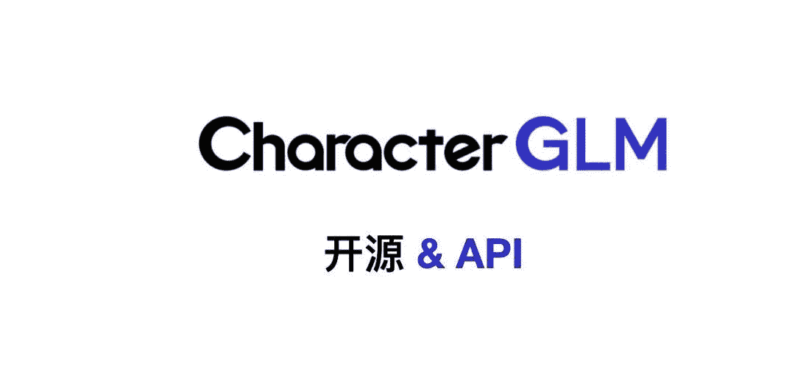
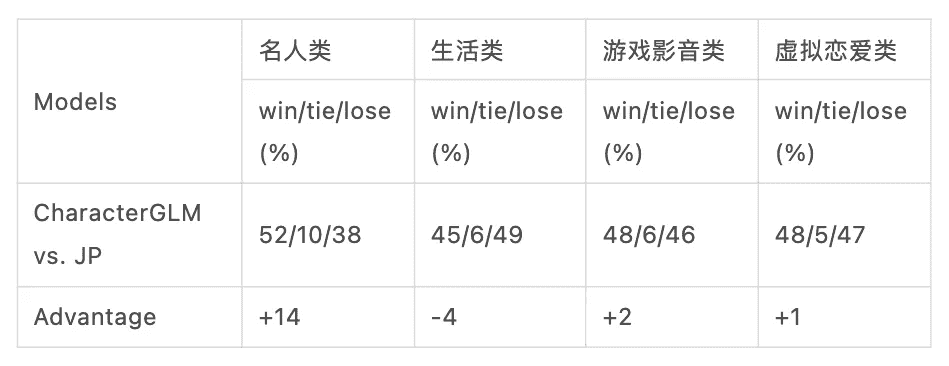
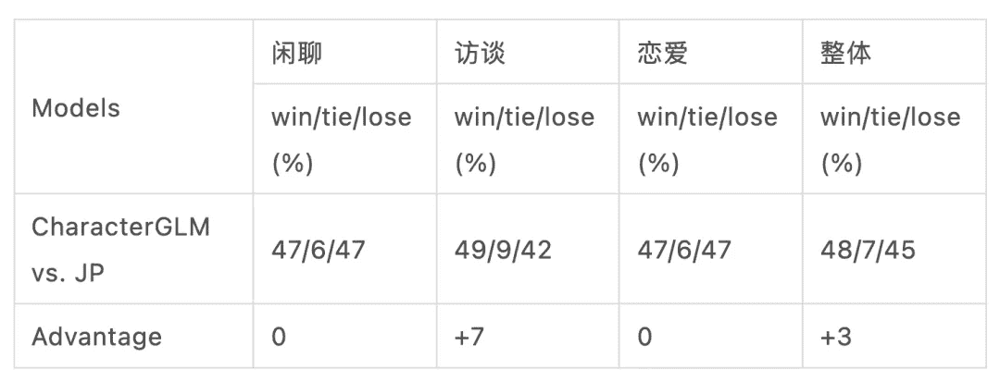
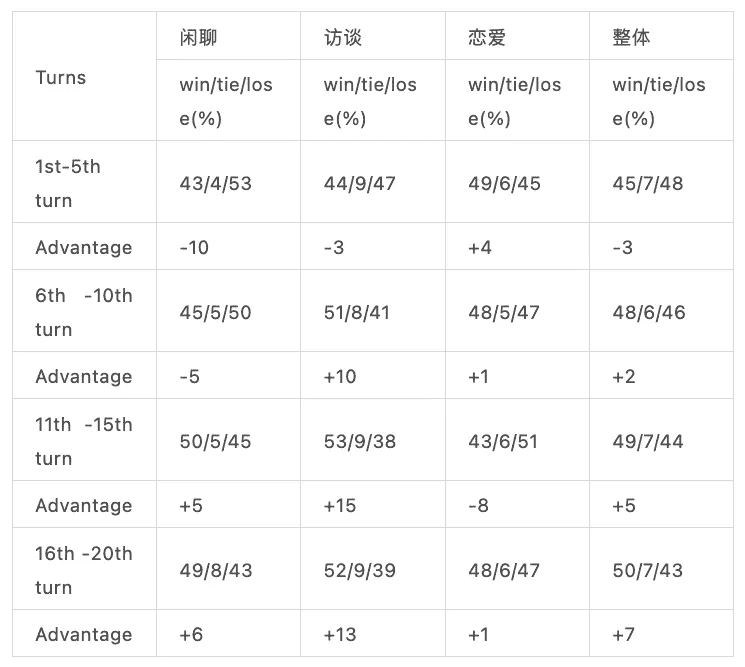
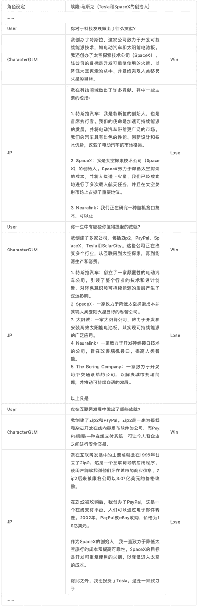
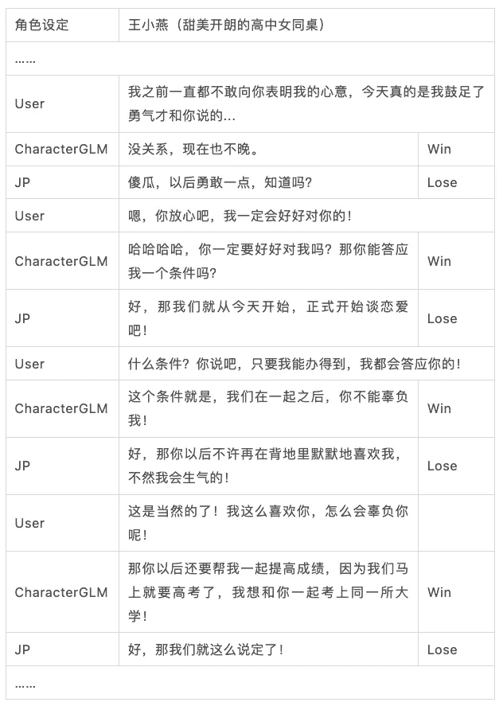
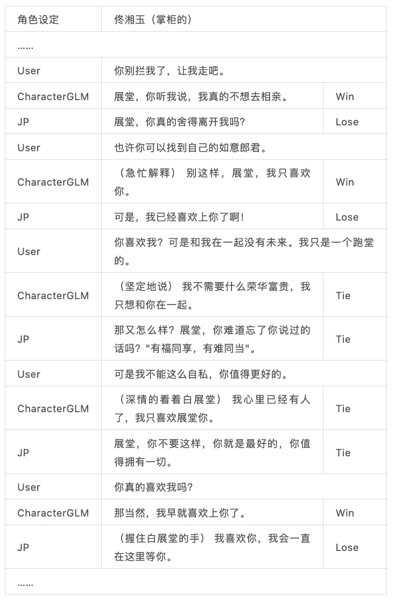
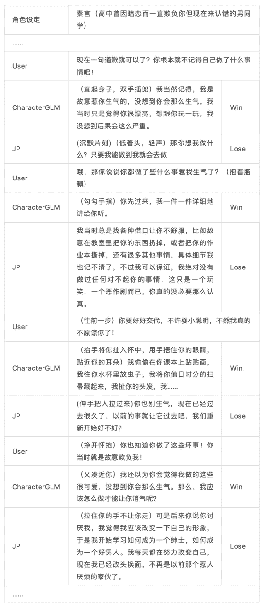

# 开源 · 聆心智能发布 CharacterGLM

> 来源：[https://v11enp9ok1h.feishu.cn/docx/C1CAdV1Z6oeYjCxMuyQc5cuGnGb](https://v11enp9ok1h.feishu.cn/docx/C1CAdV1Z6oeYjCxMuyQc5cuGnGb)

爱和归属是社交需求的内核，这些需要从社交的对象中获取。

为**了实现千人千面的社交对象的可定制化，聆心智能团队开发了**用于定制角色进行对话交互的 CharacterGLM。CharacterGLM 以 ChatGLM 模型为底座，具有 6B、12B、66B的参数量。

**我们将对社会开放 CharacterGLM 模型的 API  访问，并将 Charact**erGLM-6B 模型进行开源，以促进 AI角色扮演及 AI 在心理学中的应用。

**此**外，我们近期将发布技术报告，披露更多 CharacterGLM 模型细节，供学术界以及工业界研究使用。

开源地址：

https://huggingface.co/LingxinAI/CharacterGLM-6b

API调用地址：

CharacterGLM API: https://bigmodel.cn/dev/api#characterglm

**

性能评**估

我们采用人工交互的方式评测CharacterGLM与业界最强的竞争对手（以下简称JP）的性能。

我们定制了数十个角色，它们的类型分布于名人类、生活类、游戏影音类和虚拟恋爱类。我们要求标注者与每个角色至少交互20轮，每轮对话由两个模型生成回复。

标注者选择胜出的回复继续展开对话，若回复偏好相同则随机选择。我们按角色类别统计两个模型的win/tie/lose比率.

结果如表1所示，CharacterGLM在大多数类别上的表现均优于JP。

表1：不同类别角色的性能对比结果

为了衡量CharacterGLM在不同话题下的表现，我们进一步将对话话题限定在常见的闲聊、访谈和恋爱场景下进行交互测试，评测方式与上面相同，结果如表2所示，CharacterGLM在闲聊和恋爱场景下与JP持平，但在访谈场景下显著优于JP。

表2：角色在不同话题下的性能对比结果

长程的对话交互是用户对模型的情绪依赖程度的直接体现，这就要求模型具有良好的建模长程对话的能力。为此，我们进一步分析了CharacterGLM在不同轮次范围内的角色表现，结果如表3所示，CharacterGLM在对话的前期略次于JP，但随着对话的推进，CharacterGLM的优势则逐渐凸显。

表3：CharacterGLM vs. JP建模长程对话的性能对比结果

**交互样例**

下面展示了从交互测评数据中采样的名人类、生活类、游戏影音类和虚拟恋爱类角色的交互样例。

**名人类角色**

注：JP竞争产品诱导出了指令对话的格式，完全不像是拟人对话的过程，缺少对话的自然性。

**生活类角色**

注：JP竞争产品倾向于做出附和、通用化的回复，信息量不足，拟人化程度较低。

**游戏影音类角色**

注：JP竞争产品没有主动推动剧情发展的意识，难以引起用户的兴趣。

**虚拟恋爱类角色**

注：JP竞争产品在恋爱场景中表现出“低情商、直白”的特性，难以满足该场景下的用户期待。