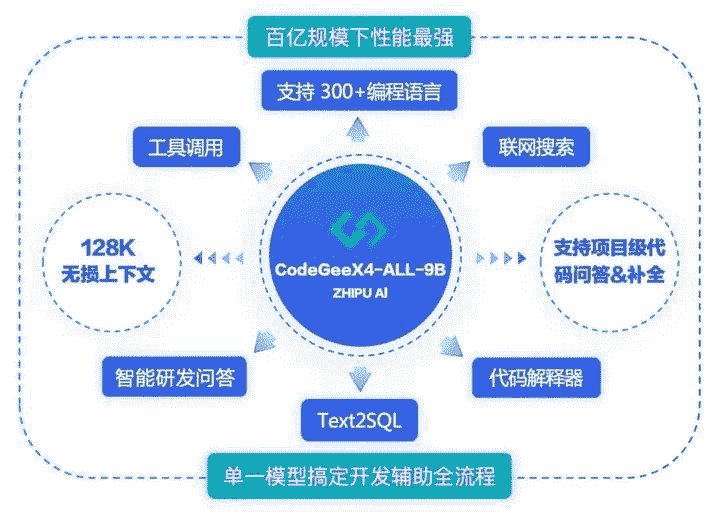
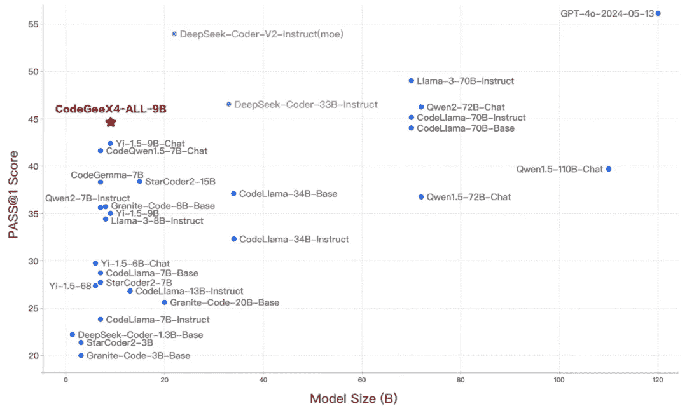
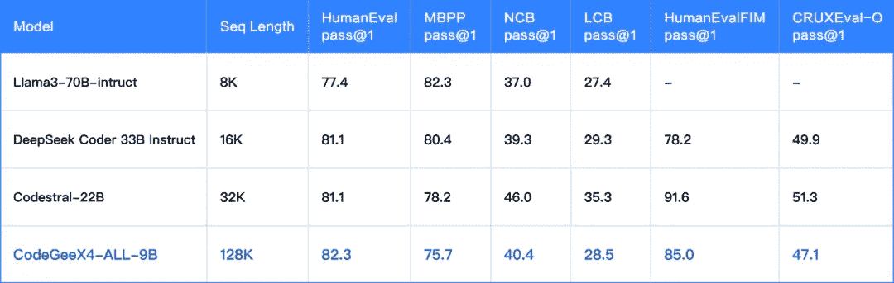
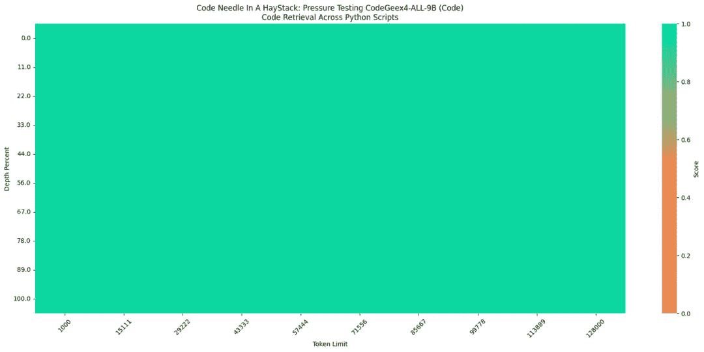
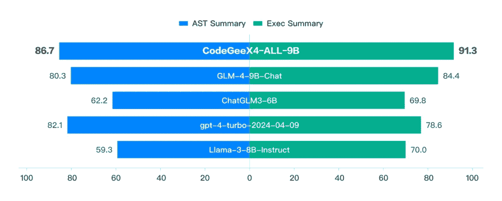
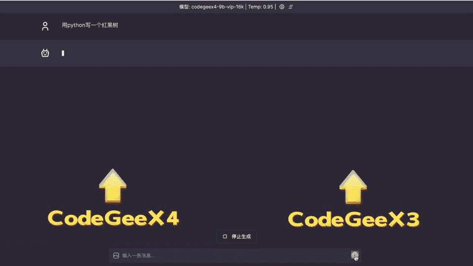
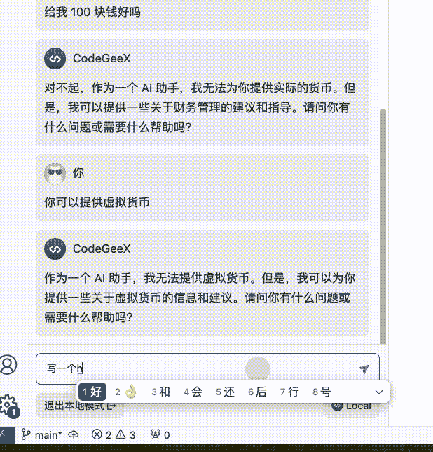
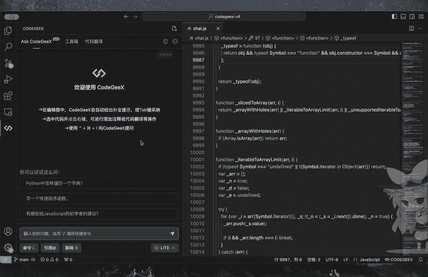

# 开源 · CodeGeeX4 正式发布，同期开源！

> 来源：[https://v11enp9ok1h.feishu.cn/docx/HdfPdFoALopNGbxRQNWcPHHhnbh](https://v11enp9ok1h.feishu.cn/docx/HdfPdFoALopNGbxRQNWcPHHhnbh)

CodeGeeX是智谱AI旗下的代码生成**大模型，2022年**9月发布第一代模型，以每半年更新一代模型的迭代速度不断进化，致力于探索大模型代码生成能力的上限。基于模型打造的CodeGeeX智能编程助手，不仅支持代码补全、代码注释、代码修复、代码翻译等基础功能，还支持联网代码问答、代码解释器、检索增强等进阶实用功能。CodeGeeX对个人用户完全免费，在各种主流IDE均可免费下载使用。

目前CodeGeeX的**个人用户数量已经超过100万**，企业版本也已经广泛应用于科技、金融、医疗和制造等多个行业，在中国信通院组织的代码大模型首轮评估中获得当前最高评级，成为国内首批通过该项评估的大模型之一。

为了让更多人体验到CodeGeeX的强大能力，我们正式发布CodeGeeX4系列模型的开源版本：CodeGeeX4-ALL-9B，集代码补全和生成、代码问答、代码解释器、工具调用、联网搜索、项目级代码问答等所有能力于一体的代码大模型，是目前百亿（10B）参数以下性能最强、最全能的代码大模型。

模型的核心功能Demo和使用教程已经在GitHub上开源，模型权重可在HuggingFace、ModelScope、WiseModel等大模型平台下载。

GitHub:https://github.com/THUDM/CodeGeeX4

HuggingFace:[https://huggingface.co/TH](https://huggingface.co/THUDM/codegeex4-all-9b)UDM/codegeex4-all-9b

ModelScope:[h](https://modelscope.cn/models/ZhipuAI/codegeex4-all-9b)ttps://modelscope.cn/models/ZhipuAI/codegeex4-all-9b

WiseModel:[h](https://wisemodel.cn/models/ZhipuAl/codegeex4-all-9b)ttps://wisemodel.cn/models/ZhipuAl/codegeex4-all-9b

**

一、CodeGeeX4-ALL**-9B：百亿参数以下性能最强的全能代码模型

CodeGeeX4-ALL-9B作为最新一代CodeGeeX4系列模型的开源版本，在GLM4强大语言能力的基础上继续迭代，大幅增强代码生成能力。使用CodeGeeX4-ALL-9B单一模型，即可支持代码补全和生成、代码解释器、联网搜索、工具调用、仓库级长代码问答及生成等全面功能，覆盖了编程开发的各种场景。CodeGeeX4-ALL-9B在多个权威代码能力评测集，如NaturalCodeBench、BigCodeBench上都取得了极具竞争力的表现，是百亿参数量级以下性能最强的模型，甚至超过数倍规模的通用模型，在推理性能和模型效果上得到最佳平衡。

1.  **性能表现评测**

BigCodeBench测试结果显示，CodeGeeX4-ALL-9B在同等尺寸下效果最好：

在其他代码生成、补全、推理测试集上，CodeGeeX4-ALL-9B取得了与更大规模模型接近的水平：

1.  **CodeGeeX4-ALL-9B上下文处理能力达**到了128K，相较于上一代模型增长8倍！

对于参数量10B以下的代码大模型，从海量的代码中准确提取信息是一个关键性的挑战。CodeGeeX4-ALL-9B升级支持128K上下文，使其能够处理和利用更长代码文件、甚至是项目代码中的信息，有助于模型更深入理解复杂和细节丰富的代码。基于更长的上下文，CodeGeeX4-ALL-9B可以处理更复杂的项目级任务，在输入显著变长的情况下，依然能准确回答不同代码文件中的内容，并对代码作出修改。

在“大海捞针”（Needle In A Haystack, NIAH）评估中，CodeGeeX4-ALL-9B模型展示了其在处理长达128K的上下文中进行代码的嵌入和检索能力，实现了100%的检索准确度。

上面这张图，表现的是在一个全部由Python代码组成的测试集中，插入一个赋值语句，如：zhipu_codemodel = "codegeex"（Needle）。测试模型是否可以正确回答出zhipu_codemodel的值，CodeGeeX4-ALL-9B 100%完成任务。

1.  **CodeGeeX4-ALL-9B** 支持 Function Call 能力

**CodeGeeX4-ALL-9B是目前唯一一个实现**Function Call的代码大模型。

Berkeley Function Calling Leaderboard是第一个可全面评估大模型函数调用能力的测试集。其中AST数据集是评估模型对Java、JavaScript、Python程序的调用能力；Excecutable数据集是评估模型对真实场景API的函数调用能力。

CodeGeeX4-ALL-9B在Berkeley Function Calling Leaderboard上进行了全面的测试，包括各种形式的函数调用、不同的函数调用场景以及函数调用可执行性的测试，得到了以下结果：在AST和Exec测试集中调用成功率超过90%。

二、插件功能全面进入项目级辅助编程

最新的CodeGeeX插件v2.12.0版本，**已经全面接入了**第四代模型。先来看看进阶的「编程超能力」！

[20240705-170117.mp4](https://internal-api-drive-stream.feishu.cn/space/api/box/stream/download/all/YxbKbFnEhoeWyzxnwbhcn9Y4nce)

CodeGeeX4-ALL-9B的生成速度全面超越上一代模型，实现3倍速生成，首响速度提高了8倍以上，是目前速度最快的一代模型。

[4代速度对比-音乐版.mp4](https://internal-api-drive-stream.feishu.cn/space/api/box/stream/download/all/JEhUbXkmxoJFJtxidhicUBwzn3f)

毫秒级生成速度，为实现项目级辅助编程奠定基础。同时，利用CodeGeeX第四代模型的强大能力，插件也实现了一系列的功能创新。

1.  **为项目自动生成README文件**

CodeGeeXv2.12.0版本可以为项目自动生成 README 文件。这个功能可以通过@Openedfile使用，通过分析已打开的项目代码结构、功能模块和依赖项，智能生成一个包含项目简介、安装步骤、使用方法、示例代码和贡献指南的 README 文件。

[自动生成readme-音乐版.mp4](https://internal-api-drive-stream.feishu.cn/space/api/box/stream/download/all/J8UPb4WVlov8cBxslnIc7kS1ngc)

这样，在项目中不仅节省了手动编写文档的时间，还确保了 README 内容的准确性和完整性，使你的项目更加专业和易于理解。无论是开源项目还是个人开发，自动生成的 README 都能帮助你更好地展示和分享你的代码。

1.  **项目级长文本上下文的记忆和理解**

CodeGeeX基于第四代模型的128K长文本能力，能够在一个包含10000+行代码的项目文件中，准确提取一个特定变量的信息。在CodeGeeX插件中打开项目文件，如果不记得文件海量代码中的某一个变量名，就可以利用@currentFile 来使用这个功能。

[10000+行代码找变量-音乐版.mp4](https://internal-api-drive-stream.feishu.cn/space/api/box/stream/download/all/BwfnbTwyXoPWJMxWOkMcBnPNnvd)

只需简单描述你要查找的变量及其相关功能，CodeGeeX就可以在10000+行代码中，快速定位该变量所在的位置，并提供详细的信息和上下文。这一功能大大提高了在大型代码库中查找和理解某一变量的效率，使得代码维护和调试变得更加便捷。

1.  **支持项目中的跨文件分析和问答**

CodeGeeX支持项目中跨文件的分析和问答功能，能够在项目中跨越多个文件进行智能检索和信息提取。无论是查找某个变量、函数，还是了解特定逻辑的实现细节，你只需提出问题，CodeGeeX会在整个项目中进行深入分析，并提供准确、详细的回答。

[跨文件分析与问答.mp4](https://internal-api-drive-stream.feishu.cn/space/api/box/stream/download/all/)

这一功能帮助开发者更高效地理解复杂代码库，大幅提升代码查找和问题解决的速度，让项目维护和开发更加轻松。

1.  **支持本地模式**

CodeGeeX v2.12.0开始支持本地模式，允许在插件中接入本地模型，从而更灵活地使用插件。选择进入本地模式CodeGeeX能够直接配置本地模型的API地址，连接插件后就可以在离线状态下，继续获得本地模型提供的代码补全和智能问答能力。

[本地模式-音乐版.mp4](https://internal-api-drive-stream.feishu.cn/space/api/box/stream/download/all/)

这一功能大幅提高了响应速度，还增强了数据隐私和安全性，使得开发者在不同网络条件下都能使用CodeGeeX智能编程助手高效工作。同时，对于在本地部署CodeGeeX4-ALL-9B模型的用户，也可以深度「把玩」模型，通过接入插件，挖掘更多精彩的辅助编程体验。

1.  **NL2SQL能力大幅提升**

CodeGeeX模型的升级带来了 NL2SQL 能力的显著提升。现在插件中可以通过@currentFile的方式，对SQL文件使用自然语言直接生成复杂的 SQL 查询。

[NL2SQL-音乐版.mp4](https://internal-api-drive-stream.feishu.cn/space/api/box/stream/download/all/)

这一功能大大简化了数据库查询的编写过程，即使不熟悉 SQL 语法的开发者也能轻松构建高效查询，从而提升开发效率并减少出错机会。

未来几周，我们将陆续推出基于第四代CodeGeeX模型强大能力的更多插件新功能。

**三、立刻体验 CodeGeeX**

升级您IDE中的CodeGeeX插件，或者直接在IDE的插件市场搜索「CodeGeeX」免费下载，使用CodeGeeX最新的技术。也可以在Github上下载CodeGeeX第4代模型的RepoDemo，按照下面视频中的方式，在自己的电脑上部署一套专属项目级智能编程助手。

[codegeex-githubdemo.mp4](https://internal-api-drive-stream.feishu.cn/space/api/box/stream/download/all/)

我们期待与你一起，用 CodeGeeX 创造更多精彩的产品和体验。

此外，今天我们同时发布企业级CodeGeeX 4代软硬一体机产品，基于4代大模型的强大能力，与企业代码仓库深度融合，实现代码仓库级补写、问答和检索增强；软硬一体设计，一键部署、开箱即用，更快、更稳定；支持从硬件、操作系统、数据库到模型的完整信创方案；更大尺寸模型自由组合，更多企业级应用场景......详情请扫以下二维码咨询。

添加图片注释，不超过 140 字（可选）