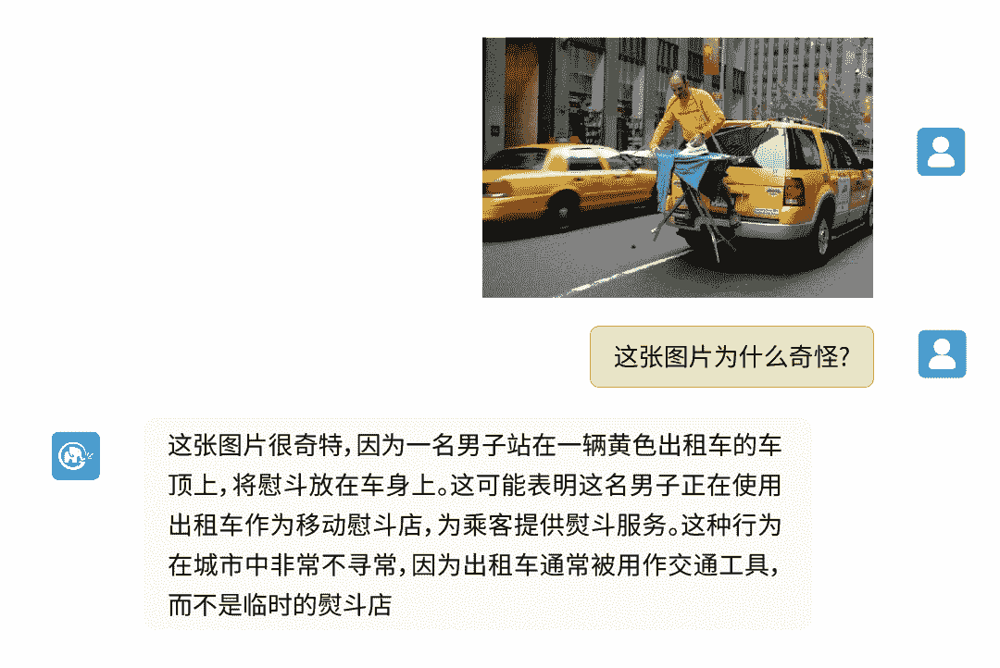
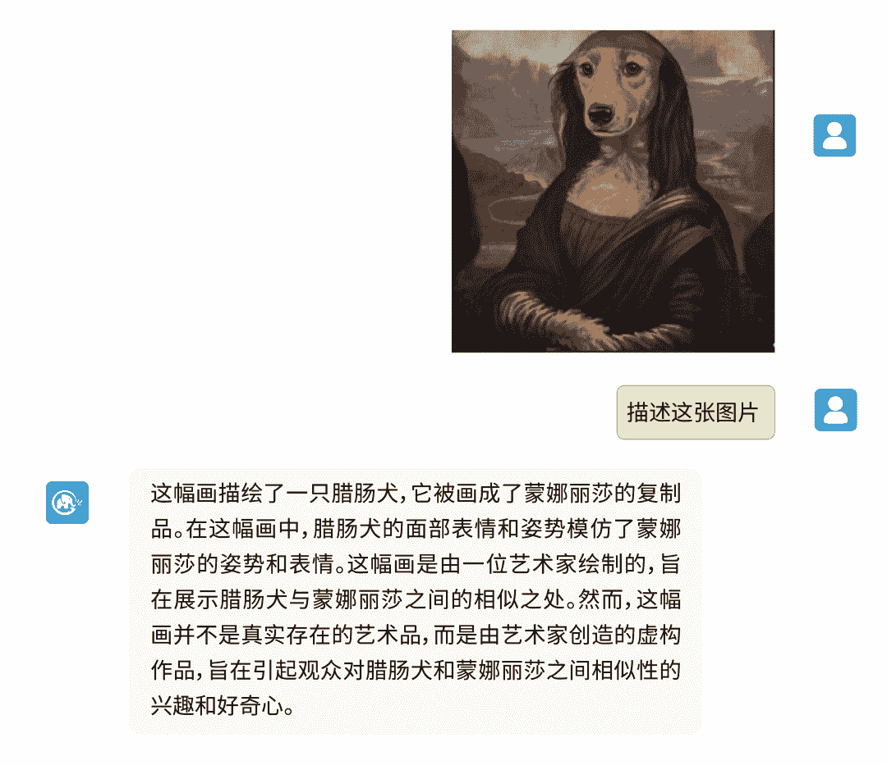
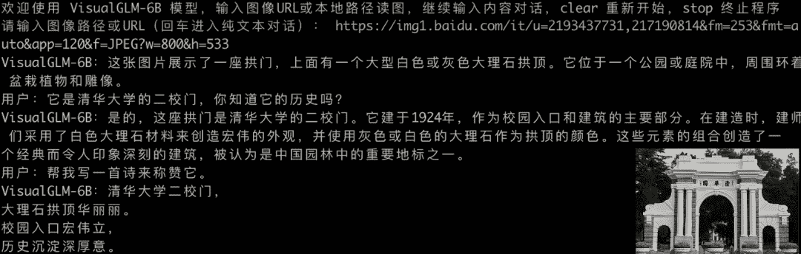
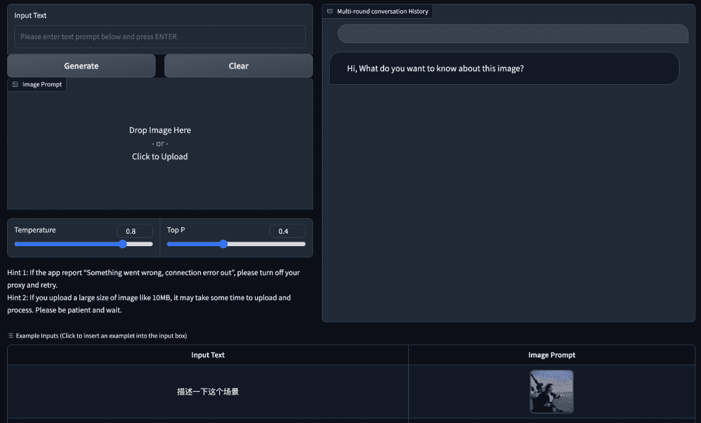

# 开源 · 多模态 VisualGLM-6B，最低只需 8.7G 显存

> 来源：[https://v11enp9ok1h.feishu.cn/docx/LpeddqjePoMGzjxYUwCcXbJunAb](https://v11enp9ok1h.feishu.cn/docx/LpeddqjePoMGzjxYUwCcXbJunAb)


OpenAI 的GPT-4样例中展现出令人印象深刻的多模态理解能力，但是能理解图像的中文开源对话模型仍是空白。

近期，智谱AI 和清华大学 KEG 实验室开源了基于 ChatGLM-6B 的多模态对话模型 VisualGLM-6B，供大家使用。

Github 链接：https://github.com/THUDM/VisualGLM-6B

Huggingface 链接：https://huggingface.co/THUDM/visualglm-6b

VisualGLM-6B 可以进行图像的描述及相关知识的问答：


也能结合常识或提出有趣的观点：





**一、简介**

VisualGLM-6B 是一个开源的，支持图像、中文和英文的多模态对话语言模型，语言模型基于 ChatGLM-6B，具有 62 亿参数；图像部分通过训练 BLIP2-Qformer 构建起视觉模型与语言模型的桥梁，整体模型共 78 亿参数。

VisualGLM-6B 依靠来自于 CogView 数据集的30M高质量中文图文对，与 300M 经过筛选的英文图文对进行预训练，中英文权重相同。该训练方式较好地将视觉信息对齐到 ChatGLM 的语义空间；之后的微调阶段，模型在长视觉问答数据上训练，以生成符合人类偏好的答案。

VisualGLM-6B 由 SwissArmyTransformer (简称 sat ) 库训练，这是一个支持 Transformer 灵活修改、训练的工具库，支持 Lora、P-tuning 等参数高效微调方法。本项目提供了符合用户习惯的 huggingface 接口，也提供了基于sat的接口。

不过，由于 VisualGLM-6B 仍处于v1版本，目前已知其具有相当多的局限性，如图像描述事实性/模型幻觉问题，图像细节信息捕捉不足，以及一些来自语言模型的局限性。请大家在使用前了解这些问题，评估可能存在的风险。在VisualGLM之后的版本中，将会着力对此类问题进行优化。

结合模型量化技术，用户可以在消费级的显卡上进行本地部署（INT4量化级别下最低只需8.7G显存）。

**二、使用**

**模型推理**

使用pip安装依赖

```
pip install -r requirements.txt
```

此时默认会安装deepspeed库（支持sat库训练），此库对于模型推理并非必要，同时部分Windows环境安装此库时会遇到问题。如果想绕过deepspeed安装，我们可以将命令改为

```
pip install -r requirements_wo_ds.txtpip install --no-deps &#x27;SwissArmyTransformer&gt;=0.3.
```

如果使用Huggingface transformers库调用模型，可以通过如下代码（其中图像路径为本地路径）：

```
from transformers import AutoTokenizer, AutoModeltokenizer = AutoTokenizer.from_pretrained(&quot;THUDM/visualglm-6b&quot;, trust_remote_code=True)model = AutoModel.from_pretrained(&quot;THUDM/visualglm-6b&quot;, trust_remote_code=True).half().cuda()image_path = &quot;your image path&quot;response, history = model.chat(tokenizer, image_path, &quot;描述这张图片。&quot;, history=[])print(response)response, history = model.chat(tokenizer, &quot;这张图片可能是在什么场所拍摄的？&quot;, history=history)print(response)
```

如果使用SwissArmyTransformer库调用模型，方法类似，可以使用环境变量SAT_HOME决定模型下载位置。在本仓库目录下

```
&gt;&gt;&gt; import argparse&gt;&gt;&gt; from transformers import AutoTokenizer&gt;&gt;&gt; tokenizer = AutoTokenizer.from_pretrained(&quot;THUDM/chatglm-6b&quot;, trust_remote_code=True)&gt;&gt;&gt; from model import chat, VisualGLMModel&gt;&gt;&gt; model, model_args = VisualGLMModel.from_pretrained(&#x27;visualglm-6b&#x27;, args=argparse.Namespace(fp16=True, skip_init=True))&gt;&gt;&gt; from sat.model.mixins import CachedAutoregressiveMixin&gt;&gt;&gt; model.add_mixin(&#x27;auto-regressive&#x27;, CachedAutoregressiveMixin())&gt;&gt;&gt; image_path = &quot;your image path or URL&quot;&gt;response, history, cache_image = chat(image_path, model, tokenizer, &quot;描述这张图片。&quot;, history=[])&gt;&gt;&gt; print(response)&gt;response, history, cache_image = chat(None, model, tokenizer, &quot;这张图片可能是在什么场所拍摄的？&quot;, history=history, image=cache_image)&gt;&gt;&gt; print(response)
```

使用 sat 库也可以轻松进行进行参数高效微调。

请注意，Huggingface模型的实现位于Huggingface的仓库中，sat模型的实现包含于本仓库中。

**三、部署工具**

**命令行 Demo**

```
python cli_demo.py
```

程序会自动下载sat模型，并在命令行中进行交互式的对话，输入指示并回车即可生成回复，输入 clear 可以清空对话历史，输入 stop 终止程序。



程序提供如下超参数控制生成过程与量化精度：

```
usage: cli_demo.py [-h] [--max_length MAX_LENGTH] [--top_p TOP_P] [--top_k TOP_K] [--temperature TEMPERATURE] [--english] [--quant {8,4}]optional arguments:  -h, --help            show this help message and exit  --max_length MAX_LENGTH                        max length of the total sequence  --top_p TOP_P         top p for nucleus sampling  --top_k TOP_K         top k for top k sampling  --temperature TEMPERATURE                        temperature for sampling  --english             only output English  --quant {8,4}         quantization bits
```

我们也提供了继承自ChatGLM-6B的打字机效果命令行工具，此工具使用Huggingface模型：

```
python cli_demo_hf.py
```

**网页版 Demo**



我们提供了一个基于 Gradio 的网页版 Demo，首先安装 Gradio：pip install gradio。然后下载并进入本仓库运行web_demo.py：

```
git clone https://github.com/THUDM/VisualGLM-6Bcd VisualGLM-6Bpython web_demo.py
```

程序会自动下载sat模型，并运行一个 Web Server，并输出地址。在浏览器中打开输出的地址即可使用。--quant 4使用4比特量化减少显存占用。

我们也提供了继承自ChatGLM-6B的打字机效果网页版工具，此工具使用Huggingface模型：

```
python web_demo_hf.py
```

**API部署**

首先需要安装额外的依赖 pip install fastapi uvicorn，然后运行仓库中的 api.py：

```
python api.py
```

程序会自动下载sat模型，默认部署在本地的 8080 端口，通过 POST 方法进行调用。下面是用curl请求的例子，一般而言可以也可以使用代码方法进行POST。

```
echo &quot;{\&quot;image\&quot;:\&quot;$(base64 path/to/example.jpg)\&quot;,\&quot;text\&quot;:\&quot;描述这张图片\&quot;,\&quot;history\&quot;:[]}&quot; &gt; temp.jsoncurl -X POST -H &quot;Content-Type: application/json&quot; -d @temp.json http://127.0.0.1:8080
```

得到的返回值为

```
{    &quot;response&quot;:&quot;这张图片展现了一只可爱的卡通羊驼，它站在一个透明的背景上。这只羊驼长着一张毛茸茸的耳朵和一双大大的眼睛，它的身体是白色的，带有棕色斑点。&quot;,    &quot;history&quot;:[(&#x27;描述这张图片&#x27;, &#x27;这张图片展现了一只可爱的卡通羊驼，它站在一个透明的背景上。这只羊驼长着一张毛茸茸的耳朵和一双大大的眼睛，它的身体是白色的，带有棕色斑点。&#x27;)],    &quot;status&quot;:200,    &quot;time&quot;:&quot;2023-05-16 20:20:10&quot;  }
```

**四、模型量化**

在Huggingface实现中，模型默认以 FP16 精度加载，运行上述代码需要大概 15GB 显存。如果你的 GPU 显存有限，可以尝试以量化方式加载模型。使用方法如下：

```
按需修改，目前只支持 4/8 bit 量化。下面将只量化ChatGLM，ViT 量化时误差较大model = AutoModel.from_pretrained(&quot;THUDM/visualglm-6b&quot;, trust_remote_code=True).quantize(8).half().cuda()
```

在sat实现中，需先传参将加载位置改为cpu，再进行量化。方法如下，详见cli_demo.py：

```
from sat.quantization.kernels import quantizemodel = quantize(model.transformer, args.quant).cuda()指定 model.transformer 只量化 ChatGLM，ViT 量化时误差较大
```

**五、局限性**

本项目正处于V1版本视觉和语言模型的参数、计算量都较小，我们总结了如下主要存在的改进方向：

+   图像描述事实性/模型幻觉问题。在生成图像长描述的时候，距离图像较远时，语言模型的将占主导，有一定可能根据上下文生成并不存在于图像的内容。

+   属性错配问题。在多物体的场景中，部分物体的某些属性，经常被错误安插到其他物体上。

+   分辨率问题。本项目使用了224*224的分辨率，也是视觉模型中最为常用的尺寸；然而为了进行更细粒度的理解，更大的分辨率和计算量是必要的。