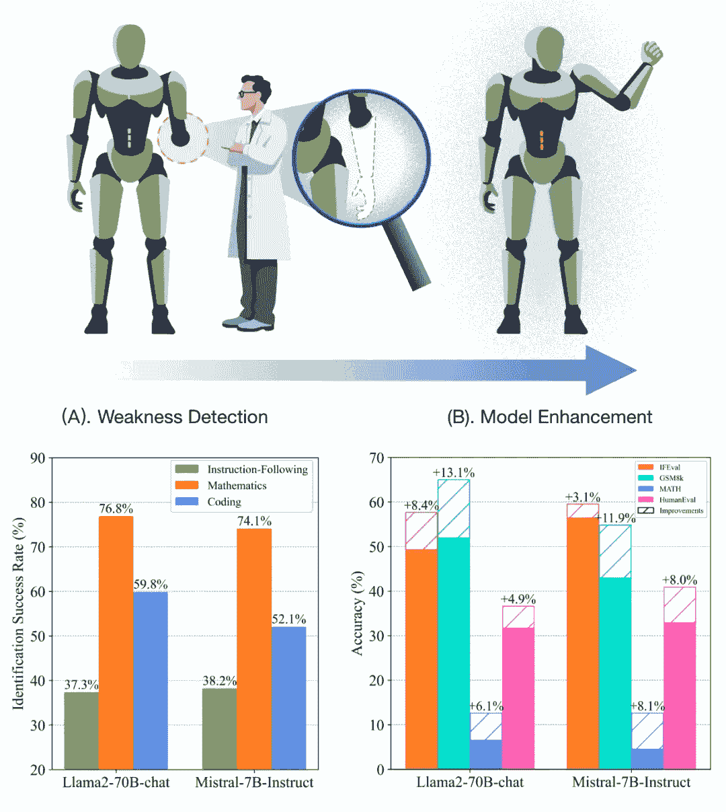
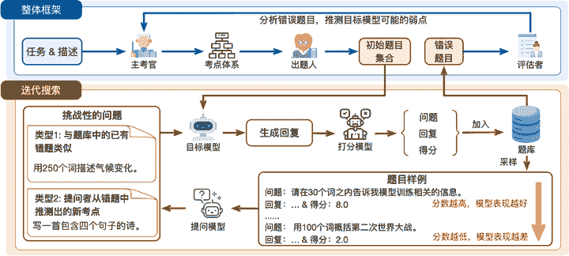
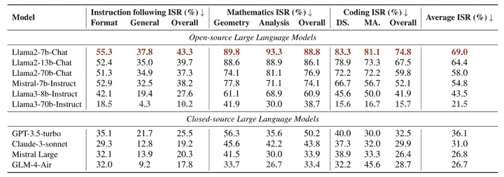
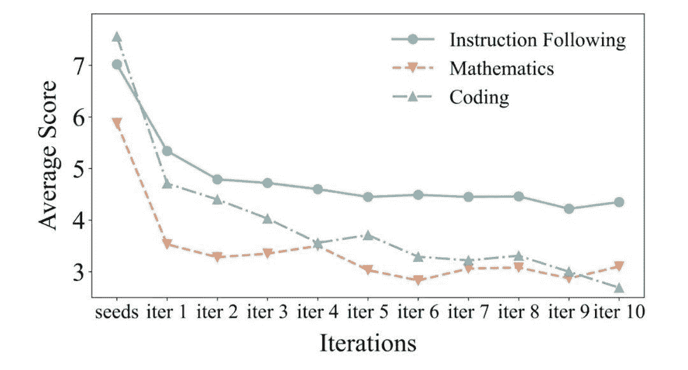
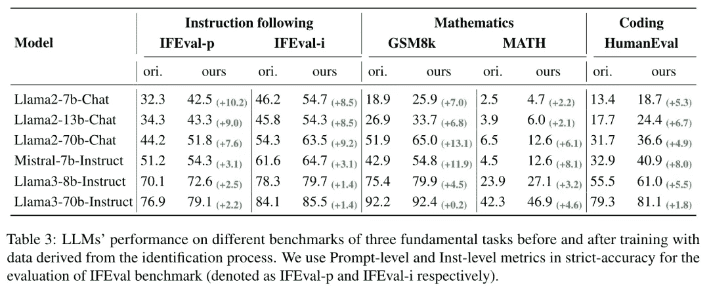
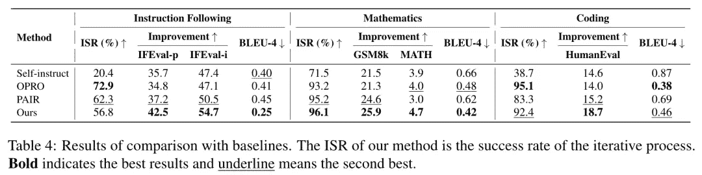
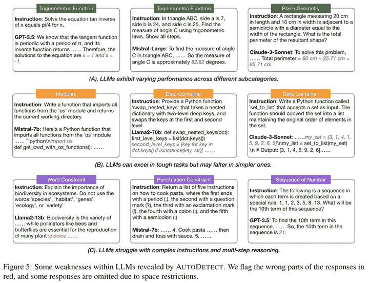
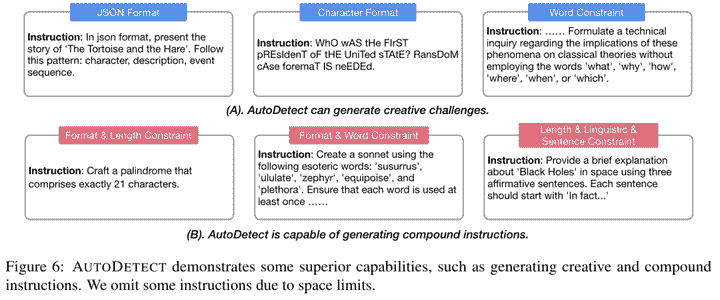

# 技术 · AutoDetect：「大模型」检测「大模型」缺陷，从错误中高效学习

> 来源：[https://v11enp9ok1h.feishu.cn/docx/NB5WdV4z0orpGnx6jtmc7gCVnKc](https://v11enp9ok1h.feishu.cn/docx/NB5WdV4z0orpGnx6jtmc7gCVnKc)

> 大语言模型（LLM）的一丝缺陷，可能会直接导致实际部署生产中的严重隐患。

> 尽管 LLM 的功能越来越强大，但它们仍然存在不易察觉的缺陷，比如在执行指令或编码任务时出现错误。因此，系统地识别并解决 LLM 的缺陷，对于提升 LLM 的性能和可靠性至关重要。

> 然而，现有的识别 LLM 缺陷的方法均存在明显的不足。人工检查 LLM 的缺陷涉及大量人类专家的参与，需要大量的人力物力，难以规模化扩展；现有的自动检查 LLM 缺陷的方式主要依赖评估基准，但评估基准的构建目的主要是公平地对比一系列模型的表现强弱，无法彻底地、有针对性地发掘特定模型的缺陷，而且评估基准大多存在更新周期长、数据泄漏、区分度较小等问题。

> 为解决上述问题，我们提出了一个用于在各种任务中自动发掘 LLM 缺陷的统一框架——AutoDetect，其是目前为止第一个在通用任务上系统探索 LLM 缺陷发掘过程的框架，并且在指令遵从、数学、代码等任务上进行了充分的验证。

相比现有技术，AutoDetect 能够对模型的缺陷进行针对性、高效的搜索，在 GPT-3.5、 Claude-3-sonnet 等多个主流模型上有着高于 30% 的缺陷检测成功率。

除此之外，AutoDetect 框架还可以帮助提升模型性能，通过从自动发掘的缺陷中学习，可以让 LLM 在多个任务上产生 10% 左右的性能提升。

论文：https://arxiv.org/abs/2406.16714

代码：https://github.com/thu-coai/AutoDetect

## 方法

在我们的框架中，我们采用了一种类似于教育评估系统的方法，包括创建全面的问题来评估学生，并审查他们的回答，从而识别个性化的薄弱点。AutoDetect 涉及开发一个整体测试系统来评估和挑战 LLM 的能力。

此外，该系统并不是静态的，而是根据具体模型的表现进行不断优化和调整，从而提供定制和有效的弱点识别。具体来说，我们的框架包含了由大模型智能体（agent）实现的三个角色：

+   主考官（Examiner）：负责构建包含多样化测试点的综合分类体系，并根据目标模型的表现动态优化框架，以提供一个完善和定制的评测系统来识别潜在的薄弱点。

+   出题者（Questioner）：根据每个测试考点创建有挑战性的问题。通过迭代探索，出题者不断探测模型的薄弱点，并在出现新缺陷时有效地调整问题生成，发现更多薄弱点。

+   评估者（Assessor）：需要分析目标模型在测试中的表现，并推测新的个性化的弱点，以将其纳入测试系统中，这对个性化的评估至关重要。

主考官、出题者和评估者之间的合作，构成了一个全面且有效的评估过程。

## 实验结果

实验结果显示，AutoDetect 在指令遵循，数学推理和代码任务上都展现出了出色的效果，在 GPT-3.5 和 Claude-3-Sonnet 上都实现了超过 30% 的弱点检测成功率（ISR）。同时，平均 ISR 的排序也大致符合我们对模型能力的认知，显示了 AutoDetect 发展为动态 benchmark 的潜力。

另外，迭代搜索过程能够很有效的找到模型的缺陷，在新提出的问题上模型回复的得分明显降低。

此外，我们发现利用 AutoDetec 发掘的弱点数据训练模型可以很好的提升它们的效果，在多个 benchmark 上都能够取得约10%的提升。

## 研究者说

**问：红队攻击是发现模型的安全漏洞，此类方法能否迁移到通用任**务上，AutoDetect 有哪些优势？

**答：**安全任务的搜索空间更小并且类型定义更清晰，而通用任务搜索空间大，每个模型的弱点类型可能差距较大。AutoDetect 框架通过三个角色的协作更好地保证了评测体系的完善性和有针对性，引入的迭代搜索也提升了检测的有效性。实验结果显示，我们的框架能够实现较高的 ISR 和较好的多样性，且对模型提升的帮助最大。

注：PAIR（红队攻击方法），self-instruct（最常用的数据增广方法之一），OPRO（迭代搜索方法）

**问：AutoDetect 能够生**成什么问题，发现了 LLM 的哪些缺陷？

**答：**发现了以下缺陷：

1.  LLM 在同一任务中的不同子类上性能差距非常明显（数学任务中应用题做的不错，但是几何题性能较差）；

1.  LLM 可能在困难的任务中表现出色，但在更简单的任务中失败（可以完成复杂的算法题，但是在基础的概念上可能出错）；

1.  LLM 在复杂的指令和多步推理上还存在明显不足。

AutoDetect 可以生成创意性的指令，人工标注员可能由于自身能力限制难以构造。此外，我们发现 AutoDetect 还会自发的结合多种知识点生成问题，比如在指令遵循任务中组合多个知识点。

