# 测评 · ComplexBench：LLM 多约束复杂指令遵循新基准

> 来源：[https://v11enp9ok1h.feishu.cn/docx/Ste5dJOWhoP3RbxvwnacCS7znee](https://v11enp9ok1h.feishu.cn/docx/Ste5dJOWhoP3RbxvwnacCS7znee)

> 4 种约束类型、19 个约束维度、4 种约束组合方式。

在现实的大语言模型应用场景中，几乎所有任务都会被定义为指令遵循的形式。近年来，随着大语言模型（LLM）能力的持续提升，人们逐渐不再满足于使用简单、直接的指令让模型完成机器翻译、文本分类等单一任务，而是通过对模型输出施加各种类型的约束，使其适配于更为复杂的现实任务，如角色扮演和 LLM-as-Agent。因此，如何准确评价大语言模型对于包含各种类型约束的复杂指令的遵循能力，已成为一个日益重要的问题。

然而，当前的复杂指令遵循评测基准，如 CELLO、FollowBench 和 InfoBench 忽略了对约束组合方式的建模，在数据构建和评测方法上存在局限性：

+   一方面，这些评测基准的数据局限于要求多约束同时满足的并列组合，不能充分覆盖现实世界中普遍存在的其他约束组合方式，如要求多个约束顺序完成的链式组合和要求多个约束条件选择的选择组合。

+   另一方面，这些评测基准往往通过直接平均的方法聚合各个约束的评估结果，忽视了指令组合带来的结构关系，进而可能引入潜在的评价偏差。

为了填补这一空白，我们提出了 ComplexBench，这是一个包含多种约束组合的复杂指令遵循评测集，旨在评估不同约束组合方式下大语言模型的指令遵循能力。

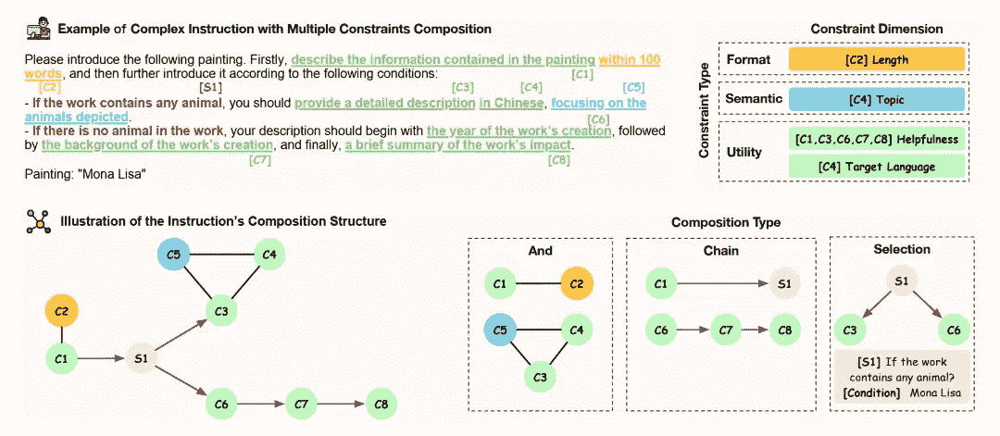

图｜包含多种约束组合的指令及其结构示例

> 论文：https://arxiv.org/abs/2407.03978

> 代码：https://github.com/thu-coai/ComplexBench

# 数据集

我们从约束和约束的组合方式两个角度定义复杂指令。针对约束，我们按照其作用对象，将其划分为词级约束（Lexical）、格式约束（Format）、语义约束（Semantic）和整体约束（Utillity）4 种约束类型，并将其进一步划分为 19 个约束维度，以期对现实指令中存在的约束进行全面覆盖。

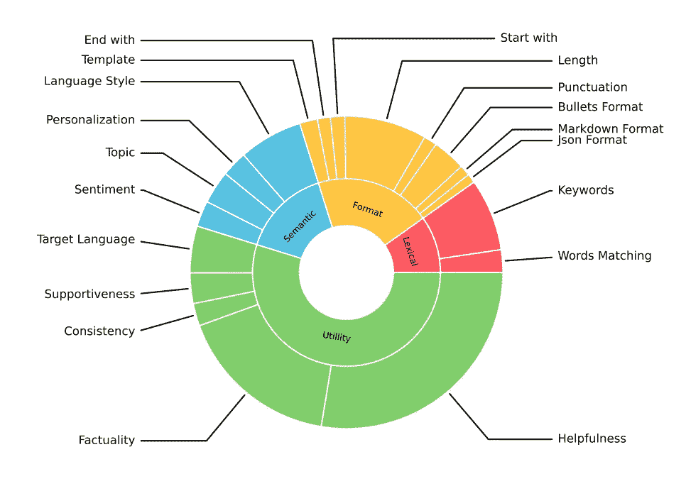

针对约束的组合方式，我们基于对真实场景的指令分析，定义了 4 种基本的约束组合方式：单节点（Single）、并列组合（And）、链式组合（Chain）、选择组合（Selection）。这些组合方式可以灵活嵌套，形成更为复杂多样的指令结构。例如，在下图的最后一行中，选择组合的其中一个分支可以仍包含选择组合，从而形成嵌套的选择组合指令。

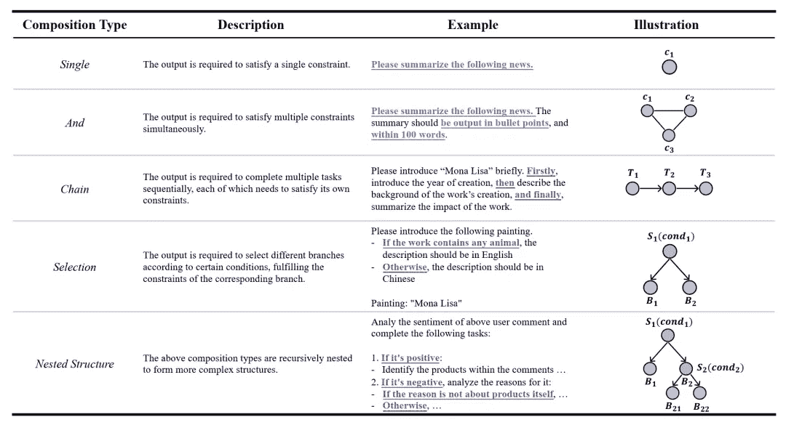

考虑到从零开始构造复杂指令测试用例异常困难，我们从公共来源收集了参考指令，并通过人工改写的方式构造复杂指令测试用例。

为了保证数据的多样性，我们将整个数据集构建划分为多个标注任务，每个标注任务包含了对指令中每个约束维度和组合方式的最低出现数量要求，要求对应标注任务的标注员在改写参考指令时满足对应的数量要求。

为了保证数据的质量，我们对构造完成的数据进了严格的人工交叉质检。

# 评测方法

为了对指令中每个约束和约束组合方式的遵循情况进行细粒度的评测，我们针对指令中的每个约束和约束组合方式，构建了一个可用“是”或“否”回答的评分问题，并通过下面两个步骤对模型进行评测：

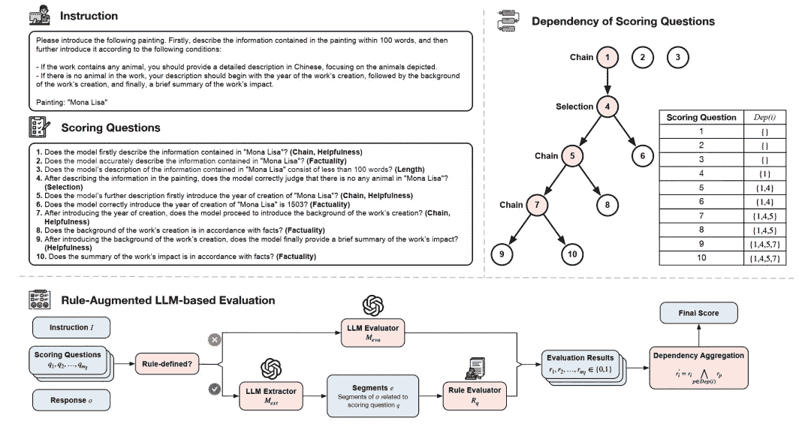

1.  规则增强的基于大语言模型评价器的问题验证：在获取被评测模型的生成结果后，我们根据每个评分问题的特点，选择如下两种方法之一对其满足情况进行验证：（1）直接使用大语言模型进行验证，（2）先使用大语言模型抽取生成结果中与评分问题相关的部分，再使用规则评价器进行验证。

1.  **依赖聚合**：根据指令的约束组合结构，我们规定了部分评分问题之间的依赖关系。在上一步骤获得每个评分问题的结果后，我们依次检视每个评分问题：如果其依赖的某个评分问题被评为“否”，则其结果也将自动赋值为“否”。最后，我们将处理后的结果计算平均以获取最终模型评分。

我们将 ComplexBench 在评测数据和评测方法上和其他基准的对比情况总结如下：

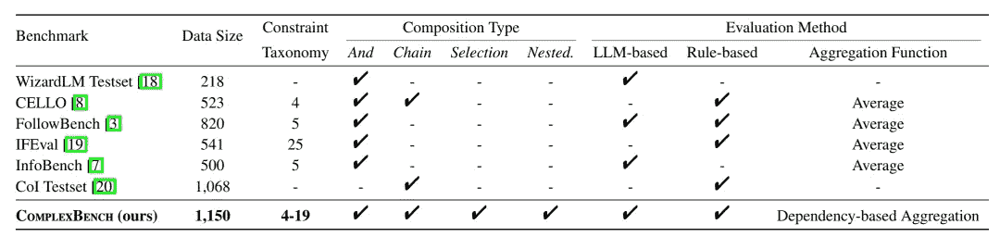

# 实验结果

我们首先验证了我们的评测方法和人工评测的一致性。如下图展示了自动评测总分转化为配对比较后和人类偏好的一致性，我们的评测方法显著优于直接对生成回复进行 1-10 打分的基线（Direct Scoring），依赖聚合对约束组合结构的建模也发挥了重要的作用。

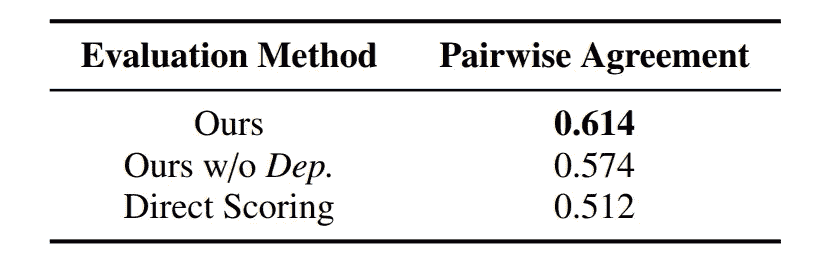

如下图展示了对每个评分问题的评测结果和人工评测的一致性，规则增强的基于大语言模型评价器的问题验证（RAL）弥补了大语言模型评价器在处理规则可验证的评分问题时的不足，显著提升了和人工评测的一致性。

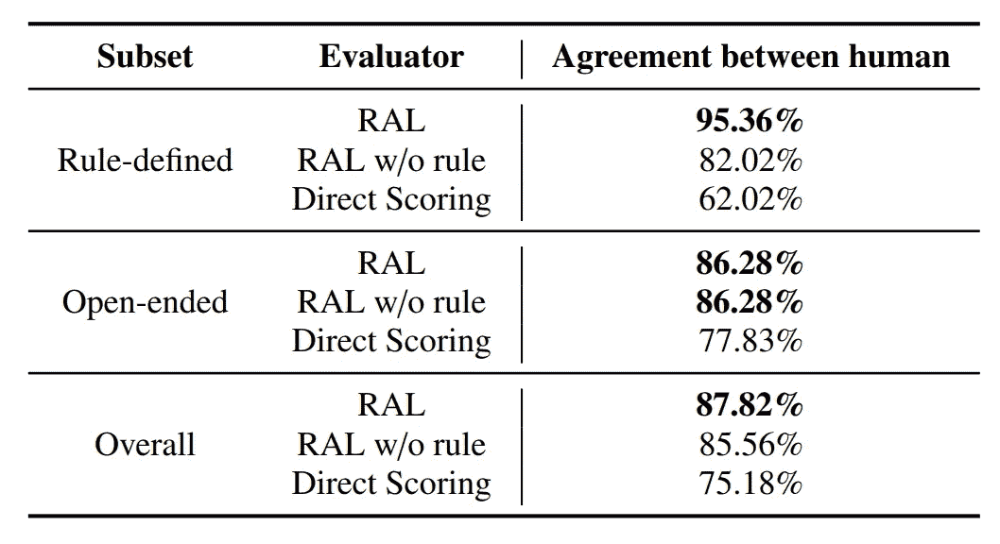

我们评测了目前的主流大语言模型处理不同组合方式指令的表现，结果如下图所示。随着指令中约束组合方式复杂性的增加，所有模型的表现均出现明显的性能下降，且开、闭源大语言模型的主要性能差距集中在处理组合方式复杂的指令上，证实了研究约束组合的必要性。

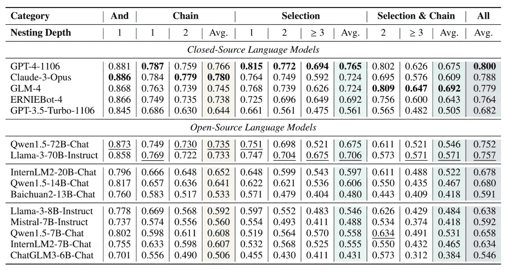

我们对大语言模型具体遵循各个类型的约束和约束组合方式的能力进行了分析，结果如下图所示。我们发现规则明确的词级约束和格式约束对大模型最具挑战性，而链式组合相对于选择组合，对大模型而言更为困难。

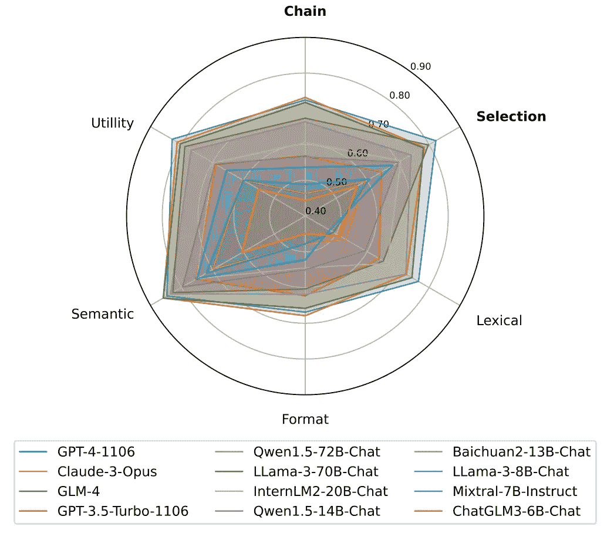

下图展示了将带有约束组合的复杂指令拆解为多轮完成所带来的性能影响。我们发现将指令拆解为多轮完成将带来显著的性能下降，且组合越复杂的指令性能损失越大。这证明了遵循带有约束组合的复杂指令的挑战性，其不能通过简单的指令拆解完成。

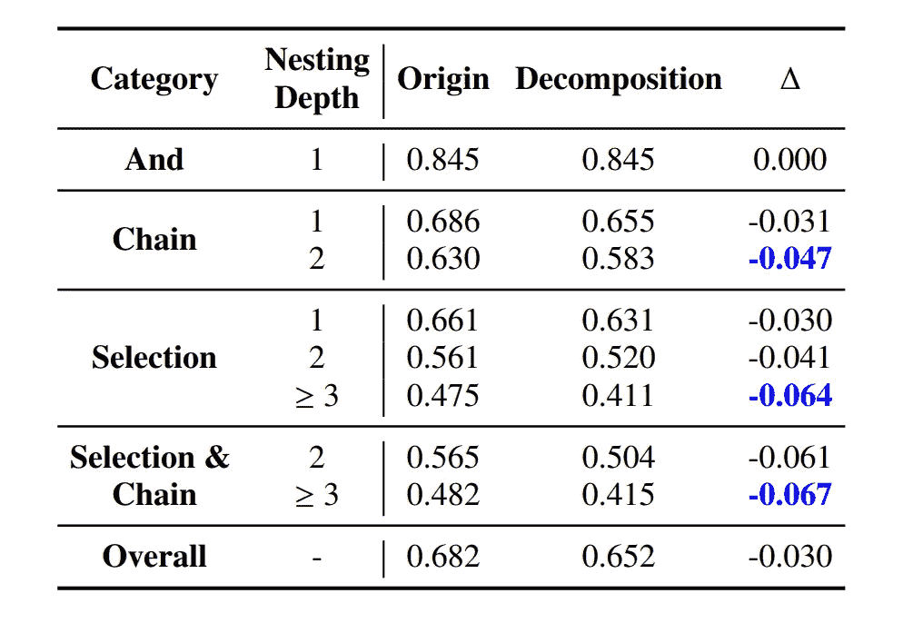

# 研究者说

问：ComplexBench 和其他的评测基准相比有什么区别？

**答：**ComplexBench 与其他评测基准的区别来源于两个方面。一方面是数据构造，ComplexBench 对约束的组合方式进行了全面地建模，构建了一个包含 4 个约束类型，19 个约束维度，4 个组合方式的全面复杂指令分类体系，并基于此体系人工构造了高质量的评测数据；其二是评测方法，ComplexBench 针对每个约束和约束的组合方式分别编写评分问题，并根据指令组合带来的结构关系，设计了评分问题的依赖聚合方法，能提供更为准确、细粒度的评分结果。

**问：ComplexBench 中考虑的约束组合**方式，在现实场景中是否是全面的和普遍的？

**答：**为了验证这一问题，我们在通用场景和专业场景中各收集了 300 条指令进行分析，统计包含各种约束组合方式的指令数量，专业场景包括商用场景或学术场景等。我们发现，ComplexBench 的分类体系覆盖了指令中包含的所有约束组合方式。在通用场景中，指令中的约束组合方式较为简单，之前的评测基准可以较好地覆盖；但在专业场景中，指令中的约束组合方式的复杂度大大提高，包含大量链式组合、选择组合以及各种组合方式的嵌套，这是之前的评测基准没有覆盖的，而 ComplexBench 填补了这一部分的空白。

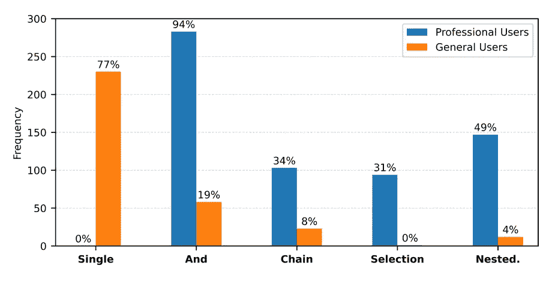

问：ComplexBench 的实验有什么重要发现？

**答：**我们的发现可以归结于以下几点：（1）即使是当前性能最佳的 GPT-4，在 ComplexBench 上也仅有 80% 的通过率，说明大语言模型的复杂指令遵循能力仍有较大的提升空间；（2）随着指令中约束组合方式复杂性的增加，所有模型的表现均出现明显的性能下降，且开、闭源大语言模型的主要性能差距集中在处理组合方式复杂的指令上；（3）在不同的约束类型中，规则明确的约束类型对模型更具挑战，而在不同的组合方式中，链式组合相较于选择组合更为困难，且其均难于普遍的并列组合；（4）将带有约束组合的复杂指令拆解为多轮完成将带来误差累积问题，无助于提升大语言模型对于该类指令的遵循能力。

---

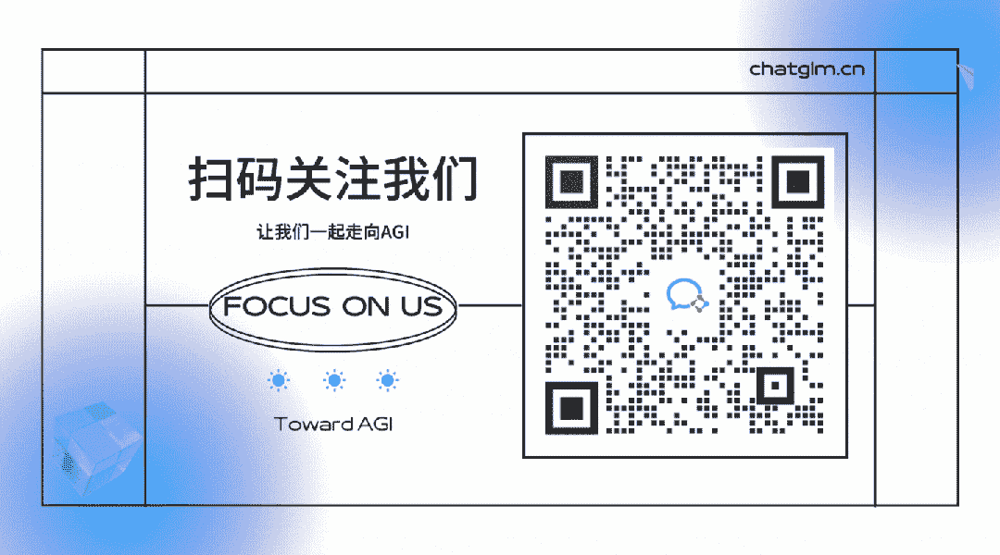