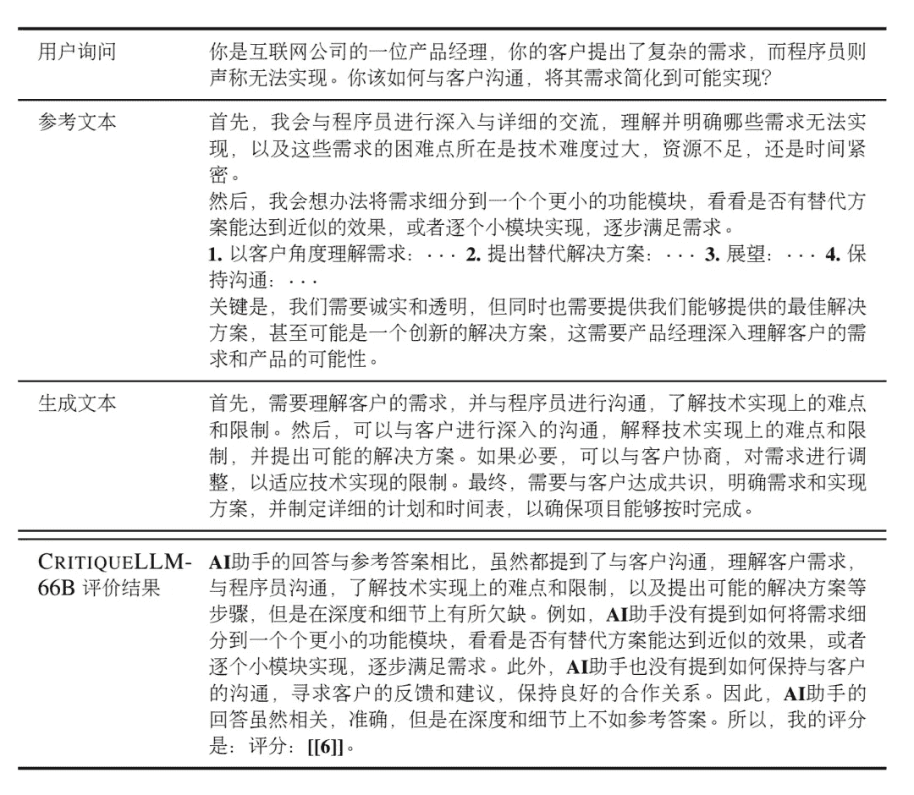
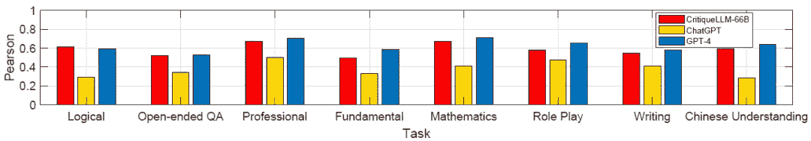
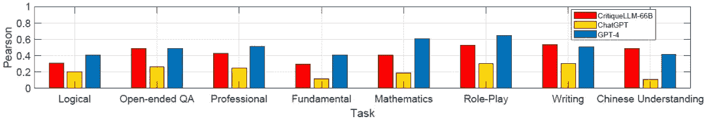
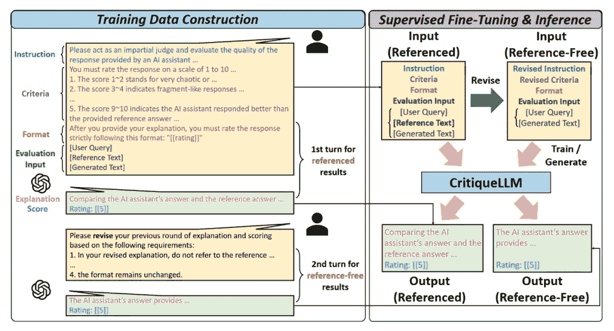
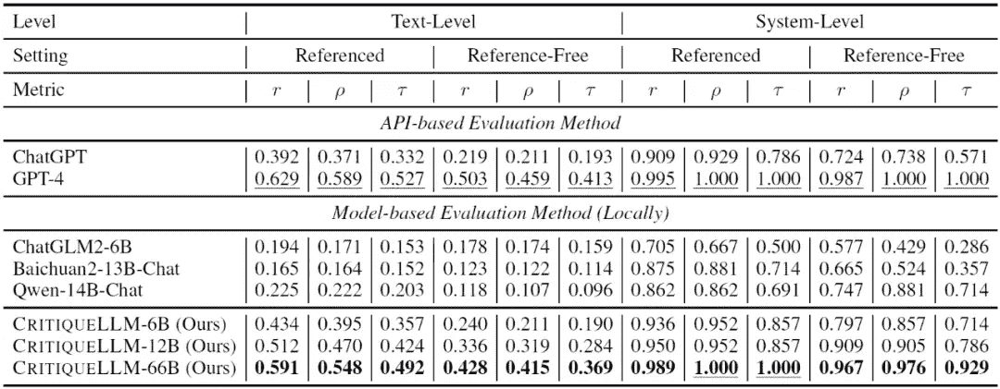
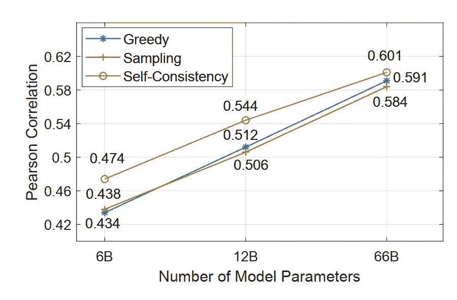
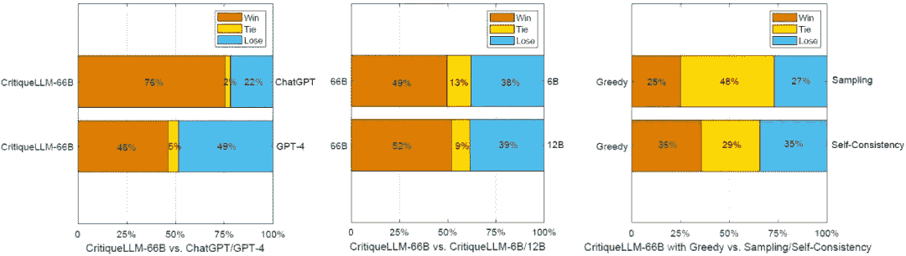
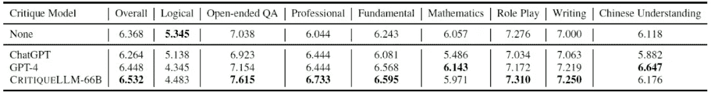

# 测评 · CritiqueLLM：高质量、低成本的评分模型

> 来源：[https://v11enp9ok1h.feishu.cn/docx/TZa0d76wZoqL23xpJ4ecrveHnSg](https://v11enp9ok1h.feishu.cn/docx/TZa0d76wZoqL23xpJ4ecrveHnSg)

模型评测，对于模型的研发至关重要。

但如何能够在研发过程中，快速、有效、公平且低成本地对模型性能进行评测，依然是一个重要问题。

传统的评价指标（如BLEU、ROUGE）基于参考文本和生成文本的n-gram重合度计算评价分数，缺乏对生成文本整体语义的把握；而基于模型的评价方法则严重依赖基座模型的选取，只有GPT-4这样“顶级”的大模型才能取得令人满意的评价效果，但其仅能通过API访问的特性又给研究者带来花费高昂、访问困难、数据泄露等一系列挑战。

因此，我们提出了可解释、可扩展的文本质量评价模型 CritiqueLLM。

该模型可以针对各类指令遵循任务上大模型的生成结果提供高质量的评价分数和评价解释。

下图展示了CritiqueLLM在含参考文本的场景下评价生成文本质量的示例，

其中 CritiqueLLM 将大模型生成文本和参考文本进行了详尽的对比，全面总结了生成文本的优缺点，最终给出了6分的评分（分数范围为1-10）。我们在下图展示了8类常见的指令遵循任务（包括逻辑推理、综合问答、专业能力、基本任务、数学计算、角色扮演、文本写作和中文理解）中，CritiqueLLM、ChatGPT和GPT4的评价分数与人工评分的相关系数。

含参考文本设定下各任务评价结果对比

无参考文本设定下各任务评价结果对比

从图中可以看出，在各项任务上660亿参数的CritiqueLLM与人工评分的相关系数均显著超过了ChatGPT，达到和GPT-4相当的水平。尤其是在具有挑战性的无参考文本设定下，CritiqueLLM能够在3项任务（包括综合问答、文本写作和中文理解）上超过GPT-4，达到目前最优的评价性能。

论文链接：https://arxiv.org/abs/2311.18702Github

链接：https://github.com/thu-coai/CritiqueLLM

# **方   法**

CritiqueLLM支持**含参考文本**和**无参考文本**两种评价设定，其核心目标是这两种设定下训练出能高效生成评价分数和评价理由的文本质量评价模型。这一过程可分为四个主要步骤：

**1、用户询问增广**：我们首先使用模型自动增广的方式，从少量公开平台收集的用户询问增广得到覆盖面较广的大量询问数据，并根据多样性和回答难度进行了精心的筛选和过滤。随后，我们收集了各种能力层次的大模型在该询问集合上的生成结果。

**2、含参考文本评价数据收集：**我们设计提示让GPT-4根据用户询问、参考文本和模型生成文本生成评价结果。提示包含详细的评价标准，使GPT-4生成的评价结果能和人类较好地对齐。

**3、无参考文本评价数据改写：**在上述含参考文本数据的基础上，我们进一步要求GPT-4对评价结果进行改写，删除其中提及参考答案的部分并尽量保持其他内容不变，从而收集无参考文本的评价数据。

4、训练CritiqueLLM：我们使用含参考文本和无参考文本的评价数据，分别训练了两种评价设定**下的Cri**t**iqueL**LM模型，使其能够针对用户询问、模型生成文本和可能存在的参考文本，生成包含评价解释和评价分数的完整评价结果。最终，我们得到了能够在含参考文本和无参考文本设定下使用的两种CritiqueLLM模型，可分别适用于两种设定下的文本质量评价任务。

# **实验结果**

我们在中文对齐评测集AlignBench上测试了CritiqueLLM的评价能力。测试集包含上述提及的8类指令遵循任务上随机采样的250条用户询问，以及8个不同的大型语言模型针对这些用户询问生成的文本。对于每个生成文本，标注员对其质量进行了1-5分的人工评分。

我们对比了各种评价模型在该测试集上与人工评分的相关系数。在下表可以看出，660亿参数的CritiqueLLM评分与人工评分的相关系数和GPT-4相当，显著超越了其他评价模型。而不同规模的CritiqueLLM模型之间也展现出良好的缩放（Scaling）特性，相关系数随着模型规模增加稳定提升，这揭示了在基座模型能力不断提升后，CritiqueLLM达到甚至超过GPT-4评价性能的潜力。

我们尝试通过改进解码方法进一步提升CritiqueLLM的评价质量，考虑到评价生成任务先生成评价解释后生成评价分数，类似思维链（Chain-of-Thought）的逐步推理过程，我们引入了思维链中常用的自洽性（Self-Consistency）解码方法。下图表明，在模型参数量较小时，自洽性解码可以显著提升评价结果与人工评分的相关系数。随着模型参数量增大，自洽性解码的收益逐渐减弱，但仍有一定效果。

针对评价模型生成的评价解释的质量，我们开展了人工评价。下图的结果表明，660亿参数的CritiqueLLM模型生成的评价解释的质量显著优于ChatGPT模型和更小规模的CritiqueLLM模型，和GPT-4非常接近。而不同的解码方式则对评价解释的质量影响不大。

# **QA**

**问：CritiqueLLM和其他**研究评价模型的同期工作相比，区别是什么？

**答：**和同期工作（如PandaLM, AUTO-J, PROMETHEUS）相比，CritiqueLLM 通过对话式评价数据构造方法同时构造高质量的含参考文本/无参考文本的评价数据，可支持在两种设定下均提供高质量评价结果。CritiqueLLM还全面分析了影响评价模型性能的重要因素，在数据和模型层面均展现出很好的缩放性质。CritiqueLLM-66B能够在3项任务上超过GPT-4的评价性能，这也揭示了其在真实场景中替代GPT-4评价的应用潜力。

**问：CritiqueLLM 提供的**评价结果能否用于改善大模型的生成质量呢？

**答：**我们将评价结果作为反馈信号，直接用于提升大模型生成质量。具体而言，我们选择ChatGPT作为生成模型，先让其针对用户询问生成文本，然后将ChatGPT、GPT-4或CritiqueLLM生成的评价结果作为提示的一部分，让ChatGPT根据评价结果生成新的文本。从下表可以看出，相较于ChatGPT和GPT-4，CritiqueLLM的评价结果对于提升ChatGPT生成质量的帮助最大。

