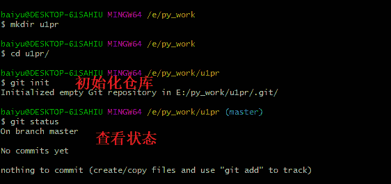
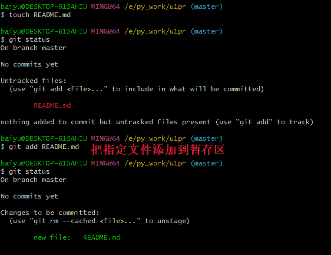
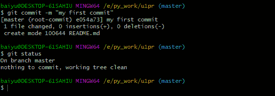
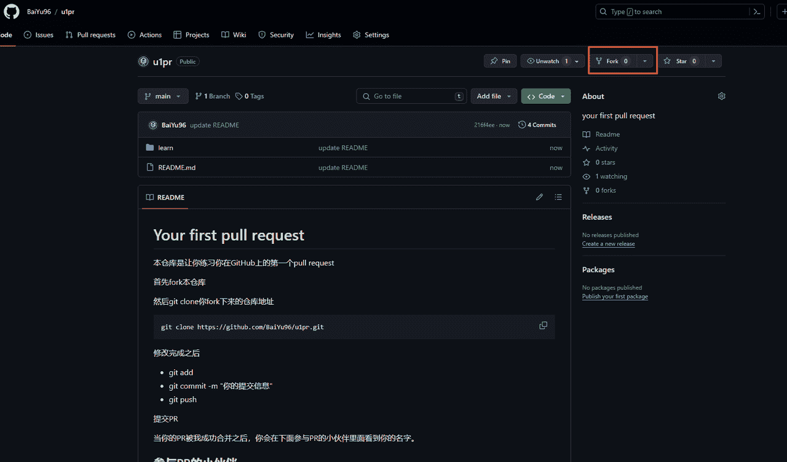
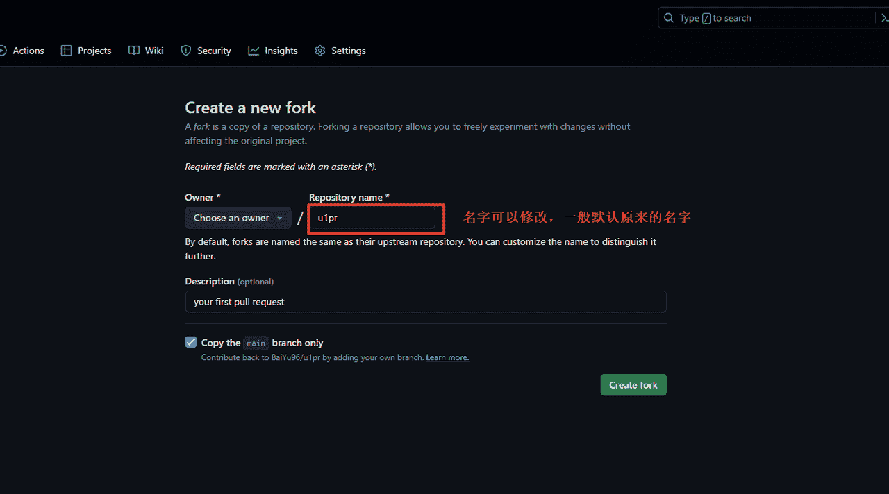

# Git 基础知识

> 来源：[https://v11enp9ok1h.feishu.cn/docx/Kh84d5gmmoBLH4xeRLpccDQ5n0f](https://v11enp9ok1h.feishu.cn/docx/Kh84d5gmmoBLH4xeRLpccDQ5n0f)

本篇文档将带大家熟悉 Git 的基本操作

# 为何使用Git

为了让代码能够更好的持续集成，我们采用Git的持续集成，Git支持版本回退等功能。

那什么是Git？

想象你正在制作一个拼图。每一块拼图代表一个文件或者项目的部分。你开始时可能有一个完整的图片作为参考，但在拼图过程中，你可能会试图调整一些拼图块的位置或者尝试不同的组合方式。

1.  **git add (添加): **这个命令就像是将拼图块从桌子上移动到你的拼图盒子里。当你完成了一些新的工作或修改后，使用git add将这些更改“添加”到Git的追踪列表中，准备提交到最终版本。

1.  git commit (提交): 当你认为你已经完成了一部分工作，并想要保存这些更改时，你使用git commit。这就像是将拼图盒子封闭起来，保存了当前的拼图进度，这些更改会得到一个描述性的标签，以便你以后可以轻松地回到这个状态。

1.  git branch (分支): 分支就像是在拼图过程中创建一个新的拼图盒子，你可以在其中尝试不同的组合，而不影响主要的拼图进度。使用git branch你可以创建一个独立的工作空间，你可以在其中安全地进行实验，不会影响主线的开发。

1.  git checkout (切换): 当你想要从一个分支（拼图盒子）切换到另一个分支时，你可以使用git checkout。这就像是从一个拼图盒子中取出你的拼图，然后将其放入另一个盒子中，让你可以在不同的拼图组合之间轻松切换。

1.  **git merge (合并):** 如果你在一个分支上的工作已经完成，并且你想要将这些更改合并到主线（或其他分支）上，你可以使用git merge。这就像是将两个拼图盒子的内容合并成一个，将一个分支的更改融入到另一个分支中。

1.  **git clone (克隆):** 这个命令就像是从商店购买一个完整的拼图套装，包括所有的拼图块和说明书。使用git clone，你可以复制一个远程仓库到你的本地计算机上，包括所有的历史记录和分支。

1.  **git pull (拉取): **当你想要获取远程仓库中的最新更改时，你可以使用git pull。这就像是检查拼图商店是否有新的拼图块，然后将它们添加到你的拼图盒子中。

1.  **git push (推送): **如果你在本地完成了一些工作，并希望将这些更改上传到远程仓库，你可以使用git push。这就像是分享你的拼图盒子，让其他人可以看到你的最新拼图进度。

1.  git status (状态): 当你想知道当前项目的更改状态时，你可以使用git status。它会告诉你哪些文件已经被修改、哪些文件已经被添加到暂存区，以及哪些文件还没有被Git追踪。

1.  **git log (日志): **如果你想查看项目的提交历史，你可以使用git log。它会显示所有的提交记录，包括每次提交的作者、日期和描述信息。

1.  git reset (重置): 当你想要撤销某些更改或回退到之前的提交状态时，你可以使用git reset。这就像是重新开始拼图，将一些错误的拼图块重新放回到盒子中。

# Git常用命令

## 基础操作

### 初始化

> git init

```
这个直接使用是将当前目录初始化成本地仓库的

初始化指定目录的则是 git init &lt; repo &gt;

如果是创建一个裸仓则是 git init --bare

将指定目录创建成裸仓 git init --bare &lt; repo &gt;

    注：裸仓跟普通仓库的区别在于，裸仓一般就是用于远程中心仓库，可以被clone，普通仓库不具备被clone的条件。
    
    在声明了裸仓库之后，使用git add命令报错如下信息：
    git 错误 fatal: This operation must be run in a work tree 
因为裸仓库无法进行git操作，所以在创建裸仓库之后还要进行git init操作

```



### 添加文件

> git add < filename >

使用之后把文件添加到暂存区



### 提交文件到本地仓库

> git commit -m “引号这里面填写的是你提交文件时的说明，这个便于你了解版本修改内容”

这个命令是把文件从暂存区提交到仓库



### 查看状态

> git status

## 远程仓库操作

### 克隆仓库

> git clone

### 关联一个远程仓库

如果你是刚在本地初始化了裸仓库之后，你要添加远程仓库的地址

> git remote add origin git@server:path/repo.git

### 提交到远程仓库

> git push < remote-name > < branch-name >

```
一般使用的是 git push origin master
master是整个项目的主分支

如果你没有推送到master分支的权限的话，那么你就将branch-name改成你有权限的分支
```

### 同步远程仓库

获取远程仓库中的最新更改

> git pull

## 分支操作

### 查看分支

查看仓库底下有多少分支

> git branch

### 创建分支

> git branch < branch-name >

```
#创建一个分支
# 例如，创建一个名字为test的分支
git branch test
```

### 删除分支

> git branch -d < branch-name >

```
# 删除指定分支 test
git branch -d test
```

### 选择分支

> git checkout < branch-name >

> 选择分支命令，可以在上面创建了个分支之后可以使用该命令来切换分支

### 创建并切换分支

> git checkout -b < branch-name >

> 这个命令相当于上面的两个命令，是创建某一分支顺便切换到当前分支

### 合并分支

将指定的分支合并到当前分支

> git merge < branch-name >

### 查看分支具体改动

这个可以查看文件的具体改动

> git diff < filename >

### 查看提交历史

查看git的提交历史，可以查看版本号，便于我们回退到某个历史

> git log

查看历史命令，便于我们回退到将来的某一个版本

> git relog

使用该命令可以让文件回归到特定版本

> git reset --hard < commit_id >

# git实战之Github使用

# git实战之OpenXlab上git的使用

# git-lfs

Git LFS（Large File Storage）是由 Atlassian, GitHub 以及其他开源贡献者开发的 Git 扩展，它通过延迟地（lazily）下载大文件的相关版本来减少大文件在仓库中的影响


> 注意：安装 Git LFS 需要 Git 的版本不低于 1.8.5

在intern-Studio上安装git-lfs

```
curl -s https://packagecloud.io/install/repositories/github/git-lfs/script.deb.sh | bash
apt-get update
apt-get install git-lfs
git lfs install
```

# 提交你的第一个PR

前面我们说了，git这个工具是被发明出来用于代码版本控制和多人协作的，当你在团队协作，或者要给开源项目贡献代码时，这个时候就是PR（Pull Request）。

PR为以下几个步骤

+   **fork目标的仓库：**当我们参与别人的项目贡献时，不可能直接在别人的代码仓库中直接修改代码，你也没有这个权限，因此你可以fork一份（相当于单独复制一个分叉出来）到你自己名下的一个仓库中。

+   **将代码clone到本地：**这里用到前面的git clone命令。代码通常是在开发者本地修改和调试的，一般不会直接在远程的仓库上开发，因此需要将你fork的代码下载到本地。

+   **修改代码：**在本地可以修改你的代码

+   **提交代码到你自己的仓库：**将修改好的代码先提交到你自己的仓库中。这里用到的时git push

+   **提交PR：**在你自己的仓库中，将改动的那部分内容，向原项目仓库中提交一个请求（PR），申请将这部分改动合并到主仓库中如果顺利的话，原仓库的维护者会接收你的PR的，但是通常不会那么顺利（原因有很多种）





# 作业

访问下面的仓库，star并且fork到你自己的仓库

并在learn文件夹下面Homework.md文件，并且在里面写入你的名字和仓库链接。

提交你的第一个PR

https://github.com/BaiYu96/u1pr

# 参考链接

https://blog.csdn.net/zhh763984017/article/details/104871163