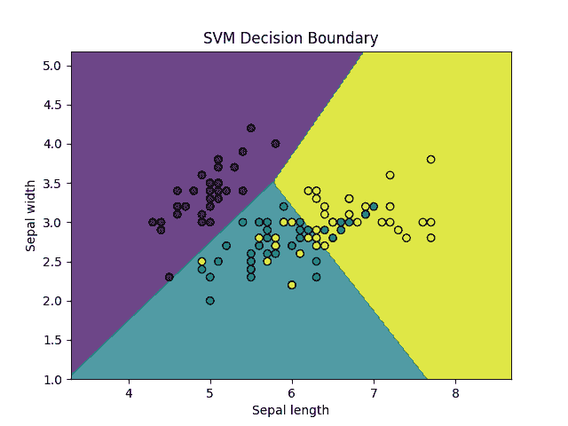

# 支持向量机

> 来源：[https://v11enp9ok1h.feishu.cn/docx/RZf1dsqfeoOkNYxSMiwcVIiun7d](https://v11enp9ok1h.feishu.cn/docx/RZf1dsqfeoOkNYxSMiwcVIiun7d)

**支持向量机**（Support Vector Machine，简称 SVM）是一种监督学习算法，主要用于分类和回归问题。

SVM 的核心思想是找到一个最优的超平面，将不同类别的数据分开。这个超平面不仅要能够正确分类数据，还要使得两个类别之间的间隔（margin）最大化。

---

## 使用 Python 实现 SVM

接下来，我们将使用 Python 中的 scikit-learn 库来实现一个简单的 SVM 分类器。

### 安装必要的库

首先，确保你已经安装了scikit-learn库。如果没有安装，可以使用以下命令进行安装：

```
pip install scikit-learn
```

### 导入库

## 实例

```
import numpy as np
import matplotlib.pyplot as plt
from sklearn import svm, datasets
from sklearn.model_selection import train_test_split
from sklearn.metrics import accuracy_score
```

### 加载数据集

我们将使用scikit-learn自带的鸢尾花（Iris）数据集。

## 实例

```
加载鸢尾花数据集
iris = datasets.load_iris()
X = iris.data[:, :2]  只使用前两个特征
y = iris.target
```

### 划分训练集和测试集

## 实例

```
将数据集划分为训练集和测试集
X_train, X_test, y_train, y_test = train_test_split(X, y, test_size=0.3, random_state=42)
```

### 训练 SVM 模型

## 实例

```
创建SVM分类器
clf = svm.SVC(kernel=&#x27;linear&#x27;)  使用线性核函数

训练模型
clf.fit(X_train, y_train)
```

### 预测与评估

## 实例

```
**在测试集上**进行预测
y_pred = clf.predict(X_test)

计算准确率
accuracy = accuracy_score(y_test, y_pred)
print(f&quot;模型准确率: {accuracy:.2f}&quot;)
```

### 可视化结果

## 实例

```
import numpy as np
import matplotlib.pyplot as plt
from sklearn import svm, datasets
from sklearn.model_selection import train_test_split
from sklearn.metrics import accuracy_score

# 加载鸢尾花数据集
iris = datasets.load_iris()
X = iris.data[:, :2]  # 只使用前两个特征
y = iris.target

# 将数据集划分为训练集和测试集
X_train, X_test, y_train, y_test = train_test_split(X, y, test_size=0.3, random_state=42)

# 创建SVM分类器
clf = svm.SVC(kernel=&#x27;linear&#x27;)  # 使用线性核函数

# 训练模型
clf.fit(X_train, y_train)

# 在测试集上进行预测
y_pred = clf.predict(X_test)

# 计算准确率
accuracy = accuracy_score(y_test, y_pred)
print(f&quot;模型准确率: {accuracy:.2f}&quot;)

# 绘制决策边界
def plot_decision_boundary(X, y, model):
    h = .02  # 网格步长
    x_min, x_max = X[:, 0].min() - 1, X[:, 0].max() + 1
    y_min, y_max = X[:, 1].min() - 1, X[:, 1].max() + 1
    xx, yy = np.meshgrid(np.arange(x_min, x_max, h),
                         np.arange(y_min, y_max, h))
    Z = model.predict(np.c_[xx.ravel(), yy.ravel()])
    Z = Z.reshape(xx.shape)
    plt.contourf(xx, yy, Z, alpha=0.8)
    plt.scatter(X[:, 0], X[:, 1], c=y, edgecolors=&#x27;k&#x27;, marker=&#x27;o&#x27;)
    plt.xlabel(&#x27;Sepal length&#x27;)
    plt.ylabel(&#x27;Sepal width&#x27;)
    plt.title(&#x27;SVM Decision Boundary&#x27;)
    plt.show()

plot_decision_boundary(X_train, y_train, clf)
```

执行以上代码，输出为：

```
模型准确率: 0.80
```

图片显示为

