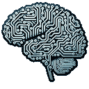

# NLP 教程

> 来源：[https://v11enp9ok1h.feishu.cn/docx/UM7OdsyNQowaubxwQEUcgRM7nVd](https://v11enp9ok1h.feishu.cn/docx/UM7OdsyNQowaubxwQEUcgRM7nVd)

自然语言处理(Natural Language Processing, NLP)是人工智能和语言学的一个交叉领域，致力于让计算机能够理解、解释和生成人类语言。

NLP 结合了计算机科学、人工智能和语言学的知识，目标是实现人机之间的自然语言交流。

---

## NLP 的核心任务

1.  **文本理解**：让计算机理解人类语言的含义

1.  **文本生成**：让计算机能够生成自然语言文本

1.  **语言翻译**：实现不同语言之间的自动翻译

1.  **情感分析**：识别文本中表达的情感倾向

## NLP 的应用场景

+   智能客服和聊天机器人

+   机器翻译(如 Google 翻译)

+   语音助手(如 Siri, Alexa)

+   垃圾邮件过滤

+   文本摘要生成

+   情感分析(产品评论分析)

## 适合学习 NLP 的人群

+   计算机科学/人工智能相关专业学生：已有编程和算法基础，希望深入AI领域。

+   语言学或心理学研究者：对语言结构、认知科学感兴趣，想用技术手段分析语言现象。

+   数据科学家/工程师：希望扩展文本数据处理能力，应用于推荐系统、搜索引擎等场景。

+   跨领域从业者：如金融、医疗、法律等行业中需要处理大量文本数据的人员。

+   对 AI 感兴趣的初学者：即使零基础，也可以通过系统学习逐步入门。

---

## 学习路径建议

**1、入门阶段**

+   学习Python和基础数学 → 掌握NLP基础任务（分词、词性标注） → 使用NLTK/spaCy实现简单项目。

**2、进阶阶段**

+   学习机器学习 → 实现文本分类、情感分析 → 学习RNN/Transformer。

**3、实战阶段**

+   参与Kaggle竞赛（如Quora问答匹配） → 复现论文模型 → 部署NLP服务（如聊天机器人）。

---

##