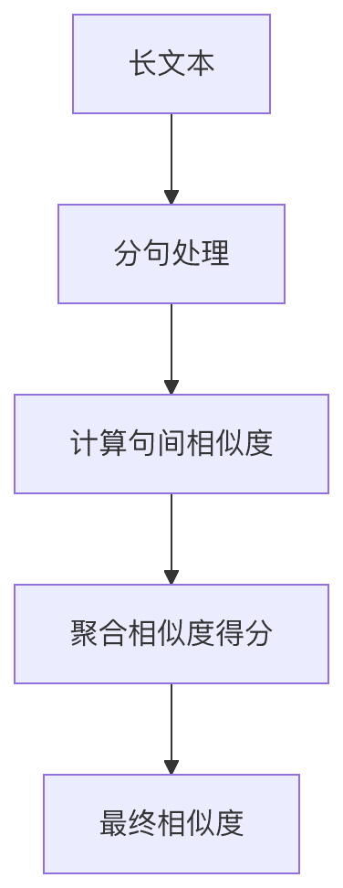

# 2.4 NLP 文本相似度计算

> 来源：[https://v11enp9ok1h.feishu.cn/docx/Cg4odXWSlonik6x0Yrnc7m0InJd](https://v11enp9ok1h.feishu.cn/docx/Cg4odXWSlonik6x0Yrnc7m0InJd)

文本相似度计算是自然语言处理(NLP)中的一项基础任务，旨在量化两个文本片段之间的相似程度。这项技术在信息检索、问答系统、抄袭检测、推荐系统等多个领域都有广泛应用。

### 核心概念

+   **语义相似度**：衡量文本在含义上的接近程度

+   **字面相似度**：衡量文本在表面词汇上的重叠程度

+   **向量空间模型**：将文本表示为高维空间中的向量

+   **距离度量**：计算向量之间的距离或相似度

---

## 常用文本相似度计算方法

### 基于词频的方法

#### 词袋模型(Bag of Words)

## 实例

```
from sklearn.feature_extraction.text import CountVectorizer

corpus = [
    &#x27;我喜欢自然语言处理&#x27;,
    &#x27;我爱学习NLP技术&#x27;,
    &#x27;文本相似度计算很有趣&#x27;
]

vectorizer = CountVectorizer()
X = vectorizer.fit_transform(corpus)
print(X.toarray())
```

#### TF-IDF 方法

## 实例

```
from sklearn.feature_extraction.text import TfidfVectorizer

tfidf = TfidfVectorizer()
tfidf_matrix = tfidf.fit_transform(corpus)
print(tfidf_matrix.toarray())
```

### 基于词向量的方法

#### Word2Vec 相似度

## 实例

```
from gensim.models import Word2Vec

sentences = [
    [&#x27;我&#x27;,&#x27;喜欢&#x27;,&#x27;自然语言处理&#x27;],
    [&#x27;我&#x27;,&#x27;爱&#x27;,&#x27;学习&#x27;,&#x27;NLP&#x27;,&#x27;技术&#x27;],
    [&#x27;文本&#x27;,&#x27;相似度&#x27;,&#x27;计算&#x27;,&#x27;很&#x27;,&#x27;有趣&#x27;]
]

model = Word2Vec(sentences, vector_size=100, window=5, min_count=1, workers=4)
vector = model.wv[&#x27;自然语言处理&#x27;]  # 获取词向量
```

#### 句子向量计算

## 实例

```
import numpy as np

def sentence_vector(sentence, model):
    vectors = [model.wv[word] for word in sentence if word in model.wv]
    return np.mean(vectors, axis=0) if vectors else np.zeros(model.vector_size)

sentence_vec1 = sentence_vector([&#x27;我&#x27;,&#x27;喜欢&#x27;,&#x27;自然语言处理&#x27;], model)
sentence_vec2 = sentence_vector([&#x27;我&#x27;,&#x27;爱&#x27;,&#x27;NLP&#x27;], model)
```

### 基于预训练模型的方法

#### BERT 相似度计算

## 实例

```
from transformers import BertTokenizer, BertModel
import torch

tokenizer = BertTokenizer.from_pretrained(&#x27;bert-base-chinese&#x27;)
model = BertModel.from_pretrained(&#x27;bert-base-chinese&#x27;)

inputs = tokenizer(&quot;这是一个示例句子&quot;, return_tensors=&quot;pt&quot;)
outputs = model(**inputs)
last_hidden_states = outputs.last_hidden_state
```

## 相似度度量指标

### 常用距离度量方法

### 代码实现示例

## 实例

```
from sklearn.metrics.pairwise import cosine_similarity

# 计算余弦相似度
similarity = cosine_similarity(tfidf_matrix[0:1], tfidf_matrix[1:2])
print(f&quot;文本相似度: {similarity[0][0]:.4f}&quot;)
```

## 实践应用示例

### 新闻标题相似度检测

## 实例

```
import pandas as pd
from sklearn.metrics.pairwise import cosine_similarity

# 示例数据
titles = [
    &quot;苹果发布新款iPhone手机&quot;,
    &quot;苹果公司推出最新智能手机&quot;,
    &quot;微软公布季度财报&quot;,
    &quot;谷歌宣布新的人工智能计划&quot;
]

# 计算相似度矩阵
tfidf = TfidfVectorizer()
tfidf_matrix = tfidf.fit_transform(titles)
similarities = cosine_similarity(tfidf_matrix)

# 显示结果
df = pd.DataFrame(similarities, columns=titles, index=titles)
print(df)
```

### 结果分析

```
                         苹果发布新款iPhone手机  苹果公司推出最新智能手机  微软公布季度财报  谷歌宣布新的人工智能计划
苹果发布新款iPhone手机           1.000000         0.723417     0.000000         0.000000
苹果公司推出最新智能手机         0.723417         1.000000     0.000000         0.000000
微软公布季度财报               0.000000         0.000000     1.000000         0.204598
谷歌宣布新的人工智能计划         0.000000         0.000000     0.204598         1.000000

```

## 进阶技术与挑战

### 处理语义相似但词汇不同的文本

## 实例

```
text1 = &quot;我喜欢猫&quot;
text2 = &quot;我讨厌狗&quot;

# 表面相似度低，但语义上都是表达对动物的态度
```

### 解决一词多义问题

## 实例

```
# &quot;苹果&quot;可以指水果或公司
text1 = &quot;苹果很甜&quot;
text2 = &quot;苹果市值创新高&quot;
```

### 长文本相似度计算



## 最佳实践建议

1.  **数据预处理很重要**

+   统一大小写

+   去除停用词

+   词干提取/词形还原

1.  **根据场景选择方法**

+   短文本：BERT等预训练模型

+   长文档：TF-IDF + 余弦相似度

+   实时系统：Word2Vec等轻量模型

1.  **考虑计算效率**

+   大规模数据使用近似最近邻(ANN)算法

+   考虑使用Faiss等高效相似度搜索库

1.  **持续评估优化**

+   建立人工评估集

+   监控生产环境效果

+   定期更新模型