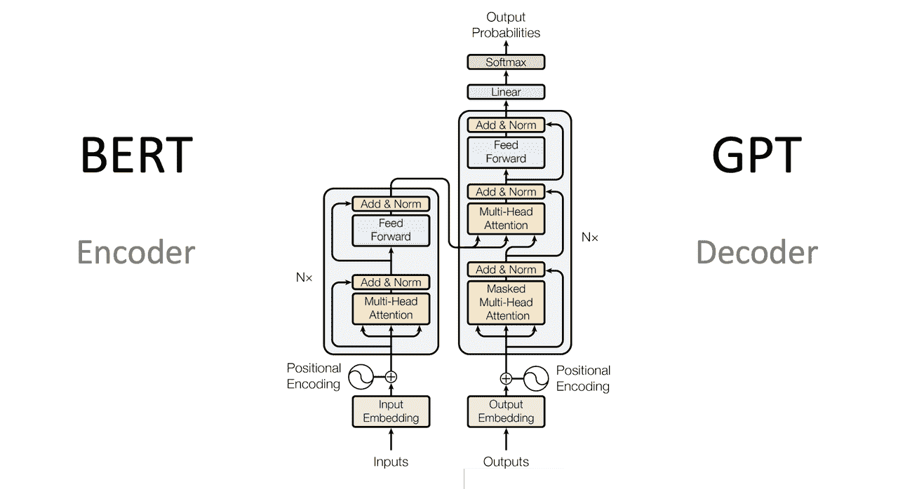

# 4.1 预训练模型

> 来源：[https://v11enp9ok1h.feishu.cn/docx/WE79dRYkJoJVmTxOAzJckQ1lnNg](https://v11enp9ok1h.feishu.cn/docx/WE79dRYkJoJVmTxOAzJckQ1lnNg)

预训练模型（Pre-trained Models）是自然语言处理（NLP）领域近年来最重要的技术突破之一。这类模型通过在大规模文本数据上进行预先训练，学习通用的语言表示能力，然后可以针对特定任务进行微调（Fine-tuning）。

### 核心思想

1.  **两阶段学习**：先在大规模通用数据上训练，再在小规模特定任务数据上微调

1.  **迁移学习**：将通用语言知识迁移到具体任务中

1.  **参数共享**：同一套模型参数可用于多种下游任务

### 与传统方法的对比

---

## 预训练模型的发展历程

1.  词嵌入时代（2013-2017）

+   **代表模型**：Word2Vec、GloVe、FastText

+   **特点**：

+   静态词向量表示

+   无法处理一词多义

+   上下文无关

## 实例

```
# Word2Vec示例
from gensim.models import Word2Vec

sentences = [[&quot;自然&quot;, &quot;语言&quot;, &quot;处理&quot;], [&quot;预训练&quot;, &quot;模型&quot;, &quot;很强大&quot;]]
model = Word2Vec(sentences, vector_size=100, window=5, min_count=1)
print(model.wv[&quot;自然&quot;])  # 输出词向量
```

###  上下文感知时代（2018-2019）

+   **代表模型**：ELMo、ULMFiT

+   **突破**：

+   动态词向量表示

+   能够处理一词多义

+   双向语言模型

1.  Transformer时代（2019至今）

+   **里程碑模型**：BERT、GPT、T5

+   **革命性改进**：

+   基于Transformer架构

+   大规模预训练

+   强大的迁移学习能力

## 主流预训练模型架构



### Encoder架构（BERT系列）


+   **特点**：

+   双向上下文理解

+   适合分类、问答等任务

+   代表模型：BERT、RoBERTa、ALBERT

### Decoder架构（GPT系列）


+   **特点**：

+   单向上下文（从左到右）

+   擅长文本生成

+   代表模型：GPT-3、GPT-4

### Encoder-Decoder架构


+   **特点**：

+   适合序列到序列任务

+   代表模型：T5、BART

## 预训练任务类型

1.  语言模型（LM）

+   **目标**：预测下一个词

+   **公式**：P(w_t | w_1, ..., w_{t-1})

1.  掩码语言模型（MLM）

+   **示例**：

+   原始句子："预训练模型很强大"

+   掩码后："预训练[MASK]很强大"

+   模型预测："模型"

1.  下一句预测（NSP）

+   **判断**两个句子是否连续

+   正例：

+   句子A："预训练模型很强大"

+   句子B："它们可以处理多种NLP任务"

+   负例：

+   句子A："预训练模型很强大"

+   句子B："今天天气真好"

1.  其他任务

+   替换token检测（RTD）

+   句子顺序预测（SOP）

---

## 如何使用预训练模型

### 使用Hugging Face Transformers

## 实例

```
from transformers import pipeline

# 情感分析示例
classifier = pipeline(&quot;sentiment-analysis&quot;)
result = classifier(&quot;预训练模型真是太棒了！&quot;)
print(result)  # [{&#x27;label&#x27;: &#x27;POSITIVE&#x27;, &#x27;score&#x27;: 0.9998}]
```

### 模型微调流程

1.  加载预训练模型

1.  准备任务特定数据集

1.  添加任务特定输出层

1.  微调训练

## 实例

```
from transformers import BertForSequenceClassification, Trainer

model = BertForSequenceClassification.from_pretrained(&quot;bert-base-chinese&quot;)
# 准备训练数据...
trainer = Trainer(model=model, args=training_args, train_dataset=train_dataset)
trainer.train()
```

### 关键参数说明

## 预训练模型的应用场景

1.  文本分类

+   情感分析

+   垃圾邮件检测

+   主题分类

1.  问答系统

+   抽取式问答

+   开放域问答

1.  文本生成

+   摘要生成

+   对话系统

+   内容创作

1.  其他应用

+   命名实体识别（NER）

+   机器翻译

+   文本相似度计算

---

## 实践建议

1.  **模型选择**：

+   分类任务优先考虑BERT类模型

+   生成任务选择GPT类模型

+   资源受限考虑蒸馏模型（如DistilBERT）

1.  **资源管理**：

+   GPU内存不足时减小batch_size

+   长文本处理注意max_length限制

+   考虑使用模型量化技术

1.  **性能优化**：

+   学习率需要精细调整

+   早停（Early Stopping）防止过拟合

+   尝试不同的优化器（AdamW等）

1.  **持续学习**：

+   关注Hugging Face社区

+   跟踪arXiv上的最新论文

+   参与开源项目实践

---

## 未来发展方向

1.  **更大规模**：模型参数继续增长（如GPT-4的万亿参数）

1.  **多模态融合**：文本与图像、语音的结合

1.  **能效优化**：更高效的训练和推理方法

1.  **领域适应**：专业领域的预训练模型

1.  **伦理安全**：解决偏见、毒性等问题

预训练模型正在重塑NLP领域的技术格局，理解其核心原理和掌握应用方法，将成为NLP工程师的必备技能。