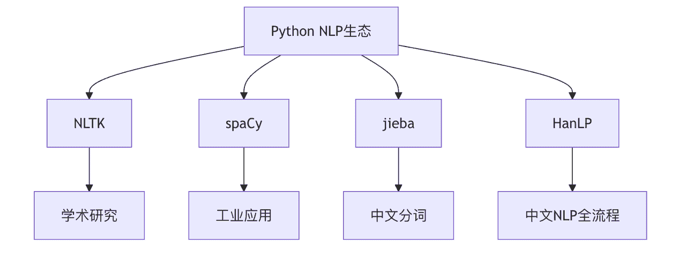

# 4.5 Python NLP 生态

> 来源：[https://v11enp9ok1h.feishu.cn/docx/XjREdmzEPoLxhzxo7WBcPAJbnSe](https://v11enp9ok1h.feishu.cn/docx/XjREdmzEPoLxhzxo7WBcPAJbnSe)

自然语言处理（Natural Language Processing, NLP）是人工智能领域的重要分支，Python 凭借其丰富的工具库成为了 NLP 开发的首选语言。

本文将全面介绍 Python NLP 生态中的核心工具包，包括：

1.  **NLTK** - 学术研究首选的自然语言处理工具包

1.  **spaCy** - 工业级高效 NLP 框架

1.  **jieba** - 最流行的中文分词工具

1.  **HanLP** - 功能全面的中文 NLP 处理库



## NLTK：自然语言处理的瑞士军刀

### 基本介绍

NLTK（Natural Language Toolkit）是最著名的 Python NLP 库之一，由宾夕法尼亚大学开发，特别适合教学和研究用途。

### 核心功能

+   文本分词（Tokenization）

+   词性标注（POS Tagging）

+   命名实体识别（NER）

+   情感分析（Sentiment Analysis）

+   词干提取（Stemming）和词形还原（Lemmatization）

### 安装与基础使用

## 实例

```
import nltk
nltk.download(&#x27;punkt&#x27;)  # 下载必要的数据包

# 示例：文本分词
from nltk.tokenize import word_tokenize
text = &quot;Natural language processing is fascinating.&quot;
tokens = word_tokenize(text)
print(tokens)  # 输出: [&#x27;Natural&#x27;, &#x27;language&#x27;, &#x27;processing&#x27;, &#x27;is&#x27;, &#x27;fascinating&#x27;, &#x27;.&#x27;]
```

### 优缺点分析

## spaCy：工业级 NLP 框架

### 基本介绍

spaCy 是一个专注于工业应用的现代 NLP 库，以其高效性和易用性著称。

### 核心特点

+   预训练模型支持

+   管道式处理机制

+   高性能的神经网络实现

+   多语言支持（包括中文）

### 安装与基础使用

## 实例

```
# 安装英文模型: python -m spacy download en_core_web_sm
# 安装中文模型: python -m spacy download zh_core_web_sm

import spacy

# 加载英文模型
nlp = spacy.load(&quot;en_core_web_sm&quot;)
doc = nlp(&quot;Apple is looking at buying U.K. startup for $1 billion&quot;)

# 提取命名实体
for ent in doc.ents:
    print(ent.text, ent.label_)
# 输出: Apple ORG
#       U.K. GPE
#       $1 billion MONEY
```

### 性能对比

## 实例

```
barChart
    title NLP库处理速度对比(词/秒)
    x-axis 库
    y-axis 速度
    bar NLTK: 10,000
    bar spaCy: 100,000
```

## jieba：中文分词利器

### 基本介绍

jieba 是专门针对中文设计的分词工具，以其简单易用和高效准确著称。

### 三种分词模式

1.  **精确模式**：最准确的分词结果

1.  **全模式**：扫描所有可能成词的词语

1.  **搜索引擎模式**：对长词再切分

### 基础使用示例

## 实例

```
import jieba

# 精确模式分词
seg_list = jieba.cut(&quot;我爱自然语言处理&quot;, cut_all=False)
print(&quot;精确模式: &quot; + &quot;/&quot;.join(seg_list)) 
# 输出: 精确模式: 我/爱/自然语言/处理

# 添加自定义词典
jieba.load_userdict(&quot;userdict.txt&quot;)  # 自定义词典文件
```

### 进阶功能

+   关键词提取

+   词性标注

+   并行分词（提高大文本处理速度）

---

## HanLP：一站式中文 NLP 解决方案

### 基本介绍

HanLP 是由一系列模型与算法组成的 NLP 工具包，目标是普及自然语言处理在生产环境中的应用。

### 功能特性

+   支持多种分词模式

+   命名实体识别

+   依存句法分析

+   文本分类

+   情感分析

### 基础使用示例

## 实例

```
from hanlp import HanLP

# 分词示例
print(HanLP.segment(&#x27;你好，欢迎使用HanLP！&#x27;))
# 输出: [你好/vl, ，/w, 欢迎/v, 使用/v, HanLP/nx, ！/w]

# 依存句法分析
sentence = HanLP.parseDependency(&quot;我爱自然语言处理&quot;)
print(sentence)
```

### 多语言支持

HanLP 不仅支持中文，还支持：

+   英文

+   日文

+   韩文

+   等多种语言

---

## 工具选型指南

### 应用场景对比

### 性能考虑因素

1.  **处理速度**：spaCy > jieba > HanLP > NLTK

1.  **内存占用**：HanLP > spaCy > NLTK > jieba

1.  **准确率**（中文）：HanLP ≈ jieba > spaCy > NLTK

---

## 综合实践案例：中文文本分析流程

## 实例

```
# 结合多个工具的中文文本处理流程
import jieba
from hanlp import HanLP
import spacy

text = &quot;自然语言处理是人工智能的重要分支，近年来发展迅速。&quot;

# 1. 使用jieba分词
words = list(jieba.cut(text))
print(&quot;分词结果:&quot;, words)

# 2. 使用HanLP进行词性标注
print(&quot;\n词性标注:&quot;)
print(HanLP.segment(text))

# 3. 使用spaCy的英文模型处理英文部分
nlp = spacy.load(&quot;en_core_web_sm&quot;)
doc = nlp(&quot;Natural Language Processing is amazing.&quot;)
print(&quot;\n英文实体识别:&quot;)
for ent in doc.ents:
    print(ent.text, ent.label_)
```

## 学习资源推荐

**官方文档**

+   NLTK: https://www.nltk.org/

+   spaCy: https://spacy.io/

+   jieba: https://github.com/fxsjy/jieba

+   HanLP: https://hanlp.hankcs.com/

---

## 总结与展望

Python NLP 生态提供了从学术研究到工业应用的完整工具链。对于中文处理，jieba 和 HanLP 是必不可少的工具，而 spaCy 则在多语言支持和工业部署方面表现优异。未来 NLP 发展将更加注重：

+   预训练语言模型的应用（如 BERT、GPT）

+   多模态处理能力

+   低资源语言支持

+   可解释性和公平性