# Deploy028 Flash attn

> 来源：[https://v11enp9ok1h.feishu.cn/docx/Cr30dFItHo6UV7xr860cSNjDnwf](https://v11enp9ok1h.feishu.cn/docx/Cr30dFItHo6UV7xr860cSNjDnwf)

attention存在的问题： 的结果非常巨大，当sequence length增加时，显存占用以`O(N^2)`比例增加。受显存访问速度的限制，导致transformer大部分是显存访问瓶颈。因而flash attention系列通过一系列等价替换的计算方式减少数据从SRAM中搬运至HBM的次数，实现较优的运行效率。

## GPU硬件背景介绍

> 以下引自：[FlashAttention2详解（性能比FlashAttention提升200%）](https://zhuanlan.zhihu.com/p/645376942)

GPU主要包含计算单元（如浮点运算单元）和内存层次结构。大多数现代GPU包含专用的低精度矩阵乘法单元（如Nvidia GPU的`Tensor Core`用于`FP16`/`BF16`矩阵乘法）。GPU的内存由多个不同大小和不同读写速度的内存组成，内存越小，读写速度越快。内存层次结构分为高带宽内存（High Bandwidth Memory, HBM）和片上SRAM（也称为shared memory）。

以`A100 GPU`为例：

+ `HBM`40-80GB，带宽为1.5-2.0TB/s，

+ `SRAM`内存分布在108个流式多处理器上，每个处理器的大小为192K，合计为20M左右，带宽约为19TB/s

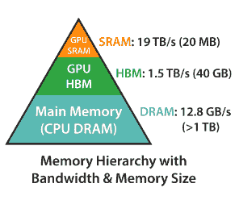

### CUDA的软件和硬件架构

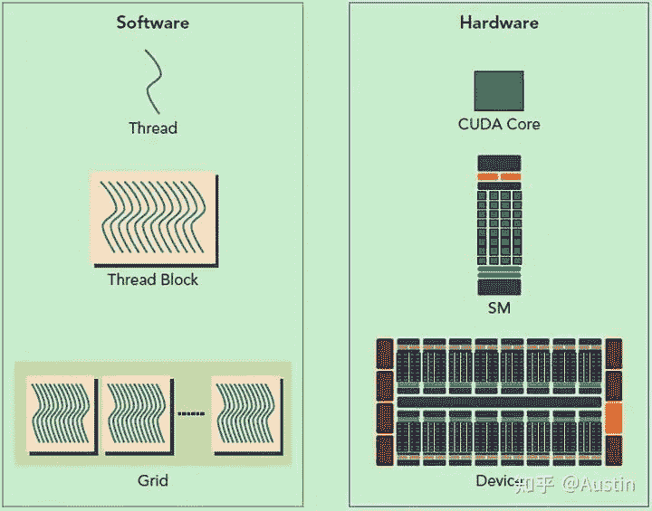

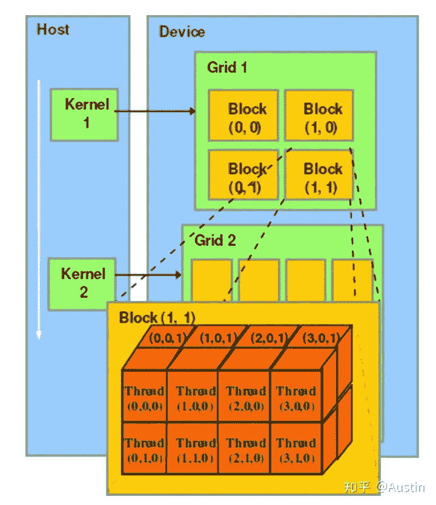

#### 硬件架构

从Hardware角度来看：

+ Streaming Processor（SP）：是最基本的处理单元，从fermi架构开始被叫做CUDA core。

+ Streaming MultiProcessor（SM）：一个SM由多个CUDA core（SP）组成，每个SM在不同GPU架构上有不同数量的CUDA core，例如Pascal架构中一个SM有128个CUDA core。

SM还包括特殊运算单元(SFU)，共享内存(shared memory)，寄存器文件(Register File)和调度器(Warp Scheduler)等。register和shared memory是稀缺资源，这些有限的资源就使每个SM中active warps有非常严格的限制，也就限制了并行能力。

#### 软件架构

CUDA软件示例

+ thread：一个CUDA并行程序由多个thread来执行

+ thread是最基本的执行单元（the basic unit of execution）。

+ warp：一个warp通常包含32个thread。每个warp中的thread可以同时执行相同的指令，从而实现SIMT（单指令多线程）并行。

+ warp是SM中最小的调度单位（the smallest scheduling unit on an SM），一个SM可以同时处理多个warp

+ thread block：一个thread block可以包含多个warp，同一个block中的thread可以同步，也可以通过shared memory进行通信。

+ thread block是GPU执行的最小单位（the smallest unit of execution on the GPU）。

+ 一个warp中的threads必然在同一个block中，如果block所含thread数量不是warp大小的整数倍，那么多出的那个warp中会剩余一些inactive的thread。也就是说，即使warp的thread数量不足，硬件也会为warp凑足thread，只不过这些thread是inactive状态，但也会消耗SM资源。

+ grid： 在GPU编程中，grid是一个由多个thread block组成的二维或三维数组。grid的大小取决于计算任务的规模和thread block的大小，通常根据计算任务的特点和GPU性能来进行调整。

### 硬件和软件的联系

SM采用的是Single-Instruction Multiple-Thread（SIMT，单指令多线程）架构，warp是最基本的执行单元，一个warp包含32个并行thread，这些thread以不同数据资源执行相同的指令。

当一个kernel被执行时，grid中的thread block被分配到SM上，大量的thread可能被分到不同的SM上，但是一个线程块的thread只能在一个SM上调度，SM一般可以调度多个block。每个thread拥有自己的程序计数器和状态寄存器，并且可以使用不同的数据来执行指令，从而实现并行计算，这就是所谓的Single Instruction Multiple Thread。

一个CUDA core可以执行一个thread，一个SM中的CUDA core会被分成几个warp，由warp scheduler负责调度。GPU规定warp中所有thread在同一周期执行相同的指令，尽管这些thread执行同一程序地址，但可能产生不同的行为，比如分支结构。一个SM同时并发的warp是有限的，由于资源限制，SM要为每个block分配共享内存，也要为每个warp中的thread分配独立的寄存器，所以SM的配置会影响其所支持的block和warp并发数量。

GPU执行模型小结：

GPU有大量的threads用于执行操作（an operation，也称为a kernel）。这些thread组成了thread block，接着这些blocks被调度在SMs上运行。在每个thread block中，threads被组成了warps（32个threads为一组）。一个warp内的threads可以通过快速shuffle指令进行通信或者合作执行矩阵乘法。在每个thread block内部，warps可以通过读取/写入共享内存进行通信。每个kernel从HBM加载数据到寄存器和SRAM中，进行计算，最后将结果写回HBM中。

## 标准attention读写次数

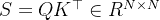

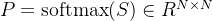

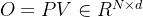

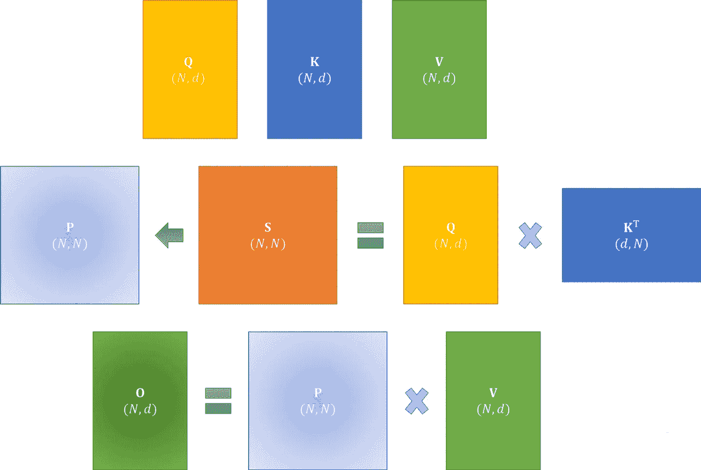

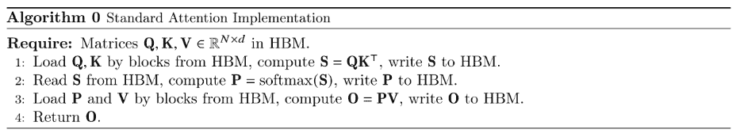

其中，一共包含八次HBM的矩阵读写操作。这八次读写操作分别为：

第一行对`Q`、`K`的读 共两次，对`S` 的写一次，读写操作总共三次

第二行对`S`读一次，对`P`写一次，读写操作总共两次

第三行对`P`、`V`的读 共两次，对`O`的写一次，读写操作总共三次

即标准注意力实现存在两个问题：

+ 显存占用多，过程中由于实例化了完整的注意力矩阵 ，导致了 的内存要求

+ HBM读写次数多，减慢了运行时间(wall-clock time)

接下来下文的Flash Attention便是要分别解决上述这两个问题。

## Flash Attention

> 通过分块方式，改变attention模块计算顺序，实现了2-4倍的加速，同时避免了对中间结果的频繁读写

> 以下引自：[通透理解FlashAttention(含其2代和第3代)：全面降低显存读写、加快计算速度](https://blog.csdn.net/v_JULY_v/article/details/133619540)

对于性能受限于内存带宽的操作，进行加速的常用方式就是`kernel`融合，该操作的典型方式分为三步：

1. 每个`kernel`将输入数据从低速的HBM中加载到高速的SRAM中

1. 在SRAM中，进行计算

1. 计算完毕后，将计算结果从SRAM中写入到HBM中

如此，便可避免反复执行“从HBM中读取输入数据，SRAM执行计算，最后将计算结果写入到HBM中”，将多个操作融合成一个操作，减少读写HBM的次数。

由于SRAM的内存大小有限，不可能一次性计算完整的注意力，因此必须进行分块计算，使得分块计算需要的内存不超过SRAM的大小。

注意力机制的计算过程是“矩阵乘法 --> `scale` --> `mask` --> `softmax` --> `dropout` --> 矩阵乘法”，矩阵乘法和逐点操作(`scale`，`mask`，`dropout`)的分块计算是容易实现的，难点在于`softmax`的分块计算。由于计算`softmax`的归一化因子(分母)时，需要获取到完整的输入数据，进行分块计算的难度比较大。下面会介绍flash attention实现分块计算的算法。

首先回顾标准attention计算过程：

考虑到向量 ，原生`softmax`计算过程如下：

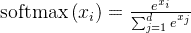

计算`x`中的最大值：

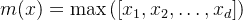

定义 ，其中每一项相当于在指数项减去最大值 ：

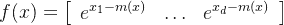

定义 为`softmax`分母中的求和项，即`exp`求和项：

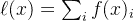

最终`softmax`可以用 和 表示：

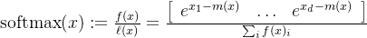

下面详细介绍flash attention的核心算法：

考虑一个大小为2d的向量 ，将其“一切为二”进行分块： ，其中 ，

换言之，子向量  是原向量的前半部分，子向量  是原向量的后半部分，

计算前半部分指数项，此时指数项减去的最大值 仅为局部最大值：

计算后半部分指数项，此时指数项减去的最大值 同样仅为局部最大值：

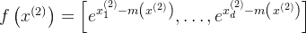

分别计算前后两部分`exp`求和项，这里计算出来的指数项同样为局部最大值：

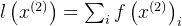

分别计算前后两部分 和  的最大值，并计算出整个 全局最大值 :

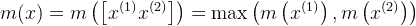

由于前后两部分指数项减去的数值为局部最大值，因而需要调整，flash attention 1在指数部分加上减去的局部最大值后，再减去全局最大值 ，这样等价于直接减去全局最大值:

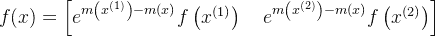

计算整体`exp`求和项，由于上面计算出来的前后两部分`exp`求和项均为局部最大值，因而通过在指数部分加上减去的局部最大值后，再减去全局最大值 ，等价于直接减去全局最大值：

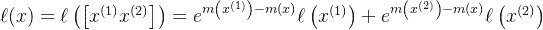

最终`softmax`计算如下：

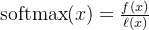

通过保持两个额外的统计量 ，可以实现`softmax`的分块计算。

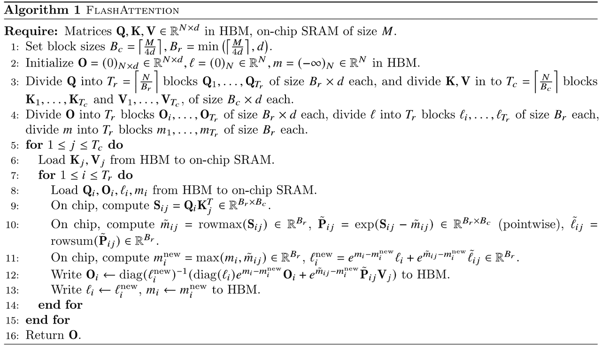

下图展示了一个示例：首先将`K`和`V`分成两部分（`K1`和`K2`，`V1`和`V2`，具体如何划分根据数据大小和GPU特性调整），根据`K1`和`Q`可以计算得到`S1`和`A1`，然后结合`V1`得到`O1`。接着计算第二部分，根据`K2`和`Q`可以计算得到`S2`和`A2`，然后结合`V2`得到`O2`。最后`O2`和`O1`一起得到Attention结果。

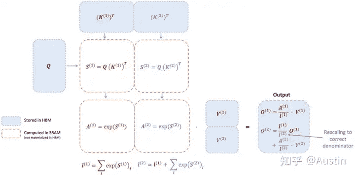

值得注意的是，输入数据`K`、`Q`、`V`是存储在HBM上的，中间结果`S`、`A`都不需要存储到HBM上。通过这种方式，FlashAttention可以将内存开销降低到线性级别，并实现了2-4倍的加速，同时避免了对中间结果的频繁读写，从而提高了计算效率。

## Flash Attention 2

> 以下引自：[FlashAttention2详解（性能比FlashAttention提升200%）FlashAttention核心逻辑以及V1 V2差异总结](https://zhuanlan.zhihu.com/p/645376942)

> 通过交换内外循环顺序，将query置于外循环，在batch较小情况下，利用query分块无关的性质，实现thread block的充分利用，性能比flash attention提升了2-3倍。

下面我们先讲述FlashAttention-2对FlashAttention的改进，从而减少了非矩阵乘法运算（`non-matmul`）的`FLOPs`。然后说明如何将任务分配给不同的thread block进行并行计算，充分利用GPU资源。最后描述了如何在一个thread block内部分配任务给不同的warps，以减少访问共享内存次数。这些优化方案使得FlashAttention-2的性能提升了2-3倍。

FlashAttention-2在FlashAttention算法基础上进行了调整，减少了非矩阵乘法运算（`non-matmul`）的`FLOPs`。这是因为现代GPU有针对`matmul`（`GEMM`）专用的计算单元（如Nvidia GPU上的`Tensor Core`），效率很高。以`A100 GPU`为例，其`FP16`/`BF16`矩阵乘法的最大理论吞吐量为312 `TFLOPs/s`，但`FP32`非矩阵乘法仅有19.5 `TFLOPs/s`，即每个`non-matmul FLOP`比`mat-mul FLOP`昂贵16倍。为了确保高吞吐量（例如超过最大理论`TFLOPs/s`的50％），我们希望尽可能将时间花在`matmul FLOPs`上。

### 算法

为了减少`non-matmul FLOPs`，本文在FlashAttention基础上做了两点改进：

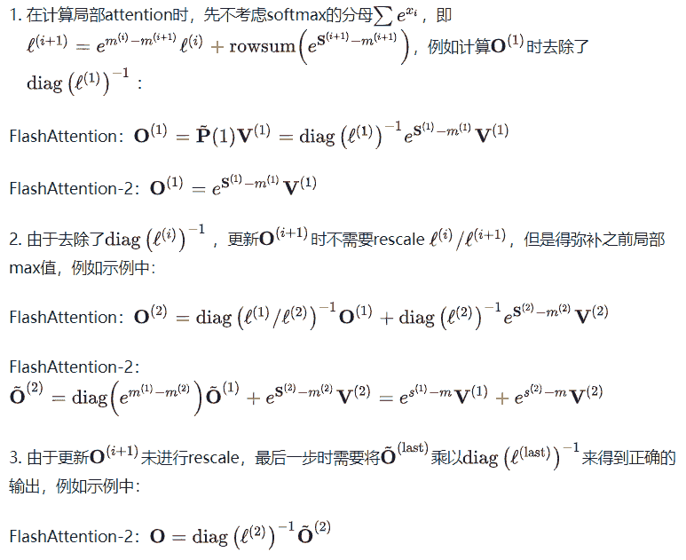

FlashAttention完整计算步骤（红色部分表示V1和V2区别）

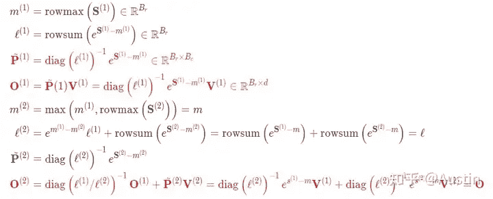

FlashAttention-2的完整计算步骤（红色部分表示V1和V2区别）：

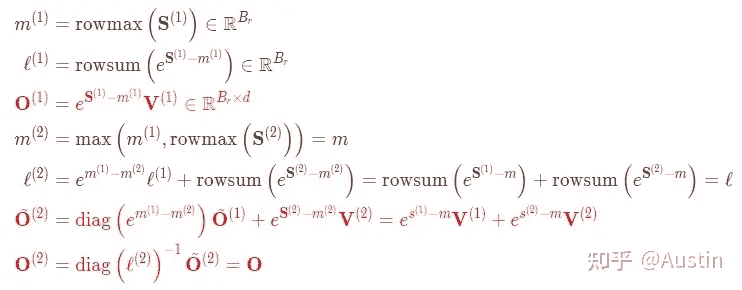

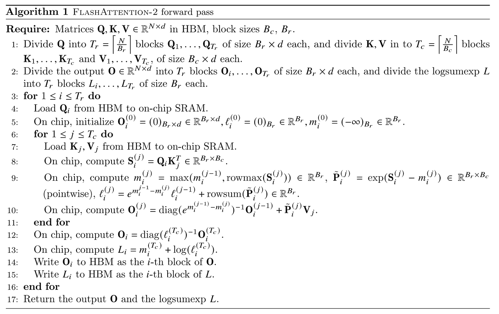

`Causal masking`是attention的一个常见操作，特别是在自回归语言建模中，需要对注意力矩阵`S`应用因果掩码（即任何`S` ，其中 `>` 的条目都设置为−∞）。

由于FlashAttention和FlashAttention-2已经通过块操作来实现，对于所有列索引都大于行索引的块（大约占总块数的一半），我们可以跳过该块的计算。这比没有应用因果掩码的注意力计算速度提高了1.7-1.8倍。

### 并行化

FlashAttention在`batch`和`heads`两个维度上进行了并行化：使用一个thread block来处理一个attention head，总共需要thread block的数量等于`batch size` × number of heads。每个block被调到到一个`SM`上运行，例如`A100 GPU`上有108个`SMs`。当block数量很大时（例如≥80），这种调度方式是高效的，因为几乎可以有效利用GPU上所有计算资源。

但是在处理长序列输入时，由于内存限制，通常会减小`batch size`和`head`数量，这样并行化程度就降低了。因此，FlashAttention-2还在序列长度这一维度上进行并行化，显著提升了计算速度。此外，当`batch size`和`head`数量较小时，在序列长度上增加并行性有助于提高GPU占用率。

Forward pass。FlashAttention算法有两个循环， 在外循环 ， 在内循环 。FlashAttention-2将 移到了外循环 ， 移到了内循环`j`，由于改进了算法使得warps之间不再需要相互通信去处理 ，所以外循环可以放在不同的thread block上。这个交换的优化方法是由Phil Tillet在`Triton`[17]提出并实现的。

另外`fwd kernel`建议使用`grid_dim = [Q_N_CTX, Batch, Head]`的顺序`Launch Kernel`，先遍历`Q_N_CTX`，然后遍历`Batch`, `Head`；先遍历`Q_N_CTX`意味着同时会有很多个Block在计算同一个`[Batch, Head]`的不同`Q_N_CTX`对应的Tile，那么对于同一列方向的QK输出Tile来说，`K`和`V`的Tile就可以在`L2`上复用，第二行计算可以直接从`L2`拿到，这样可以显著提高`L2 cache hit rate`。这个优化在大`seq_length`的时候优化很明显。

### warps工作划分

上一节讨论了如何分配thread block，然而在每个thread block内部，我们也需要决定如何在不同的warp之间分配工作。我们通常在每个thread block中使用4或8个warp。

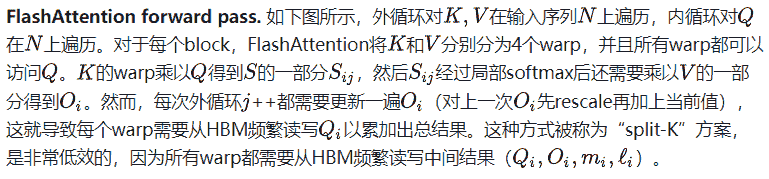

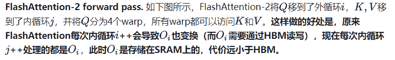

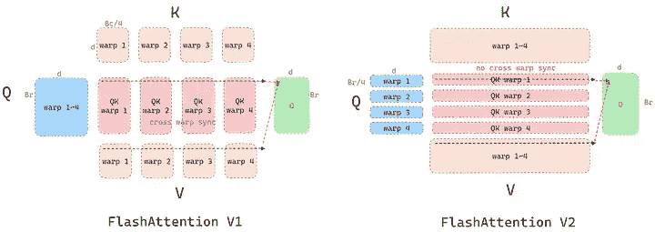

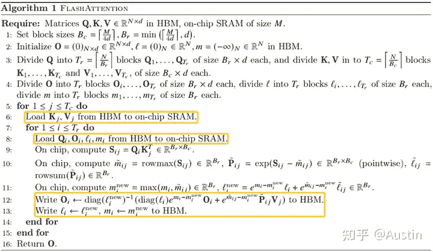

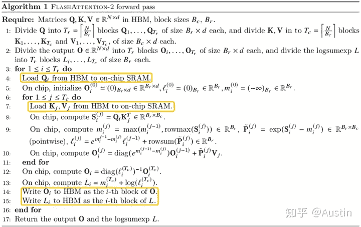

### 访存量对比

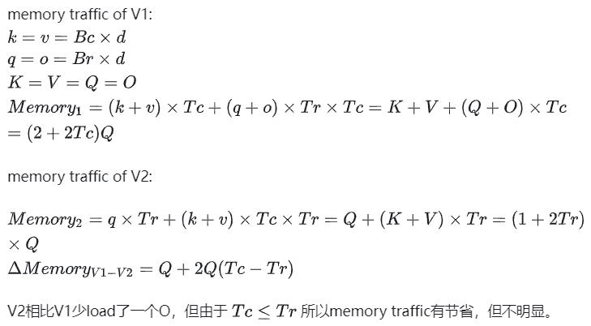

经过以上分析，`flash attention 2`比`flash attention`少了`O`的存储开销。通过将`query`置于外循环，还在序列长度这一维度上进行并行化，当`batch size`和`head`数量较小时，有助于提高`GPU`占用率。

## Flash Attention 3（Flash Decoding）

> `Flash-Decoding`，推理过程中显著加速`attention`操作（例如长序列生成速度提高8倍），主要思想是最大化并行加载`keys`和`values`的效率，通过重新缩放组合得到正确结果。

> 以下引自：FlashAttenion-V3: Flash Decoding详解

在`decoding`过程中，每个生成的新`token`需要与先前的`tokens`合并[后，才能继续执行`attention`操作，即`softmax()`](https://zhuanlan.zhihu.com/p/626079753)，即[`softmax()`](https://zhuanlan.zhihu.com/p/645376942)×V。`Attention`操作在训练过程的瓶颈主要卡在访问内存读写中间结果（例如 ）的带宽，相关加速方案可以参考`FlashAttention`和`FlashAttention2`。

然而，上述优化不适合直接应用于推理过程。因为在训练过程中，`FlashAttention`对`batch size`和`query length`进行了并行化加速。而在推理过程中，`query length`通常为1，这意味着如果`batch size`小于`GPU`上的`SM`数量（例如`A100`上有108个`SMs`），那么整个计算过程只使用了`GPU`的一小部分！特别是当上下文较长时，通常会减小`batch size`来适应`GPU`内存。例如`batch size = 1`时，`FlashAttention`对`GPU`利用率小于1%！

`Flash-Decoding`在此基础上增加了一个新的并行化维度：`keys`/`values`的序列长度。即使`batch size`很小，但只要上下文足够长，它就可以充分利用`GPU`。与`FlashAttention`类似，`Flash-Decoding`几乎不用额外存储大量数据到全局内存中，从而减少了内存开销。

`Flash attention`计算过程：

`https://picx.zhimg.com/v2-2c21fe2fe87a25e76a5863e3dd25b2d1_b.webp`

`Flash decoding`计算过程：

`https://pic3.zhimg.com/v2-13fcb10493400523013dcfe55cc9b846_b.jpg`

`Flash Decoding`主要包含以下三个步骤（可以结合上图来看）：

1. 将`keys`和`values`分成较小的`block`

2. 使用`FlashAttention`并行计算`query`与每个`block`的注意力（这是和`FlashAttention`最大的区别）。对于每个`block`的每行（因为一行是一个特征维度），`Flash Decoding`会额外记录`attention values`的`log-sum-exp`（标量值，用于第3步进行`rescale`）

3. 对所有`output blocks`进行`reduction`得到最终的`output`，需要用`log-sum-exp`值来重新调整每个块的贡献

实际应用中，第1步中的数据分块不涉及`GPU`操作（因为不需要在物理上分开），只需要对第2步和第3步执行单独`[kernels](https://zhida.zhihu.com/search?q=%E5%B9%B6%E8%A1%8C%E5%8C%96&zhida_source=entity&is_preview=1)`。虽然最终的`reduction`操作会引入一些额外的计算，但在总体上，`Flash-Decoding`通过增加并行化的方式取得了更高的效率。

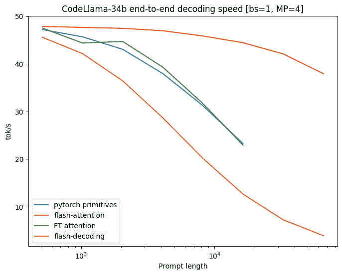

run-time in us

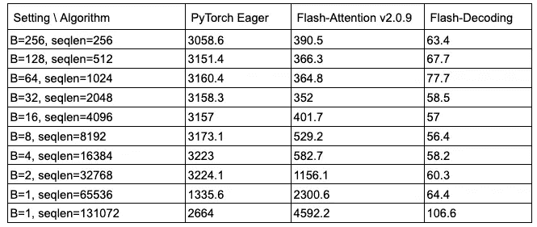

[`上图可以看出`](https://zhida.zhihu.com/search?q=%E5%8F%AF%E6%89%A9%E5%B1%95%E6%80%A7&zhida_source=entity&is_preview=1)，`Flash-Decoding`在处理非常大的序列时速度可以提高8倍，并且比其他方法具有更好的可扩展性。所有方法在处理`small prompts`时表现相似，但随着序列长度从512增加到64k，其他方法的性能都变差了，而`Flash-Decoding`对序列长度的增加并不敏感。

## Flash Attention 4

> 以下引自：`[FlashAttention-V4](https://zhuanlan.zhihu.com/p/665595287)`，非官方】`FlashDecoding++`

### 共享`softmax`最大值

为了提高`softmax`并行性，之前方法（`FlashAttention`、`FlashDecoding`）将计算过程拆分，各自计算`partial softmax`结果，最后需要通过同步操作来更新`partial softmax`结果。这种同步`partial softmax`更新操作占`Llama2-7B`推理的注意力计算的18.8%。

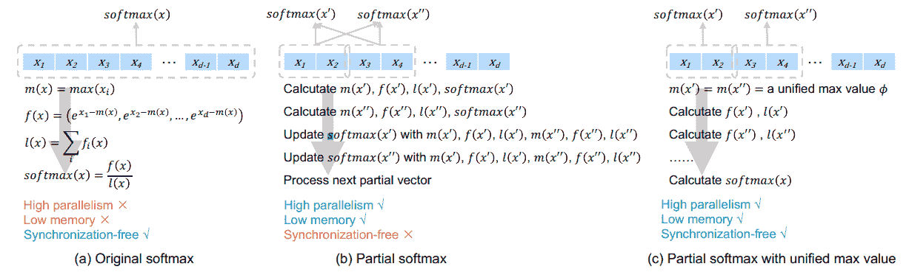

Asynchronized softmax with unified max value. `FlashDecoding++`为分块`softmax`计算设置了一个共享的最大值。这样可以独立计算`partial softmax`，无需同步更新。

如下图所示对于`OPT-6.7B`来说，数值范围较大，于是作者采用动态调整策略，如果在推理过程中发现设置的`ϕ`不合理，那么就终止当前操作，然后采用`FlashAttention`和`FlashDecoding`的方法计算`softmax`。

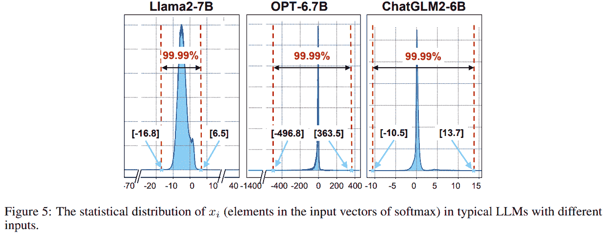

Flat GEMM Optimization with Double Buffering

在共享内存中分配两个`buffer`，一个`buffer`用于执行当前`tile`的`GEMM`计算，同时另一个`buffer`则加载下一个`tile` `GEMM`所需的数据。这样计算和内存访问是重叠的，本文在`N`较大时采取这种策略。

Heuristic Dataflow with Hardware Resource Adaption

偏工程化思路，根据不同的`M`, `K`, `N`选取`FastGEMV`、`flat GEMM`（本文方法）、`CUTLASS`。

本文值得借鉴的思路主要是`softmax`取最大值，其他两种优化方式细节跳过。

> `Flash attention 2`用来解决`flash attention`训练阶段或`profilling`阶段并发度不够的问题，使得`Query`可以拆分并行；

> `Flash attention 3/4`用来解决`flash attention`在`generation`阶段并发度不够的问题，使得`K`、`V`可以拆分并行
