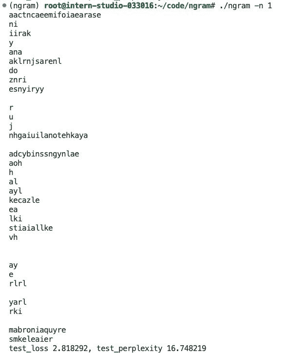
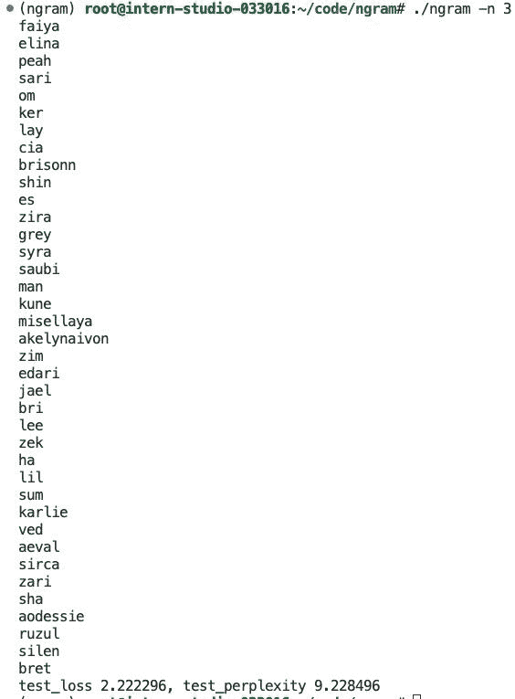
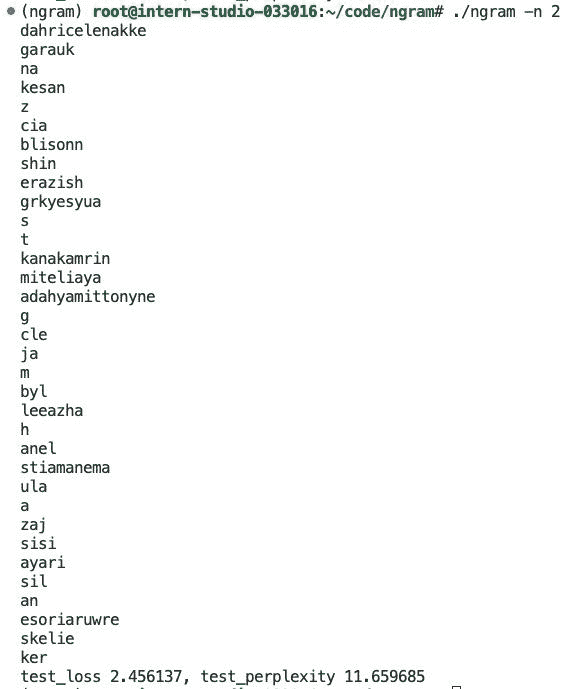
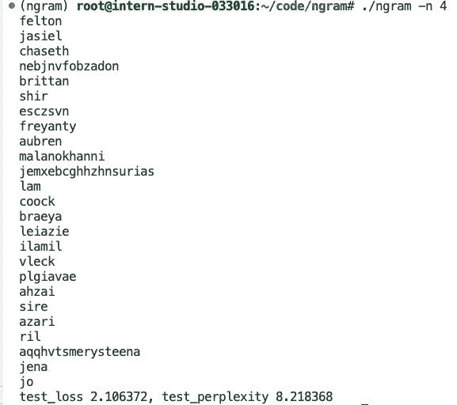
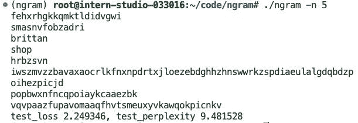
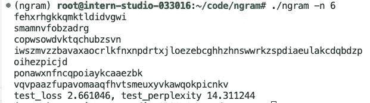

# 101N0102 ngram C 核心代码解读

> 来源：[https://v11enp9ok1h.feishu.cn/docx/IAXKdK9mroUf75xLYsfc5azankh](https://v11enp9ok1h.feishu.cn/docx/IAXKdK9mroUf75xLYsfc5azankh)

> 虽然不知道大家有没有懂ngram，🐧小弟但是经历了不懈的学习总之是懂了。来写一个ngram c代码解读吧。之前很少写代码解读，总感觉容易写成流水账。今天第一次体验一下

## 写在前面

代码仓库在：https://github.com/EurekaLabsAI/ngram

还是来一个最简单的简介吧：

N-Gram是一种基于统计语言模型的算法。它的基本思想是将文本里面的内容按照字节进行大小为N的滑动窗口操作，形成了长度是N的字节片段序列。

每一个字节片段称为gram，对所有gram的出现频度进行统计，并且按照事先设定好的阈值进行过滤，形成关键gram列表，也就是这个文本的向量特征空间，列表中的每一种gram就是一个特征向量维度。

## 代码整体解读

我们这里要训练的是一个类似花名册的东西，在`data/train.txt`下。最终的目的是通过给定的`n`的大小，使用一个{1, 2, 3, 4, 5, 6} - Gram的算法来进行采样生成一个新的名字。

## 先玩玩再说

整体来看呢，这版c代码会比python代码快很多。如果你体验了python代码和c代码，这俩简直就不是一个速度。。。

### 编译代码

c写完代码需要编译再执行，简单编译下

```
gcc -O3 ngram.c -o ngram -lm
```

参数解释：

+   `-O3`: 用O3进行编译期优化

+   `-lm`：使用数学相关的库

### 不同的seq_len的结果

编译好之后，就要运行啦。在这里ngram模型接受两个输入:

+   `seq_len`: 第一个是`seq_len`。它代表了模型使用几个字节组成一个片段来统计概率。

+   `Smoothing`: 另一个是`smoothing`，这代表了一个光滑值。光滑值是，如果某个片段没有出现时。不存在它的频率，这样也无法计算它的概率。无法计算`loss`，也不会把这种可能性从词表里采样到。

让我们先试试不同`seq_len`的结果：













能看到在`n`是4的时候，`text`的PPL最低。生成的名字也会更符合认知。

### 不同的smoothing的结果

这里不再展示，smoothing变化时，PPL也会随之变化。代码预设的`n = 4`，`s = 0.1`得到最低的PPL。

## 从主函数开始

```
// the arity of the n-gram model (1 = unigram, 2 = bigram, 3 = trigram, ...)
int seq_len = 4;
float smoothing = 0.1f;
```

这里定义了两个最重要的变量`seq_len`和`smoothing`，控制模型分片大小和光滑程度的参数。

```
// simple argparse, example usage: ./ngram -n 4 -s 0.1
for (int i = 1; i < argc; i+=2) {
    if (i + 1 >= argc) { error_usage(); } // must have arg after flag
    if (argv[i][0] != '-') { error_usage(); } // must start with dash
    if (!(strlen(argv[i]) == 2)) { error_usage(); } // must be -x (one dash, one letter)
    if (argv[i][1] == 'n') { seq_len = atoi(argv[i+1]); }
    else if (argv[i][1] == 's') { smoothing = atof(argv[i+1]); }
    else { error_usage(); }
}
```

从命令行中读取`n`和`s`，默认为`n=4`，`s=0.1`。

## 碰到NgramModel定义和初始化

接下来在主函数里，代码定义了`NgramModel`，并调用`ngram_init`进行了初始化。让我们看看这是什么？

```
NgramModel model;
ngram_init(&model, NUM_TOKENS, seq_len, smoothing);
```

### 定义NgramModel

```
// ----------------------------------------------------------------------------
// ngram model

typedef struct {
    // hyperparameters
    int seq_len;
    int vocab_size;
    float smoothing;
    // parameters
    size_t num_counts; // size_t because int would only handle up to 2^31-1 ~= 2 billion counts
    uint32_t* counts;
    // internal buffer for ravel_index
    int* ravel_buffer;
} NgramModel;
```

`NgramModel`通过一个结构体定义，分别是三个超参数，`seq_len`, `vocab_size`(词表大小，这里是26个字符+截止符),`smoothing`。三个参数，`num_counts`, `counts`和`ravel_buffer`。至于它们都是什么，请继续往下看。

### 初始化NgramModel

```
ngram_init(&model, NUM_TOKENS, seq_len, smoothing);
void ngram_init(NgramModel *model, const int vocab_size, const int seq_len, const float smoothing) {
    // sanity check and store the hyperparameters
    assert(vocab_size > 0);
    assert(seq_len >= 1 && seq_len <= 6); // sanity check max ngram size we'll handle
    model->vocab_size = vocab_size;
    model->seq_len = seq_len;
    model->smoothing = smoothing;
    // allocate and init memory for counts (np.zeros in numpy)
    model->num_counts = powi(vocab_size, seq_len);
    model->counts = (uint32_t*)mallocCheck(model->num_counts * sizeof(uint32_t));
    for (size_t i = 0; i < model->num_counts; i++) {
        model->counts[i] = 0;
    }
    // allocate buffer we will use for ravel_index
    model->ravel_buffer = (int*)mallocCheck(seq_len * sizeof(int));
}
```

初始化时，`ngram_init`需要一个类型为`NgramModel`结构题定义的指针，一个`vocab_size`大小，一个`seq_len`，一个`smoothing`。

#### 实现：

首先做了一系列`assert`。

+   定义了模型的`vocab_size`是`NUM_TOKENS`，也就是27。

+   定义了`seq_len`和`smoothing`。

+   定义了`num_counts` 是  。这里`powi`同理于`std::pow`，就不展开了。

+   给`counts`分配空间并全部初始化为0

> 上面两步的感觉其实就像是`torch.zeros([vocab_size, vocab_size, ..., vocab_size], dtype=torch.int32)`。

> `n`是几维度就是几。

+   `ravel_buffer`， 这是一个内部缓存，后续详细介绍。

## 碰到DataLoader相关的一系列操作

```
// train the model
DataLoader train_loader;
dataloader_init(&train_loader, "data/train.txt", seq_len);
while (dataloader_next(&train_loader)) {
}
dataloader_free(&train_loader);
```

看这段实现，我们首先实例化了一个`train_loader`，之后初始化了`train_loader`。之后开始训练，让我们对照实例化和原始代码进行讲解。

### 定义DataLoader & 定义Tape

```
typedef struct {
    FILE *file;
    int seq_len;
    Tape tape;
} DataLoader;
```

很好理解的是`file`和`seq_len`。那`Tape`是什么呢？简单理解就是某个片段。

#### 定义一个缓冲区Tape

```
typedef struct {
    int n;
    int length;
    int* buffer;
} Tape;
```

`Tape` 存储一个固定窗口的token，功能类似于一个有限队列。以方便Ngram模型的更新。

+   `N` 当前缓冲区中token数量

+   `length`：缓冲区长度

+   `buffer`：缓冲区

### 初始化DataLoader & 初始化Tape

```
dataloader_init(&train_loader, "data/train.txt", seq_len);
void dataloader_init(DataLoader *dataloader, const char *path, const int seq_len) {
    dataloader->file = fopenCheck(path, "r");
    dataloader->seq_len = seq_len;
    tape_init(&dataloader->tape, seq_len);
}
```

首先我们让`dataloader`读取了一个文件，之后确定`n`大小。最后用`seq_len`初始化`dataloader`中的`tape`。

```
void tape_init(Tape *tape, const int length) {
    // we will allow a buffer of length 0, useful for the Unigram model
    assert(length >= 0);
    tape->length = length;
    tape->n = 0; // counts the number of elements in the buffer up to max
    tape->buffer = NULL;
    if (length > 0) {
        tape->buffer = (int*)mallocCheck(length * sizeof(int));
    }
}
```

通过`seq_len`定义了`tape`的`length`。初始化了某个片段的统计值，并分配了`length`长度的空间给`tape`。

### 迭代DataLoader->dataloader_next & tape_update

```
dataloader_next(&train_loader)
int dataloader_next(DataLoader *dataloader) {
    // returns 1 if a new window was read, 0 if the end of the file was reached
    int c;
    while (1) {
        c = fgetc(dataloader->file);
        if (c == EOF) {
            break;
        }
        int token = tokenizer_encode(c);
        int ready = tape_update(&dataloader->tape, token);
        if (ready) {
            return 1;
        }
    }
    return 0;
}
```

+   读取过程：读啊读，如果读到了文件最后就`break`。每个读进来的字符(`\n`, `a`,`b`,`c`...`z`)通过`tokenizer_encode`转换成数字(0-26)。我们把0定义成结束符号,对应的就是`\n`。（很合理是不是，正好换行是结束。可以换下一个词了。

+   更新过程：

```
int tape_update(Tape *tape, const int token) {
    // returns 1 if the tape is ready/full, 0 otherwise
    if (tape->length == 0) {
        return 1; // unigram tape is always ready
    }
    // shift all elements to the left by one
    for (int i = 0; i < tape->length - 1; i++) {
        tape->buffer[i] = tape->buffer[i + 1];
    }
    // add the new token to the end (on the right)
    tape->buffer[tape->length - 1] = token;
    // keep track of when we've filled the tape
    if (tape->n < tape->length) {
        tape->n++;
    }
    return (tape->n == tape->length);
```

开始的时候`tape`空空如也，我们一个个字符从`tape`的右侧读进来，然后慢慢入队。等这个队列满了的时候，我们会返回`return (tape->n == tape->length);`也就是`true`。这时候会触发:

```
if (ready) {
    return 1;
}
```

说明我们第一次堆满这个队列，那么就可以开始我们的更新流程了～

### 释放DataLoader -> dataloader_free

```
void dataloader_free(DataLoader *dataloader) {
    fclose(dataloader->file);
    tape_free(&dataloader->tape);
}
```

没啥好说的，关闭文件，释放缓冲区一气呵成～

## 终于要开始训练啦

```
ngram_train(&model, train_loader.tape.buffer);
```

训练代码异常的简单，只有一行。让我们看看在这里都做了啥吧。

```
ngram_train(&model, train_loader.tape.buffer);
void ngram_train(NgramModel *model, const int* tape) {
    // tape here is of length `seq_len`, and we want to update the counts
    size_t offset = ravel_index(tape, model->seq_len, model->vocab_size);
    assert(offset >= 0 && offset < model->num_counts);
    model->counts[offset]++;
}
```

我们的输入是我们`model`，和一个被填满的队列。

### ravel_index开始寻址


# ngram C 语言实现详解

## 一维索引寻址

```c
size_t offset = ravel_index(tape, model->seq_len, model->vocab_size);
size_t ravel_index(const int* index, const int n, const int dim) {
    // convert an n-dimensional index into a 1D index (ravel_multi_index in numpy)
    // each index[i] is in the range [0, dim)
    size_t index1d = 0;
    size_t multiplier = 1;
    for (int i = n - 1; i >= 0; i--) {
        int ix = index[i];
        assert(ix >= 0 && ix < dim);
        index1d += multiplier * ix;
        multiplier *= dim;
    }
    return index1d;
}
```

根据`n`和词表大小进行1D训址，做这步是因为`C`语言中高维数组定义寻址较复杂，直接压缩成单维度进行寻址。

+ 在每个维度上寻找索引，这个操作在每个维度上寻找了它所对应的索引

```c
int ix = index[i];
```

+ 依次迭代维度

这里可以理解成`multiplier`是一个寻址的基，每一次迭代新的维度需要给基 * 一个词表大小。

```c
index1d += multiplier * ix;
multiplier *= dim;
```

感觉说的还是很抽象，那让咱们来画个图吧：

下面是一个8x8的表，如果我们想找到这个`(3, 3)`的坐标一维的表示，是不是需要像这样

| 0 | 1 | 2 | 3 | 4 | 5 | 6 | 7 |
| --- | --- | --- | --- | --- | --- | --- | --- |
| 8 | 9 | 10 | 11 | 12 | 13 | 14 | 15 |
| 16 | 17 | 18 | 19 | 20 | 21 | 22 | 23 |
| 24 | 25 | 26 | 我想找到这儿，它的坐标是(3, 3) |  |  |  |  |
|  |  |  |  |  |  |  |  |
|  |  |  |  |  |  |  |  |
|  |  |  |  |  |  |  |  |
|  |  |  |  |  |  |  |  |

扩展到高维度也是一样的，它返回了一个`token`在一维上的偏移值。然后我们把这个偏移值在模型定义的一个`counts`里`++` ... 一直训练到结束。

## 模型推理

```c
// sample from the model for 200 time steps
Tape sample_tape;
tape_init(&sample_tape, seq_len - 1);
tape_set(&sample_tape, EOT_TOKEN); // fill with EOT tokens to init
uint64_t rng = 1337;
for (int i = 0; i < 200; i++) {
    ngram_inference(&model, sample_tape.buffer, probs);
    float coinf = random_f32(&rng);
    int token = sample_discrete(probs, NUM_TOKENS, coinf);
    tape_update(&sample_tape, token);
    char c = tokenizer_decode(token);
    printf("%c", c);
}
printf("\n");
```

是不是看完了训练，推理都看起来眉清目秀了～在推理时，我们先定义了一个`Tape`，填充满结束符号，也就是`0`

```c
ngram_inference(&model, sample_tape.buffer, probs);
void ngram_inference(NgramModel *model, const int* tape, float* probs) {
    // here, tape is of length `seq_len - 1`, and we want to predict the next token
    // probs should be a pre-allocated buffer of size `vocab_size`

    // copy the tape into the buffer and set the last element to zero
    for (int i = 0; i < model->seq_len - 1; i++) {
        model->ravel_buffer[i] = tape[i];
    }
    ...
}
```

`ravel_buffer`在推理时使用，我们给`ravel_buffer`最后填上`0`元素。

```c
model->ravel_buffer[model->seq_len - 1] = 0;
// find the offset into the counts array based on the context
size_t offset = ravel_index(model->ravel_buffer, model->seq_len, model->vocab_size);
// seek to the row of counts for this context
uint32_t* counts_row = model->counts + offset;
```

在这里还有一个点，每次`ravel_buffer`的最后一个值都是`0`，这样索引时找到的`offset`都是某一行的开始。`counts_row`能找到特定行的开始位置。

```c
// calculate the sum of counts in the row
float row_sum = model->vocab_size * model->smoothing;
for (int i = 0; i < model->vocab_size; i++) {
    row_sum += counts_row[i];
}
```

添加`smoothing`为了防止`row_sum`为`0`的情况发生。

```c
if (row_sum == 0.0f) {
    // the entire row of counts is zero, so let's set uniform probabilities
    float uniform_prob = 1.0f / model->vocab_size;
    for (int i = 0; i < model->vocab_size; i++) {
        probs[i] = uniform_prob;
    }
} else {
    // normalize the row of counts into probabilities
    float scale = 1.0f / row_sum;
    for (int i = 0; i < model->vocab_size; i++) {
        float counts_i = counts_row[i] + model->smoothing;
        probs[i] = scale * counts_i;
    }
}
```

当然如果你的`smoothing`设成`0`了，那不好意思。还是会为`0`，这时候就每个位置均分。否则计算这一组`tape`每个字符的概率。拿`n = 4`举例，现在这步我们算得就是：

之后我们会在这组概率里随机采样一下。采样就不多说了😋

```c
int token = sample_discrete(probs, NUM_TOKENS, coinf);
```

采样完之后还有什么很关键？那就是把采样的结果加进`tape`里啊！

```c
tape_update(&sample_tape, token);
```

这样下次预测就会根据这次的结果再进行预测啦，一直预测到生成一个`0`。`0`是截止符号，也是换行符号。我们就会开始预测下一个词。

## 模型测试

最后还是要讲讲测试，大部分的接口都在上文同步过了。

```c
// evaluate the test split loss
DataLoader test_loader;
dataloader_init(&test_loader, "data/test.txt", seq_len);
float sum_loss = 0.0f;
int count = 0;
while (dataloader_next(&test_loader)) {
    // note that ngram_inference will only use the first seq_len - 1 tokens in buffer
    ngram_inference(&model, test_loader.tape.buffer, probs);
    // and the last token in the tape buffer is the label
    int target = test_loader.tape.buffer[seq_len - 1];
    // negative log likelihood loss
    sum_loss += -logf(probs[target]);
    count++;
}
dataloader_free(&test_loader);
float mean_loss = sum_loss / count;
float test_perplexity = expf(mean_loss);
printf("test_loss %f, test_perplexity %f\n", mean_loss, test_perplexity);
```

这里我们主要是计算一个`negative log likelihood loss`。它的计算流程是训练好的模型，每次`test`加载一个新的字符。并进行生成。找到新的字符应该是什么。

```c
int target = test_loader.tape.buffer[seq_len - 1];
```

并得到这个字符的`negative log likelihood loss`

```c
-logf(probs[target]);
```

之后一直累加就好了，计算平均`loss`和`PPL`

```c
float mean_loss = sum_loss / count;
float test_perplexity = expf(mean_loss);
```

## 总结

这就是关于`ngram C`的全部啦，又是肝到天亮的一次。学习`C`的代码能让你更感觉到融会贯通，更加掌握`ngram`。确实很有意思～
