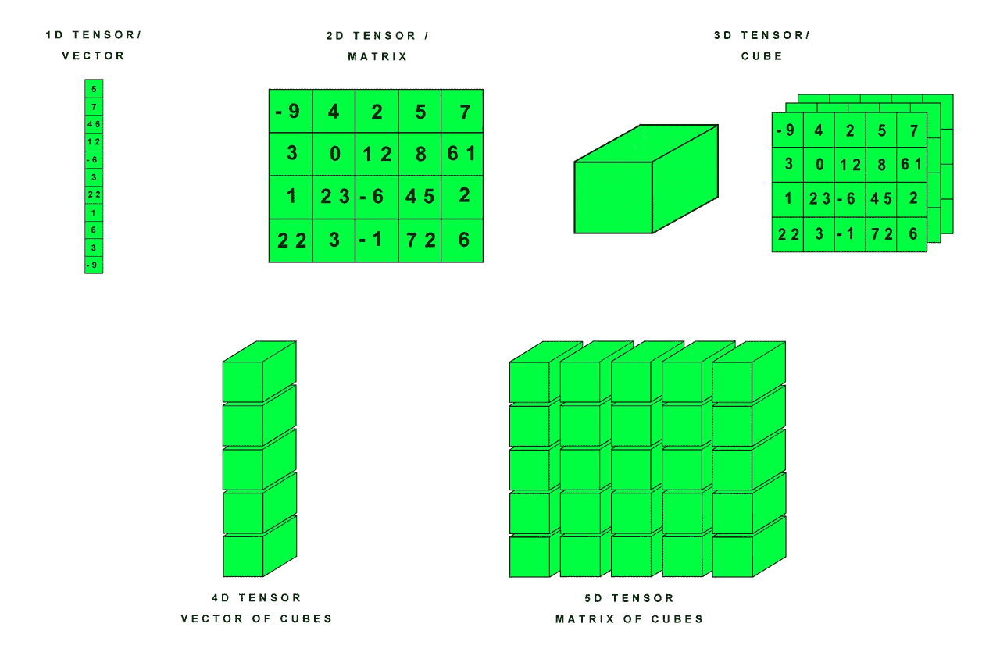

# PyTorch 张量（Tensor）

> 来源：[https://v11enp9ok1h.feishu.cn/docx/Ul8idh7dQoVEt3xB4mCcAMb6n0c](https://v11enp9ok1h.feishu.cn/docx/Ul8idh7dQoVEt3xB4mCcAMb6n0c)

张量是一个多维数组，可以是标量、向量、矩阵或更高维度的数据结构。

+   在 PyTorch 中，张量（Tensor）是数据的核心表示形式，类似于 NumPy 的多维数组，但具有更强大的功能，例如支持 GPU 加速和自动梯度计算。

+   张量支持多种数据类型（整型、浮点型、布尔型等）。

+   张量可以存储在 CPU 或 GPU 中，GPU 张量可显著加速计算。

下图展示了不同维度的张量（Tensor）在 PyTorch 中的表示方法：



**说明：**

+   1D Tensor / Vector（一维张量/向量）: 最基本的张量形式，可以看作是一个数组，图中的例子是一个包含 10 个元素的向量。

+   2D Tensor / Matrix（二维张量/矩阵）: 二维数组，通常用于表示矩阵，图中的例子是一个 4x5 的矩阵，包含了 20 个元素。

+   3D Tensor / Cube（三维张量/立方体）: 三维数组，可以看作是由多个矩阵堆叠而成的立方体，图中的例子展示了一个 3x4x5 的立方体，其中每个 5x5 的矩阵代表立方体的一个"层"。

+   **4D Tensor / Vector o**f Cubes（四维张量/立方体向量）: 四维数组，可以看作是由多个立方体组成的向量，图中的例子没有具体数值，但可以理解为一个包含多个 3D 张量的集合。

+   **5D Tensor / Matrix o**f Cubes（五维张量/立方体矩阵）: 五维数组，可以看作是由多个4D张量组成的矩阵，图中的例子同样没有具体数值，但可以理解为一个包含多个 4D 张量的集合。

---

## 创建张量

张量创建的方式有：

使用 **torch.tensor()** 函数，你可以将一个列表或数组转换为张量：

## 实例

```
import torch

tensor = torch.tensor([1, 2, 3])
print(tensor)
```

**输出如下：**

tensor([1, 2, 3])

如果你有一个 NumPy 数组，可以使用 torch.from_numpy() 将其转换为张量：

## 实例

```
import numpy as np

np_array = np.array([1, 2, 3])
tensor = torch.from_numpy(np_array)
print(tensor)
```

**输出如下：**

tensor([1, 2, 3])

创建 2D 张量（矩阵）：

## 实例

```
import torch

tensor_2d = torch.tensor([
    [-9, 4, 2, 5, 7],
    [3, 0, 12, 8, 6],
    [1, 23, -6, 45, 2],
    [22, 3, -1, 72, 6]
])
print(&quot;2D Tensor (Matrix):\n&quot;, tensor_2d)
print(&quot;Shape:&quot;, tensor_2d.shape)  # 形状
```

**输出如下：**

```
2D Tensor (Matrix):
 tensor([[-9,  4,  2,  5,  7],
        [ 3,  0, 12,  8,  6],
        [ 1, 23, -6, 45,  2],
        [22,  3, -1, 72,  6]])
Shape: torch.Size([4, 5])
```

其他维度的创建：

```
# 创建 3D 张量（立方体）
tensor_3d = torch.stack([tensor_2d, tensor_2d + 10, tensor_2d - 5])  # 堆叠 3 个 2D 张量
print(&quot;3D Tensor (Cube):\n&quot;, tensor_3d)
print(&quot;Shape:&quot;, tensor_3d.shape)  # 形状

# 创建 4D 张量（向量的立方体）
tensor_4d = torch.stack([tensor_3d, tensor_3d + 100])  # 堆叠 2 个 3D 张量
print(&quot;4D Tensor (Vector of Cubes):\n&quot;, tensor_4d)
print(&quot;Shape:&quot;, tensor_4d.shape)  # 形状

# 创建 5D 张量（矩阵的立方体）
tensor_5d = torch.stack([tensor_4d, tensor_4d + 1000])  # 堆叠 2 个 4D 张量
print(&quot;5D Tensor (Matrix of Cubes):\n&quot;, tensor_5d)
print(&quot;Shape:&quot;, tensor_5d.shape)  # 形状
```

## 张量的属性

张量的属性如下表：

## 实例

```
import torch

# 创建一个 2D 张量
tensor = torch.tensor([[1, 2, 3], [4, 5, 6]], dtype=torch.float32)

# 张量的属性
print(&quot;Tensor:\n&quot;, tensor)
print(&quot;Shape:&quot;, tensor.shape)  # 获取形状
print(&quot;Size:&quot;, tensor.size())  # 获取形状（另一种方法）
print(&quot;Data Type:&quot;, tensor.dtype)  # 数据类型
print(&quot;Device:&quot;, tensor.device)  # 设备
print(&quot;Dimensions:&quot;, tensor.dim())  # 维度数
print(&quot;Total Elements:&quot;, tensor.numel())  # 元素总数
print(&quot;Requires Grad:&quot;, tensor.requires_grad)  # 是否启用梯度
print(&quot;Is CUDA:&quot;, tensor.is_cuda)  # 是否在 GPU 上
print(&quot;Is Contiguous:&quot;, tensor.is_contiguous())  # 是否连续存储

# 获取单元素值
single_value = torch.tensor(42)
print(&quot;Single Element Value:&quot;, single_value.item())

# 转置张量
tensor_T = tensor.T
print(&quot;Transposed Tensor:\n&quot;, tensor_T)
```

**输出结果：**

```
Tensor:
 tensor([[1., 2., 3.],
         [4., 5., 6.]])
Shape: torch.Size([2, 3])
Size: torch.Size([2, 3])
Data Type: torch.float32
Device: cpu
Dimensions: 2
Total Elements: 6
Requires Grad: False
Is CUDA: False
Is Contiguous: True
Single Element Value: 42
Transposed Tensor:
 tensor([[1., 4.],
         [2., 5.],
         [3., 6.]])
```

---

## 张量的操作

张量操作方法说明如下。

基础操作：

#### **形状操作**

## 实例

```
**import**** torc**h

# 创建**一个**** 2D 张**量
**te****nsor ****= tor****ch.te****nsor(**[[**1,**** 2, 3**], [4, 5, 6**]]****, dty**pe=torch.**fl****oat32**)
**pr****int(&quot;**原始张量:\n&quot;,** t****ensor**)

# 1. **索引****和切片操作****
prin**t(**&quot;\****n【索引和**切片】&quot;)
pr**in****t(&quot;获取**第一行:&quot;, te**ns****or[0]**) ** #**** 获取第一****行
****print**(&quot;获取第一行第一列的**元素**:&quot;, tensor[0, 0])  # 获取特定元素
print(&quot;获取第二列的所有元素:&quot;, tensor[:, 1])  # 获取第二列所有元素

# 2. 形状变换操作
print(&quot;\n【形状变换】&quot;)
reshaped = tensor.view(3, 2)  # 改变张量形状为 3x2
print(&quot;改变形状后的张量:\n&quot;, reshaped)
flattened = tensor.flatten()  # 将张量展平成一维
print(&quot;展平后的张量:\n&quot;, flattened)

# 3. 数学运算操作
print(&quot;\n【数学运算】&quot;)
tensor_add = tensor + 10  # 张量加法
print(&quot;张量加 10:\n&quot;, tensor_add)
tensor_mul = tensor * 2  # 张量乘法
print(&quot;张量乘 2:\n&quot;, tensor_mul)
tensor_sum = tensor.sum()  # 计算所有元素的和
print(&quot;张量元素的和:&quot;, tensor_sum.item())

# 4. 与其他张量的操作
print(&quot;\n【与其他张量操作】&quot;)
tensor2 = torch.tensor([[1, 1, 1], [1, 1, 1]], dtype=torch.float32)
print(&quot;另一个张量:\n&quot;, tensor2)
tensor_dot = torch.matmul(tensor, tensor2.T)  # 张量矩阵乘法
print(&quot;矩阵乘法结果:\n&quot;, tensor_dot)

# 5. 条件判断和筛选
print(&quot;\n【条件判断和筛选】&quot;)
mask = tensor &gt; 3  # 创建一个布尔掩码
print(&quot;大于 3 的元素的布尔掩码:\n&quot;, mask)
filtered_tensor = tensor[tensor &gt; 3]  # 筛选出符合条件的元素
print(&quot;大于 3 的元素:\n&quot;, filtered_tensor)
```

# 输出结果：

```
原始张量:
 tensor([[1., 2., 3.],
         [4., 5., 6.]])

【索引和切片】
获取第一行: tensor([1., 2., 3.])
获取第一行第一列的元素: tensor(1.)
获取第二列的所有元素: tensor([2., 5.])

【形状变换】
改变形状后的张量:
 tensor([[1., 2.],
         [3., 4.],
         [5., 6.]])
展平后的张量:
 tensor([1., 2., 3., 4., 5., 6.])

【数学运算】
张量加 10:
 tensor([[11., 12., 13.],
         [14., 15., 16.]])
张量乘 2:
 tensor([[ 2.,  4.,  6.],
         [ 8., 10., 12.]])
张量元素的和: 21.0

【与其他张量操作】
另一个张量:
 tensor([[1., 1., 1.],
         [1., 1., 1.]])
矩阵乘法结果:
 tensor([[ 6.,  6.],
         [15., 15.]])

【条件判断和筛选】
大于 3 的元素的布尔掩码:
 tensor([[False, False, False],
         [ True,  True,  True]])
大于 3 的元素:
 tensor([4., 5., 6.])
```

---

## 张量的 GPU 加速

将张量转移到 GPU：

```
device = torch.device(&#x27;cuda&#x27; if torch.cuda.is_available() else &#x27;cpu&#x27;)
x = torch.tensor([1.0, 2.0, 3.0], device=device)
```

检查 GPU 是否可用：

```
torch.cuda.is_available()  # 返回 True 或 False
```

---

## 张量与 NumPy 的互操作

张量与 NumPy 的互操作如下表所示：

## 实例

```
**import**** torch**
import** n****umpy ****as np**

# 1. NumP**y ****数组转换为**** P****yTorc****h ****张量
pr****in****t(&quot;1.** N**um****Py 转为** PyTorch 张量&quot;)**
n****umpy_****ar****ray =**** n****p.arr****ay****([[1,** 2**, ****3], [**4, 5, 6**]]****)
pri**nt(&quot;NumPy** 数****组:\n&quot;****, **numpy_array)

# 使用 torch.from_numpy() 将 NumPy 数组转换为张量
tensor_from_numpy = torch.from_numpy(numpy_array)
print(&quot;转换后的 PyTorch 张量:\n&quot;, tensor_from_numpy)

# 修改 NumPy 数组，观察张量的变化（共享内存）
numpy_array[0, 0] = 100
print(&quot;修改后的 NumPy 数组:\n&quot;, numpy_array)
print(&quot;PyTorch 张量也会同步变化:\n&quot;, tensor_from_numpy)

# 2. PyTorch 张量转换为 NumPy 数组
print(&quot;\n2. PyTorch 张量转为 NumPy 数组&quot;)
tensor = torch.tensor([[7, 8, 9], [10, 11, 12]], dtype=torch.float32)
print(&quot;PyTorch 张量:\n&quot;, tensor)

# 使用 tensor.numpy() 将张量转换为 NumPy 数组
numpy_from_tensor = tensor.numpy()
print(&quot;转换后的 NumPy 数组:\n&quot;, numpy_from_tensor)

# 修改张量，观察 NumPy 数组的变化（共享内存）
tensor[0, 0] = 77
print(&quot;修改后的 PyTorch 张量:\n&quot;, tensor)
print(&quot;NumPy 数组也会同步变化:\n&quot;, numpy_from_tensor)

# 3. 注意：不共享内存的情况（需要复制数据）
print(&quot;\n3. 使用 clone() 保证独立数据&quot;)
tensor_independent = torch.tensor([[13, 14, 15], [16, 17, 18]], dtype=torch.float32)
numpy_independent = tensor_independent.clone().numpy()  # 使用 clone 复制数据
print(&quot;原始张量:\n&quot;, tensor_independent)
tensor_independent[0, 0] = 0  # 修改张量数据
print(&quot;修改后的张量:\n&quot;, tensor_independent)
print(&quot;NumPy 数组（不会同步变化）:\n&quot;, numpy_independent)
```

**输出结果：**

```
1. NumPy 转为 PyTorch 张量
NumPy 数组:
 [[1 2 3]
 [4 5 6]]
转换后的 PyTorch 张量:
 tensor([[1, 2, 3],
         [4, 5, 6]])

修改后的 NumPy 数组:
 [[100   2   3]
 [  4   5   6]]
PyTorch 张量也会同步变化:
 tensor([[100,   2,   3],
         [  4,   5,   6]])

2. PyTorch 张量转为 NumPy 数组
PyTorch 张量:
 tensor([[ 7.,  8.,  9.],
         [10., 11., 12.]])
转换后的 NumPy 数组:
 [[ 7.  8.  9.]
 [10. 11. 12.]]

修改后的 PyTorch 张量:
 tensor([[77.,  8.,  9.],
         [10., 11., 12.]])
NumPy 数组也会同步变化:
 [[77.  8.  9.]
 [10. 11. 12.]]

3. 使用 clone() 保证独立数据
原始张量:
 tensor([[13., 14., 15.],
         [16., 17., 18.]])
修改后的张量:
 tensor([[ 0., 14., 15.],
         [16., 17., 18.]])
NumPy 数组（不会同步变化）:
 [[13. 14. 15.]
 [16. 17. 18.]]
```