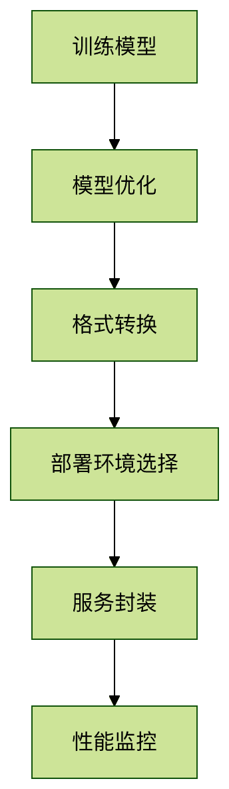

# PyTorch 模型部署

> 来源：[https://v11enp9ok1h.feishu.cn/docx/GDI1d1ZWSomoE1x3kjSctesGnqh](https://v11enp9ok1h.feishu.cn/docx/GDI1d1ZWSomoE1x3kjSctesGnqh)

模型部署是将训练好的机器学习模型投入实际应用的过程。PyTorch 提供了多种工具和方法来实现这一目标。

### 为什么需要模型部署

+   **应用集成**：将AI能力整合到Web、移动端或嵌入式系统中

+   **性能优化**：针对生产环境优化模型推理速度

+   **资源管理**：有效利用计算资源，实现高并发服务

### 部署流程概览



## 模型准备与优化

### 模型导出格式

PyTorch 主要支持以下导出格式：

### 导出为TorchScript

## 实例

```
import torch
import torchvision

# 加载预训练模型
model = torchvision.models.resnet18(pretrained=True)
model.eval()

# 示例输入
example_input = torch.rand(1, 3, 224, 224)

# 方法1: 通过追踪(tracing)导出
traced_script = torch.jit.trace(model, example_input)
traced_script.save(&quot;resnet18_traced.pt&quot;)

# 方法2: 通过脚本(scripting)导出
scripted_model = torch.jit.script(model)
scripted_model.save(&quot;resnet18_scripted.pt&quot;)
```

# **注意事项**：

1.  torch.jit.trace 更适合没有控制流的模型

1.  torch.jit.script 能处理包含条件判断等复杂逻辑的模型

1.  导出前务必调用 model.eval()

## 部署方案选择

### 本地部署方案

#### LibTorch (C++ API)

## 实例

```
#include &lt;torch/script.h&gt;

int main() {
    // 加载模型
    torch::jit::script::Module module;
    module = torch::jit::load(&quot;resnet18.pt&quot;);
    
    // 准备输入
    std::vector&lt;torch::jit::IValue&gt; inputs;
    inputs.push_back(torch::ones({1, 3, 224, 224}));
    
    // 执行推理
    auto output = module.forward(inputs).toTensor();
    std::cout &lt;&lt; output.slice(/*dim=*/1, /*start=*/0, /*end=*/5) &lt;&lt; &#x27;\n&#x27;;
}
```

#### ONNX Runtime

## 实例

```
import onnxruntime as ort

# 创建推理会话
sess = ort.InferenceSession(&quot;model.onnx&quot;)

# 准备输入
input_name = sess.get_inputs()[0].name
input_data = np.random.rand(1, 3, 224, 224).astype(np.float32)

# 执行推理
outputs = sess.run(None, {input_name: input_data})
```

### 云端部署方案

#### TorchServe (官方服务框架)

## 实例

```
# 安装
pip install torchserve torch-model-archiver

# 打包模型
torch-model-archiver --model-name resnet18 \
                     --version 1.0 \
                     --serialized-file model.pth \
                     --extra-files index_to_name.json \
                     --handler image_classifier \
                     --export-path model_store

# 启动服务
torchserve --start --model-store model_store --models resnet18=resnet18.mar
```

#### 使用FastAPI构建REST API

## 实例

```
from fastapi import FastAPI
from PIL import Image
import io
import torch

app = FastAPI()
model = torch.jit.load(&quot;model.pt&quot;)

@app.post(&quot;/predict&quot;)
async def predict(image: UploadFile = File(...)):
    img_data = await image.read()
    img = Image.open(io.BytesIO(img_data))
    # 预处理...
    with torch.no_grad():
        output = model(img_tensor)
    return {&quot;prediction&quot;: output.argmax().item()}
```

## 性能优化技巧

### 量化加速

## 实例

```
# 动态量化
quantized_model = torch.quantization.quantize_dynamic(
    model, {torch.nn.Linear}, dtype=torch.qint8)

# 静态量化
model.qconfig = torch.quantization.get_default_qconfig(&#x27;fbgemm&#x27;)
torch.quantization.prepare(model, inplace=True)
# 校准...
torch.quantization.convert(model, inplace=True)
```

### 使用TensorRT加速

## 实例

```
import torch_tensorrt

# 编译优化
trt_model = torch_tensorrt.compile(model, 
    inputs=[torch_tensorrt.Input((1, 3, 224, 224))],
    enabled_precisions={torch.float32}  # 或 {torch.float16}
)

# 保存优化后模型
torch.jit.save(trt_model, &quot;model_trt.pt&quot;)
```

## 常见问题解答

Q1: 部署时出现版本兼容性问题怎么办？ A: 建议使用Docker容器固定环境版本，或通过 conda 创建专用环境。

Q2: 如何监控部署模型的性能？ A: 可以集成Prometheus等监控工具，跟踪延迟、吞吐量和资源使用情况。

Q3: 模型部署后如何实现热更新？ A: TorchServe支持模型版本管理和A/B测试，可通过API动态切换模型版本。