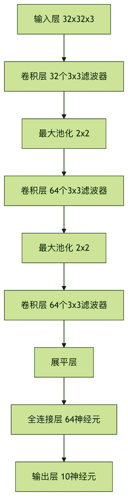

# TensorFlow 实例 - 图像分类项目

> 来源：[https://v11enp9ok1h.feishu.cn/docx/GhOYd55CvoO2PXx7TI9cguUanBc](https://v11enp9ok1h.feishu.cn/docx/GhOYd55CvoO2PXx7TI9cguUanBc)

图像分类是计算机视觉中最基础也最重要的任务之一。本项目将使用 TensorFlow 框架构建一个能够识别不同类别图像的深度学习模型。

### 什么是图像分类

图像分类是指让计算机自动识别图像中主要物体所属类别的技术。例如：

+   识别照片中是猫还是狗

+   区分不同种类的花朵

+   判断医学影像中的病变类型

### 技术选型

我们将使用以下技术栈：

+   **TensorFlow**：Google 开发的主流深度学习框架

+   **Keras**：TensorFlow 的高级API，简化模型构建

+   **Matplotlib**：用于可视化训练过程和结果

## 环境准备

### 安装必要库

```
pip install tensorflow matplotlib numpy
```

### 验证安装

```
import tensorflow as tf
print(f&quot;TensorFlow 版本: {tf.__version__}&quot;)
```

## 数据集准备

我们将使用经典的 CIFAR-10 数据集，它包含10个类别的6万张32x32彩色图像。

### 加载数据集

## 实例

```
from tensorflow.keras.datasets import cifar10

# 加载数据
(train_images, train_labels), (test_images, test_labels) = cifar10.load_data()

# 类别名称
class_names = [&#x27;飞机&#x27;, &#x27;汽车&#x27;, &#x27;鸟&#x27;, &#x27;猫&#x27;, &#x27;鹿&#x27;, 
               &#x27;狗&#x27;, &#x27;青蛙&#x27;, &#x27;马&#x27;, &#x27;船&#x27;, &#x27;卡车&#x27;]
```

### 3.2 数据预处理

## 实例

```
# 归一化像素值到0-1范围
train_images = train_images / 255.0
test_images = test_images / 255.0

# 查看数据形状
print(&quot;训练集图像形状:&quot;, train_images.shape)
print(&quot;训练集标签形状:&quot;, train_labels.shape)
```

## 构建模型

### 4.1 模型架构

我们将构建一个卷积神经网络(CNN)，这是处理图像任务的经典结构。

## 实例

```
from tensorflow.keras import layers, models

model = models.Sequential([
    # 卷积层1
    layers.Conv2D(32, (3, 3), activation=&#x27;relu&#x27;, input_shape=(32, 32, 3)),
    layers.MaxPooling2D((2, 2)),
    
    # 卷积层2
    layers.Conv2D(64, (3, 3), activation=&#x27;relu&#x27;),
    layers.MaxPooling2D((2, 2)),
    
    # 卷积层3
    layers.Conv2D(64, (3, 3), activation=&#x27;relu&#x27;),
    
    # 全连接层
    layers.Flatten(),
    layers.Dense(64, activation=&#x27;relu&#x27;),
    layers.Dense(10)  # 输出层，10个类别
])
```

### 模型结构可视化



## 训练模型

### 编译模型

## 实例

```
model.compile(optimizer=&#x27;adam&#x27;,
              loss=tf.keras.losses.SparseCategoricalCrossentropy(from_logits=True),
              metrics=[&#x27;accuracy&#x27;])
```

### 开始训练

## 实例

```
history = model.fit(train_images, train_labels, epochs=10, 
                    validation_data=(test_images, test_labels))
```

### 训练过程可视化

## 实例

```
import matplotlib.pyplot as plt

plt.plot(history.history[&#x27;accuracy&#x27;], label=&#x27;训练准确率&#x27;)
plt.plot(history.history[&#x27;val_accuracy&#x27;], label=&#x27;验证准确率&#x27;)
plt.xlabel(&#x27;Epoch&#x27;)
plt.ylabel(&#x27;Accuracy&#x27;)
plt.ylim([0, 1])
plt.legend(loc=&#x27;lower right&#x27;)
plt.show()
```

## 模型评估与预测

### 评估测试集性能

## 实例

```
test_loss, test_acc = model.evaluate(test_images, test_labels, verbose=2)
print(f&#x27;\n测试准确率: {test_acc}&#x27;)
```

### 进行预测

## 实例

```
import numpy as np

# 添加softmax层使输出为概率
probability_model = tf.keras.Sequential([model, layers.Softmax()])

# 对测试集前5张图进行预测
predictions = probability_model.predict(test_images[:5])

# 显示预测结果
for i in range(5):
    predicted_label = np.argmax(predictions[i])
    true_label = test_labels[i][0]
    print(f&quot;预测: {class_names[predicted_label]} | 实际: {class_names[true_label]}&quot;)
```

## 项目扩展建议

### 提高模型性能的方法

1.  增加网络深度（更多卷积层）

1.  使用数据增强技术

1.  尝试不同的优化器和学习率

1.  添加批归一化层

### 实际应用方向

+   医学影像分析

+   自动驾驶中的物体识别

+   工业质检系统

+   安防监控系统

---

1.  常见问题解答

### Q1: 为什么选择CNN而不是普通神经网络？

A: CNN通过局部连接和权值共享能更好地捕捉图像的空间特征，且参数更少。

### Q2: 如何选择合适的epoch数量？

A: 观察验证集准确率，当不再提升时停止训练，避免过拟合。

### Q3: 遇到内存不足错误怎么办？

A: 可以减小batch size，或使用更小的图像尺寸。