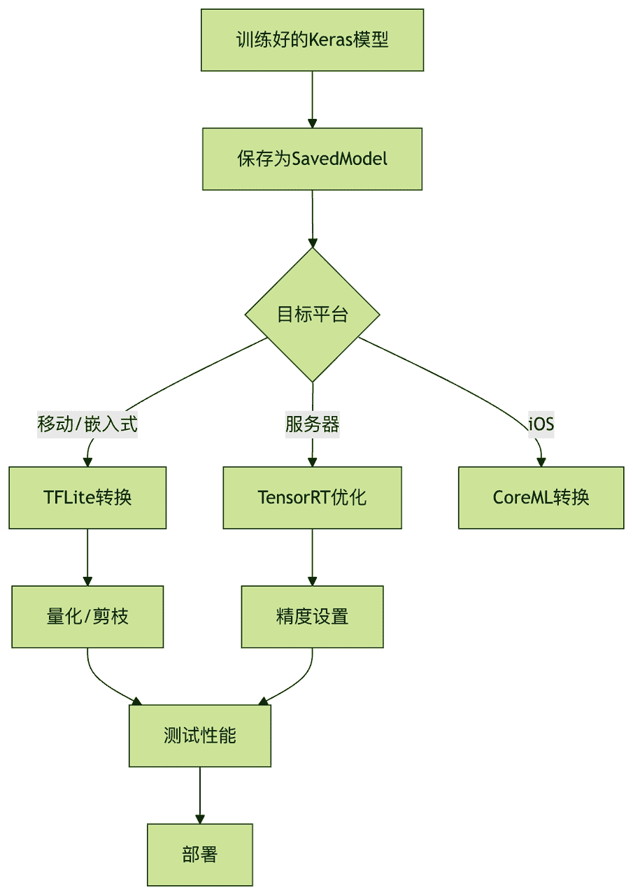

# TensorFlow 模型转换与优化

> 来源：[https://v11enp9ok1h.feishu.cn/docx/USd1ddRnHoIsiYxxh6NcCIxBnqe](https://v11enp9ok1h.feishu.cn/docx/USd1ddRnHoIsiYxxh6NcCIxBnqe)

在机器学习项目开发中，模型转换与优化是部署前的重要步骤。

TensorFlow 提供了多种工具和技术来帮助开发者将训练好的模型转换为适合不同部署环境的格式，并对其进行优化以提高性能。

### 为什么需要模型转换与优化

+   **部署需求**：训练好的模型需要适配不同平台（移动端、嵌入式设备、服务器等）

+   **性能提升**：优化可以减少模型大小、降低延迟、提高推理速度

+   **资源限制**：移动设备和边缘计算设备通常有严格的内存和计算资源限制

+   **跨平台兼容**：确保模型能在不同硬件架构和操作系统上运行

### 主要转换与优化技术

---

## 模型格式转换

### SavedModel 格式

SavedModel 是 TensorFlow 的标准模型保存格式，包含完整的模型架构、权重和计算图。

## 实例

```
import tensorflow as tf

# 保存为 SavedModel
model.save(&#x27;my_model&#x27;, save_format=&#x27;tf&#x27;)

# 加载 SavedModel
loaded_model = tf.keras.models.load_model(&#x27;my_model&#x27;)
```

#### 关键特点：

+   包含模型的计算图和变量

+   支持签名定义（输入/输出规范）

+   跨平台兼容（支持 TensorFlow Serving）

### TensorFlow Lite 转换

TensorFlow Lite 是针对移动和嵌入式设备的轻量级解决方案。

## 实例

```
# 转换模型为 TFLite 格式
converter = tf.lite.TFLiteConverter.from_saved_model(&#x27;my_model&#x27;)
tflite_model = converter.convert()

# 保存转换后的模型
with open(&#x27;model.tflite&#x27;, &#x27;wb&#x27;) as f:
    f.write(tflite_model)
```

#### 转换选项：

+   optimizations：设置优化级别（默认、大小优化、延迟优化）

+   target_spec：指定目标设备特性

+   representative_dataset：用于量化校准的数据集

---

## 模型优化技术

### 量化（Quantization）

量化通过降低数值精度来减小模型大小和提高推理速度。

## 实例

```
# 动态范围量化（最简单的量化方式）
converter = tf.lite.TFLiteConverter.from_saved_model(&#x27;my_model&#x27;)
converter.optimizations = [tf.lite.Optimize.DEFAULT]
tflite_quant_model = converter.convert()
```

#### 量化类型对比：

### 剪枝（Pruning）

剪枝通过移除不重要的神经元连接来减少模型参数。

## 实例

```
import tensorflow_model_optimization as tfmot

# 定义剪枝参数
prune_params = {
    &#x27;pruning_schedule&#x27;: tfmot.sparsity.keras.PolynomialDecay(
        initial_sparsity=0.50,
        final_sparsity=0.90,
        begin_step=0,
        end_step=1000
    )
}

# 应用剪枝
model = tf.keras.Sequential([...])  # 你的模型
model_for_pruning = tfmot.sparsity.keras.prune_low_magnitude(model, **prune_params)

# 训练剪枝模型
model_for_pruning.compile(...)
model_for_pruning.fit(...)

# 去除剪枝包装
model_for_export = tfmot.sparsity.keras.strip_pruning(model_for_pruning)
```

## 硬件特定优化

### TensorRT 优化（NVIDIA GPU）

## 实例

```
# 使用 TF-TRT 转换器
from tensorflow.python.compiler.tensorrt import trt_convert as trt

converter = trt.TrtGraphConverterV2(
    input_saved_model_dir=&#x27;my_model&#x27;,
    precision_mode=trt.TrtPrecisionMode.FP16
)
converter.convert()
converter.save(&#x27;trt_optimized_model&#x27;)
```

### Core ML 转换（Apple 设备）

## 实例

```
import coremltools as ct

# 从 SavedModel 转换
mlmodel = ct.convert(&#x27;my_model&#x27;)

# 保存 Core ML 模型
mlmodel.save(&#x27;model.mlmodel&#x27;)
```

## 最佳实践与常见问题

### 转换优化流程



### 常见问题解决

1.  **精度下降过多**

+   尝试混合量化（部分层保持FP32）

+   使用量化感知训练（QAT）

1.  **转换后模型无法运行**

+   检查操作兼容性（某些操作可能不被目标平台支持）

+   更新TensorFlow和转换器版本

1.  **性能提升不明显**

+   确保正确设置了优化选项

+   考虑模型架构本身是否适合目标硬件