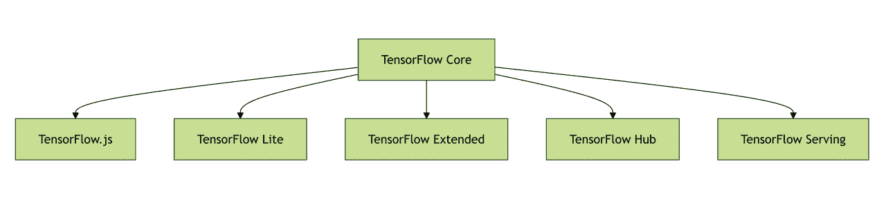
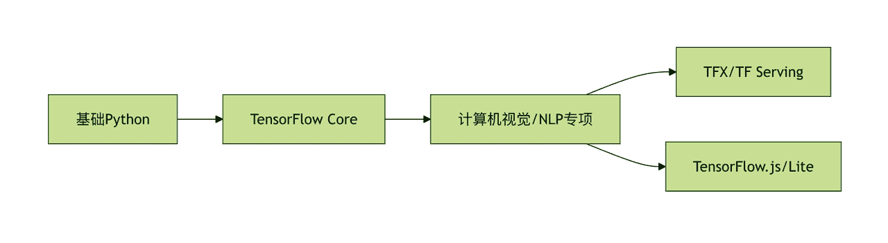

# TensorFlow 生态系统

> 来源：[https://v11enp9ok1h.feishu.cn/docx/Tb4GdjSxmo7dELxVgZ7c5K5cnBh](https://v11enp9ok1h.feishu.cn/docx/Tb4GdjSxmo7dELxVgZ7c5K5cnBh)

TensorFlow 生态系统是由 Google 开发的一套围绕 TensorFlow 核心框架构建的完整机器学习工具集。它不仅包含基础的深度学习框架，还提供了一系列配套工具、库和平台，形成了一个覆盖机器学习全流程的解决方案。



## TensorFlow 核心组件

### TensorFlow Core

TensorFlow 的核心框架，提供基础的张量计算和自动微分功能。

## 实例

```
import tensorflow as tf

# 创建一个常量张量
tensor = tf.constant([[1, 2], [3, 4]])
print(tensor)
```

### TensorFlow.js

允许在浏览器和 Node.js 环境中运行机器学习模型的 JavaScript 库。

## 实例

```
// 在浏览器中加载预训练模型
async function loadModel() {
    const model = await tf.loadLayersModel(&#x27;model.json&#x27;);
    return model;
}
```

### TensorFlow Lite

专为移动和嵌入式设备优化的轻量级解决方案。

## 实例

```
// Android 中使用 TFLite
Interpreter.Options options = new Interpreter.Options();
Interpreter interpreter = new Interpreter(modelFile, options);
```

## 扩展工具与平台

### TensorFlow Extended (TFX)

端到端的机器学习平台，用于生产环境中的 ML 流水线。

## 实例

```
# 定义 TFX 流水线组件
example_gen = CsvExampleGen(input_base=path_to_csv)
statistics_gen = StatisticsGen(examples=example_gen.outputs[&#x27;examples&#x27;])
```

### TensorFlow Hub

预训练模型库，可以轻松重用已有模型。

## 实例

```
# 使用 TF Hub 中的预训练模型
embed = hub.load(&quot;https://tfhub.dev/google/nnlm-en-dim128/1&quot;)
embeddings = embed([&quot;TensorFlow is great&quot;])
```

### TensorFlow Serving

高性能服务系统，用于部署训练好的模型。

## 实例

```
# 启动 TensorFlow Serving 服务
tensorflow_model_server --port=8500 --rest_api_port=8501 \
    --model_name=my_model --model_base_path=/models/my_model
```

## 生态系统优势对比

## 实际应用案例

### 案例1：使用TFX构建推荐系统

1.  使用ExampleGen导入用户行为数据

1.  用Transform进行特征工程

1.  Trainer组件训练推荐模型

1.  通过Pusher部署到生产环境

### 案例2：移动端图像分类

1.  用TensorFlow Core训练CNN模型

1.  转换为TensorFlow Lite格式

1.  集成到Android/iOS应用

1.  使用设备端GPU加速推理

---

## 学习路径建议

1.  **初学者**：从TensorFlow Core开始，掌握基础API

1.  **Web开发者**：学习TensorFlow.js构建浏览器ML应用

1.  **移动开发者**：专注于TensorFlow Lite和模型优化

1.  **ML工程师**：掌握TFX构建生产级流水线

1.  **系统架构师**：研究TF Serving和分布式部署



## 常见问题解答

Q：TensorFlow和PyTorch生态系统有何区别？ A：TensorFlow生态系统更注重生产部署和跨平台支持，而PyTorch在研究社区更受欢迎。

Q：如何选择适合的TensorFlow组件？ A：根据应用场景：Web选TF.js，移动选TFLite，生产系统选TFX+TF Serving。

Q：学习TensorFlow需要哪些前置知识？ A：基础Python编程、线性代数和微积分基础、基本机器学习概念。