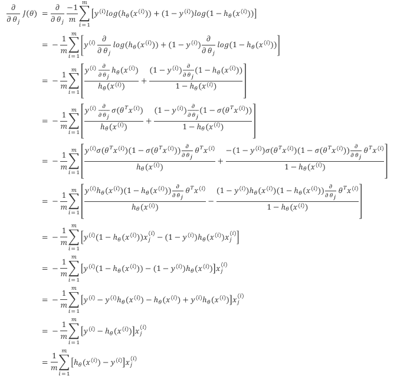

# 第三周

> 来源：[https://v11enp9ok1h.feishu.cn/docx/CBF0d2jgooTRIGxn1yycgeomnBe](https://v11enp9ok1h.feishu.cn/docx/CBF0d2jgooTRIGxn1yycgeomnBe)

## Logistic Regression

### 二分类

其中，$g(z)$ 被称为 Sigmoid 函数（或者 Logistic 函数），将任意实数映射到 (0, 1) 区间。这样，可以通过划分判定边界（decision boundary）进行分类。

### 成本函数

Logistic Regression 不能使用和线性回归相同的成本函数，因为 Sigmoid 函数是非凸的，容易陷入局部最优。

作为替代，使用以下成本函数：

注意，$y$ 只有 0 或 1 两种取值。

向量化的表示为：

### 梯度下降

由梯度下降的一般形式：

可以推导出 LR 的梯度下降公式：

向量化表示为：

推导过程如下：

## 正则化

**高偏差（high bias）**或者欠拟合是指模型对已有数据的拟合较差，通常因为模型太简单或者使用过少的特征；而**高方差（high variance）**或者过拟合是指模型对已有数据的拟合过强，以至于对于新数据无法很好的预测，通常因为模型过于复杂。

两种技术可用于处理过拟合问题：

1.  减少特征数量：人工选择留下的特征，或者使用特征选择的算法；

1.  正则化（Regularization）：留下所有的特征，但是减小参数 $\theta\_j$。

### 加入正则化的成本函数

其中，$\lambda$ 用于控制参数过大所付出的代价。$\lambda$ 选取过大时，可能导致欠拟合。

### 加入正则化的线性回归

#### 梯度下降

#### 正规方程

### 加入正则化的 Logistic Regression

#### 成本函数

#### 梯度下降